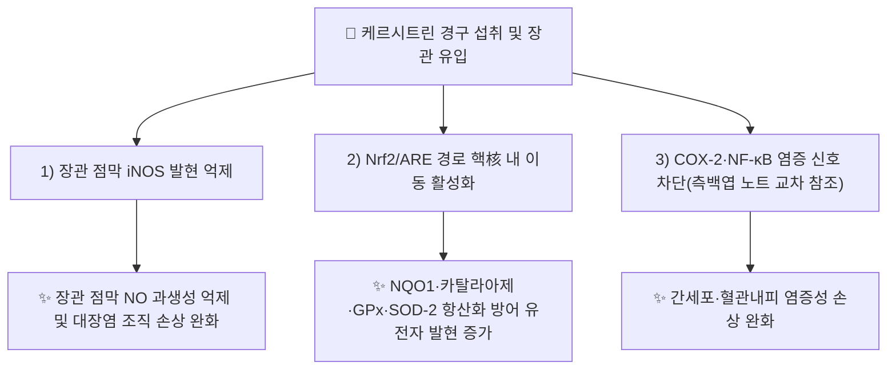

# 🔬 케르시트린 (Quercitrin, C₂₁H₂₀O₁₁)

> **핵심 3줄 요약 (Key Summary)**:
> - 🌿 기원 본초 & 화학 계열: 플라보놀 [[케르세틴]]의 3번 탄소에 람노오스가 결합된 모노람노시드 배당체로, [[측백엽]](Platycladi Cacumen, KP 지표성분 ≥0.20%)에 풍부하며 다수의 식물계 플라보놀 배당체 중 하나입니다.
> - 🎯 핵심 분자 표적 & 조절 경로: 장관 iNOS 발현 억제(Camuesco 2004) 및 Nrf2/ARE 경로를 통한 항산화 방어 유전자(NQO1·카탈라아제·GPx·SOD-2) 유도(Truong 2016)가 세포·동물 수준에서 직접 검증되었습니다.
> - 🩺 주요 약리 활성 & 질환 치료 기전: 장관 항염증(대장염 모델에서 iNOS 저하), 아세트아미노펜 유발 급성 간손상에서 ALT·AST 저하 및 간세포 괴사 완화, 모세혈관 투과성 억제(측백엽 노트 교차 참조)가 보고되어 있습니다.
> - ⚠️ 근거 수준: 아래 References 2건은 iNOS 억제(대장염 동물모델)와 Nrf2 경로 활성화(APAP 간손상 세포·동물모델)에 한정됩니다. 케르시트린 단독 성분의 임상(인체) 근거는 확인하지 못했으며, 측백엽 노트가 인용한 PMID 41990926은 측백엽 복합 팅크 연구로 케르시트린 단독 효능을 입증하지 않습니다.

---

## 📌 목차
1. [기본 화학 정보 & 분자 구조식 (Chemical Identity)](#1-기본-화학-정보--분자-구조식-chemical-identity)
2. [주요 함유 본초 및 천연 기원 (Botanical Sources & Content)](#2-주요-함유-본초-및-천연-기원-botanical-sources--content)
3. [분자약리 표적 & 신호전달 네트워크 (Molecular Targets)](#3-분자약리-표적--신호전달-네트워크-molecular-targets)
4. [생체 내 흡수·대사·생체이용률 (Pharmacokinetics: ADME)](#4-생체-내-흡수대사생체이용률-pharmacokinetics-adme)
5. [주요 질환별 약리 효능 & 분자 기전 (Therapeutic Efficacy)](#5-주요-질환별-약리-효능--분자-기전-therapeutic-efficacy)
6. [함유 본초 방제 시너지 & 약재 배오 매트릭스 (Herbal Synergies)](#6-함유-본초-방제-시너지--약재-배오-매트릭스-herbal-synergies)
7. [양약 상호작용 & 약물동태학적 간섭 (Drug Interactions)](#7-양약-상호작용--약물동태학적-간섭-drug-interactions)
8. [💡 사용자 진료실 핵심 필기 & 임상 응용 팁 (Melt-In & High-Yield)](#8--사용자-진료실-핵심-필기--임상-응용-팁-melt-in--high-yield)
9. [출처 및 학술 참고 문헌 (References)](#9-출처-및-학술-참고-문헌-references)

---
## 1. 기본 화학 정보 & 분자 구조식 (Chemical Identity)

> 🖼️ **이미지 미첨부 안내**: 금회 작성 시점에 PubChem/Wikimedia Commons 외부 조달이 네트워크 제약으로 불가하여 구조식·원물 이미지를 첨부하지 못했습니다(날조 출처 금지 원칙상 미첨부가 임시 공백보다 안전). 추후 이미지 보완 시 `케르시트린_1_구조식.png`(PubChem CID 5280459 PNG)을 `_첨부·자료\첨부파일\`에 저장 후 본 섹션에 추가 필요.

| 항목 | 상세 내용 |
| :--- | :--- |
| **IUPAC 명칭** | 3′,4′,5,7-Tetrahydroxy-3-(α-L-rhamnopyranosyloxy)flavone |
| **분자식 / 분자량** | C₂₁H₂₀O₁₁ / 448.38 g/mol |
| **PubChem CID** | [5280459](https://pubchem.ncbi.nlm.nih.gov/compound/5280459) |
| **CAS 등록 번호** | 522-12-3 |
| **화학 골격 분류** | 플라보놀 O-모노람노시드(Quercetin-3-O-α-L-rhamnoside) — [[이소케르시트린]](Quercetin-3-O-glucoside)과 당 종류(람노오스 vs 글루코오스)만 다른 위치 이성질 배당체 |
| **물리화학적 성상** | 담황색 결정성 분말, 수용성은 낮고 에탄올에 잘 녹음, 맛은 쓰며 광안정성이 상대적으로 낮음 |
| **식물 내 생합성 경로** | [[케르세틴]](아글리콘)에 UDP-람노오스 의존성 람노실전이효소(rhamnosyltransferase)가 작용해 3-OH 위치에 람노오스가 결합되어 생성 |

---

## 2. 주요 함유 본초 및 천연 기원 (Botanical Sources & Content)

| 함유 본초 (한글/한자) | 기원 식물학적 명칭 (과명 / 학명) | 주요 함유 약용 부위 | 지표 함량 (%) | 한의학적 귀경 및 약효 특성 |
| :--- | :--- | :--- | :--- | :--- |
| [[측백엽]] (側柏葉) | 측백나무과 / *Platycladus orientalis* | 어린 가지 및 잎 | KP 규격 0.20% 이상 | 肺·肝·大腸經, 양혈지혈·생발오발 |
| [[미리시트린]] 공존 식물(참고) | 다수 Rosaceae·Polygonaceae 계열 | 잎·수피 | 함량 미확인(개별 본초별 상이) | 본초별 상이 |

> **[함유 특성]**: 케르시트린은 측백엽의 핵심 지표성분(KP 규격 성분)으로 등재되어 있으며, 미리시트린·아멘토플라본과 함께 측백엽의 양혈지혈·생발오발 효능을 구성하는 플라보노이드 배당체군의 일원입니다. 측백엽 외 식물계 전반(특히 장미과·마디풀과 식물의 잎)에서도 널리 발견되는 보편적 플라보놀 배당체입니다.

---

## 3. 분자약리 표적 & 신호전달 네트워크 (Molecular Targets)

### 1) 핵심 분자 표적 (Molecular Targets)
* **iNOS(유도형 산화질소합성효소) 발현 억제**: TNBS 유발 대장염 쥐 모델에서 케르시트린 경구 투여 시 대장 점막의 iNOS 단백 발현이 유의하게 감소하며, 이는 과산화질소(NO)·peroxynitrite 매개 조직 손상을 줄여 장관 항염증 효과로 이어짐 (Camuesco et al. 2004, *Br J Pharmacol*).
* **Nrf2/ARE 경로 활성화**: 아세트아미노펜(APAP) 유발 간독성 모델(HepG2 세포·마우스)에서 케르시트린이 활성산소종(ROS)을 낮추고 Nrf2의 핵 내 이동을 촉진하여 NQO1·카탈라아제·GPx·SOD-2 등 2상 항산화 효소 발현을 증가시킴. 동시에 JNK·p38 MAPK 인산화를 억제하여 iNOS·COX-2·IL-1β 등 염증 유전자 발현을 저하 (Truong et al. 2016, *Nutrients*).

---

## 4. 생체 내 흡수·대사·생체이용률 (Pharmacokinetics: ADME)

* **장관 흡수 및 배출 펌프 (P-gp) 상호작용**:
  * 람노시드 배당체 형태는 글루코시드(예: 이소케르시트린) 대비 장관 상피 락타아제-플로리진 하이드롤라아제(LPH)에 의한 직접 가수분해 효율이 낮아, 주로 대장 미생물총에 의한 탈당화(deglycosylation) 경로를 통해 아글리콘(케르세틴)으로 전환된 뒤 흡수되는 것으로 알려져 있습니다.
  * 장관 국소에서 미분해 상태로 체류하는 비율이 상대적으로 높아, 전신 흡수형 플라보노이드와 달리 **장관 국소 항염증 효과(대장염 모델)에 유리**한 약동학적 특성을 가집니다.
* **장내 미생물총(Microbiome) 대사 전환**:
  * 대장 세균의 β-람노시다아제(β-rhamnosidase)에 의해 람노오스가 분리되어 케르세틴 아글리콘으로 전환되며, 이후 장내균에 의해 추가로 페놀산 대사체로 분해됩니다.
* **간 대사 및 소실**:
  * 흡수된 케르세틴 아글리콘은 간에서 UGT·SULT에 의한 2상 포합 반응(글루쿠론산화·황산화)을 거쳐 배출되며, 케르시트린 자체의 인체 반감기 자료는 확인하지 못했습니다(⚠️ 근거 미확인).

---

## 5. 주요 질환별 약리 효능 & 분자 기전 (Therapeutic Efficacy)

### 1) 장관 염증성 질환 (대장염 모델)
* TNBS 유발 쥐 대장염 모델에서 케르시트린 경구 투여 시 대장 점막 iNOS 발현 억제를 통해 조직 손상 지표(궤양 면적·MPO 활성)가 개선됨 (Camuesco et al. 2004, PMID 15533892).
### 2) 급성 간독성·산화스트레스 관련 질환
* 아세트아미노펜(APAP) 과량 투여로 유발된 급성 간손상 모델(HepG2 세포 및 마우스)에서 케르시트린이 Nrf2/ARE 경로를 통한 항산화 방어 유전자 발현 증가와 JNK/p38 억제를 통한 염증 저하를 동시에 나타내어 ALT·AST 상승 및 간 조직 괴사를 완화함 (Truong et al. 2016, PMID 27428996).
### 3) 모세혈관 보호 (측백엽 노트 교차 참조)
* 측백엽 노트에서는 케르시트린이 혈관 내피세포의 COX-2·NF-κB를 차단해 모세혈관 투과성을 억제하고 출혈 시간을 단축하는 기전으로 서술되어 있으나, 이 서술의 1차 출처 PMID는 측백엽 노트 자체 References에서 확인 필요(본 노트에서는 교차 참조로만 표기).

---

## 6. 함유 본초 방제 시너지 & 약재 배오 매트릭스 (Herbal Synergies)

| 함유 본초 / 방제 | 공존 유효 성분군 | 분자약리 시너지 기전 | 전통 한의학적 효능 연계 |
| :--- | :--- | :--- | :--- |
| [[측백엽]] | [[미리시트린]], 아멘토플라본, α-투존 | 모세혈관 투과성 차단 및 수렴 지혈 상가 작용(측백엽 노트 교차 참조) | 양혈지혈, 생발오발 |

---

## 7. 양약 상호작용 & 약물동태학적 간섭 (Drug Interactions)

* **CYP450 효소 간섭**:
  * 플라보놀 배당체 계열은 일반적으로 CYP3A4 기질 약물과 경쟁적 상호작용 가능성이 문헌상 제기되나, 케르시트린 단독의 CYP 간섭 자료는 확인하지 못했습니다(⚠️ 근거 미확인 — 추측 금지).
* **항염증제·간보호제 병용 시 고려사항**:
  * 아세트아미노펜 등 간독성 위험 약물 병용 시 Nrf2 경로를 통한 보조적 간보호 가능성이 동물실험 수준에서 제시되나, 인체 용량·상호작용 자료 부재로 임상적 권고는 보류합니다.

---

## 8. 💡 사용자 진료실 핵심 필기 & 임상 응용 팁 (Melt-In & High-Yield)

* **임상 적용 시 주의점**:
  * 케르시트린은 단일 분리 성분 기준 연구가 많지 않아, 측백엽 등 함유 본초 전탕액 투여 시의 효능을 케르시트린 단독 효능으로 과대 해석하지 않도록 주의가 필요합니다.
  * 장관 국소 체류 비율이 높은 약동학적 특성상, 전신 흡수형 플라보노이드(루틴 등)보다 **장관계 염증 질환**에 상대적으로 유리할 가능성이 있습니다(동물모델 근거 수준).

---

## 9. 출처 및 학술 참고 문헌 (References)

1. **Camuesco D, Comalada M, Rodríguez-Cabezas ME, Nieto A, Lorente MD, Concha A, Zarzuelo A, Gálvez J. (2004)**. *The intestinal anti-inflammatory effect of quercitrin is associated with an inhibition in iNOS expression*. **British Journal of Pharmacology**, 143(7), 908–918. [PMID 15533892](https://pubmed.ncbi.nlm.nih.gov/15533892/) · doi:10.1038/sj.bjp.0705941
   - **[연구 요약]**: TNBS 유발 쥐 대장염 모델에서 케르시트린 경구 투여가 iNOS 발현 억제를 통해 장관 조직 손상을 완화함을 확인.
2. **Truong VL, Ko SY, Jun M, Jeong WS. (2016)**. *Quercitrin from Toona sinensis (Juss.) M.Roem. Attenuates Acetaminophen-Induced Acute Liver Toxicity in HepG2 Cells and Mice through Induction of Antioxidant Machinery and Inhibition of Inflammation*. **Nutrients**, 8(7), 431. [PMID 27428996](https://pubmed.ncbi.nlm.nih.gov/27428996/) · doi:10.3390/nu8070431
   - **[연구 요약]**: HepG2 세포 및 마우스 APAP 간독성 모델에서 케르시트린이 Nrf2/ARE 경로 활성화 및 JNK·p38 억제를 통해 항산화·항염증 작용으로 간손상을 완화함을 확인.
3. **대한민국약전(KP) 제12개정 (2022)**. 의약품각조: 측백엽(側柏葉) 규격 — 케르시트린 0.20% 이상 함유.
   - **[공정서 규격]**: 측백엽의 지표성분 함량 기준.

> 검증 메모 (2026-10-18): 다빈치 노트 신규 생성. PMID 15533892·27428996은 WebSearch·WebFetch로 제목·저자·저널·연도·페이지를 직접 조회하여 확인함. PubChem CID 5280459·CAS 522-12-3·분자식 C₂₁H₂₀O₁₁은 Wikipedia 화학 인포박스를 통해 확인(측백엽.md 기재 분자식과 일치). 측백엽 노트가 인용한 "모세혈관 COX-2/NF-κB 차단" 서술은 1차 출처 재확인 전까지 교차 참조로만 표기함.
