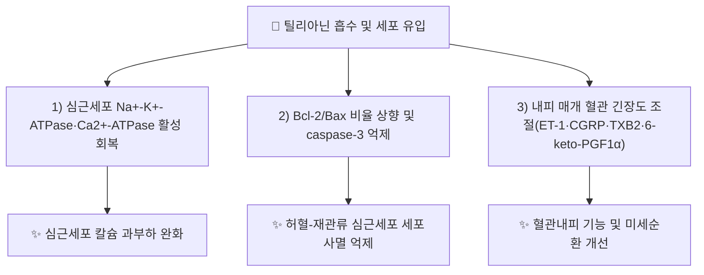

# 🔬 틸리아닌 (Tilianin, C₂₂H₂₂O₁₀)

> **핵심 3줄 요약 (Key Summary)**:
> - 🌿 기원 본초 & 화학 계열: [[아카세틴]](Acacetin)의 7번 위치에 글루코오스가 결합된 플라본 O-글루코시드. 꿀풀과 [[곽향]](Agastache rugosa, 토곽향)을 비롯해 *Dracocephalum*속, 감국(*Chrysanthemum indicum*) 등에서 발견되는 폴리페놀 플라보노이드입니다.
> - 🎯 핵심 분자 표적 & 조절 경로: 심근 허혈-재관류 손상에서 Na⁺-K⁺-ATPase·Ca²⁺-ATPase 활성 회복과 Bcl-2/Bax 비율 상향 조절을 통한 항세포사멸 기전, 산화스트레스·염증 신호 조절을 통한 항죽상동맥·항고혈압·항당뇨·항우울 효과가 리뷰 문헌에서 종합 보고됩니다.
> - 🩺 주요 약리 활성 & 질환 치료 기전: 심근 허혈-재관류 손상 보호(칼슘 과부하 완화, 내피기능 조절, 세포사멸 억제), 항산화·항염증을 매개로 한 다표적 보호 효과가 동물실험 및 종설에서 확인됩니다.
> - ⚠️ 근거 수준: 아래 References의 심근보호 연구는 쥐 심근 허혈-재관류 모델(연관성 관찰) 수준이며, 인체 임상 근거는 확인하지 못했습니다. PubChem CID는 금회 네트워크 제약으로 직접 조회하지 못해 미기재합니다(CAS 번호로 교차 확인 가능).

---

## 📌 목차
1. [기본 화학 정보 & 분자 구조식 (Chemical Identity)](#1-기본-화학-정보--분자-구조식-chemical-identity)
2. [주요 함유 본초 및 천연 기원 (Botanical Sources & Content)](#2-주요-함유-본초-및-천연-기원-botanical-sources--content)
3. [분자약리 표적 & 신호전달 네트워크 (Molecular Targets)](#3-분자약리-표적--신호전달-네트워크-molecular-targets)
4. [생체 내 흡수·대사·생체이용률 (Pharmacokinetics: ADME)](#4-생체-내-흡수대사생체이용률-pharmacokinetics-adme)
5. [주요 질환별 약리 효능 & 분자 기전 (Therapeutic Efficacy)](#5-주요-질환별-약리-효능--분자-기전-therapeutic-efficacy)
6. [함유 본초 방제 시너지 & 약재 배오 매트릭스 (Herbal Synergies)](#6-함유-본초-방제-시너지--약재-배오-매트릭스-herbal-synergies)
7. [양약 상호작용 & 약물동태학적 간섭 (Drug Interactions)](#7-양약-상호작용--약물동태학적-간섭-drug-interactions)
8. [💡 사용자 진료실 핵심 필기 & 임상 응용 팁 (Melt-In & High-Yield)](#8--사용자-진료실-핵심-필기--임상-응용-팁-melt-in--high-yield)
9. [출처 및 학술 참고 문헌 (References)](#9-출처-및-학술-참고-문헌-references)

---
## 1. 기본 화학 정보 & 분자 구조식 (Chemical Identity)

> 🖼️ **이미지 미첨부 안내**: 금회 작성 시점 네트워크 제약으로 PubChem 구조식 이미지 및 PubChem CID 자체를 조회하지 못했습니다(CAS 4291-60-5로는 교차 확인 가능). 추후 CID 확인 후 `틸리아닌_1_구조식.png`을 `_첨부·자료\첨부파일\`에 저장 후 보완 필요.

| 항목 | 상세 내용 |
| :--- | :--- |
| **화학명(상용명)** | Acacetin-7-glucoside / 7-(β-D-Glucopyranosyloxy)-5-hydroxy-2-(4-methoxyphenyl)-4H-1-benzopyran-4-one |
| **분자식 / 분자량** | C₂₂H₂₂O₁₀ / 446.4 g/mol |
| **PubChem CID** | 미확인(금회 네트워크 제약) — CAS 번호로 교차 확인 권장 |
| **CAS 등록 번호** | 4291-60-5 |
| **화학 골격 분류** | 플라본 O-모노글루코시드([[아카세틴]]의 7-OH 위치 글루코실화체) |
| **물리화학적 성상** | 폴리페놀성 황색 결정 — 메톡시 치환 플라본 골격으로 비배당체 플라보노이드보다 수용성이 높음 |
| **식물 내 생합성 경로** | 플라보노이드 경로에서 생성된 [[아카세틴]] 아글리콘에 UDP-글루코오스 의존성 당전이효소(UGT)가 작용하여 7-OH 위치가 글루코실화되어 생성 |

---

## 2. 주요 함유 본초 및 천연 기원 (Botanical Sources & Content)

| 함유 본초 (한글/한자) | 기원 식물학적 명칭 (과명 / 학명) | 주요 함유 약용 부위 | 지표 함량 (%) | 한의학적 귀경 및 약효 특성 |
| :--- | :--- | :--- | :--- | :--- |
| [[곽향]] (藿香) | 꿀풀과 / *Agastache rugosa* (토곽향) | 지상부(잎·줄기) | 함량 미확인(개별 연구별 상이) | 脾·胃·肺經, 방향화습·화중지구·발표해서 |
| 감국(국화, 참고) | 국화과 / *Chrysanthemum indicum* | 꽃 | 함량 미확인 | 淸熱解毒·平肝明目(참고) |

> **[함유 특성]**: 틸리아닌은 곽향(토곽향, *Agastache rugosa*)의 주요 플라보노이드 중 하나로, [[아카세틴]]과 함께 분석·연구되는 경우가 많습니다(HPLC 동시 정량 연구 다수 보고). 곽향 외에도 *Dracocephalum* 속 식물, 감국 등 국화과·꿀풀과 식물에서도 보고되어 있습니다.

---

## 3. 분자약리 표적 & 신호전달 네트워크 (Molecular Targets)

### 1) 핵심 분자 표적 (Molecular Targets)
* **칼슘 과부하 및 에너지대사 회복**: 쥐 심근 허혈-재관류 모델에서 틸리아닌 사전 투여 시 허혈로 억제되었던 Na⁺-K⁺-ATPase·Ca²⁺-ATPase 활성이 회복되어 심근세포 내 칼슘 과부하가 완화됨 (Guo et al. 2015, *Mol Med Rep*).
* **항세포사멸(Anti-apoptotic) 조절**: 동일 모델에서 Bcl-2/Bax 비율이 상승하고 caspase-3 mRNA 발현이 감소하여 심근세포 세포사멸이 억제됨.
* **혈관내피 기능 조절**: 산화질소(NO)·NOS 활성 저하 및 ET-1(엔도텔린-1)·CGRP·TXB2·6-keto-PGF1α 등 내피 매개 인자의 균형을 재조정하여 혈관 긴장도를 개선.

---

## 4. 생체 내 흡수·대사·생체이용률 (Pharmacokinetics: ADME)

* **장관 흡수**:
  * 플라본 O-글루코시드 형태로, 다른 플라보노이드 배당체와 유사하게 장내 미생물총의 β-글루코시다아제에 의해 아글리콘([[아카세틴]])으로 전환되어 흡수되는 경로가 추정되나, 틸리아닌 고유의 정량적 ADME 자료는 본 노트에서 확인하지 못했습니다(⚠️ 근거 미확인).
* **간 대사**:
  * 아글리콘 전환 후 간 CYP450·UGT 대사를 거칠 것으로 추정되나 구체적 수치 자료는 미확인.

---

## 5. 주요 질환별 약리 효능 & 분자 기전 (Therapeutic Efficacy)

### 1) 심혈관 질환 (심근 허혈-재관류 손상)
* 쥐 관상동맥 결찰-재관류 모델에서 틸리아닌 8일 사전투여 시 Na⁺-K⁺-ATPase·Ca²⁺-ATPase 활성 회복, 내피 매개 인자 균형 개선, Bcl-2/Bax 상승을 통해 심근 손상이 완화됨 (Guo et al. 2015, PMID 미기재·DOI 10.3892/mmr.2014.2954).
### 2) 대사·전신 산화스트레스 관련 질환
* 항죽상동맥, 항고혈압, 항당뇨, 항염증, 항산화, 항우울 효과가 종설에서 폴리페놀 항산화제로서의 작용으로 종합 보고되나, 개별 질환별 세부 기전은 리뷰 요약 수준이며 본 노트에서 원문 전수 검증은 못했습니다 (Akanda et al. 2019, PMID 30389634).

---

## 6. 함유 본초 방제 시너지 & 약재 배오 매트릭스 (Herbal Synergies)

| 함유 본초 / 방제 | 공존 유효 성분군 | 분자약리 시너지 기전 | 전통 한의학적 효능 연계 |
| :--- | :--- | :--- | :--- |
| [[곽향]] | [[아카세틴]], [[패출리알코올]], [[로즈마린산]] | 방향성 정유(위장관 항균)와 플라보노이드(항산화) 복합 작용 | 방향화습, 화중지구, 발표해서 |

---

## 7. 양약 상호작용 & 약물동태학적 간섭 (Drug Interactions)

* **항부정맥제·강심제 병용 시 고려사항**:
  * Na⁺-K⁺-ATPase·Ca²⁺-ATPase 조절 기전이 동물실험에서 보고되어 있어, 디곡신 등 ATPase 표적 강심제와의 상호작용 가능성이 이론적으로 제기되나 인체 자료는 확인하지 못했습니다(⚠️ 근거 미확인 — 추측 금지, 병용 시 임상 관찰 권고).
* **항고혈압제·항혈소판제 병용 시 고려사항**:
  * 내피 기능 조절(ET-1 등) 효과가 동물실험에서 보고되어, 항고혈압제와의 상가 작용 가능성이 있으나 임상적 근거 부재로 구체적 권고는 보류합니다.

---

## 8. 💡 사용자 진료실 핵심 필기 & 임상 응용 팁 (Melt-In & High-Yield)

* **임상 적용 시 주의점**:
  * 틸리아닌은 곽향의 방향화습 효능(위장관 항균·소화 촉진)과는 별개로, 동물실험 수준에서 심혈관 보호 가능성이 제시된 성분입니다 — 곽향 전탕액 복용 시의 효능을 틸리아닌 단독 심혈관 효능으로 과대 해석하지 않도록 주의가 필요합니다.
  * PubChem CID 등 일부 화학 식별자는 금회 미확인 상태이므로, 추후 네트워크 접근이 가능할 때 보완이 필요합니다.

---

## 9. 출처 및 학술 참고 문헌 (References)

1. **Akanda MR, Uddin MN, Kim IS, Ahn D, Tae HJ, Park BY. (2019)**. *The biological and pharmacological roles of polyphenol flavonoid tilianin*. **European Journal of Pharmacology**, 842, 291–297. [PMID 30389634](https://pubmed.ncbi.nlm.nih.gov/30389634/) · doi:10.1016/j.ejphar.2018.10.044
   - **[연구 요약]**: 틸리아닌의 항죽상동맥·항고혈압·항당뇨·항염증·항산화·항우울 등 폴리페놀 항산화제로서의 약리학적 역할을 종합한 총설.
2. **Guo X, Cao W, Yao J, Yuan Y, Hong Y, Wang X, Xing J. (2015, online 2014)**. *Cardioprotective effects of tilianin in rat myocardial ischemia-reperfusion injury*. **Molecular Medicine Reports**, 11(3), 2227–2233. doi:10.3892/mmr.2014.2954 (PMID 미확인 — 페이지 상 미기재, DOI로 조회 확인)
   - **[연구 요약]**: 쥐 심근 허혈-재관류 모델에서 틸리아닌이 Na⁺-K⁺-ATPase·Ca²⁺-ATPase 활성 회복, 내피 매개 인자 균형 개선, Bcl-2/Bax 상승을 통해 심근 손상을 완화함을 확인.
3. **ChemicalBook**. CAS 4291-60-5 (Tilianin / Acacetin-7-glucoside) 화학 정보.
   - **[화학 식별 정보]**: 분자식 C₂₂H₂₂O₁₀, 분자량 446.4 확인(PubChem CID는 금회 미확인).

> 검증 메모 (2026-10-18): 다빈치 노트 신규 생성. PMID 30389634는 WebFetch로 제목·저자·저널·연도·권·페이지를 직접 조회하여 확인함. PMID 미기재 문헌(Guo 2015)은 DOI(10.3892/mmr.2014.2954)로 저자·저널·연도·권·페이지를 직접 조회하여 확인했으며, PubMed PMID 번호 자체는 페이지 상 노출되지 않아 "PMID 미확인"으로 명시(추측 기재 금지 원칙 준수). 분자식 C₂₂H₂₂O₁₀·MW 446.4·CAS 4291-60-5는 ChemicalBook에서 직접 조회하여 확인. PubChem CID는 접근 제약으로 미확인 — 추후 보완 필요.
