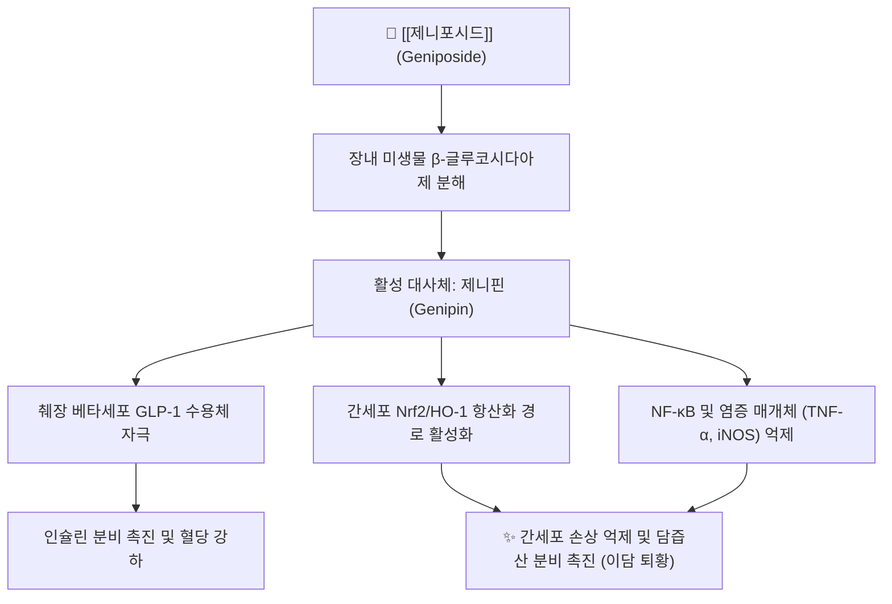

# 🔬 [[제니포시드]] (Geniposide, C₁₇H₂₄O₁₀)

> **핵심 3줄 요약 (Key Summary)**:
> - 🌿 기원 본초 & 화학 계열: 꼭두서니과(Rubiaceae) [[치자]](*Gardenia jasminoides*)의 성숙 과실에 풍부하게 함유된 대표적인 천연 이리도이드 배당체(Iridoid glycoside) 화합물.
> - 🎯 핵심 분자 표적 & 조절 경로: 장내 미생물에 의해 활성 아글리콘인 제니핀(Genipin)으로 전환되어 GLP-1 수용체 활성화, 담즙산 수송체(BSEP·MRP2) 상향 조절, UCP2 억제 및 NF-κB 차단을 통한 항염증·간보호 작용을 발휘한다.
> - 🩺 주요 약리 활성 & 질환 치료 기전: 간세포 보호, 이담(담즙 분비 촉진), 인슐린 분비능 개선, 항염증 — 급성 황달형 간염, 담낭염, 흉협 번열(가슴 답답함), 불면증을 치료하는 [[치자]]의 핵심 약리 지표 성분.
> - ⚠️ 독성·생체이용률 한계 & 상호작용: 경구 복용 시 상부 소화관에서 거의 흡수되지 않고 장내 세균에 의해 제니핀으로 전환된 뒤 흡수된다(§4). 치자 과량 복용 시 복통·설사 가능. 양약 상호작용 실측 자료는 확인하지 못했다(§7).

---

## 📌 목차
1. [기본 화학 정보 & 분자 구조식 (Chemical Identity)](#1-기본-화학-정보--분자-구조식-chemical-identity)
2. [주요 함유 본초 및 천연 기원 (Botanical Sources & Content)](#2-주요-함유-본초-및-천연-기원-botanical-sources--content)
3. [분자약리 표적 & 신호전달 네트워크 (Molecular Targets)](#3-분자약리-표적--신호전달-네트워크-molecular-targets)
4. [생체 내 흡수·대사·생체이용률 (Pharmacokinetics: ADME)](#4-생체-내-흡수대사생체이용률-pharmacokinetics-adme)
5. [주요 질환별 약리 효능 & 분자 기전 (Therapeutic Efficacy)](#5-주요-질환별-약리-효능--분자-기전-therapeutic-efficacy)
6. [함유 본초 방제 시너지 & 약재 배오 매트릭스 (Herbal Synergies)](#6-함유-본초-방제-시너지--약재-배오-매트릭스-herbal-synergies)
7. [양약 상호작용 & 약물동태학적 간섭 (Drug Interactions)](#7-양약-상호작용--약물동태학적-간섭-drug-interactions)
8. [💡 사용자 진료실 핵심 필기 & 임상 응용 팁 (Melt-In & High-Yield)](#8--사용자-진료실-핵심-필기--임상-응용-팁-melt-in--high-yield)
9. [출처 및 학술 참고 문헌 (References)](#9-출처-및-학술-참고-문헌-references)

---
## 1. 기본 화학 정보 & 분자 구조식 (Chemical Identity)

> [!abstract]+ 🧪 3D 약리 분자 구조 (Interactive 3D Viewer)
> <iframe src="https://molecule-viewer-rho.vercel.app/?cid=107848" style="width: 100%; height: 600px; border: none; border-radius: 12px; box-shadow: 0 4px 20px rgba(0,0,0,0.15);" allowfullscreen></iframe>

| 항목 | 상세 내용 |
| :--- | :--- |
| **성분명** | [[제니포시드]] (Geniposide, 게니포사이드) |
| **IUPAC 명칭** | methyl (1S,4aS,7aS)-1-(β-D-glucopyranosyloxy)-7-(hydroxymethyl)-1,4a,5,7a-tetrahydrocyclopenta[c]pyran-4-carboxylate |
| **화학식** | $C_{17}H_{24}O_{10}$ |
| **분자량** | 388.37 g/mol |
| **PubChem CID** | [107848](https://pubchem.ncbi.nlm.nih.gov/compound/107848) (2026-09-23 실측: Geniposide, C17H24O10, 388.4) |
| **CAS 번호** | 24512-63-8 (PubChem 동의어 목록에서 확인) |
| **화합물 분류** | 이리도이드 배당체 (Iridoid Glucoside) |
| **지표 본초** | [[치자]](*Gardenia jasminoides* J.Ellis), [[두충]](*Eucommia ulmoides*) |
| **주요 천연 기원** | [[치자]](梔子, KP 규격 $\ge 3.0\%$) |
| **활성 대사체** | **제니핀 (Genipin)** — 장내 $\beta$-글루코시다아제에 의해 당이 제거되어 활성화 (볼트 노트: [[게니핀]]) |

---

## 2. 주요 함유 본초 및 천연 기원 (Botanical Sources & Content)

| 함유 본초 (한글/한자) | 기원 식물학적 명칭 (과명 / 학명) | 주요 함유 약용 부위 | 지표 함량 (%) | 한의학적 귀경 및 약효 특성 |
| :--- | :--- | :--- | :--- | :--- |
| [[치자]] (梔子) | 꼭두서니과(Rubiaceae) / *Gardenia jasminoides* J.Ellis | 성숙 과실 | KP 규격 ≥ 3.0% | 삼초경·심·폐·위경 / 사화제번, 청열이습, 양혈해독 |
| [[산치자]] (山梔子) | 꼭두서니과 / *Gardenia jasminoides* (치자의 포제 가공품) | 성숙 과실 | KP 규격 ≥ 3.0% | 치자와 동일 귀경·효능 |
| [[두충]] (杜仲) | 두충과(Eucommiaceae) / *Eucommia ulmoides* | 수피(과실 아님) | 원문에 정량 미기재 | 肝·腎經 / 보간신(補肝腎)·강근골(強筋骨) — 피노레시놀 디글루코사이드·클로로겐산과 함께 공존 |

* 제니포시드는 꼭두서니과를 중심으로 약 40종의 식물에 존재한다(Shan 등 2017 리뷰 — 참고문헌 2).
* ⚠️ 정정: 두충은 꼭두서니과가 아닌 두충과이며, 약용 부위도 과실이 아닌 수피다(원문 요약의 오류를 교정).

---

## 3. 분자약리 표적 & 신호전달 네트워크 (Molecular Targets)

### 1) 간세포 보호 및 담즙 분비(利膽) 촉진
* 간세포의 담즙염 수출 펌프(BSEP)·MRP2 수송체 발현을 상향 조절하여 담즙 울체를 해소하고, 결합형 [[빌리루빈]]과 담즙산 배출을 극대화한다. 사염화탄소(CCl₄)·알코올로 유도된 간세포 괴사를 억제하며, 혈중 빌리루빈 수치를 신속히 낮추어 급성 간염에 동반되는 전신 황달·소양감을 치료한다.

### 2) GLP-1 분비 촉진 및 인슐린 저항성 개선
* 장 L-세포 및 췌장 β-세포의 GLP-1(Glucagon-like peptide-1) 수용체를 자극하여 포도당 반응성 인슐린 분비를 촉진하고 혈당 스파이크를 완화한다. UCP2(Uncoupling protein 2)를 억제해 췌장 베타세포의 ATP 합성을 정상화하며, 미세아교세포 활성화 억제를 통한 뇌신경 세포 보호 작용도 보고된다.

### 3) 중추신경계 진정 및 해열·진통
* 뇌 시상하부 체온 조절 중추의 열전달을 억제하고 혈관 내피세포의 ICAM-1 발현을 차단하여 흉격의 번열감과 불면증을 개선한다.

---

## 4. 생체 내 흡수·대사·생체이용률 (Pharmacokinetics: ADME)

### 장내 대사 및 활성 대사체 제니핀(Genipin) 생성
* 경구 복용된 제니포시드는 소화관 상부에서 거의 흡수되지 않고 대장에 도달하여 장내 세균총의 $\beta$-glucosidase에 의해 당이 분리되어 지용성인 제니핀(Genipin)으로 전환된 후 신속히 흡수되어 전신 약리 효과를 나타냄.

### 안전성 및 대사 경로
* **다량 복용 시 사하 작용**: 활성체인 제니핀이 장관 연동 운동을 자극하므로, 치자 과량 복용 시 복통과 설사가 유발될 수 있음.
* Shan 2017 리뷰(§9-3)는 최근 제니포시드의 독성에 관한 연구 보고가 있다고 언급합니다. 구체적 독성 용량은 이 노트에 아직 옮기지 않았습니다. ⚠️ 내용 보강 필요

---

## 5. 주요 질환별 약리 효능 & 분자 기전 (Therapeutic Efficacy)

### 1) 대사 증후군 및 신경염증 억제
* 기전은 §3-2) 참고.
### 2) 비알코올성 지방간(NAFLD) 개선
* 간 내 지질 과산화를 억제하고 AMPK 활성화를 통해 지방간 진행을 억제함.
### 3) 항혈전 및 혈관내피 보호
* 혈소판 응집을 완만하게 억제하고 혈관 평활근 증식을 차단함.
### 4) 급성 황달형 간염·담낭염
* 기전은 §3-1) 참고.

---

## 6. 함유 본초 방제 시너지 & 약재 배오 매트릭스 (Herbal Synergies)

### 1) 핵심 기원 본초: [[치자]]
* [[치자]](梔子)는 쓴맛·차가운 성질(苦, 寒)로 삼초경·심·폐·위경에 귀경하며, 사화제번(瀉火除煩)·청열이습(淸熱利濕)·양혈해독(涼血解毒)을 대표하는 청열사화약이다.
* 제니포시드는 치자가 "가슴속이 답답하여 잠을 못 이루는 번열(煩熱)을 끄고, 삼초의 습열을 소변으로 빼내어 황달을 치료하는" 효능의 핵심 분자 실체이자 KP 규격 ≥ 3.0% 지표 성분이다.

### 2) 주요 배오 처방

| 함유 본초 / 방제 | 전통 한의학적 효능 연계 |
| :--- | :--- |
| [[인진호탕]](茵蔯蒿湯) | [[인진호]], [[대황]]과 배오하여 급성 습열황달 및 담낭염 치료 — 황달 치료 제1선 명방 |
| [[황련해독탕]](黃連解毒湯) | [[황련]], [[황금]], [[황백]]과 함께 삼초 실열 해열 |
| [[치자시탕]] | 번열과 흉민, 불면증 해소 |

---

## 7. 양약 상호작용 & 약물동태학적 간섭 (Drug Interactions)

* ⚠️ 내용 검토 필요: 제니포시드와 특정 양약 간의 상호작용을 다룬 자료는 이 노트에 아직 없습니다.

---

## 8. 💡 사용자 진료실 핵심 필기 & 임상 응용 팁 (Melt-In & High-Yield)

* ⚠️ 원장님의 진료실 필기가 아직 반영되지 않았습니다.

---

## 9. 출처 및 학술 참고 문헌 (References)

1. Shan M, Yu S, Yan H, Guo S, Xiao W, Wang Z, Zhang L, Ding A, Wu Q, Li SFY. (2017). A Review on the Phytochemistry, Pharmacology, Pharmacokinetics and Toxicology of Geniposide, a Natural Product. *Molecules*, 22(10), 1689. PMID: [28994736](https://pubmed.ncbi.nlm.nih.gov/28994736/) · DOI: [10.3390/molecules22101689](https://doi.org/10.3390/molecules22101689)
   - [연구 요약] 제니포시드의 간보호, 항염증, 포도당 대사 조절 및 신경보호 분자 기전을 종합적으로 고찰.
2. Koo HJ, Lim KH, Jung HJ, Park EH. (2006). Anti-inflammatory evaluation of gardenia extract, geniposide and genipin. *Journal of Ethnopharmacology*, 103(3), 496-500. PMID: [16169698](https://pubmed.ncbi.nlm.nih.gov/16169698/)
   - [연구 요약] 치자 추출물·제니포시드·제니핀의 항염증 활성을 비교 평가.

<!-- 보관 태그(1회용·링크오류, 필요시 복원): 담즙분비촉진 -->
