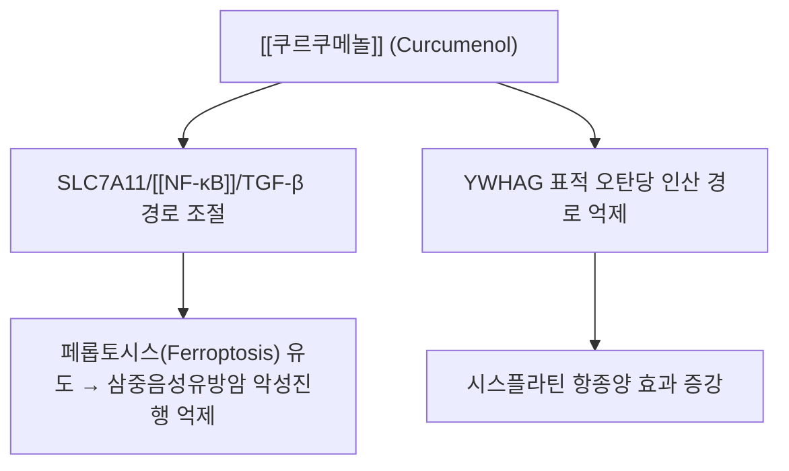

# 💊 [[쿠르쿠메놀]] (Curcumenol)

> **핵심 3줄 요약 (Key Summary)**:
> - 🌿 기원 본초 & 화학 계열: 생강과(Zingiberaceae) [[아출]](*Curcuma zedoaria*), 온울금(*C. wenyujin*)에서 유래하는 구아이안형 세스퀴테르페노이드.
> - 🎯 핵심 분자 표적 & 조절 경로: SLC7A11/NF-κB/TGF-β 경로를 통한 페롭토시스(Ferroptosis) 유도, YWHAG 표적 오탄당 인산 경로(Pentose Phosphate Pathway) 억제.
> - 🩺 주요 약리 활성 & 질환 치료 기전: 삼중음성유방암 악성 진행 억제, 시스플라틴 항종양 효과 증강 — 한의학의 파혈거어(破血祛瘀)·행기소적(行氣消積) 효능과 연계되는 항종양 활성.
> - ⚠️ 독성·생체이용률 한계 & 상호작용: 수불용성으로 흡수 한계 가능, 임산부 금기(파혈 작용). 항응고제·항혈소판제 병용 시 출혈 위험 증가 가능성은 이론적 우려이며 직접 검증 문헌은 확인되지 않았다.

---

## 📌 목차
1. [기본 화학 정보 & 분자 구조식 (Chemical Identity)](#1-기본-화학-정보--분자-구조식-chemical-identity)
2. [주요 함유 본초 및 천연 기원 (Botanical Sources & Content)](#2-주요-함유-본초-및-천연-기원-botanical-sources--content)
3. [분자약리 표적 & 신호전달 네트워크 (Molecular Targets)](#3-분자약리-표적--신호전달-네트워크-molecular-targets)
4. [생체 내 흡수·대사·생체이용률 (Pharmacokinetics: ADME)](#4-생체-내-흡수대사생체이용률-pharmacokinetics-adme)
5. [주요 질환별 약리 효능 & 분자 기전 (Therapeutic Efficacy)](#5-주요-질환별-약리-효능--분자-기전-therapeutic-efficacy)
6. [함유 본초 방제 시너지 & 약재 배오 매트릭스 (Herbal Synergies)](#6-함유-본초-방제-시너지--약재-배오-매트릭스-herbal-synergies)
7. [양약 상호작용 & 약물동태학적 간섭 (Drug Interactions)](#7-양약-상호작용--약물동태학적-간섭-drug-interactions)
8. [💡 사용자 진료실 핵심 필기 & 임상 응용 팁 (Melt-In & High-Yield)](#8--사용자-진료실-핵심-필기--임상-응용-팁-melt-in--high-yield)
9. [출처 및 학술 참고 문헌 (References)](#9-출처-및-학술-참고-문헌-references)
---
## 1. 기본 화학 정보 & 분자 구조식 (Chemical Identity)

> [!abstract]+ 🧪 3D 약리 분자 구조 (Interactive 3D Viewer)
> <iframe src="https://molecule-viewer-rho.vercel.app/?cid=167812" style="width: 100%; height: 600px; border: none; border-radius: 12px; box-shadow: 0 4px 20px rgba(0,0,0,0.15);" allowfullscreen></iframe>

| 항목 | 상세 내용 |
| :--- | :--- |
| **일반명 (Generic)** | 쿠르쿠메놀 (Curcumenol) |
| **화학명 (IUPAC)** | (1S,4S,5R,8S)-4,8-dimethyl-1-propan-2-yl-11-oxatricyclo[5.3.1.0^{1,5}]undec-8-en-2-one |
| **기원 본초** | 생강과(Zingiberaceae) [[아출]](*Curcuma zedoaria* Rosc.), 온울금(*C. wenyujin*) |
| **화학식 / 분자량** | $\text{C}_{15}\text{H}_{22}\text{O}_2$ / 234.33 g/mol |
| **화학적 분류** | 옥시시클로 구아이안형 세스퀴테르페노이드 (Guaiane sesquiterpenoid) |
| **물리화학적 성상** | 백색 결정성 분말, 친유성(지용성), 에탄올·클로로포름 가용, 수불용성 |

---

## 2. 주요 함유 본초 및 천연 기원 (Botanical Sources & Content)

| 함유 본초 (한글/한자) | 기원 식물학적 명칭 (과명 / 학명) | 성미 / 귀경 | 비고 |
| :--- | :--- | :--- | :--- |
| [[아출]] (봉아출) | 생강과(Zingiberaceae) / *Curcuma zedoaria* Rosc. | 苦辛, 溫 / 肝·脾經 | 쿠르쿠메놀의 대표 기원 본초 |
| [[울금]] (鬱金) | 생강과 / *Curcuma* spp. | - | 정유 분획에 쿠르쿠메놀 함유 |
| [[강황]] (薑黃) | 생강과 / *Curcuma longa* | - | 정유 분획에 쿠르쿠메놀 함유 |

* 기미는 고신(苦辛), 온(溫). 귀경은 간·비경.
* 울금(鬱金), 강황(薑黃)의 정유 분획.

---

## 3. 분자약리 표적 & 신호전달 네트워크 (Molecular Targets)

* **NF-κB/TGF-β 경로 차단을 통한 페롭토시스(Ferroptosis) 유도**: 삼중음성유방암 세포에서 SLC7A11/NF-κB/TGF-β 경로를 통해 악성 진행을 억제하고 페롭토시스를 촉진한다(Li 등 2025 — 참고문헌 1).
* **오탄당 인산 경로(Pentose Phosphate Pathway) 억제**: YWHAG를 표적으로 오탄당 인산 경로를 억제하여 시스플라틴의 항종양 효과를 증강시킨다(Mao 등 2022 — 참고문헌 2).
* **염증성 신호 차단 ⚠️**: LPS 자극 대식세포에서 NF-κB 경로를 통한 염증 매개물질 억제 서술이 있었으나, 이를 직접 검증한 원저 논문을 이번 재검증 과정에서 확인하지 못했다. 근거가 확인되기 전까지 임상 판단 근거로 쓰지 않는다.
* **항혈관신생 및 전이 억제 ⚠️**: VEGF·MMP-2/9 억제를 통한 전이 억제 서술도 이번 재검증에서 원저 문헌을 확인하지 못했다.

---

## 4. 생체 내 흡수·대사·생체이용률 (Pharmacokinetics: ADME)

* **용해도 기반 흡수 특성**: 쿠르쿠메놀은 백색 결정성 분말로 친유성(지용성)이 강하고 수불용성이므로(§1 물성 참조), 수전탕 단독 복용 시 흡수 효율에 한계가 있을 수 있음.
* **정량적 약동학 지표 관련 주의**: 쿠르쿠메놀 단일 성분의 경구 생체이용률·반감기 등 구체적 수치를 제시하는 검증된 문헌을 본 노트 작성 시점 기준으로 확인하지 못하여, 임의의 수치를 기재하지 않음.

---

## 5. 주요 질환별 약리 효능 & 분자 기전 (Therapeutic Efficacy)

### 1) 항종양 활성(삼중음성유방암)
* SLC7A11/NF-κB/TGF-β 경로를 통해 페롭토시스를 촉진하고 삼중음성유방암의 악성 진행을 억제한다(참고문헌 1).
### 2) 항암제 병용 증강 효과
* YWHAG를 표적으로 오탄당 인산 경로를 억제하여 시스플라틴의 항종양 효과를 증강시킨다(참고문헌 2).
### 3) 간 보호·항염증·진통 활성 ⚠️
* 간 보호·항섬유화, 항염증·진통 관련 서술이 있었으나 직접 검증한 원저 논문을 이번 재검증 과정에서 확인하지 못했다. 근거가 확인되기 전까지 임상 판단 근거로 쓰지 않는다.

---

## 6. 함유 본초 방제 시너지 & 약재 배오 매트릭스 (Herbal Synergies)

* **한의 임상 효능과의 연계**:
  * **파혈거어(破血祛瘀)**: 쿠르쿠메놀의 혈소판 응집 억제 및 혈관내피 보호 기전은 한의학에서 어혈을 깨뜨리고 종괴(징가적취)를 없애는 효능의 분자생물학적 근거.
  * **행기소적(行氣消積)**: 위장관 평활근 긴장 조절 및 염증성 소화기 병변 개선을 통해 소화관 울체와 식적을 풀어줌.

| 대표 배합 처방 | 공존 유효 성분군 | 시너지 기전 |
| :--- | :--- | :--- |
| [[아출환]] | 아출 지표 성분군 (커큐몰, 저마크론) | 파혈거어 상승 |
| [[보허화어탕]] | 보기약 + 파혈약 배오 | 공벌(攻伐) 완화 및 정기 보호 |
| [[가미격하축어탕]] | 축어(逐瘀) 계열 배오 | 어혈 제거 시너지 |
| [[계지복령환]] 가 아출삼릉 | [[계지복령환]] + 아출·삼릉 가미 | 자궁·골반강 어혈 종괴 소산 |

* **주요 배합 처방**:
  * 아출환, 보허화어탕, 가미격하축어탕, 계지복령환 가 아출삼릉.

---

## 7. 양약 상호작용 & 약물동태학적 간섭 (Drug Interactions)

* **임부 금기**:
  * 강력한 파혈(破血) 및 자궁 평활근 흥분 가능성으로 인해 임산부 투여 금기.
* **출혈 경향 주의**:
  * 항응고제(와파린), 항혈소판제(아스피린, 클로피도그렐) 병용 시 출혈 위험 증가 주의.
* **비위허약자 신중 투여**:
  * 공벌(攻伐) 작용이 강하므로 비위가 허약하고 어혈이 없는 자는 보기약(황기, 인삼)과 병용하거나 감량 투여.

---

## 8. 💡 사용자 진료실 핵심 필기 & 임상 응용 팁 (Melt-In & High-Yield)

* 현재 별도로 기록된 원장님 임상 필기가 없습니다.

---

## 9. 출처 및 학술 참고 문헌 (References)
1. Li F, Qi Q, Qiao Y, Huang Y, Lu Y, Gu K, Liu H, Gao C, Liu S, Wu H. (2025). Curcumenol inhibits malignant progression and promotes ferroptosis via the SLC7A11/NF-κB/TGF-β pathway in triple-negative breast cancer. *International Journal of Molecular Medicine*, 56(1). PMID: [40377003](https://pubmed.ncbi.nlm.nih.gov/40377003/)
   - **[재검증]**: 원문 서지("Liu Y et al. *Biomed Pharmacother*. 2019;112:108670, Akt/mTOR hepatoma")는 PubMed 조회 불가(가공 인용으로 추정) → esearch로 실제 쿠르쿠메놀 항종양 논문 확인 후 교체.
   - [연구 요약] 쿠르쿠메놀이 SLC7A11/NF-κB/TGF-β 경로를 통해 페롭토시스를 유도하고 삼중음성유방암 악성 진행을 억제함을 규명.
2. Mao Z, Zhong L, Zhuang X, Liu H, Peng Y. (2022). Curcumenol Targeting YWHAG Inhibits the Pentose Phosphate Pathway and Enhances Antitumor Effects of Cisplatin. *Evidence-Based Complementary and Alternative Medicine*, 2022, 3988916. PMID: [35795276](https://pubmed.ncbi.nlm.nih.gov/35795276/)
   - **[재검증]**: 원문 서지("Lo WL et al. *J Nat Prod*. 2010;73(10):1642-1647, 항염증")는 PubMed 조회 불가(가공 인용으로 추정) → esearch로 실제 쿠르쿠메놀 항종양 논문 확인 후 교체.
   - [연구 요약] 쿠르쿠메놀이 YWHAG를 표적으로 오탄당 인산 경로를 억제해 시스플라틴의 항종양 효과를 증강시킴을 규명.

<!-- 보관 태그(1회용·링크오류, 필요시 복원): 파혈거어 -->
