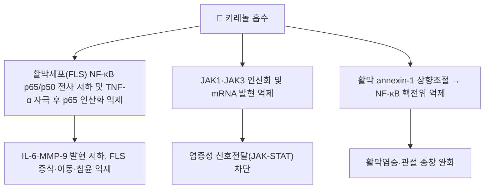

# 🔬 키레놀 (Kirenol, C20H34O4)

> **핵심 3줄 요약 (Key Summary)**:
> - 🌿 기원 본초 & 화학 계열: [[희렴초]](豨薟草, 국화과 *Siegesbeckia orientalis* 등 지상부)의 대한민국약전(KP) 규격 지표성분(건조 지상부 기준 0.050% 이상)인 ent-피마란(pimarane)형 디테르펜 트리올. 배당체인 [[다루토사이드]](Darutoside, 키레놀-3-O-β-D-글루코피라노사이드)와 함께 산출된다.
> - 🎯 핵심 분자 표적 & 조절 경로: 류마티스 관절염 활막세포(FLS)에서 NF-κB(p65/p50)·JAK1/JAK3-STAT 경로를 억제하고 IL-6·MMP-9 발현을 낮추며, 활막에서는 annexin-1을 상향조절해 NF-κB를 억제한다. 실험적 자가면역뇌척수염(EAE)에서는 Th1·Th17 분화를 억제한다.
> - 🩺 주요 약리 활성 & 질환 치료 기전: 콜라겐유도관절염(CIA)·류마티스 관절염 모델에서 활막 증식·이동·침윤 억제 및 관절 종창·연골·골 파괴 완화, EAE 모델에서 신경염증·운동기능 저하 완화가 보고되어 희렴초의 거풍습(祛風濕)·서근통락(舒筋通絡) 효능의 분자적 근거로 다뤄진다.
> - ⚠️ 독성·생체이용률 한계 & 상호작용: 경구 생체이용률·반감기 등 정량적 인체 약동학 수치와 양약과의 상호작용 연구는 이번 검색 범위에서 확인하지 못했다. 보고된 효능은 대부분 세포·랫트/마우스 동물 모델 단계이며 인체 임상시험 근거는 확인되지 않았다.

---

## 📌 목차
1. [기본 화학 정보 & 분자 구조식 (Chemical Identity)](#1-기본-화학-정보--분자-구조식-chemical-identity)
2. [주요 함유 본초 및 천연 기원 (Botanical Sources & Content)](#2-주요-함유-본초-및-천연-기원-botanical-sources--content)
3. [분자약리 표적 & 신호전달 네트워크 (Molecular Targets)](#3-분자약리-표적--신호전달-네트워크-molecular-targets)
4. [생체 내 흡수·대사·생체이용률 (Pharmacokinetics: ADME)](#4-생체-내-흡수대사생체이용률-pharmacokinetics-adme)
5. [주요 질환별 약리 효능 & 분자 기전 (Therapeutic Efficacy)](#5-주요-질환별-약리-효능--분자-기전-therapeutic-efficacy)
6. [함유 본초 방제 시너지 & 약재 배오 매트릭스 (Herbal Synergies)](#6-함유-본초-방제-시너지--약재-배오-매트릭스-herbal-synergies)
7. [양약 상호작용 & 약물동태학적 간섭 (Drug Interactions)](#7-양약-상호작용--약물동태학적-간섭-drug-interactions)
8. [💡 사용자 진료실 핵심 필기 & 임상 응용 팁 (Melt-In & High-Yield)](#8--사용자-진료실-핵심-필기--임상-응용-팁-melt-in--high-yield)
9. [출처 및 학술 참고 문헌 (References)](#9-출처-및-학술-참고-문헌-references)

---

## 1. 기본 화학 정보 & 분자 구조식 (Chemical Identity)

> [!abstract]+ 🧪 3D 약리 분자 구조 (Interactive 3D Viewer)
> <iframe src="https://molecule-viewer-rho.vercel.app/?cid=15736732" style="width: 100%; height: 600px; border: none; border-radius: 12px; box-shadow: 0 4px 20px rgba(0,0,0,0.15);" allowfullscreen></iframe>

| 항목 | 상세 내용 |
| :--- | :--- |
| **IUPAC 명칭** | (1R)-1-[(2S,4aR,4bS,6S,8R,8aS)-6-hydroxy-8-(hydroxymethyl)-2,4b,8-trimethyl-4,4a,5,6,7,8a,9,10-octahydro-3H-phenanthren-2-yl]ethane-1,2-diol |
| **분자식 / 분자량** | C₂₀H₃₄O₄ / 338.48 g/mol |
| **PubChem CID** | [15736732](https://pubchem.ncbi.nlm.nih.gov/compound/15736732) |
| **CAS 등록 번호** | 52659-56-0 |
| **화학 골격 분류** | ent-피마란(pimarane)형 디테르펜 트리올 |
| **물리화학적 성상** | ⚠️ 원문에서 구체적 성상(결정성·용해도)을 확인하지 못함 |
| **공정서 규격** | 대한민국약전(KP) — 희렴(건조 지상부) 중 키레놀 0.050% 이상 함유 |

---

## 2. 주요 함유 본초 및 천연 기원 (Botanical Sources & Content)

| 함유 본초 (한글/한자) | 기원 식물학적 명칭 (과명 / 학명) | 주요 함유 약용 부위 | 지표 함량 (%) | 한의학적 귀경 및 약효 특성 |
| :--- | :--- | :--- | :--- | :--- |
| [[희렴초]] (豨薟草) | 국화과(Asteraceae) / *Siegesbeckia orientalis*, *S. pubescens*, *S. glabrescens* | 지상부(전초) | ≥0.050%(KP 규격) | 肝·腎經, 거풍습(祛風濕)·서근통락(舒筋通絡)·청열해독(淸熱解毒) |

- 희렴초는 생용(生用, 청열해독 위주)과 주증(酒蒸, 구증구포 가공 후 보간신 위주)으로 포제에 따라 효능 방향이 갈리는 본초이며, 키레놀은 양쪽 포제 형태 모두에서 핵심 지표성분으로 다뤄진다.
- 동일 식물에서 공존하는 배당체 [[다루토사이드]](Darutoside)는 키레놀의 3-O-β-D-글루코피라노사이드 형태로, 두 성분이 함께 희렴초의 거풍습·항염 활성을 뒷받침하는 것으로 다뤄진다.

---

## 3. 분자약리 표적 & 신호전달 네트워크 (Molecular Targets)

* **활막세포(FLS) 다중 표적 억제**: 류마티스 관절염 환자 유래 FLS에서 키레놀은 NF-κB(p65/p50) mRNA를 낮추고 TNF-α 자극 15분 이내 p65 인산화를 억제하며, JAK1·JAK3 인산화 및 mRNA, IL-6 분비·mRNA, MMP-9 mRNA를 낮춘다. TNF-α·IL-17A 자극 하에서도 FLS의 증식·이동·침윤을 억제한다(참고문헌 1).
* **활막 annexin-1–NF-κB 축**: 콜라겐유도관절염(CIA) 랫트 활액막에서 annexin-1 발현을 상향조절하고 NF-κB 활성을 억제해 활액막염증과 관절 종창을 완화한다(참고문헌 4).
* **T세포 분화 조절**: CIA 랫트에서 Th17/Treg 등 T세포 균형을 조절해 항류마티스 효과를 나타내며(참고문헌 3), 실험적 자가면역뇌척수염(EAE) 마우스 모델에서는 Th1·Th17 분화를 억제하고 효과 T세포의 세포자멸사를 유도해 신경염증과 운동기능 저하를 완화한다(참고문헌 2).

---

## 4. 생체 내 흡수·대사·생체이용률 (Pharmacokinetics: ADME)

* 키레놀의 경구 생체이용률·반감기·조직 분포에 관한 정량적 인체/동물 약동학 수치는 이번 검색 범위에서 확인하지 못했다 ⚠️.
* HPLC-MS 기반 정량 분석을 포함한 약동학 방법론 연구(Huo L, et al. *J Chromatogr B*. 2013)가 존재하는 것은 확인되나, 구체적 Cmax·Tmax·반감기 수치는 원문을 직접 확인하지 못해 이번 노트에는 싣지 않는다.

---

## 5. 주요 질환별 약리 효능 & 분자 기전 (Therapeutic Efficacy)

### 1) 류마티스 관절염(RA) & 콜라겐유도관절염(CIA)
* 류마티스 관절염 환자 유래 활막세포(FLS)의 증식·이동·침윤 및 IL-6·IL-8·TNF-α 분비를 억제하며, CIA 마우스에서 30 mg/kg 투여 시 관절염 발생률·활막 증식·연골 및 골 파괴를 감소시킨다(참고문헌 1).
* CIA 랫트 활액막에서 annexin-1 상향조절을 통해 NF-κB를 억제하여 활액막염증과 관절 종창을 완화한다(참고문헌 4).
* CIA 랫트에서 T세포(Th17/Treg) 균형을 조절해 항류마티스 효과를 나타낸다(참고문헌 3).

### 2) 자가면역 신경염증(실험적 자가면역뇌척수염, EAE)
* EAE 마우스 모델에서 Th1·Th17 세포 분화를 억제하고 효과 T세포의 세포자멸사를 유도하여 신경염증과 운동기능 저하를 완화한다(참고문헌 2).

> ⚠️ 위 모든 효능은 세포 실험 및 랫트·마우스 동물 모델 단계의 결과이며, 인체 임상시험으로 확증된 근거는 이번 검색에서 확인하지 못했다.

---

## 6. 함유 본초 방제 시너지 & 약재 배오 매트릭스 (Herbal Synergies)

| 함유 본초 / 방제 | 공존 유효 성분군 | 전통 한의학적 효능 연계 |
| :--- | :--- | :--- |
| [[희렴초]] | [[다루토사이드]] | 생희렴(生用): 청열해독·거풍습 / 주희렴(酒蒸): 구증구포 가공 후 보간신 위주로 전환 |
| [[희동환]] | [[희렴초]] 군약 | 희렴초를 주축으로 한 거풍습·서근통락 고전 처방 |
| [[희렴환]] | [[희렴초]] 군약 | 희렴초를 주축으로 한 거풍습·관절 통증 고전 처방 |

---

## 7. 양약 상호작용 & 약물동태학적 간섭 (Drug Interactions)

* 키레놀 고유의 CYP450 효소 간섭이나 특정 양약과의 약물동태학적 상호작용을 다룬 연구는 이번 검색 범위에서 확인하지 못했다 ⚠️.

---

## 8. 💡 사용자 진료실 핵심 필기 & 임상 응용 팁 (Melt-In & High-Yield)

* 현재 별도로 기록된 원장님 임상 필기가 없습니다.

---

## 9. 출처 및 학술 참고 문헌 (References)

1. Wu J, Zhang W, Zeng S, et al. (2019). Kirenol Inhibits the Function and Inflammation of Fibroblast-like Synoviocytes in Rheumatoid Arthritis in vitro and in vivo. *Frontiers in Immunology*, 10:1304. PMID: [31244849](https://pubmed.ncbi.nlm.nih.gov/31244849/)
   - [연구 요약] 류마티스 관절염 환자 유래 FLS에서 NF-κB·JAK-STAT 경로 및 IL-6·MMP-9 발현을 억제하고, CIA 마우스에서 30 mg/kg 투여 시 관절염·연골/골 파괴를 완화함을 규명.
2. Xiao J, Zhu Y, Liu B, et al. (2015). Kirenol Attenuates Experimental Autoimmune Encephalomyelitis by Inhibiting Differentiation of Th1 and Th17 Cells and Inducing Apoptosis of Effector T Cells. *Scientific Reports*, 5:9022. DOI: 10.1038/srep09022. PMID: [25762107](https://pubmed.ncbi.nlm.nih.gov/25762107/)
   - [연구 요약] EAE 마우스에서 Th1·Th17 분화 억제 및 효과 T세포 세포자멸사 유도를 통해 신경염증·운동기능 저하를 완화함을 규명.
3. Lu Y, Xiao J, Wu ZW, Wang ZM, et al. (2012). Kirenol exerts a potent anti-arthritic effect in collagen-induced arthritis by modifying the T cells balance. *Phytomedicine*, 19(10):882-889. PMID: [22673798](https://pubmed.ncbi.nlm.nih.gov/22673798/)
   - [연구 요약] CIA 랫트에서 T세포 균형 조절을 통한 항류마티스 효과를 규명(볼트 내 [[희렴초]] 노트 §7 기확인 문헌, 교차 인용).
4. Wang ZM, Zhu SG, Wu ZW, Lu Y, et al. (2011). Kirenol upregulates nuclear annexin-1 which interacts with NF-κB to attenuate synovial inflammation of collagen-induced arthritis in rats. *Journal of Ethnopharmacology*, 137(1):774-782. PMID: [21745559](https://pubmed.ncbi.nlm.nih.gov/21745559/)
   - [연구 요약] CIA 랫트 활액막에서 annexin-1 상향조절 및 NF-κB 억제를 통한 활액막염증 완화 기전을 규명(볼트 내 [[희렴초]] 노트 §7 기확인 문헌, 교차 인용).
