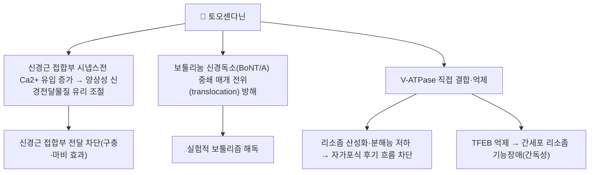

# 🔬 토오센다닌 (Toosendanin, C30H38O11)

> **핵심 3줄 요약 (Key Summary)**:
> - 🌿 기원 본초 & 화학 계열: [[천련자]](川楝子, 멀구슬나무과 *Melia toosendan* 성숙 열매)의 대한민국약전(KP) 규격 지표성분(건조 성숙 열매 기준 0.050% 이상)인 테트라노르트리테르페노이드(tetranortriterpenoid) 리모노이드(limonoid) 계열 성분. 수피(苦楝皮, [[고련피]])에도 함유된다.
> - 🎯 핵심 분자 표적 & 조절 경로: 신경근 접합부에서 양상성(biphasic, 촉진 후 억제)으로 신경전달물질 유리를 조절하는 선택적 시냅스전 차단제로, 보툴리눔 신경독소(BoNT/A)가 SNARE 단백질 기질에 도달하는 전위(translocation) 과정을 방해해 항보툴리즘 효과를 낸다. 암세포에서는 액포형 H⁺-ATPase(V-ATPase)를 직접 억제해 자가포식(autophagy) 후기 단계를 차단한다.
> - 🩺 주요 약리 활성 & 질환 치료 기전: 전통적으로 구충(살충)·행기지통 효능으로 쓰이며, 현대 연구에서는 실험적 보툴리즘의 해독제, 화학항암제(캄토테신 등) 병용 시 보호적 자가포식 차단을 통한 항암 증강, 간암(PI3K/CRBN-BNC2 분자 글루 기전) 등 다양한 약리 활성이 보고된다.
> - ⚠️ 독성·생체이용률 한계 & 상호작용: 간독성이 주요 임상 적용의 제한 요인이다 — TFEB 매개 리소좀 기능장애를 통해 자가포식 후기 흐름(autophagic flux)을 억제함으로써 간세포 손상을 일으키는 것으로 보고되었다. 치료역이 좁고 과량·장기 투여 시 신경독성·간독성 위험이 있어 임상 사용은 극히 제한적이며, 정량적 인체 약동학·양약 상호작용 자료는 이번 검색에서 확인하지 못했다.

---

## 📌 목차
1. [기본 화학 정보 & 분자 구조식 (Chemical Identity)](#1-기본-화학-정보--분자-구조식-chemical-identity)
2. [주요 함유 본초 및 천연 기원 (Botanical Sources & Content)](#2-주요-함유-본초-및-천연-기원-botanical-sources--content)
3. [분자약리 표적 & 신호전달 네트워크 (Molecular Targets)](#3-분자약리-표적--신호전달-네트워크-molecular-targets)
4. [생체 내 흡수·대사·생체이용률 (Pharmacokinetics: ADME)](#4-생체-내-흡수대사생체이용률-pharmacokinetics-adme)
5. [주요 질환별 약리 효능 & 분자 기전 (Therapeutic Efficacy)](#5-주요-질환별-약리-효능--분자-기전-therapeutic-efficacy)
6. [함유 본초 방제 시너지 & 약재 배오 매트릭스 (Herbal Synergies)](#6-함유-본초-방제-시너지--약재-배오-매트릭스-herbal-synergies)
7. [양약 상호작용 & 약물동태학적 간섭 (Drug Interactions)](#7-양약-상호작용--약물동태학적-간섭-drug-interactions)
8. [💡 사용자 진료실 핵심 필기 & 임상 응용 팁 (Melt-In & High-Yield)](#8--사용자-진료실-핵심-필기--임상-응용-팁-melt-in--high-yield)
9. [출처 및 학술 참고 문헌 (References)](#9-출처-및-학술-참고-문헌-references)

---

## 1. 기본 화학 정보 & 분자 구조식 (Chemical Identity)

> [!abstract]+ 🧪 3D 약리 분자 구조 (Interactive 3D Viewer)
> <iframe src="https://molecule-viewer-rho.vercel.app/?cid=115060" style="width: 100%; height: 600px; border: none; border-radius: 12px; box-shadow: 0 4px 20px rgba(0,0,0,0.15);" allowfullscreen></iframe>

| 항목 | 상세 내용 |
| :--- | :--- |
| **분자식 / 분자량** | C₃₀H₃₈O₁₁ / 574.6 g/mol |
| **PubChem CID** | [115060](https://pubchem.ncbi.nlm.nih.gov/compound/115060) — ⚠️ 동일 CAS로 중복 등재된 CID 9851101도 확인됨(같은 분자식·분자량) |
| **CAS 등록 번호** | 58812-37-6 |
| **화학 골격 분류** | 테트라노르트리테르페노이드(tetranortriterpenoid) 리모노이드(limonoid) — [[천련자]]·[[고련피]]의 공정서 지표성분 |
| **물리화학적 성상** | ⚠️ 원문에서 구체적 성상(결정성·용해도)을 확인하지 못함 |
| **공정서 규격** | 대한민국약전(KP) — 천련자(건조 성숙 열매) 중 토오센다닌 0.050% 이상 함유 |

---

## 2. 주요 함유 본초 및 천연 기원 (Botanical Sources & Content)

| 함유 본초 (한글/한자) | 기원 식물학적 명칭 (과명 / 학명) | 주요 함유 약용 부위 | 지표 함량 (%) | 한의학적 귀경 및 약효 특성 |
| :--- | :--- | :--- | :--- | :--- |
| [[천련자]] (川楝子) | 멀구슬나무과(Meliaceae) / *Melia toosendan* | 성숙 열매 | ≥0.050%(KP 규격) | 肝經, 행기지통(行氣止痛)·소충(疏蟲)·조습살충(燥濕殺蟲) |
| [[고련피]] (苦楝皮) | 멀구슬나무과 / *Melia toosendan*, *M. azedarach* | 뿌리껍질·줄기껍질 | ⚠️ 구체적 함량 수치 미확인 | 구충(驅蟲)·살충(殺蟲) |

---

## 3. 분자약리 표적 & 신호전달 네트워크 (Molecular Targets)

* **신경근 접합부 양상성(biphasic) 차단**: 토오센다닌은 선택적 시냅스전 차단제로, 신경근 접합부 및 중추 시냅스에서 신경전달물질 유리를 먼저 촉진한 뒤 억제하여 결국 시냅스 전달을 차단한다. K⁺ 채널 일부를 억제하고 L형 Ca²⁺ 채널을 통한 칼슘 유입과 세포내 칼슘을 증가시키는 것이 이 양상성 효과·세포독성의 기전으로 제시된다(참고문헌 1).
* **항보툴리즘 기전**: 보툴리눔 신경독소 A형(BoNT/A)에 대한 생체 내·외 길항작용이 보고되며, PC12 세포막에서 단일채널 패치클램프 기록 결과 BoNT/A 유발 채널 형성이 지연되고 채널 크기가 줄어 SNARE 단백질 절단 단계가 아니라 독소의 막 전위(translocation) 단계를 방해하는 것으로 제시된다(참고문헌 1, 2).
* **V-ATPase 억제를 통한 자가포식 차단**: 토오센다닌은 액포형 H⁺-ATPase(V-ATPase)에 직접 결합·억제하여 리소좀 산성화와 분해효소(카뎁신 B 등) 활성을 낮추고, 자가포식 후기 흐름(autophagic flux)을 차단한다. 암세포·이종이식 마우스에서 캄토테신이 유도하는 보호적 자가포식을 차단해 항암 효과를 증강시킨다(참고문헌 3).
* **TFEB 매개 간독성 기전**: 간세포에서는 TFEB(리소좀 유전자 발현의 핵심 조절인자)를 억제하여 리소좀 기능장애를 유발, 자가포식 후기 흐름을 억제함으로써 간세포 손상을 일으킨다. TFEB 과발현이나 라파마이신을 통한 자가포식 활성화가 이 손상을 완화한다(참고문헌 4).

---

## 4. 생체 내 흡수·대사·생체이용률 (Pharmacokinetics: ADME)

* 토오센다닌의 경구 생체이용률·반감기 등 정량적 인체 약동학 데이터는 이번 검색 범위에서 확인되지 않았다 ⚠️.
* 간독성이 주요 용량 제한 요인으로 다뤄지며(§5-③), 치료역이 좁아 임상 적용이 제한적이라는 점이 여러 리뷰에서 공통적으로 지적된다.

---

## 5. 주요 질환별 약리 효능 & 분자 기전 (Therapeutic Efficacy)

### 1) 실험적 보툴리즘(botulism) 해독
* BoNT/A에 의한 신경근 차단을 길항하여 실험적 보툴리즘 치료제로 전통적으로 활용되어 왔으며, 독소의 막 전위 단계를 방해하는 기전이 제시된다(참고문헌 1, 2).

### 2) 항암(화학항암제 병용 증강)
* V-ATPase를 직접 억제해 캄토테신 등 화학항암제가 유발하는 보호적 자가포식을 차단함으로써, 암세포 및 이종이식 마우스 모델에서 항암 효과를 증강시킨다(참고문헌 3).
* 흑색종에서는 CRBN(E3 유비퀴틴 리가아제 복합체)·BNC2에 결합하는 분자 글루(molecular glue)로 작용해 BNC2 분해 → PIK3CA 전사 억제를 유도, 증식·전이를 억제하는 기전이 제시된다(볼트 내 [[천련자]] 노트 §2 기확인 문헌 — Dai H, et al. 2026, *Adv Sci (Weinh)*, PMID 42669594).

### 3) 간독성(주요 안전성 이슈)
* TFEB 매개 리소좀 기능장애를 통해 자가포식 후기 흐름을 억제, 간세포 손상을 유발하는 것으로 보고되어 임상 적용 시 간기능 모니터링이 필요한 근거로 제시된다(참고문헌 4).

### 4) 구충(驅蟲)·살충 효능(전통 한의학 연계)
* 천련자·고련피의 전통적 구충 효능과 관련해 신경근 접합부 작용(§3)이 분자적 근거로 다뤄지나, 구충 효능 자체를 직접 검증한 현대 약리 문헌은 이번 검색에서 확인하지 못했다 ⚠️.

---

## 6. 함유 본초 방제 시너지 & 약재 배오 매트릭스 (Herbal Synergies)

| 함유 본초 / 방제 | 공존 유효 성분군 | 전통 한의학적 효능 연계 |
| :--- | :--- | :--- |
| [[천련자]] | 멜리아디온, 아제다라킨(Azedarachin A~C), 멜리아닌 | 행기지통(行氣止痛)·간기울결에 따른 산기통(疝氣痛)·협통 |
| [[고련피]] | (천련자와 공통 리모노이드 계열) | 구충(驅蟲)·살충(殺蟲) |

---

## 7. 양약 상호작용 & 약물동태학적 간섭 (Drug Interactions)

* 토오센다닌 고유의 CYP450 효소 간섭이나 특정 양약과의 정량적 약물동태학적 상호작용 자료는 이번 검색 범위에서 확인하지 못했다 ⚠️.
* 다만 간독성이 보고되는 성분이므로, 간대사 의존성이 높거나 간독성 위험이 있는 양약(아세트아미노펜 고용량, 일부 스타틴 등)과의 병용 시 임상적으로 주의가 필요할 것으로 사료되나, 이를 직접 검증한 병용 연구는 확인하지 못했다.

---

## 8. 💡 사용자 진료실 핵심 필기 & 임상 응용 팁 (Melt-In & High-Yield)

* 현재 별도로 기록된 원장님 임상 필기가 없습니다.

---

## 9. 출처 및 학술 참고 문헌 (References)

1. Shi YL, Li MF. (2007). Biological effects of toosendanin, a triterpenoid extracted from Chinese traditional medicine. *Progress in Neurobiology*, 82(1):1-10. DOI: 10.1016/j.pneurobio.2007.02.002. PMID: [17363132](https://pubmed.ncbi.nlm.nih.gov/17363132/)
   - [연구 요약] 토오센다닌이 신경근·중추 시냅스에서 양상성(촉진 후 억제) 신경전달물질 유리 조절제로 작용하며, 보툴리눔독소 길항·K⁺채널 억제·L형 Ca²⁺ 유입 증가 등 다면적 약리 작용을 지님을 정리한 종설.
2. Li MF, Shi YL. (2006). Toosendanin interferes with pore formation of botulinum toxin type A in PC12 cell membrane. *Acta Pharmacologica Sinica*, 27(1):66-70. DOI: 10.1111/j.1745-7254.2006.00236.x.
   - [연구 요약] PC12 세포막의 단일채널 패치클램프 기록으로 토오센다닌이 BoNT/A 유발 채널 형성을 지연시키고 채널 크기를 줄여, 독소의 막 전위(translocation) 단계를 방해함을 규명.
3. Dong Y, Zhu G, Wang SF, Keon KA, Rubinstein JL, Zeng SX, et al. (2022). Toosendanin, a novel potent vacuolar-type H+-translocating ATPase inhibitor, sensitizes cancer cells to chemotherapy by blocking protective autophagy. *International Journal of Biological Sciences*, 18(7):2684-2702. DOI: 10.7150/ijbs.71041.
   - [연구 요약] 토오센다닌이 V-ATPase에 직접 결합·억제해 리소좀 산성화를 저해, 캄토테신 유도 보호적 자가포식을 차단함으로써 암세포·이종이식 마우스에서 항암 효과를 증강시킴을 규명.
4. Luo L, Liang Y, Fu Y, Liang Z, Zheng J, Lan J, Shen F, Huang Z. (2022). Toosendanin Induces Hepatocyte Damage by Inhibiting Autophagic Flux via TFEB-Mediated Lysosomal Dysfunction. *Pharmaceuticals (Basel)*, 15(12):1509. DOI: 10.3390/ph15121509. PMID: [36558960](https://pubmed.ncbi.nlm.nih.gov/36558960/)
   - [연구 요약] 토오센다닌이 TFEB를 억제해 리소좀 산성화·분해능을 저해, 자가포식 후기 흐름을 차단함으로써 간세포 손상을 유발하며, TFEB 과발현·라파마이신이 이를 완화함을 규명.
