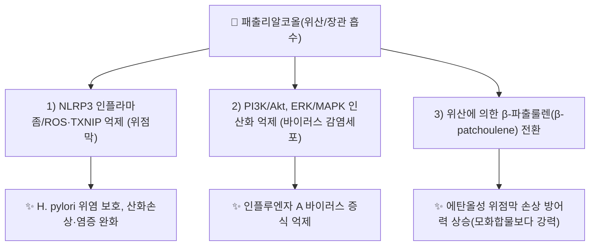

# 🔬 패출리알코올 (Patchouli alcohol, Patchoulol)

> **핵심 3줄 요약 (Key Summary)**:
> - 🌿 기원 본초 & 화학 계열: [[곽향]](藿香) 중에서도 광곽향(*Pogostemon cablin*)의 정유에 가장 풍부한 삼환성(tricyclic) 세스퀴테르펜 알코올. 패출리 특유의 흙내음·나무향을 내는 지표 성분.
> - 🎯 핵심 분자 표적 & 조절 경로: 위 상피세포·대식세포에서 NLRP3 인플라마좀(NLRP3/caspase-1/TXNIP) 및 활성산소(ROS)를 억제하고, 인플루엔자 바이러스 감염세포에서 PI3K/Akt·ERK/MAPK 인산화를 저해.
> - 🩺 주요 약리 활성 & 질환 치료 기전: 헬리코박터 파일로리 유발 위염 보호, 에탄올성 위점막 손상 방지(위액 내 대사체 β-파출룰렌으로 전환되어 상승), 인플루엔자 A 바이러스 억제 — 곽향의 방향화습(芳香化濕)·화중지구(和中止嘔) 효능의 현대 약리적 근거로 다뤄짐.
> - ⚠️ 독성·생체이용률 한계 & 상호작용: 지용성이 높아 경구 흡수·생체이용률에 관한 사람 대상 약동학 자료가 부족하며, 양약과의 상호작용 연구도 확인되지 않음.

---
## 📌 목차
1. [기본 화학 정보 & 분자 구조식 (Chemical Identity)](#1-기본-화학-정보--분자-구조식-chemical-identity)
2. [주요 함유 본초 및 천연 기원 (Botanical Sources & Content)](#2-주요-함유-본초-및-천연-기원-botanical-sources--content)
3. [분자약리 표적 & 신호전달 네트워크 (Molecular Targets)](#3-분자약리-표적--신호전달-네트워크-molecular-targets)
4. [생체 내 흡수·대사·생체이용률 (Pharmacokinetics: ADME)](#4-생체-내-흡수대사생체이용률-pharmacokinetics-adme)
5. [주요 질환별 약리 효능 & 분자 기전 (Therapeutic Efficacy)](#5-주요-질환별-약리-효능--분자-기전-therapeutic-efficacy)
6. [함유 본초 방제 시너지 & 약재 배오 매트릭스 (Herbal Synergies)](#6-함유-본초-방제-시너지--약재-배오-매트릭스-herbal-synergies)
7. [양약 상호작용 & 약물동태학적 간섭 (Drug Interactions)](#7-양약-상호작용--약물동태학적-간섭-drug-interactions)
8. [💡 사용자 진료실 핵심 필기 & 임상 응용 팁 (Melt-In & High-Yield)](#8--사용자-진료실-핵심-필기--임상-응용-팁-melt-in--high-yield)
9. [출처 및 학술 참고 문헌 (References)](#9-출처-및-학술-참고-문헌-references)

---
## 1. 기본 화학 정보 & 분자 구조식 (Chemical Identity)

> [!abstract]+ 🧪 3D 약리 분자 구조 (Interactive 3D Viewer)
> <iframe src="https://molecule-viewer-rho.vercel.app/?cid=10955174" style="width: 100%; height: 600px; border: none; border-radius: 12px; box-shadow: 0 4px 20px rgba(0,0,0,0.15);" allowfullscreen></iframe>

| 항목 | 상세 내용 |
| :--- | :--- |
| **IUPAC 명칭** | (1S,2S,5R,8S)-1,5,9,9-tetramethyl-4-tricyclo[6.3.1.0¹,⁵]dodecanol (Patchoulol) |
| **분자식 / 분자량** | C₁₅H₂₆O / 약 222.36 g/mol |
| **PubChem CID** | [10955174](https://pubchem.ncbi.nlm.nih.gov/compound/10955174) |
| **CAS 등록 번호** | 5986-55-0 |
| **화학 골격 분류** | 삼환성(Tricyclic) 세스퀴테르펜 3차 알코올 |
| **물리화학적 성상** | 백색 결정성 고체 또는 점조성 액체, 특유의 흙·나무향(패출리 향의 핵심), 물에 거의 불용·고지용성 |

---
## 2. 주요 함유 본초 및 천연 기원 (Botanical Sources & Content)

| 함유 본초 | 기원 식물학적 명칭 | 주요 함유 부위 | 비고 |
| :--- | :--- | :--- | :--- |
| [[곽향]] (藿香, 광곽향) | 꿀풀과 / *Pogostemon cablin* | 지상부(정유) | 광곽향 정유의 주성분(토곽향 *Agastache rugosa*의 주성분은 [[에스트라골]]로 서로 구별됨) |

곽향 정유(PEO)는 일사병(heatstroke) 마우스 모델에서 체온조절 회복, 장 점막 장벽 보존(ZO-1·Occludin 상향), 대식세포 M1→M2 극성화 전환을 통해 다장기 손상을 완화한다(Li 2026, [[곽향]] 참조, PMID 42642843). ⚠️ 내용 검토 필요: 해당 연구는 광곽향 정유 전체를 다룬 것으로, 패출리알코올 단독의 기여는 이 노트에서 별도로 검증하지 못했다.

---
## 3. 분자약리 표적 & 신호전달 네트워크 (Molecular Targets)

### (1) NLRP3 인플라마좀 억제를 통한 위점막 보호
* 헬리코박터 파일로리 감염 마우스·GES-1 위상피세포 모델에서 패출리알코올은 ROS·MDA를 낮추고 비단백 설프하이드릴·카탈라아제·GSH/GSSG 비율 등 항산화력을 높였다.
* IL-1β·IL-6·KC(마우스), IL-6·TNF-α·MCP-1(세포) 등 염증 매개물질을 감소시켰다.
* NLRP3·활성 caspase-1·TXNIP 발현 및 공동국재화를 억제하여 NLRP3 인플라마좀의 프라이밍(NF-κB 매개 추정)과 활성화(ROS/TXNIP 매개) 신호를 동시에 차단하는 것으로 제시되었다(Lian 2018, PMID 30524287).

### (2) PI3K/Akt·ERK/MAPK 경로 억제를 통한 항바이러스 작용
* MDCK·A549 세포에서 H1N1 계열 인플루엔자 A 바이러스(Vir09, NWS, PR8)에 대해 용량 의존적으로 바이러스 역가를 감소시켰다.
* 바이러스 흡착 후 초기 4시간 이내 단계를 방해하고 바이러스 입자를 직접 불활성화하는 것으로 제시되었으며, 뉴라미니다아제·혈구응집·중합효소 미니게놈 활성에는 유의한 영향이 없었다.
* 감염 세포에서 PI3K·Akt 인산화 및 ERK1/2 인산화를 감소시켰으나 비감염 세포의 기저 PI3K/Akt 활성에는 영향이 없었다(Yu 2019, PMID 31870450).

---
## 4. 생체 내 흡수·대사·생체이용률 (Pharmacokinetics: ADME)

* **위산에 의한 생체전환 — β-파출룰렌(β-patchoulene) 생성**: 랫드 위액이 패출리알코올을 산 촉매 반응으로 이성질체인 β-파출룰렌으로 전환시키며, 이 대사체가 에탄올 유발 위점막 손상 모델에서 모화합물보다 더 강력한 보호 효과(궤양 면적 감소, 염증·세포사멸 지표 억제, 항산화 효소 회복, NF-κB·ERK1/2 경로 조절)를 나타냈다(Liu 2017, [Sci Rep 7:1-13](https://doi.org/10.1038/s41598-017-05996-5)).
* ⚠️ 내용 검토 필요: 사람 대상 경구 흡수율·반감기·대사경로 등 체계적 ADME 자료는 이 노트에서 확인하지 못했다.

---
## 5. 주요 질환별 약리 효능 & 분자 기전 (Therapeutic Efficacy)

### (1) 소화기 보호 — 화중지구(和中止嘔)의 약리적 근거
* 헬리코박터 파일로리 위염 모델에서 항산화·항염증·NLRP3 억제를 통한 위점막 보호(Lian 2018, PMID 30524287).
* 에탄올성 급성 위점막 손상에서 위산 대사체 β-파출룰렌을 매개로 한 보호 효과(Liu 2017).
* 이는 곽향이 전통적으로 식체·구토·위장관 불편감([[화중지구]])에 사용되어 온 임상적 경험과 부합하는 현대 약리 근거로 다뤄진다.

### (2) 항바이러스 — 인플루엔자 A
* PR8 바이러스 마우스 폐렴모델에서 비강 내 패출리알코올(40 μg/일) 투여군의 14일 생존율이 100%로, 위약군(30%)보다 높고 오셀타미비르군(90%)과 비슷하거나 우수했으며 폐 바이러스 역가와 폐렴 병리도 완화되었다(Yu 2019, PMID 31870450).

---
## 6. 함유 본초 방제 시너지 & 약재 배오 매트릭스 (Herbal Synergies)

| 함유 본초 / 방제 | 공존 유효 성분군 | 전통 한의학적 효능 연계 |
| :--- | :--- | :--- |
| [[곽향]] | [[에스트라골]], [[아카세틴]], [[로즈마린산]] | [[방향화습]](芳香化濕)·[[화중지구]](和中止嘔) |
| [[곽향정기산]] | [[곽향]], [[소엽]], [[반하]], [[백출]] 등 | 여름 감기·냉방병·식중독·곽란의 제1방 — 곽향의 위장관 보호·항균 작용이 방 전체 효능의 축 |

---
## 7. 양약 상호작용 & 약물동태학적 간섭 (Drug Interactions)

⚠️ 내용 검토 필요: 패출리알코올의 CYP450 간섭이나 특정 양약과의 상호작용을 검증한 사람 대상 자료는 이 노트에서 확인하지 못했다.

---
## 8. 💡 사용자 진료실 핵심 필기 & 임상 응용 팁 (Melt-In & High-Yield)

* 현재 별도로 기록된 원장님 임상 필기가 없습니다.

---
## 9. 출처 및 학술 참고 문헌 (References)

1. **Lian DW, Xu YF, Ren WK, et al.** (2018). *Unraveling the Novel Protective Effect of Patchouli Alcohol Against Helicobacter pylori-Induced Gastritis: Insights Into the Molecular Mechanism in vitro and in vivo.* Frontiers in Pharmacology, 9:1347. [PMID 30524287](https://pubmed.ncbi.nlm.nih.gov/30524287/) · DOI: [10.3389/fphar.2018.01347](https://doi.org/10.3389/fphar.2018.01347)
   - **[연구 요약]**: 패출리알코올이 항산화·항염증 및 NLRP3 인플라마좀 억제를 통해 헬리코박터 파일로리 유발 위염을 보호함을 규명.
2. **Yu Y, Zhang Y, Wang S, Liu W, Hao C, Wang W.** (2019). *Inhibition effects of patchouli alcohol against influenza a virus through targeting cellular PI3K/Akt and ERK/MAPK signaling pathways.* Virology Journal, 16:163. [PMID 31870450](https://pubmed.ncbi.nlm.nih.gov/31870450/) · DOI: [10.1186/s12985-019-1266-x](https://doi.org/10.1186/s12985-019-1266-x)
   - **[연구 요약]**: 패출리알코올이 바이러스 직접 불활성화 및 PI3K/Akt·ERK/MAPK 경로 억제를 통해 인플루엔자 A 바이러스 증식을 억제하고 마우스 폐렴모델 생존율을 개선함을 보고.
3. **Liu Y, Liang J, Wu J, et al.** (2017). *Transformation of patchouli alcohol to β-patchoulene by gastric juice: β-patchoulene is more effective in preventing ethanol-induced gastric injury.* Scientific Reports, 7:1-13. DOI: [10.1038/s41598-017-05996-5](https://doi.org/10.1038/s41598-017-05996-5)
   - **[연구 요약]**: 위산이 패출리알코올을 β-파출룰렌으로 전환시키며, 이 대사체가 에탄올 유발 위점막 손상을 모화합물보다 효과적으로 예방함을 규명.
4. PubChem Compound Summary — Patchoulol (CID 10955174): [https://pubchem.ncbi.nlm.nih.gov/compound/10955174](https://pubchem.ncbi.nlm.nih.gov/compound/10955174)

> 검증 메모 (2026-10-25): 다빈치 정원 가꾸기 — PMID 30524287, 31870450은 PubMed 서지와 대조하여 일치 확인. Liu 2017(Sci Rep)은 DOI로 서지 확인, PMID는 이 노트에서 확정하지 못함.
