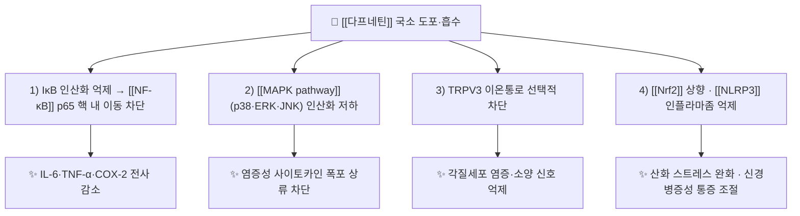

# 🔬 다프네틴 (Daphnetin, C9H6O4 / 7,8-dihydroxychromen-2-one)

> **핵심 3줄 요약 (Key Summary)**:
> - 🌿 기원 본초 & 화학 계열: [[조사마]](祖師麻, Cortex Daphnes)의 대표 지표성분이며, 瑞香科 식물에 널리 분포하는 [[쿠마린]] 계열(7,8-dihydroxycoumarin) 화합물이다.
> - 🎯 핵심 분자 표적 & 조절 경로: [[NF-κB]]·[[MAPK pathway]] 신호 억제, [[Nrf2]]/[[NLRP3]] 조절, TRPV3 이온통로 선택적 차단.
> - 🩺 주요 약리 활성: 항염·항산화·신경병증성 통증 완화·피부 소양 억제. 외용 카타플라스마의 진통 기전을 설명하는 성분이다.
> - ⚠️ 독성·생체이용률 한계: 비배당체로 지용성이 높아 피부 투과에는 유리하나, 경구 생체이용률이 낮고 간 대사 개입이 커 병용약 상호작용 확인이 필요하다.

---

## 📌 목차
1. [기본 화학 정보 & 분자 구조식 (Chemical Identity)](#1-기본-화학-정보--분자-구조식-chemical-identity)
2. [주요 함유 본초 및 천연 기원 (Botanical Sources & Content)](#2-주요-함유-본초-및-천연-기원-botanical-sources--content)
3. [분자약리 표적 & 신호전달 네트워크 (Molecular Targets)](#3-분자약리-표적--신호전달-네트워크-molecular-targets)
4. [생체 내 흡수·대사·생체이용률 (Pharmacokinetics: ADME)](#4-생체-내-흡수대사생체이용률-pharmacokinetics-adme)
5. [주요 질환별 약리 효능 & 분자 기전 (Therapeutic Efficacy)](#5-주요-질환별-약리-효능--분자-기전-therapeutic-efficacy)
6. [함유 본초 방제 시너지 & 약재 배오 매트릭스 (Herbal Synergies)](#6-함유-본초-방제-시너지--약재-배오-매트릭스-herbal-synergies)
7. [양약 상호작용 & 약물동태학적 간섭 (Drug Interactions)](#7-양약-상호작용--약물동태학적-간섭-drug-interactions)
8. [💡 진료실 핵심 필기 & 임상 응용 팁 (Melt-In & High-Yield)](#8--진료실-핵심-필기--임상-응용-팁-melt-in--high-yield)
9. [출처 및 학술 참고 문헌 (References)](#9-출처-및-학술-참고-문헌-references)

---

## 1. 기본 화학 정보 & 분자 구조식 (Chemical Identity)
![[다프네틴_01_구조식.png|360]]
> [그림 1: [[다프네틴]]의 2D 화학 분자 구조식 — PubChem CID 5280569 정본(PubChem PNG API)]

> [!abstract]+ 🧪 3D 약리 분자 구조 (Interactive 3D Viewer)
> <iframe src="https://molecule-viewer-rho.vercel.app/?cid=5280569" width="100%" height="450px" frameborder="0" allow="webgl" style="border-radius: 8px;"></iframe>

| 항목 | 상세 내용 |
| :--- | :--- |
| IUPAC 명칭 | 7,8-dihydroxychromen-2-one (7,8-dihydroxy-2H-chromen-2-one) |
| 분자식 / 분자량 | C9H6O4 / 178.14 g/mol |
| PubChem CID | [5280569](https://pubchem.ncbi.nlm.nih.gov/compound/5280569) |
| CAS 등록 번호 | 486-35-1 |
| 화학 골격 분류 | 쿠마린(coumarin, 1,2-benzopyrone) 계열 — 7,8-디히드록시 유도체 |
| 물리화학적 성상 | 담황색 결정성 분말, 물에 난용·에탄올에 가용. 8번 수산기가 7번과 함께 카테콜 형태를 이뤄 산화되기 쉽다 |
| 식물 내 생합성 경로 | 시킴산 → 페닐알라닌 → p-쿠마르산 → umbelliferone 경유 → 7,8-수산화 단계로 5·8번 위치에 수산기가 도입된다(일반 [[쿠마린]] 생합성 경로) |

별칭: Daphnetol, 7,8-dihydroxy-2H-1-benzopyran-2-one. 8-O-배당체는 daphnin(7,8-dihydroxycoumarin-7-O-β-D-glucoside)이다.

---

## 2. 주요 함유 본초 및 천연 기원 (Botanical Sources & Content)

![[다프네틴_02_기원식물.jpg|400]]
> [그림 2: [[다프네틴]]을 지표성분으로 함유하는 황서향의 가지와 잎 — File:Daphne giraldii 2015-06-20 3136.jpg, Wikimedia Commons, CC BY-SA 4.0]

| 함유 본초 (한글/한자) | 기원 식물학적 명칭 (과명 / 학명) | 주요 함유 약용 부위 | 지표 함량 | 한의학적 귀경 및 약효 특성 |
| :--- | :--- | :--- | :--- | :--- |
| [[조사마]] (祖師麻) | 서향과 / *Daphne giraldii* Nitsche | 줄기껍질·뿌리껍질 | 외용 카타플라스마 1매당 600 µg 규격(2021년 시험 제품) | 肝·胃, 祛風除濕·活血止痛 |
| 황서향 동속 (陝西瑞香) | 서향과 / *Daphne tangutica* Maxim. | 수피 | 문헌별 편차, 본 회차 미확인 | 조사마와 동일 계열로 통용 |
| 서향 (瑞香) | 서향과 / *Daphne odora* Thunb. | 수피·잎 | 식물 부위별 편차, 본 회차 미확인 | 관상·민간 약용, 처방 수재는 드묾 |

- 지표 함량의 근거는 2021년 다기관 시험에 사용된 시험약 규격(매 1매당 다프네틴 600 µg)이다. 국내 유통품의 함량 규격은 별도 확인이 필요하다.

---

## 3. 분자약리 표적 & 신호전달 네트워크 (Molecular Targets)

### 1) 핵심 분자 표적
- [[NF-κB]] 경로: IκBα 인산화·분해를 억제해 p65의 핵 내 이동을 막는다. 패혈증 신손상 모델에서 비정형(non-canonical) NF-κB 억제가 보고됐다([PMID 42764734](https://pubmed.ncbi.nlm.nih.gov/42764734/)).
- [[MAPK pathway]] 경로: p38·JNK·ERK 인산화를 낮춰 염증 매개체 생성을 상류에서 줄인다. 2021년 리뷰가 인용한 기전 축이다.
- TRPV3: 각질세포에 풍부한 온감 수용체로, 선택적 차단 시 피부 염증과 소양이 줄어든다([PMID 42508711](https://pubmed.ncbi.nlm.nih.gov/42508711/)). 외용 제형에서 "붙이면 가렵던 부위가 덜 가렵다"는 체감을 설명하는 근거다.
- [[Nrf2]]·[[NLRP3]]: 척수 미세아교세포의 M2 편향을 유도해 신경병증성 통증을 완화했다는 동물실험 보고가 있다([PMID 42308799](https://pubmed.ncbi.nlm.nih.gov/42308799/)).

### 2) 한의학적 해석과의 접점
- 祛風除濕·活血止痛의 "염증·순환" 축은 NF-κB·MAPK 억제와 국소 혈류 개선이라는 현대 기전과 겹친다.
- 다만 대부분의 분자 근거가 세포·동물 모델이다. 임상 근거는 무릎 골관절염 외용 RCT 1건(2021)에 국한되므로, 기전의 정교함을 임상 효과 크기로 확대 해석하지 않는다.

---

## 4. 생체 내 흡수·대사·생체이용률 (Pharmacokinetics: ADME)
- **경구 흡수**: 비배당체이나 수산기가 2개 있어 장관 흡수가 제한적이고, 위장관 자극이 보고된다. 小毒 약재로 분류되는 이유 중 하나다.
- **피부 투과**: 지용성 아글리콘 형태가 각질층을 통과한다. 흑고약 기질의 폐쇄성 습포가 수화를 유도해 투과를 높인다 → [[카타플라스마제]]
- **대사·배설**: 쿠마린 골격은 간에서 포합 반응(글루쿠론산화·황산화)을 거쳐 신장으로 배설되는 것으로 알려져 있다. 구체적 반감기 수치는 본 회차에서 확인하지 못했다(추정 금지).
- **임상적 함의**: 전신 노출이 적어 경구 NSAID의 위장관·신장 부담을 피할 수 있다는 점이 외용 제형의 핵심 장점이다 → [[국소 NSAID]]

---

## 5. 주요 질환별 약리 효능 & 분자 기전 (Therapeutic Efficacy)

### 1) 무릎 골관절염 (외용)
- 조사마 카타플라스마 2주 적용에서 보행 시 VAS −25.4 mm, WOMAC 통증 30% 반응률 78.4%(대조 64.7%)로 국소 NSAID에 비열등했다([PMID 34025414](https://pubmed.ncbi.nlm.nih.gov/34025414/)).
- 기전상 국소 활막 염증 억제 + 통각수용기 민감도 저하 + 폐쇄·온열 효과의 합산으로 해석된다 → [[퇴행성 슬관절염]]

### 2) 피부 염증·소양
- TRPV3 차단으로 피부 염증과 소양이 완화됐다([PMID 42508711](https://pubmed.ncbi.nlm.nih.gov/42508711/)). 다만 이는 병변 피부에 직접 도포하는 연구가 아니라 세포·동물 수준이다.
- 임상적으로는 파스류 사용 후 생기는 접촉 피부염과 감별이 필요하다 → [[접촉 피부염]]

### 3) 신경병증성 통증
- 척수 미세아교세포 [[Nrf2]]/[[NLRP3]] 조절을 통한 진통 효과가 rat 모델에서 보고됐다([PMID 42308799](https://pubmed.ncbi.nlm.nih.gov/42308799/)). 사람 대상 근거는 없다.

---

## 6. 함유 본초 방제 시너지 & 약재 배오 매트릭스

| 함유 본초 / 방제 | 공존 유효 성분군 | 분자약리 시너지 기전 | 전통 한의학적 효능 연계 |
| :--- | :--- | :--- | :--- |
| [[조사마]] | daphnodorin, daphnin, 플라보노이드 | 쿠마린·플라보노이드 병존으로 항염 다표적 동시 조절 | 祛風除濕, 活血止痛 |
| [[조사마]] + [[독활]] | [[오스톨]] 등 푸라노쿠마린 | NF-κB 억제 중복 + 하부 관절 표적 | 腰膝 風寒濕痹 |
| [[조사마]] + [[위령선]] | 사포닌·쿠마린 | 항염 + 通絡(연부조직 유착 완화) | 關節拘攣·骨刺痛 |

- 배오의 근거는 전통 문헌·교과서 수준이며, 성분 간 시너지를 정량 검증한 임상시험은 본 회차에서 확인하지 못했다.

---

## 7. 양약 상호작용 & 약물동태학적 간섭
- **항응고·항혈소판**: 쿠마린 골격 성분은 이론적으로 비타민 K 길항 계열과 구분되지만, 외용 시 전신 노출이 적어 임상적 출혈 위험은 낮다. 다만 피부 박리·미란 부위에 도포하면 흡수가 늘 수 있어 [[와파린]]·DOAC 복용자에서는 병변 피부 사용을 피한다.
- **국소 NSAID 병용**: 같은 부위에 [[인도메타신]] 카타플라스마·겔을 겹쳐 바르면 접촉 피부염 위험이 가산된다. 한 부위에 두 제품을 겹치지 않는다.
- **CYP 간섭**: 경구 복용 시 CYP 개입 가능성이 거론되나 정량 자료를 확인하지 못했다. 내복 처방 시 병용약 검토가 필요하다.

---

## 8. 💡 진료실 핵심 필기 & 임상 응용 팁 (Melt-In & High-Yield)
- **외용 우선 원칙**: 小毒 약재이므로 진료실에서는 외용 카타플라스마·첩부제로 한정해 쓰는 것이 안전하다. 내복은 원전·규격 확인 후에만.
- **부착 시간 변형**: 원 시험은 24시간 연속 부착이었고 피부 자극이 28.8%였다. 진료실에서는 야간 8~12시간 부착 후 제거, 아침 보습, 부착 부위 좌우 교대가 현실적이다. 3~4일 연속 후 1일 휴지기도 실용적이다.
- **첫 1주 확인**: 피부가 얇은 고령자·하지 정맥부전 환자는 부착 부위를 매일 확인한다. 38건 중 34건이 약물이 아닌 부착재 접촉 피부염이었다는 점을 기억한다.
- **급성기 배치 금지**: 발열·발적·관절종창이 뚜렷한 급성 염증은 이 시험의 제외 기준이었다. 냉각·부목·관절 보호를 먼저 하고, 외용제는 아급성~만성 단계에 배치한다.
- **환자 설명**: "한약 성분을 습포 형태로 만든 파스입니다. 하루 종일 붙이면 피부가 빨개질 수 있어 밤에 붙이고 아침에 떼는 방식으로 쓰겠습니다."

---

## 9. 출처 및 학술 참고 문헌 (References)
1. **Cortex Daphnes 연구팀 (2021)**. *Clinical Efficacy of Cortex Daphnes (Zushima) Patch in Patients With Symptomatic Knee Osteoarthritis*. Frontiers in Pharmacology, 12, 646310. [PMID 34025414](https://pubmed.ncbi.nlm.nih.gov/34025414/)
   - [연구 요약] 264명 다기관 비열등성 RCT. 다프네틴 600 µg/매 카타플라스마가 인도메타신 카타플라스마에 비열등, WOMAC 통증 반응률은 우수.
2. **Daphnetin TRPV3 (2026)**. *Daphnetin ameliorates skin inflammation by selectively inhibiting transient receptor potential vanilloid 3 channels*. European Journal of Pharmacology. [PMID 42508711](https://pubmed.ncbi.nlm.nih.gov/42508711/)
   - [연구 요약] TRPV3 선택적 억제를 통한 피부 염증·소양 완화 기전. 외용 제형의 소양 억제 근거.
3. **Daphnetin 신경병증성 통증 (2026)**. *Daphnetin alleviates neuropathic pain in rats by modulating spinal microglial polarization via the Nrf2/NLRP3 inflammasome pathway*. International Immunopharmacology. [PMID 42308799](https://pubmed.ncbi.nlm.nih.gov/42308799/)
   - [연구 요약] rat 모델에서 미세아교세포 M2 편향 유도로 통각과민 감소. 사람 대상 자료 없음.
4. **Daphnetin 비정형 NF-κB (2026)**. *Daphnetin Alleviates Sepsis-Associated Acute Kidney Injury by Promoting Autophagy and Suppressing Non-canonical NF-κB Signaling*. Current Medicinal Chemistry. [PMID 42764734](https://pubmed.ncbi.nlm.nih.gov/42764734/)
   - [연구 요약] 비정형 NF-κB 억제 확인. 신장 모델이므로 관절 적응증 근거로 직접 인용하지 않는다.
5. **PubChem**. *Daphnetin, CID 5280569*. [링크](https://pubchem.ncbi.nlm.nih.gov/compound/5280569)
   - [연구 요약] 분자식·분자량·CAS·IUPAC 명칭의 1차 확인 자료.

## 함께 보기
- [[조사마]] · [[쿠마린]] · [[카타플라스마제]] · [[퇴행성 슬관절염]] · [[NF-κB]] · TRPV3 · [[접촉 피부염]] · [[인도메타신]]
- [[2026-10-20_근골격계-사지말초_심층리뷰]] 1번 · [[2026-10-20_근골격계-사지말초_개념학습]]
