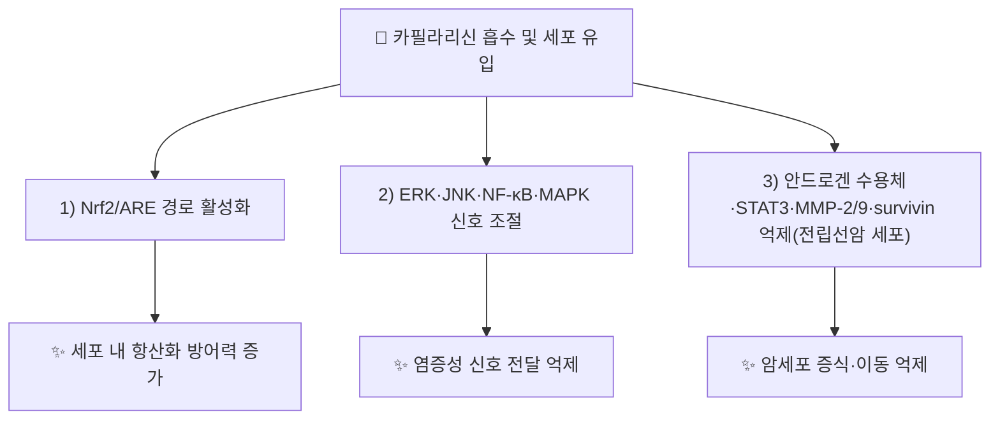

# 🔬 [[카필라리신]] (Capillarisin / C₁₆H₁₂O₇)

> **핵심 3줄 요약 (Key Summary)**:
> - 🌿 기원 본초 & 화학 계열: [[인진호]](茵蔯蒿, *Artemisia capillaris* Thunb.)의 KP 규격 지표성분(건조물 기준 ≥0.10%). 크로몬(chromone) 골격에 4-하이드록시페녹시기가 결합된 구조로, ChEBI는 쿠마린류로도 분류한다.
> - 🎯 핵심 분자 표적 & 조절 경로: Nrf2/ARE 항산화 경로 활성화, ERK·JNK·NF-κB·MAPK 염증 신호 조절. 전립선암 세포에서는 안드로겐 수용체·survivin·MMP-2/9·STAT3를 억제한다.
> - 🩺 주요 약리 활성 & 질환 치료 기전: 항산화·항염증 작용과 함께 간암(HepG2·Huh7)·대장암 세포주에서 증식·이동 억제가 보고되었다(세포실험 수준, IC50 72~105 μg/mL).
> - ⚠️ 독성·생체이용률 한계 & 상호작용: 단일 성분 기준 인체 ADME 정량 데이터는 확인하지 못했다. 복합처방(인진호탕) 투여 후 혈중 동태(Tmax 5~39분, t½ 26~159분)만 보고되어 있어 카필라리신 단독 수치로 보기 어렵다(⚠️ 확인 필요).

---

## 📌 목차
1. [기본 화학 정보 & 분자 구조식](#1-기본-화학-정보--분자-구조식-chemical-identity)
2. [주요 함유 본초 및 천연 기원](#2-주요-함유-본초-및-천연-기원-botanical-sources--content)
3. [분자약리 표적 & 신호전달 네트워크](#3-분자약리-표적--신호전달-네트워크-molecular-targets)
4. [생체 내 흡수·대사·생체이용률](#4-생체-내-흡수대사생체이용률-pharmacokinetics-adme)
5. [주요 질환별 약리 효능 & 분자 기전](#5-주요-질환별-약리-효능--분자-기전-therapeutic-efficacy)
6. [함유 본초 방제 시너지 & 약재 배오 매트릭스](#6-함유-본초-방제-시너지--약재-배오-매트릭스-herbal-synergies)
7. [양약 상호작용 & 약물동태학적 간섭](#7-양약-상호작용--약물동태학적-간섭-drug-interactions)
8. [💡 사용자 진료실 핵심 필기 & 임상 응용 팁](#8--사용자-진료실-핵심-필기--임상-응용-팁-melt-in--high-yield)
9. [출처 및 학술 참고 문헌 (References)](#9-출처-및-학술-참고-문헌-references)

---
## 1. 기본 화학 정보 & 분자 구조식 (Chemical Identity)

| 항목 | 상세 내용 |
| :--- | :--- |
| **계통 명칭** | 5,7-Dihydroxy-2-(4-hydroxyphenoxy)-6-methoxy-4H-chromen-4-one |
| **분자식 / 분자량** | C₁₆H₁₂O₇ / 316.26 g/mol |
| **PubChem CID** | ⚠️ 확인 필요(검색 범위 내에서 신뢰 가능한 CID를 확정하지 못함 — CAS 번호로 식별 권장) |
| **CAS 등록 번호** | 56365-38-9 |
| **화학 골격 분류** | 크로몬(chromone) 유도체 — 4-하이드록시페녹시기가 결합된 디아릴에터형 구조. ChEBI는 쿠마린류(coumarins)로도 분류한다 |
| **물리화학적 성상** | 담황색~황색 분말, 융점 약 225℃(분해), 클로로포름·디클로로메탄·에틸아세테이트·DMSO·아세톤에 가용 |
| **함량 변동** | 수확 시기에 따라 함량이 변동 — 잎에서는 7월 말, 두상화서(capitulum)에서는 8월 초에 최고치를 보인다는 보고가 있다(Hsueh et al. 2021) |

---

## 2. 주요 함유 본초 및 천연 기원 (Botanical Sources & Content)

| 함유 본초 (한글/한자) | 기원 식물학적 명칭 (과명 / 학명) | 주요 함유 약용 부위 | 지표 함량 (%) | 한의학적 귀경 및 약효 특성 |
| :--- | :--- | :--- | :--- | :--- |
| [[인진호]] (茵蔯蒿) | 국화과(Asteraceae) / *Artemisia capillaris* Thunb. | 어린 전초(개화 전 채취) | KP 규격 ≥0.10% | 간·위·방광경 / 청열이습(淸熱利濕)·퇴황달(退黃疸) |

> [[인진호]] 노트에는 카필라리신이 쿠마린 성분 [[스코파론]]과 함께 핵심 지표성분으로 기재되어 있다. 다만 인진호 노트가 인용한 개별 PMID(38148156·42203023)는 각각 스코파론·카필라리세놀 C에 대한 것으로, 카필라리신 단독에 특이적인 1차 문헌은 이번 조사에서 §9의 Hsueh et al. (2021) 종설이 유일하게 확인되었다.

---

## 3. 분자약리 표적 & 신호전달 네트워크 (Molecular Targets)

### 1) 항산화·항염증 기전
* Nrf2/ARE 경로 활성화를 통한 내인성 항산화 효소계 유도, ERK·JNK·NF-κB·MAPK 신호 조절을 통한 염증 반응 억제가 보고된다(Hsueh et al. 2021 종설).

### 2) 전립선암 세포에서의 항종양 기전
* 안드로겐 수용체 활성화를 억제하고 survivin·MMP-2·MMP-9·STAT3 발현을 낮춘다는 세포실험 결과가 보고되어 있다(⚠️ 개별 1차 논문 PMID는 종설 인용 수준에서만 확인, 직접 검증 못함).

### 3) 간암·대장암 세포 증식·이동 억제
* 간암세포(HepG2·Huh7)에서 IC50 72·105 μg/mL, 대장암세포 이동·증식에서 IC50 92.1·76.7 μg/mL — 세포실험 수준의 농도이며 임상적 의미는 아직 불명확하다(⚠️ 확인 필요).

---

## 4. 생체 내 흡수·대사·생체이용률 (Pharmacokinetics: ADME)

* ⚠️ 카필라리신 단독 성분의 인체·동물 ADME 정량 데이터는 확인하지 못했다.
* 인진호 복합방제(인진호탕, Yin-Chen-Hao-Tang) 투여 후 혈중 동태 연구에서는 최고혈중농도 196~490 μg/L, Tmax 5~39분, t½ 26~159분, AUC 변동이 큰 것으로 보고되었으나, 이는 복합방제 수준의 수치로 카필라리신 단일성분 고유값으로 보기 어렵다.
* 혈중 단백 결합과 관련해 카필라리신은 [[스코파론]]보다 사람 혈청 알부민에 더 강하게 결합한다는 보고가 있다(Hsueh et al. 2021).

---

## 5. 주요 질환별 약리 효능 & 분자 기전 (Therapeutic Efficacy)

### 1) 간 보호 및 황달·간질환 관리(한의학적 청열이습·퇴황달)
* [[인진호]]의 전통적 퇴황달 효능과 연계하여 간세포 보호·항산화 기전이 제시되나, 카필라리신 단독의 간보호 1차 문헌은 이번 조사에서 직접 확인하지 못했다(⚠️ 확인 필요 — 같은 본초의 다른 성분인 스코파론·카필라리세놀 C의 간암세포 자멸사 연구와 혼동하지 않도록 주의).

### 2) 항종양 보조 가능성(전립선암·간암·대장암 세포주)
* §3-2·3-3 참조. 세포실험 단계로, 동물·임상 수준 근거는 확인하지 못했다.

### 3) 항염증 전신 적용 가능성
* Nrf2/ARE·NF-κB 경로 조절을 통한 전신 항염증 보조 가능성이 제시되나, 임상적 적응증은 아직 불명확하다.

---

## 6. 함유 본초 방제 시너지 & 약재 배오 매트릭스 (Herbal Synergies)

| 함유 본초 / 방제 | 공존 유효 성분군 | 분자약리 시너지 기전 | 전통 한의학적 효능 연계 |
| :--- | :--- | :--- | :--- |
| [[인진호]] | [[스코파론]], 클로로겐산 | 쿠마린·크로몬·페놀산의 복합 항산화·간보호 작용(개별 기전은 성분별로 구분됨) | 청열이습(淸熱利濕), 퇴황달(退黃疸) |
| [[인진호탕]] | [[인진호]]+[[산치자]]+[[대황]] | 복합방제 수준의 혈중 동태(Tmax·t½)만 확인됨 | 양명병 습열황달 치료 |

---

## 7. 양약 상호작용 & 약물동태학적 간섭 (Drug Interactions)

* ⚠️ 카필라리신과 특정 양약(스타틴·항응고제 등) 간의 임상적 CYP 상호작용을 직접 다룬 문헌은 검색 범위 내에서 확인하지 못했다.
* 사람 혈청 알부민에 상대적으로 강하게 결합한다는 보고(§4)로 보아 알부민 결합률이 높은 다른 약물과의 치환 상호작용 가능성이 이론적으로 존재하나, 정량 데이터는 ⚠️ 확인 필요.

---

## 8. 💡 사용자 진료실 핵심 필기 & 임상 응용 팁 (Melt-In & High-Yield)

* ⚠️ 원장님의 진료실 필기가 아직 반영되지 않았습니다. 인진호·인진호탕 처방 시 카필라리신 관련 임상 관찰이 있으면 추가해 주시면 다음 정원 가꾸기 때 녹여 정리하겠습니다.

---

## 9. 출처 및 학술 참고 문헌 (References)

1. **Hsueh TP, Lin WL, Dalley JW, Tsai TH. (2021)**. *The Pharmacological Effects and Pharmacokinetics of Active Compounds of Artemisia capillaris*. **Biomedicines**, 9(10), 1412. doi:10.3390/biomedicines9101412.
   - [PubMed: PMID 34680529](https://pubmed.ncbi.nlm.nih.gov/34680529/)
   - **[연구 요약]**: 인진호 유효성분(카필라리신·스코파론 등)의 약리 효과와 약동학을 종합한 종설. 카필라리신을 크로몬 유도체로 분류하고 항산화·항염증·항종양(전립선암·간암·대장암 세포) 기전, 복합방제 투여 후 혈중 동태를 정리.
2. **대한민국약전(KP) 제12개정 (2022)**. 의약품각조 제2부: 인진호(Artemisiae Capillaris Herba) 규격 기준.
   - **[공정서 규격]**: 건조물 기준 카필라리신 0.10% 이상 함유 필수 규격 명시(출처: [[인진호]] 노트 §7-2 교차 확인).

> ⚠️ 확인 불가/추정 표시 총괄: PubChem CID, 단일성분 ADME 정량값, 개별 전립선암·간암 세포실험 1차 PMID는 검색 범위 내에서 확정하지 못해 각 섹션에 개별 표시했다. CAS 56365-38-9, 분자식 C₁₆H₁₂O₇, PMID 34680529는 복수 출처로 교차 확인된 값이다.

---
🏛️ **상위 허브**: [[00_약리성분_MOC]]
