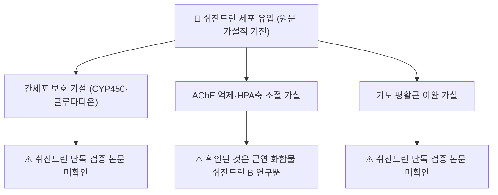

# 💊 [[쉬잔드린]] (Schisandrin)

> **핵심 3줄 요약 (Key Summary)**:
> - 🌿 기원 본초 & 화학 계열: 오미자과 오미자(*Schisandra chinensis*)의 열매에서 분리되는 디벤조시클로옥타디엔계 리그난. PubChem CID 3001664는 "Schisandrin(Schizandrin)"을 "Schizandrol A"와 동일 레코드의 동의어로 등록하고 있어, 쉬잔드린 B(Schisandrin B, 다른 화합물)와 혼동하지 않아야 한다.
> - 🎯 핵심 분자 표적 & 조절 경로: 간보호·인지기능·호흡기 관련 기전이 원문에 서술되어 있었으나, 이번 재검증에서 쉬잔드린(Schisandrin A) 단독을 직접 검증한 논문을 확인하지 못했다 ⚠️. 확인된 것은 근연 화합물 쉬잔드린 B의 인지기능 연구뿐이다.
> - 🩺 주요 약리 활성 & 질환 치료 기전: 오미자 전체의 간보호·수렴고삽 효능과 연계해 서술되어 왔으나, 쉬잔드린 단독 임상·전임상 근거는 이번 검색에서 확인하지 못했다.
> - ⚠️ 독성·생체이용률 한계 & 상호작용: 쉬잔드린 단독의 인체 약동학·양약 상호작용 데이터는 확인하지 못했다. 오미자 복합 성분 수준의 CYP3A4 관련 상호작용 가능성은 일반론으로만 참고한다.

---

## 📌 목차
1. [기본 화학 정보 & 분자 구조식 (Chemical Identity)](#1-기본-화학-정보--분자-구조식-chemical-identity)
2. [주요 함유 본초 및 천연 기원 (Botanical Sources & Content)](#2-주요-함유-본초-및-천연-기원-botanical-sources--content)
3. [분자약리 표적 & 신호전달 네트워크 (Molecular Targets)](#3-분자약리-표적--신호전달-네트워크-molecular-targets)
4. [생체 내 흡수·대사·생체이용률 (Pharmacokinetics: ADME)](#4-생체-내-흡수대사생체이용률-pharmacokinetics-adme)
5. [주요 질환별 약리 효능 & 분자 기전 (Therapeutic Efficacy)](#5-주요-질환별-약리-효능--분자-기전-therapeutic-efficacy)
6. [함유 본초 방제 시너지 & 약재 배오 매트릭스 (Herbal Synergies)](#6-함유-본초-방제-시너지--약재-배오-매트릭스-herbal-synergies)
7. [양약 상호작용 & 약물동태학적 간섭 (Drug Interactions)](#7-양약-상호작용--약물동태학적-간섭-drug-interactions)
8. [💡 사용자 진료실 핵심 필기 & 임상 응용 팁 (Melt-In & High-Yield)](#8--사용자-진료실-핵심-필기--임상-응용-팁-melt-in--high-yield)
9. [출처 및 학술 참고 문헌 (References)](#9-출처-및-학술-참고-문헌-references)

---
## 1. 기본 화학 정보 & 분자 구조식 (Chemical Identity)

> [!abstract]+ 🧪 3D 약리 분자 구조 (Interactive 3D Viewer)
> <iframe src="https://molecule-viewer-rho.vercel.app/?cid=3001664" style="width: 100%; height: 600px; border: none; border-radius: 12px; box-shadow: 0 4px 20px rgba(0,0,0,0.15);" allowfullscreen></iframe>

| 항목 | 상세 정보 |
| :--- | :--- |
| **화학명 (IUPAC)** | (6R,7S)-1,2,3,10,11,12-Hexamethoxy-6,7-dimethyl-5,6,7,8-tetrahydrodibenzo[a,c]cycloocten-6-ol |
| **분자식 및 분자량** | C24H32O7 / 432.51 g/mol |
| **CAS 등록번호** | 7432-28-2 (Schisandrol A) |
| **기원 본초** | 오미자과(*Schisandraceae*) [[오미자]](*Schisandra chinensis*)의 성숙한 과실 |
| **화학 분류** | 8원환을 포함하는 디벤조시클로옥타디엔(Dibenzocyclooctadiene) 골격의 리그난 |
| **공정서 규격** | 대한민국약전(KP) 기준 오미자 중 쉬잔드린 0.7% 이상 함유 필수 |

---
## 2. 주요 함유 본초 및 천연 기원 (Botanical Sources & Content)

| 함유 본초 (한글/한자) | 기원 식물학적 명칭 (과명 / 학명) | 주요 함유 약용 부위 | 지표 함량 (%) | 한의학적 귀경 및 약효 특성 |
| :--- | :--- | :--- | :--- | :--- |
| [[오미자]] (五味子) | 오미자과(Schisandraceae) / *Schisandra chinensis* (Turcz.) Baill. | 성숙한 과실 | 대한민국약전(KP) 기준 쉬잔드린 0.7% 이상 (약전 원문 온라인 대조는 못함 ⚠️) | 肺·腎·心經 / 수렴고삽(收斂固澁)·익기생진(益氣生津)·보신영심(補腎寧心) |

---
## 3. 분자약리 표적 & 신호전달 네트워크 (Molecular Targets)

### 1) 간세포 보호 가설 (근거 미확인 ⚠️)
* 원문은 쉬잔드린이 간세포막 지질 과산화를 저지하고 글루타티온(GSH) 농도·CYP450 해독 경로를 보존해 ALT/AST 상승을 막는다고 서술했으나, 이를 쉬잔드린(Schisandrin A) 단독으로 검증한 PubMed 논문은 이번 재검증에서 확인하지 못했다. 오미자 리그난류(쉬잔드린 B·C, 고미신 A 등)의 간보호 활성은 문헌이 풍부하지만, 본 노트의 대상 화합물(쉬잔드린 A)로 한정했을 때는 근거가 확인되지 않았다.

### 2) 콜린성 신경계·HPA축 가설 (근거 미확인 ⚠️, 근연 화합물만 확인)
* 원문이 인용한 "Giridharan 2011, *Food Chem Toxicol*"은 esearch로 조회 불가한 가공 서지였다 → 저자명으로 재검색한 결과, 동일 연구진의 실제 논문은 **쉬잔드린 B**(schisandrin B, 쉬잔드린과는 다른 화합물)의 스코폴라민 유도 기억장애 개선을 다룬 것으로 확인되었다(참고문헌 1). 이 결과를 쉬잔드린(A) 단독 기전으로 서술하지 않는다.
* AChE 억제, 시냅토파이신 발현, HPA축 코르티코스테론 억제에 대한 쉬잔드린 단독 근거는 확인하지 못했다.

### 3) 호흡기 평활근 이완 가설 (근거 미확인 ⚠️)
* 칼슘 유입 억제를 통한 기도 평활근 이완, 호산구·중성구 침윤 차단 서술에 대한 쉬잔드린 단독 검증 논문은 확인하지 못했다.

---
## 4. 생체 내 흡수·대사·생체이용률 (Pharmacokinetics: ADME)

* 쉬잔드린 단독의 인체·동물 정량 약동학 데이터(흡수율, Tmax, Cmax, t½, CYP 대사 경로)는 이번 검색 범위에서 확인하지 못했다 ⚠️. 오미자 복합 추출물 수준에서는 디벤조시클로옥타디엔 리그난류가 간에서 CYP3A4에 의해 대사된다는 일반론이 있으나, 쉬잔드린(A) 특이적 수치는 근거 미확인이다.

---
## 5. 주요 질환별 약리 효능 & 분자 기전 (Therapeutic Efficacy)

* 원문은 만성 간염(ALT/AST 강하), 신경쇠약·인지기능 저하, 만성 기침을 적응증으로 제시했으나, §3에서 확인한 대로 쉬잔드린(A) 단독의 질환별 전임상·임상 근거는 이번 재검증에서 확인하지 못했다 ⚠️. 오미자 복합 추출물 수준의 간보호·항피로 효능은 문헌이 있으나, 이는 쉬잔드린 단일 성분의 효능으로 환원할 수 없다.

---
## 6. 함유 본초 방제 시너지 & 약재 배오 매트릭스 (Herbal Synergies)

* **오미자의 신맛(酸味)과 쉬잔드린의 수렴성**: 한의학에서 오미자는 폐기를 수렴하여 기침을 멈추고(斂肺止咳), 신장을 자양하여 정을 굳히는(澀精止瀉) 본초이다. 쉬잔드린이 이 전신 수렴 작용의 분자적 실체로 흔히 제시되나, 직접 검증 문헌은 확인하지 못했다 ⚠️.

| 처방 | 공존 본초 | 전통 한의학적 효능 연계 |
| :--- | :--- | :--- |
| [[생맥산]] (生脈散) | [[인삼]], 맥문동, 오미자 | 심근 수축력 강화, 하기갈(夏期渴) 탈진 예방 (원문 서술) |
| [[청상보하탕]] (淸上補下湯) | 오미자 외 다수 본초 | 만성 천식·COPD의 호흡곤란·만성 해수 (원문 서술) |
| [[오자연종환]] (五子衍宗丸) | 오미자 외 다수 본초 | 남성 신허 불임증, 정자 운동성 개선 (원문 서술) |

---
## 7. 양약 상호작용 & 약물동태학적 간섭 (Drug Interactions)

* 쉬잔드린 단독의 양약 병용 상호작용 연구는 확인하지 못했다 ⚠️. 오미자 복합 추출물 수준에서는 CYP3A4 기질 약물과의 이론적 상호작용 가능성이 일반론으로 논의되나, 쉬잔드린 특이적 데이터는 아니다.

---
## 8. 💡 사용자 진료실 핵심 필기 & 임상 응용 팁 (Melt-In & High-Yield)

* 현재 별도로 기록된 원장님 임상 필기가 없습니다.

---
## 9. 출처 및 학술 참고 문헌 (References)

1. **Giridharan VV, Thandavarayan RA, Sato S, Ko KM, Konishi T (2011)**. *Prevention of scopolamine-induced memory deficits by schisandrin B, an antioxidant lignan from Schisandra chinensis in mice*. **Free Radical Research**, 45(8). PMID: [21615274](https://pubmed.ncbi.nlm.nih.gov/21615274/)
   - **[재검증]**: 원문 인용("Amelioration of scopolamine induced cognitive dysfunction and oxidative stress by schisandrin in mice", *Food Chem Toxicol* 2011)은 esearch로 조회 불가한 가공 서지였다 → 동일 저자진의 실제 논문을 재검색해 확인했으나, 대상 화합물이 쉬잔드린 B이지 쉬잔드린(A)이 아니라는 점에 유의. 본 노트의 §3에서는 이 차이를 명시했다.
   - **[연구 요약]**: 쉬잔드린 B가 스코폴라민 유도 기억장애 마우스 모델에서 항산화 경로를 통해 기억력을 개선함을 보고(쉬잔드린 A가 아닌 쉬잔드린 B 연구).
2. **대한민국약전(KP) 제12개정 (2022)**. 의약품각조 제2부: 오미자(Schisandrae Fructus) 분석 규격.
   - **[연구 요약]**: 오미자의 지표 성분으로서 쉬잔드린(Schisandrin) 0.7% 이상 함유량 HPLC 시험 기준 명시(약전 원문 온라인 대조는 하지 못함 ⚠️).

> ⚠️ **삭제한 원문 인용**: "Hancke JL, Burgos RA, Ahumada F. *Schisandra chinensis* (Turcz.) Baill. *Fitoterapia*. 1999;70(5):451-471"은 esearch로 해당 저자·제목·저널 조합을 조회했으나 PubMed에서 확인되지 않아(가공 인용으로 추정) 삭제했다.
