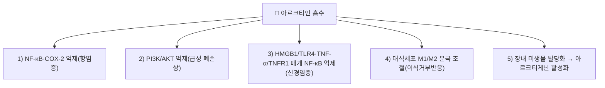

# 아르크티인 (Arctiin)

> **핵심 3줄 요약 (Key Summary)**:
> - 🌿 기원 본초 & 화학 계열: 국화과(Asteraceae) [[우방자]](우엉 씨앗, *Arctium lappa*)에 풍부하게 함유된 다이벤질부티로락톤형 리그난(Lignan) 배당체. 장내 미생물에 의해 탈당화되어 아글리콘인 아르크티게닌(Arctigenin)으로 활성화된다.
> - 🎯 핵심 분자 표적 & 조절 경로: NF-κB·COX-2 억제(항염증), PI3K/AKT 경로 억제(급성 폐손상), HMGB1/TLR4·TNF-α/TNFR1 매개 NF-κB 활성화 억제(신경염증), 대식세포 분극 조절(이식거부반응)이 아르크티인 자체로 확인된다.
> - 🩺 주요 약리 활성 & 질환 치료 기전: 인플루엔자 A 바이러스 감염 완화, LPS 유도 급성 폐손상 억제, 항우울·신경염증 완화, 간이식 급성거부반응 완화가 아르크티인 단독으로 보고됐다. ⚠️ 대장염 모델에서는 "아르크티게닌만이 유효 성분이고 아르크티인 자체는 아니다"라는 연구가 있어, 모든 효능을 아르크티인=아르크티게닌으로 환원하지 않는다(참고문헌 5 참조, 본문 §3에 반영).
> - ⚠️ 독성·생체이용률 한계 & 상호작용: 아르크티인 단독의 인체 약동학·양약 상호작용 데이터는 확인하지 못했다. 장내 미생물 탈당화 의존도가 높아 개체 간 활성 대사체(아르크티게닌) 노출 차이가 클 수 있다.

---

## 📌 목차
1. [기본 화학 정보 & 분자 구조식 (Chemical Identity)](#1-기본-화학-정보--분자-구조식-chemical-identity)
2. [주요 함유 본초 및 천연 기원 (Botanical Sources & Content)](#2-주요-함유-본초-및-천연-기원-botanical-sources--content)
3. [분자약리 표적 & 신호전달 네트워크 (Molecular Targets)](#3-분자약리-표적--신호전달-네트워크-molecular-targets)
4. [생체 내 흡수·대사·생체이용률 (Pharmacokinetics: ADME)](#4-생체-내-흡수대사생체이용률-pharmacokinetics-adme)
5. [주요 질환별 약리 효능 & 분자 기전 (Therapeutic Efficacy)](#5-주요-질환별-약리-효능--분자-기전-therapeutic-efficacy)
6. [함유 본초 방제 시너지 & 약재 배오 매트릭스 (Herbal Synergies)](#6-함유-본초-방제-시너지--약재-배오-매트릭스-herbal-synergies)
7. [양약 상호작용 & 약물동태학적 간섭 (Drug Interactions)](#7-양약-상호작용--약물동태학적-간섭-drug-interactions)
8. [💡 사용자 진료실 핵심 필기 & 임상 응용 팁 (Melt-In & High-Yield)](#8--사용자-진료실-핵심-필기--임상-응용-팁-melt-in--high-yield)
9. [출처 및 학술 참고 문헌 (References)](#9-출처-및-학술-참고-문헌-references)

---

## 1. 기본 화학 정보 & 분자 구조식 (Chemical Identity)

> [!abstract]+ 🧪 3D 약리 분자 구조 (Interactive 3D Viewer)
> <iframe src="https://molecule-viewer-rho.vercel.app/?cid=100528" style="width: 100%; height: 600px; border: none; border-radius: 12px; box-shadow: 0 4px 20px rgba(0,0,0,0.15);" allowfullscreen></iframe>

| 항목 | 내용 |
| :--- | :--- |
| 성분명 | 아르크티인 (Arctiin) |
| 화학명 (IUPAC) | (3R,4R)-4-[(3,4-dimethoxyphenyl)methyl]-3-[(4-hydroxy-3-methoxyphenyl)methyl]oxolan-2-one 4-O-β-D-glucopyranoside |
| 분자식 / 분자량 | C27H34O11 / 534.55 g/mol |
| CAS 번호 | 20362-31-6 |
| 천연 기원 식물 | [[우방자]](牛蒡子), 개나리 열매([[연교]]) |
| 대사 활성체 | 장내 미생물에 의해 포도당이 탈락되어 **아르크티게닌(Arctigenin)**으로 활성화 |

![[아르크티인_1_구조식.png|450]]
> [그림 1: 아르크티인(arctiin)의 2D 구조식 — 분자식 C27H34O11, 분자량 534.6. 페놀성 수산기와 공액 이중결합이 항산화·항염 활성의 구조적 근거가 된다 — 출처: PubChem — CID 100528 (Compound Summary, 2D Structure)]

---

## 2. 주요 함유 본초 및 천연 기원 (Botanical Sources & Content)

| 함유 본초 (한글/한자) | 기원 식물학적 명칭 (과명 / 학명) | 주요 함유 약용 부위 | 한의학적 귀경 및 약효 특성 |
| :--- | :--- | :--- | :--- |
| [[우방자]] (牛蒡子) | 국화과(Asteraceae) / *Arctium lappa* L. | 씨앗(과실) | 肺·胃經 / 소산풍열(疏散風熱)·선폐투진(宣肺透疹)·해독소종(解毒消腫) |
| [[연교]] (連翹) | 물푸레나무과(Oleaceae) / *Forsythia suspensa* | 열매 | 심·담·소장경 / 청열해독(淸熱解毒)·소종산결(消腫散結) |

---

## 3. 분자약리 표적 & 신호전달 네트워크 (Molecular Targets)

### 1) 항염증 (NF-κB/COX-2 경로)
* LPS 자극 모델에서 아르크티인이 NF-κB 경로를 통한 COX-2 발현을 억제함이 보고되었다(참고문헌 2).

### 2) 급성 폐손상 보호 (PI3K/AKT 경로)
* LPS 유도 급성 폐손상 마우스 모델에서 아르크티인이 PI3K/AKT 신호를 억제해 폐 손상을 완화함이 보고되었다(참고문헌 3).

### 3) 항우울·신경염증 완화
* HMGB1/TLR4 및 TNF-α/TNFR1 매개 NF-κB 활성화를 억제해 신경염증을 완화하고 항우울 효과를 나타낸다는 보고가 있다(참고문헌 4).

### 4) 간이식 급성거부반응 완화
* 랫드 간이식 모델에서 아르크티인이 NF-κB 신호를 매개로 대식세포 분극을 조절해 급성거부반응을 완화함이 보고되었다(참고문헌 5).

### 5) 항바이러스 활성 (인플루엔자)
* 면역정상·면역저하 마우스의 인플루엔자 A 바이러스 감염 모델에서 아르크티인과 대사체 아르크티게닌의 치료 효과가 확인되었다(참고문헌 1).

⚠️ **아르크티인 ≠ 아르크티게닌 주의**: 덱스트란황산나트륨(DSS) 유도 대장염 모델에서는 "아르크티게닌만이 유효 성분이고 아르크티인 자체는 아니다"라는 연구가 있다(Jeong 등, PMID 25284342 — 제목 기준 확인). 따라서 아르크티게닌 연구 결과를 아르크티인의 효능으로 일괄 치환하지 않는다. 세포 증식 억제·cyclin D1 하향·항종양 활성은 아르크티인 자체를 대상으로 한 논문을 이번 재검증에서 확인하지 못해 ⚠️ 근거 미확인으로 제외했다.

---

## 4. 생체 내 흡수·대사·생체이용률 (Pharmacokinetics: ADME)

* 아르크티인은 배당체 형태로 장관 상부에서 흡수가 제한적이며, 대장 내 미생물 β-글루코시다제에 의해 탈당화되어 아글리콘 아르크티게닌으로 전환된 뒤 흡수되는 것이 일반적 기전으로 알려져 있으나, 아르크티인 단독의 정량 약동학 수치(Cmax, Tmax, 생체이용률 %, 반감기)는 이번 검색 범위에서 확인하지 못했다 ⚠️.

---

## 5. 주요 질환별 약리 효능 & 분자 기전 (Therapeutic Efficacy)

### 1) 인플루엔자 바이러스 감염
* 면역정상·면역저하 마우스 모델에서 아르크티인·아르크티게닌 투여가 치료 효과를 보임(참고문헌 1).

### 2) 급성 폐손상·급성 염증
* LPS 유도 급성 폐손상 마우스에서 PI3K/AKT 억제를 통한 보호 효과(참고문헌 3), LPS 자극 모델에서 NF-κB/COX-2 억제를 통한 항염증 효과(참고문헌 2).

### 3) 신경염증·우울
* HMGB1/TLR4·TNF-α/TNFR1 매개 신경염증 완화를 통한 항우울 효과(참고문헌 4).

### 4) 간이식 거부반응
* 랫드 간이식 모델에서 대식세포 분극 조절을 통한 급성거부반응 완화(참고문헌 5).

⚠️ 풍열(風熱) 감모·인후종통·유행성 이하선염·마진 초기 발진 등 한의학적 적응증은 우방자 전체의 전통 효능이며, 아르크티인 단독의 직접 임상 근거는 이번 검색에서 확인하지 못했다.

---

## 6. 함유 본초 방제 시너지 & 약재 배오 매트릭스 (Herbal Synergies)

| 처방 | 공존 본초 | 전통 한의학적 효능 연계 |
| :--- | :--- | :--- |
| [[은교산]] (銀翹散) | [[금은화]], [[연교]], [[우방자]] | 풍열 감기 및 급성 인두염 치료 (원문 서술) |

* 아르크티인은 "열을 내리고 목구멍을 이롭게 하며(청열리인 淸熱利咽), 뭉친 열독을 풀어 피부 발진을 밖으로 뿜어내는" 우방자의 핵심 분자 실체로 제시되나, 처방 수준의 정량적 시너지 데이터는 확인하지 못했다 ⚠️.

---

## 7. 양약 상호작용 & 약물동태학적 간섭 (Drug Interactions)

* 아르크티인 단독의 양약 병용 상호작용 연구는 이번 검색에서 확인하지 못했다 ⚠️.

---

## 8. 💡 사용자 진료실 핵심 필기 & 임상 응용 팁 (Melt-In & High-Yield)

* 현재 별도로 기록된 원장님 임상 필기가 없습니다.

---

## 9. 출처 및 학술 참고 문헌 (References)

1. **Hayashi K, Narutaki K, Nagaoka Y, Hayashi T, Uesato S (2010)**. *Therapeutic effect of arctiin and arctigenin in immunocompetent and immunocompromised mice infected with influenza A virus*. **Biological and Pharmaceutical Bulletin**, 33(7), 1199-1205. PMID: [20606313](https://pubmed.ncbi.nlm.nih.gov/20606313/)
   - **[연구 요약]**: 아르크티인 및 대사체 아르크티게닌의 인플루엔자 바이러스 증식 억제 및 면역 조절 효능을 규명.
2. **Lee S, Shin S, Kim H, et al. (2011)**. *Anti-inflammatory function of arctiin by inhibiting COX-2 expression via NF-κB pathways*. **Journal of Inflammation**, 8, 16. PMID: [21733191](https://pubmed.ncbi.nlm.nih.gov/21733191/)
   - **[연구 요약]**: 아르크티인이 NF-κB 경로를 통해 COX-2 발현을 억제함을 규명.
3. **Zhou B, Weng G, Huang Z, Liu T, Dai F (2018)**. *Arctiin Prevents LPS-Induced Acute Lung Injury via Inhibition of PI3K/AKT Signaling Pathway in Mice*. **Inflammation**, 41(6), 2129-2135. PMID: [30116933](https://pubmed.ncbi.nlm.nih.gov/30116933/)
   - **[연구 요약]**: LPS 유도 급성 폐손상 마우스에서 PI3K/AKT 경로 억제를 통한 보호 효과를 규명.
4. **Xu X, Zeng XY, Cui YX, et al. (2020)**. *Antidepressive Effect of Arctiin by Attenuating Neuroinflammation via HMGB1/TLR4- and TNF-α/TNFR1-Mediated NF-κB Activation*. **ACS Chemical Neuroscience**. PMID: [32609480](https://pubmed.ncbi.nlm.nih.gov/32609480/)
   - **[연구 요약]**: HMGB1/TLR4·TNF-α/TNFR1 매개 NF-κB 활성화를 억제해 신경염증과 우울 행동을 완화함을 보고.
5. **Wei D, Xia X, Jin Z, et al. (2026)**. *Arctiin attenuates acute rejection after rat liver transplantation by modulating macrophage polarization via the NF-κB signaling pathway*. **International Immunopharmacology**. PMID: [42641191](https://pubmed.ncbi.nlm.nih.gov/42641191/)
   - **[연구 요약]**: 랫드 간이식 급성거부반응 모델에서 NF-κB 매개 대식세포 분극 조절을 통한 보호 효과를 보고.

> 참고: DSS 유도 대장염 모델에서 "아르크티게닌만이 유효 성분이고 아르크티인 자체는 아니다"라는 연구(PMID 25284342, 제목 기준 확인)가 있어, §3·§5에서 아르크티인=아르크티게닌 치환을 경계하는 근거로 인용했다.

<!-- 보관 태그(1회용·링크오류, 필요시 복원): 리그난배당체, 우엉, 우방자 -->
