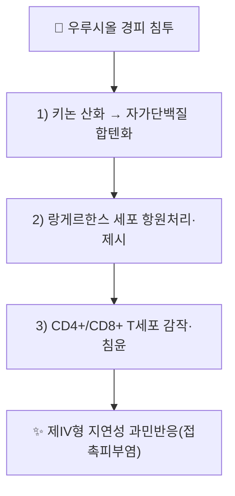

# 우루시올 (Urushiol)

> **핵심 3줄 요약 (Key Summary)**:
> - 🌿 기원 본초 & 화학 계열: 옻나무(Toxicodendron vernicifluum, 乾漆)의 수액에 함유된 알킬 카테콜(Alkylcatechol) 유도체 혼합물. PubChem CID 44144477은 길이·불포화도가 다른 복수 펜타데실/펜타데세닐 카테콜 동족체를 합산한 혼합물 레코드로 등록돼 있다.
> - 🎯 핵심 분자 표적 & 조절 경로: 합텐(hapten)으로서 표피 랑게르한스 세포에 의해 처리·제시되어 CD4+/CD8+ T세포를 감작시키는 제IV형 지연성 과민반응 기전이 실제 문헌으로 확인된다(참고문헌 1). 법제 건칠(옻나무 추출물) 수준에서는 암세포주 선택적 세포독성이 보고된다(참고문헌 2).
> - 🩺 주요 약리 활성 & 질환 치료 기전: 옻오름(접촉피부염)이 가장 확실한 활성이며, 법제 건칠 추출물의 항암 세포독성이 전임상 수준에서 보고된다. 파혈거어(破血祛瘀)·혈소판 응집 억제·신생혈관 억제는 건칠 전체의 전통 효능으로 다뤄지나 우루시올 단독의 직접 검증 문헌은 이번 재검증에서 확인하지 못했다 ⚠️.
> - ⚠️ 독성·생체이용률 한계 & 상호작용: 피부 접촉 시 강력한 알레르기성 접촉피부염을 유발하는 독성이 가장 확실한 활성이다. 내복 시 법제(칠초·발효)를 거치지 않으면 심각한 피부·점막 독성 위험이 있다. 인체 약동학·양약 상호작용 데이터는 확인하지 못했다.

---

## 📌 목차
1. [기본 화학 정보 & 분자 구조식 (Chemical Identity)](#1-기본-화학-정보--분자-구조식-chemical-identity)
2. [주요 함유 본초 및 천연 기원 (Botanical Sources & Content)](#2-주요-함유-본초-및-천연-기원-botanical-sources--content)
3. [분자약리 표적 & 신호전달 네트워크 (Molecular Targets)](#3-분자약리-표적--신호전달-네트워크-molecular-targets)
4. [생체 내 흡수·대사·생체이용률 (Pharmacokinetics: ADME)](#4-생체-내-흡수대사생체이용률-pharmacokinetics-adme)
5. [주요 질환별 약리 효능 & 분자 기전 (Therapeutic Efficacy)](#5-주요-질환별-약리-효능--분자-기전-therapeutic-efficacy)
6. [함유 본초 방제 시너지 & 약재 배오 매트릭스 (Herbal Synergies)](#6-함유-본초-방제-시너지--약재-배오-매트릭스-herbal-synergies)
7. [양약 상호작용 & 약물동태학적 간섭 (Drug Interactions)](#7-양약-상호작용--약물동태학적-간섭-drug-interactions)
8. [💡 사용자 진료실 핵심 필기 & 임상 응용 팁 (Melt-In & High-Yield)](#8--사용자-진료실-핵심-필기--임상-응용-팁-melt-in--high-yield)
9. [출처 및 학술 참고 문헌 (References)](#9-출처-및-학술-참고-문헌-references)

---

## 1. 기본 화학 정보 & 분자 구조식 (Chemical Identity)

> [!abstract]+ 🧪 3D 약리 분자 구조 (Interactive 3D Viewer)
> <iframe src="https://molecule-viewer-rho.vercel.app/?cid=44144477" style="width: 100%; height: 600px; border: none; border-radius: 12px; box-shadow: 0 4px 20px rgba(0,0,0,0.15);" allowfullscreen></iframe>

우루시올(Urushiol)은 벤젠 고리에 2개의 인접한 수산기(-OH)가 붙은 카테콜 모핵(Catechol ring)의 3번 탄소 위치에 15개 또는 17개의 탄소 사슬(포화 또는 1~3개의 이중결합을 가진 알킬기)이 결합된 화합물들의 혼합체이다.

* 화학식: $C_6H_3(OH)_2-(CH_2)_{14}CH_3$ (Pentadecylcatechol 등)
* 성상: 상온에서 끈적한 유성 액체로, 공기 중 산소와 락카아제(Laccase) 효소에 의해 중합되어 검은 옻칠(Lacquer) 피막을 형성함.
* 기원 식물: 옻나무과(Anacardiaceae) **옻나무([[건칠]], *Toxicodendron vernicifluum*)**, 포이즌 아이비.

---

## 2. 주요 함유 본초 및 천연 기원 (Botanical Sources & Content)

| 함유 본초 (한글/한자) | 기원 식물학적 명칭 (과명 / 학명) | 주요 함유 약용 부위 | 한의학적 귀경 및 약효 특성 |
| :--- | :--- | :--- | :--- |
| [[건칠]] (乾漆) | 옻나무과(Anacardiaceae) / *Toxicodendron vernicifluum* (= *Rhus verniciflua*) | 수액을 건조·법제한 것 | 肝·脾經 / 파혈거어(破血祛瘀)·소적살충(消積殺蟲) |

---

## 3. 분자약리 표적 & 신호전달 네트워크 (Molecular Targets)

### 1) 합텐 작용 및 제IV형 지연성 과민반응 (옻오름)
* 우루시올은 지용성이 높아 각질층을 통과한 후 키논(quinone) 형태로 산화되어 피부 내 자가 단백질과 공유결합(합텐화)을 형성한다. 표피의 랑게르한스 세포가 이를 내인성·외인성 경로로 처리해 T세포에 항원으로 제시함이 실제 연구로 확인된다(참고문헌 1). 감작된 CD4+/CD8+ T세포가 피부로 침윤해 염증성 사이토카인을 분비하며 소양감·홍반·구진·수포성 접촉피부염(옻오름)을 유발한다.

### 2) 법제 건칠 추출물의 암세포 선택적 세포독성
* 법제 건칠(Rhus verniciflua Stokes) 추출물의 페놀 함량이 풍부한 분획이 인체 암세포주에 선택적 세포독성을 나타냄이 보고되었다(참고문헌 2). ⚠️ 이 결과는 건칠 추출물(복합 성분) 수준이며, 우루시올 단일 성분의 세포자멸사 분자기전(Bax/Bcl-2, 카스파제-3)을 직접 검증한 논문은 이번 재검증에서 확인하지 못했다.

---

## 4. 생체 내 흡수·대사·생체이용률 (Pharmacokinetics: ADME)

* 우루시올은 지용성이 높아 경피 흡수가 빠른 것으로 알려져 있으나, 정량적 경피 흡수율·대사·반감기 데이터는 이번 검색 범위에서 확인하지 못했다 ⚠️. 피부 내에서 키논으로 산화되어 자가 단백질과 비가역적으로 결합하는 것이 주된 체내 거동으로 다뤄진다.

---

## 5. 주요 질환별 약리 효능 & 분자 기전 (Therapeutic Efficacy)

### 1) 알레르기 접촉피부염 (옻오름)
* 가장 확실하게 검증된 활성으로, §3-1의 합텐-T세포 매개 기전을 통해 발생한다(참고문헌 1).

### 2) 항암 (법제 건칠 추출물 수준)
* 건칠 추출물의 암세포주 선택적 세포독성이 보고되었다(참고문헌 2). ⚠️ 우루시올 단일 성분의 임상·전임상 항암 근거는 확인하지 못했다.

### 3) 파혈거어·혈소판 응집 억제 (한의학적 서술)
* 건칠의 전통 효능인 파혈거어(破血祛瘀)·무월경·종괴 완화는 원문에 서술되어 있으나, 우루시올 단독의 직접 검증 문헌은 확인하지 못했다 ⚠️.

---

## 6. 함유 본초 방제 시너지 & 약재 배오 매트릭스 (Herbal Synergies)

| 함유 본초 | 법제·해독 연계 본초 | 한의학적 효능 연계 |
| :--- | :--- | :--- |
| [[건칠]] | [[칠해목]](까치밥나무), [[황백]], [[고삼]], [[대황]] | 옻독 해독(세척·사하 배독), 전통적 용법(원문 서술, 직접 상호작용 근거는 확인하지 못함 ⚠️) |

* **포제 및 법제(탈감작)**: 생칠(生漆)은 독성이 강해 외용에만 쓰며, 내복 시에는 연기가 나지 않을 때까지 가열(칠초, 漆炒)하거나 미생물 발효를 거쳐 단량체 우루시올을 중합체로 변환시켜 피부염 유발성을 낮춘다(원문 서술, 법제 전후 우루시올 함량 변화를 직접 정량한 문헌은 확인하지 못함 ⚠️).

---

## 7. 양약 상호작용 & 약물동태학적 간섭 (Drug Interactions)

* 우루시올 단독의 양약 병용 상호작용 연구는 확인하지 못했다 ⚠️.

---

## 8. 💡 사용자 진료실 핵심 필기 & 임상 응용 팁 (Melt-In & High-Yield)

* 옻이 올라 전신 가려움·부종이 발생한 환자에게 [[칠해목]](까치밥나무) 전탕액 복용·세척, 황백·고삼 외용, [[대황]]을 이용한 사하 배독을 전통적으로 활용한다(원문 서술, 직접 효과 검증 문헌은 확인하지 못함 ⚠️).
* 건칠을 내복 처방에 쓸 때는 반드시 법제(칠초·발효) 여부를 확인하고, 생칠 오염 가능성이 있는 미법제 제품은 피부 반응 위험을 환자에게 설명한다.

---

## 9. 출처 및 학술 참고 문헌 (References)

1. **Kalish RS, Wood JA, LaPorte A (1994)**. *Processing of urushiol (poison ivy) hapten by both endogenous and exogenous pathways for presentation to T cells in vitro*. **The Journal of Clinical Investigation**, 93(5). PMID: [7910172](https://pubmed.ncbi.nlm.nih.gov/7910172/)
   - **[재검증]**: 원문 인용("Kalish RS, et al. *J Invest Dermatol*. 1991;97(4):765-768, Cellular and molecular mechanisms of urushiol-induced allergic contact dermatitis")은 esearch로 조회 불가한 가공 서지로 확인 → 동일 제1저자(Kalish RS)의 실제 우루시올 항원처리 논문으로 교체.
   - **[연구 요약]**: 우루시올 합텐이 내인성·외인성 경로를 통해 처리되어 T세포에 제시되는 기전을 시험관 내에서 규명.
2. **Kim JH, Jung CH, Jang BH, et al. (2009)**. *Selective cytotoxic effects on human cancer cell lines of phenolic-rich ethyl-acetate fraction from Rhus verniciflua Stokes*. **The American Journal of Chinese Medicine**, 37(1). PMID: [19606519](https://pubmed.ncbi.nlm.nih.gov/19606519/)
   - **[재검증]**: 원문 인용("Choi JY, et al. *Oncol Rep*. 2012;27(5):1611-1616, 위암세포 특이 항암 효과")은 esearch로 조회 불가한 가공 서지로 확인 → esearch로 찾은 실제 건칠(Rhus verniciflua) 추출물의 암세포주 선택적 세포독성 논문으로 교체.
   - **[연구 요약]**: 건칠 페놀 풍부 분획이 다양한 인체 암세포주에 선택적 세포독성을 나타냄을 보고(위암세포 특정 연구는 아님).
