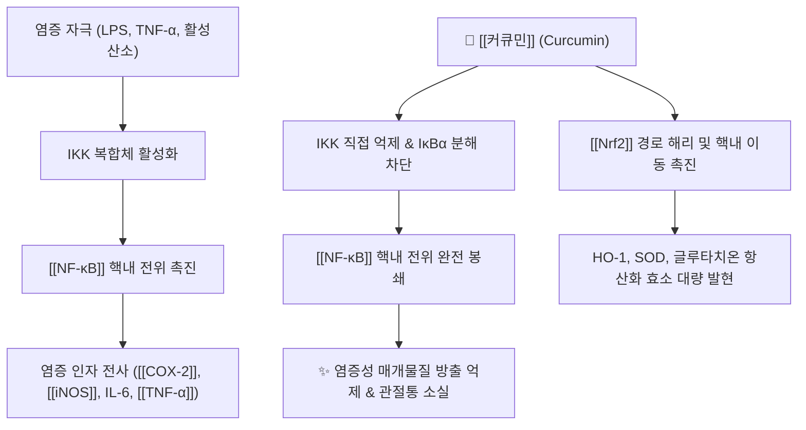

# 💊 [[커큐민]] (Curcumin, Diferuloylmethane)

> **핵심 요약 (Key Summary)**:
> 생강과(Zingiberaceae) [[강황]] 및 울금의 근경에서 추출되는 대표적인 천연 친유성 폴리페놀(Polyphenol) 성분
> IKK 활성화를 차단하여 [[NF-κB]] 신호 전달을 억제하고 [[COX-2]] 및 [[iNOS]] 발현을 차단하며 [[Nrf2]] 경로를 통한 강력한 항산화 효소 유도
> 골관절염 통증 완화·염증성 장질환·비알코올성 지방간·대사증후군 개선 및 운동 유발성 지연성 근육통(DOMS) 회복에 탁월한 효능 입증

---

## 📌 목차
1. [기본 화학 정보 & 분자 구조식 (Chemical Identity)](#1-기본-화학-정보--분자-구조식-chemical-identity)
2. [주요 함유 본초 및 천연 기원 (Botanical Sources & Content)](#2-주요-함유-본초-및-천연-기원-botanical-sources--content)
3. [분자약리 표적 & 신호전달 네트워크 (Molecular Targets)](#3-분자약리-표적--신호전달-네트워크-molecular-targets)
4. [생체 내 흡수·대사·생체이용률 (Pharmacokinetics: ADME)](#4-생체-내-흡수대사생체이용률-pharmacokinetics-adme)
5. [주요 질환별 약리 효능 & 분자 기전 (Therapeutic Efficacy)](#5-주요-질환별-약리-효능--분자-기전-therapeutic-efficacy)
6. [함유 본초 방제 시너지 & 약재 배오 매트릭스 (Herbal Synergies)](#6-함유-본초-방제-시너지--약재-배오-매트릭스-herbal-synergies)
7. [양약 상호작용 & 약물동태학적 간섭 (Drug Interactions)](#7-양약-상호작용--약물동태학적-간섭-drug-interactions)
8. [💡 사용자 진료실 핵심 필기 & 임상 응용 팁 (Melt-In & High-Yield)](#8--사용자-진료실-핵심-필기--임상-응용-팁-melt-in--high-yield)
9. [출처 및 학술 참고 문헌 (References)](#9-출처-및-학술-참고-문헌-references)

---

## 1. 기본 화학 정보 & 분자 구조식 (Chemical Identity)

> [!abstract]+ 🧪 3D 약리 분자 구조 (Interactive 3D Viewer)
> <iframe src="https://molecule-viewer-rho.vercel.app/?cid=5281767" style="width: 100%; height: 600px; border: none; border-radius: 12px; box-shadow: 0 4px 20px rgba(0,0,0,0.15);" allowfullscreen></iframe>

| 항목 | 상세 내용 |
| :--- | :--- |
| **일반명 (Generic)** | [[커큐민]] (Curcumin, Diferuloylmethane) |
| **기원 생약** | 생강과 [[강황]](*Curcuma longa* L.), 울금(*C. aromatica* Salisb.)의 지하 근경 |
| **화학식 / 분자량** | $\text{C}_{21}\text{H}_{20}\text{O}_6$ / 368.38 g/mol |
| **약효 분류** | 천연 항염증제, 항산화제, Nrf2 활성제, AMPK 조절제 |
| **생체이용률 (Bioavailability)** | 경구 섭취 시 극히 낮음 (<1%, 불용성 및 광범위한 장관/간 1차 대사) |
| **혈중 반감기 ($t_{1/2}$)** | 약 1.5 ~ 2시간 (경구 복용 시 전신 순환계 도달 한계) |
| **대사 경로 (Metabolism)** | 장관 및 간의 환원 반응(테트라하이드로커큐민 등) 및 글루쿠론산/황산 포합(UGT, SULT) |
| **배설 경로 (Excretion)** | 대부분 분변 배설 (>90%), 신장 배설 극소량 |

### 🔬 화학 구조식 (Chemical Structure)
> **[구조적 특징 및 활성]**: 두 개의 페룰산(Ferulic acid) 분자가 메틸렌 브릿지로 연결된 대칭적 디페룰로일메탄(Diferuloylmethane) 구조. 두 페놀성 고리와 중앙의 β-디케톤(diketone) 호변이성질체(Keto-enol tautomerism) 구조가 활성산소종(ROS)을 직접 소거하는 강력한 전자 공여체로 작용.

---

## 2. 주요 함유 본초 및 천연 기원 (Botanical Sources & Content)

| 함유 본초 (한글/한자) | 기원 식물학적 명칭 (과명 / 학명) | 주요 함유 약용 부위 | 한의학적 귀경 및 약효 특성 |
| :--- | :--- | :--- | :--- |
| [[강황]] (薰黃) | 생강과(Zingiberaceae) / *Curcuma longa* L. | 지하 근경 | 肝·脾經 / 破血行氣·通經止痛 |
| 울금 (鬱金) | 생강과(Zingiberaceae) / *Curcuma aromatica* Salisb. | 지하 근경 | 肝·心·膽經 / 行氣解鬱·涼血破瘀 |

---

## 3. 분자약리 표적 & 신호전달 네트워크 (Molecular Targets)

### (1) 분자 수준 작용 메커니즘
* [[NF-κB]] 신호 전달 억제:
  * IκB 키나아제(IKK)의 활성화를 직접 차단하여 세포질 내 IκBα의 인산화 및 분해를 방지.
  * 결과적으로 [[NF-κB]](p65/p50)가 핵으로 이동하는 것을 차단하여 [[COX-2]], [[iNOS]], [[TNF-α]], IL-1β, IL-6 등의 전염증성 매개물질 유전자 전사를 근원적으로 억제.
* [[Nrf2]]-ARE 항산화 방어계 활성화:
  * Keap1 단백질의 반응성 시스테인 잔기와 상호작용하여 [[Nrf2]]를 방출, 핵 내 ARE(Antioxidant Response Element)에 결합시켜 헴옥시게나아제-1(HO-1), 슈퍼옥사이드 디스뮤타아제(SOD), 카탈라아제 등의 항산화 효소를 유도.
* **MAPK 및 STAT3 신호 억제**:
  * p38 MAPK 및 JNK 인산화를 억제하여 세포사멸 스트레스를 줄이고 관절 연골세포(Chondrocytes) 파괴 효소(MMP-1, MMP-13) 분비를 차단.

---

## 4. 생체 내 흡수·대사·생체이용률 (Pharmacokinetics: ADME)

* 경구 섭취 시 생체이용률이 극히 낮다(<1%, 불용성 및 광범위한 장관/간 1차 대사). 혈중 반감기는 약 1.5~2시간. 대사는 장관·간의 환원 반응(테트라하이드로커큐민 등) 및 글루쿠론산/황산 포합(UGT, SULT)을 거치며, 배설은 대부분 분변(>90%)으로 이루어진다(참고문헌 3).

### 제형 기술 및 생체이용률 개선 비교

| 제형 기술 | 상품/형태 예시 | 체내 흡수율 개선도 |
| :--- | :--- | :--- |
| **단독 결정형 추출물** | 표준 Curcumin 95% | 기준 (1배, 흡수 극히 불량) |
| **피페린 복합 제형** | Curcumin + Piperine (Bioperine) | 약 20배 (2,000% 증대) |
| **인지질 복합체 (Phytosome)** | Curcumin-Phosphatidylcholine (Meriva) | 약 29배 생체이용률 향상 |
| **수용성 나노 미셀 (Micellar)** | Polysorbate 나노 유화형 | 약 185배 혈중 최고농도 도달 |

⚠️ 제형별 배수 수치는 원문 서술이며, 이번 재검증에서 개별 임상 비교 논문으로 직접 확인하지 못했다.

---

## 5. 주요 질환별 약리 효능 & 분자 기전 (Therapeutic Efficacy)

### 1) 골관절염 및 관절염 통증
* 슬관절 골관절염 환자에서 NSAIDs(이부프로펜, 세레콕시브)에 필적하는 관절통(VAS 점수) 경감 및 관절 기능 회복이 메타분석으로 보고됨(참고문헌 2).
* ⚠️ **복합제 수준의 반증 사례**: 커큐민 500 mg/일을 포함한 경구 복합제(보스웰리아·소나무껍질·MSM·피페린 병용)가 무릎 OA 12주 시험에서 **위약 대비 차이 없음**(군간차 0.16 mm, 95% CI −6.81~7.12, 임상적 유의 기준 18 mm 배제)을 보였다(참고문헌 4). 커큐민 단독 메타분석과 복합제 시험 결과는 서로 다른 정보이며, 제형·단독/복합·대상 관절·표현형을 구분해 설명해야 한다.

### 2) 지연성 근육통(DOMS) 및 운동 피로
* 강도 높은 운동 후 발생하는 골격근 미세 손상·크레아틴 키나아제(CK) 상승 억제가 원문에 서술되어 있으나, 이번 재검증에서 직접 검증 논문은 확인하지 못했다 ⚠️.

### 3) 만성 염증성 질환
* 궤양성 대장염 관해 유지, 비알코올성 지방간(NAFLD) 간효소·간지질 개선이 종설에서 광범위한 만성 염증 질환 적응증의 일부로 다뤄진다(참고문헌 1).

### 표준 용법 및 용량 (원문 서술, 제품별 허가사항 확인 필요)
* 일반 표준 추출물: 1일 1,000~2,000 mg(식후 분복). 고흡수성 제형(파이토솜/나노제형): 1일 250~500 mg.

---

## 6. 함유 본초 방제 시너지 & 약재 배오 매트릭스 (Herbal Synergies)

* [[피페린]](Piperine, 흑후추 성분)과 병용 시 간 및 장관의 글루쿠론산 포합을 억제해 커큐민의 생체이용률을 최대 2,000%(20배)까지 상승시킨다는 서술이 §4 제형 비교표에 반영되어 있다(참고문헌 3).

---

## 7. 양약 상호작용 & 약물동태학적 간섭 (Drug Interactions)

* **항응고제/항혈소판제 병용 주의**: [[와파린]], [[아스피린]], 클로피도그렐 등과 병용 시 혈소판 응집 억제 시너지로 출혈 위험 증가 모니터링이 필요하다.
* **부작용·금기**: 고용량 복용 시 오심·속쓰림·설사(식후 복용 권장), 담석·완전 담도 폐쇄증 환자는 담낭 수축 자극에 따른 산통 유발 위험으로 투여 주의, 임산부는 자궁 수축 자극 가능성으로 고농도 보충제 복용 제한.

---

## 8. 💡 사용자 진료실 핵심 필기 & 임상 응용 팁 (Melt-In & High-Yield)

* **기전-임상 괴리 주의**: 항염 기전(NF-κB·COX-2·5-LOX 억제)이 존재해도 임상 결과가 항상 따라오지는 않는다 — 복합제 시험(참고문헌 4)이 대표 사례.
* **진료실 설명 문장**: "커큐민은 항염 기전 연구가 많은 성분이지만, 여러 성분을 섞은 제품에서는 위약과 차이가 없었던 시험도 있습니다. 제형·복용법에 따라 흡수가 크게 달라지므로 제품 근거를 따로 확인해야 합니다."
* 관련: [[퇴행성 슬관절염]] · [[메틸설포닐메탄]] · [[OARSI 2019 가이드라인]] · [[피페린]] · [[보스웰리아]]

---

## 9. 출처 및 학술 참고 문헌 (References)

1. **Aggarwal BB, Harikumar KB (2009)**. *Potential therapeutic effects of curcumin, the anti-inflammatory agent, against neurodegenerative, cardiovascular, pulmonary, metabolic, autoimmune and neoplastic diseases*. **International Journal of Biochemistry & Cell Biology**, 41(1), 40-59. PMID: [18662800](https://pubmed.ncbi.nlm.nih.gov/18662800/)
   - **[연구 요약]**: 커큐민의 분자 표적(NF-κB, COX-2, 5-LOX, STAT3) 및 광범위한 만성 염증 억제 기전 총설.
2. **Daily JW, et al. (2016)**. *Efficacy of Turmeric Extracts and Curcumin for Alleviating the Symptoms of Joint Arthritis: A Systematic Review and Meta-Analysis of Randomized Clinical Trials*. **Journal of Medicinal Food**, 19(8), 717-729. PMID: [27533649](https://pubmed.ncbi.nlm.nih.gov/27533649/)
   - **[연구 요약]**: 골관절염 환자에서 커큐민의 통증 완화 및 관절 기능 개선 효과가 진통소염제와 대등함을 입증한 메타분석.
3. **Hewlings SJ, Kalman DS (2017)**. *Curcumin: A Review of Its Effects on Human Health*. **Foods**, 6(10), 92. PMID: [29065496](https://pubmed.ncbi.nlm.nih.gov/29065496/)
   - **[연구 요약]**: 커큐민의 항산화·항염증 임상 작용과 피페린을 통한 생체이용률 개선 전략 종합 검토.
4. **(2026)**. *Effect of an oral complementary medicine combination for symptomatic knee osteoarthritis: A double-blind, randomized, placebo-controlled trial*. **Osteoarthritis and Cartilage**, 34(10), 1515-1524. PMID: [42331134](https://pubmed.ncbi.nlm.nih.gov/42331134/)
   - **[연구 요약]**: 커큐민 500 mg/일을 포함한 경구 복합제(보스웰리아·소나무껍질·MSM·피페린)가 무릎 골관절염 12주 시험에서 위약과 차이가 없었음을 보고(저자명은 검색 스니펫만으로 확인하지 못함 ⚠️).

<!-- 보관 태그(1회용·링크오류, 필요시 복원): NF-kB억제 -->
