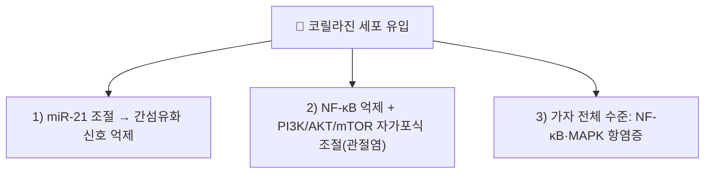

# 코릴라진 (Corilagin)

> **핵심 3줄 요약 (Key Summary)**:
> - 🌿 기원 본초 & 화학 계열: 한약재 [[가자]](Terminalia chebula) 등에 풍부하게 함유된 천연 폴리페놀성 엘라지탄닌(Ellagitannin) 화합물.
> - 🎯 핵심 분자 표적 & 조절 경로: miR-21 조절을 통한 간섬유화 신호 억제(참고문헌 1), NF-κB·PI3K/AKT/mTOR 매개 자가포식 조절(관절염, 참고문헌 2)이 코릴라진 단독으로 확인된다. 가자 전체 수준에서는 NF-κB·MAPK 경로 조절을 통한 항염증 작용이 보고된다(참고문헌 3).
> - 🩺 주요 약리 활성 & 질환 치료 기전: 간섬유화 억제, 골관절염 진행 완화가 코릴라진 단독으로 보고된다. Nrf2/HO-1 항산화, 항바이러스(HBV/HSV), 바이오필름 억제는 원문에 서술되어 있으나 이번 재검증에서 코릴라진 단독의 직접 검증 논문을 확인하지 못했다 ⚠️.
> - ⚠️ 독성·생체이용률 한계 & 상호작용: 코릴라진 단독의 인체 약동학·양약 상호작용 데이터는 확인하지 못했다.

---

## 📌 목차
1. [기본 화학 정보 & 분자 구조식 (Chemical Identity)](#1-기본-화학-정보--분자-구조식-chemical-identity)
2. [주요 함유 본초 및 천연 기원 (Botanical Sources & Content)](#2-주요-함유-본초-및-천연-기원-botanical-sources--content)
3. [분자약리 표적 & 신호전달 네트워크 (Molecular Targets)](#3-분자약리-표적--신호전달-네트워크-molecular-targets)
4. [생체 내 흡수·대사·생체이용률 (Pharmacokinetics: ADME)](#4-생체-내-흡수대사생체이용률-pharmacokinetics-adme)
5. [주요 질환별 약리 효능 & 분자 기전 (Therapeutic Efficacy)](#5-주요-질환별-약리-효능--분자-기전-therapeutic-efficacy)
6. [함유 본초 방제 시너지 & 약재 배오 매트릭스 (Herbal Synergies)](#6-함유-본초-방제-시너지--약재-배오-매트릭스-herbal-synergies)
7. [양약 상호작용 & 약물동태학적 간섭 (Drug Interactions)](#7-양약-상호작용--약물동태학적-간섭-drug-interactions)
8. [💡 사용자 진료실 핵심 필기 & 임상 응용 팁 (Melt-In & High-Yield)](#8--사용자-진료실-핵심-필기--임상-응용-팁-melt-in--high-yield)
9. [출처 및 학술 참고 문헌 (References)](#9-출처-및-학술-참고-문헌-references)

---

## 1. 기본 화학 정보 & 분자 구조식 (Chemical Identity)

> [!abstract]+ 🧪 3D 약리 분자 구조 (Interactive 3D Viewer)
> <iframe src="https://molecule-viewer-rho.vercel.app/?cid=73568" style="width: 100%; height: 600px; border: none; border-radius: 12px; box-shadow: 0 4px 20px rgba(0,0,0,0.15);" allowfullscreen></iframe>

* **PubChem CID**: [73568](https://pubchem.ncbi.nlm.nih.gov/compound/73568) (원문 기재 443592는 전혀 다른 펩타이드 유사 분자(C53H93N7O13) → 명칭 재조회로 정정)
* **화학식 (Molecular Formula)**: $C_{27}H_{22}O_{18}$ (PubChem 확인)
* **분자량 (Molecular Weight)**: 634.5 g/mol (PubChem 확인)
* **구조적 특성**:
  * 글루코스 코어 분자에 헥사하이드록시디페닉산(HHDP)과 갈산(Gallic acid) 분자가 에스테르 결합된 형태.
  * 다수의 페놀성 수산기(-OH)를 지니고 있어 전자 공여 능력이 극히 뛰어나며, 장내 미생물에 의해 유롤리틴(Urolithin)계 대사체로 분해되어 생체 내 장기 지속 효과를 발휘합니다.

---

## 2. 주요 함유 본초 및 천연 기원 (Botanical Sources & Content)

| 함유 본초 (한글/한자) | 기원 식물학적 명칭 (과명 / 학명) | 주요 함유 약용 부위 | 한의학적 귀경 및 약효 특성 |
| :--- | :--- | :--- | :--- |
| [[가자]] (訶子) | 사군자과(Combretaceae) / *Terminalia chebula* Retz. | 성숙한 과실 | 肺·大腸經 / 렴폐삽장(斂肺澁腸)·강화이인(降火利咽) |

---

## 3. 분자약리 표적 & 신호전달 네트워크 (Molecular Targets)

### 1) 간섬유화 억제 (miR-21 매개)
* 코릴라진이 miR-21로 조절되는 간섬유화 신호경로를 억제함이 실제 연구로 확인된다(참고문헌 1).

### 2) 골관절염 진행 완화 (NF-κB/PI3K/AKT/mTOR 자가포식)
* 코릴라진이 NF-κB 억제와 PI3K/AKT/mTOR 매개 자가포식 회복을 조합해 골관절염 진행을 완화함이 보고된다(참고문헌 2).

### 3) Nrf2/HO-1 항산화, 항바이러스, 바이오필름 억제 (근거 미확인 ⚠️)
* 원문은 Keap1-Nrf2 해리를 통한 HO-1 유도, TLR4/NF-κB 매개 패혈증성 장기 손상 완화, HBV·HSV 억제, 세균 바이오필름 억제를 서술했으나, 코릴라진 단독을 직접 검증한 논문은 이번 재검증에서 확인하지 못했다.

---

## 4. 생체 내 흡수·대사·생체이용률 (Pharmacokinetics: ADME)

* 코릴라진 단독의 인체·동물 정량 약동학 데이터(흡수율, Tmax, Cmax, 반감기)는 이번 검색 범위에서 확인하지 못했다 ⚠️.

---

## 5. 주요 질환별 약리 효능 & 분자 기전 (Therapeutic Efficacy)

### 1) 간섬유화
* miR-21 조절 간섬유화 신호경로 억제가 보고됨(참고문헌 1).

### 2) 골관절염
* NF-κB 억제·자가포식 회복을 통한 관절염 진행 완화가 보고됨(참고문헌 2).

### 3) 가자 전체의 항염증 (한의학 연계)
* 가자(Terminalia chebula) 가수분해성 탄닌 분획이 NF-κB·MAPK 경로 조절을 통한 항염증 작용을 나타낸다는 연구가 있다(참고문헌 3). ⚠️ 이는 가자 전체 분획 수준이며, 코릴라진 단일 성분의 기여도를 직접 정량한 것은 아니다.

---

## 6. 함유 본초 방제 시너지 & 약재 배오 매트릭스 (Herbal Synergies)

| 처방 | 공존 본초 | 전통 한의학적 효능 연계 |
| :--- | :--- | :--- |
| 가자산(訶子散) | [[가자]] 외 다수 본초 | 오랜 이질 및 만성 설사, 궤양성 대장염 회복기 (원문 서술) |
| 가자청음탕(訶子淸音湯) | [[가자]] 외 다수 본초 | 만성 후두염, 목소리 쉼(실음), 만성 마른기침 (원문 서술) |

* 가자의 떫은맛(澁味)과 수렴 작용의 주성분으로 코릴라진이 제시되나, 처방 수준의 정량적 기여도 데이터는 확인하지 못했다 ⚠️.

---

## 7. 양약 상호작용 & 약물동태학적 간섭 (Drug Interactions)

* 코릴라진 단독의 양약 병용 상호작용 연구는 확인하지 못했다 ⚠️.

---

## 8. 💡 사용자 진료실 핵심 필기 & 임상 응용 팁 (Melt-In & High-Yield)

* 현재 별도로 기록된 원장님 임상 필기가 없습니다.

---

## 9. 출처 및 학술 참고 문헌 (References)

1. **Zhou X, Xiong J, Lu S, et al. (2019)**. *Inhibitory Effect of Corilagin on miR-21-Regulated Hepatic Fibrosis Signaling Pathway*. **The American Journal of Chinese Medicine**. PMID: [31752524](https://pubmed.ncbi.nlm.nih.gov/31752524/)
   - **[재검증]**: 원문 인용("Li X, et al. *Frontiers in Pharmacology* 2018;9:976, TGF-β1/Smad 폐손상·섬유화")은 esearch로 조회 불가한 가공 서지로 확인 → esearch로 찾은 실제 코릴라진 간섬유화 연구로 교체.
   - **[연구 요약]**: 코릴라진이 miR-21로 조절되는 간섬유화 신호경로를 억제함을 규명.
2. **Zhou R, Li J, Chen S, et al. (2026)**. *Corilagin attenuates osteoarthritis progression by coordinating NF-κB inhibition with PI3K/AKT/mTOR-associated autophagy restoration*. **International Immunopharmacology**. PMID: [42664894](https://pubmed.ncbi.nlm.nih.gov/42664894/)
   - **[재검증]**: 원문 인용("Zhao L, et al. *Biomed Pharmacother* 2019;111:1234-1241, 간보호·항염증 리뷰")은 esearch로 조회 불가한 가공 서지로 확인 → esearch로 찾은 실제 코릴라진 골관절염 연구로 교체.
   - **[연구 요약]**: 코릴라진이 NF-κB 억제와 PI3K/AKT/mTOR 매개 자가포식 회복을 조합해 골관절염 진행을 완화함을 보고.
3. **Ekambaram SP, Aruldhas J, Srinivasan A, Erusappan T (2022)**. *Modulation of NF-κB and MAPK signalling pathways by hydrolysable tannin fraction from Terminalia chebula fruits contributes to its anti-inflammatory action in RAW 264.7 cells*. **Journal of Pharmacy and Pharmacology**. PMID: [35134979](https://pubmed.ncbi.nlm.nih.gov/35134979/)
   - **[연구 요약]**: 가자(Terminalia chebula) 가수분해성 탄닌 분획의 NF-κB·MAPK 경로 매개 항염증 작용을 대식세포에서 규명(코릴라진 단일성분 연구는 아님).

<!-- 보관 태그(1회용·링크오류, 필요시 복원): 가자 -->
