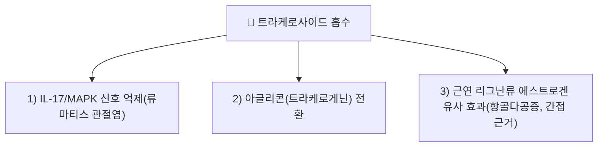

# 트라케로사이드 (Tracheloside)

> **핵심 3줄 요약 (Key Summary)**:
> - 🌿 기원 본초 & 화학 계열: 협죽도과 상록 만경목 [[낙석등]](Trachelospermi Caulis)에 함유된 디벤질부티로락톤계 리그난 배당체(Lignan glucoside).
> - 🎯 핵심 분자 표적 & 조절 경로: IL-17/MAPK 신호 억제를 통한 류마티스 관절염 완화가 트라케로사이드 단독으로 실제 확인된다(참고문헌 1). 에스트로겐 유사·항골다공증 활성은 아마씨·잇꽃씨 유래 리그난 전구체 연구에서 함께 다뤄진다(참고문헌 2).
> - 🩺 주요 약리 활성 & 질환 치료 기전: 류마티스 관절염 완화가 가장 확실한 근거이며, 항골다공증은 근연 리그난류 수준의 간접 근거다.
> - ⚠️ 독성·생체이용률 한계 & 상호작용: 트라케로사이드 단독의 인체 약동학·양약 상호작용 데이터는 확인하지 못했다.

---

## 📌 목차
1. [기본 화학 정보 & 분자 구조식 (Chemical Identity)](#1-기본-화학-정보--분자-구조식-chemical-identity)
2. [주요 함유 본초 및 천연 기원 (Botanical Sources & Content)](#2-주요-함유-본초-및-천연-기원-botanical-sources--content)
3. [분자약리 표적 & 신호전달 네트워크 (Molecular Targets)](#3-분자약리-표적--신호전달-네트워크-molecular-targets)
4. [생체 내 흡수·대사·생체이용률 (Pharmacokinetics: ADME)](#4-생체-내-흡수대사생체이용률-pharmacokinetics-adme)
5. [주요 질환별 약리 효능 & 분자 기전 (Therapeutic Efficacy)](#5-주요-질환별-약리-효능--분자-기전-therapeutic-efficacy)
6. [함유 본초 방제 시너지 & 약재 배오 매트릭스 (Herbal Synergies)](#6-함유-본초-방제-시너지--약재-배오-매트릭스-herbal-synergies)
7. [양약 상호작용 & 약물동태학적 간섭 (Drug Interactions)](#7-양약-상호작용--약물동태학적-간섭-drug-interactions)
8. [💡 사용자 진료실 핵심 필기 & 임상 응용 팁 (Melt-In & High-Yield)](#8--사용자-진료실-핵심-필기--임상-응용-팁-melt-in--high-yield)
9. [출처 및 학술 참고 문헌 (References)](#9-출처-및-학술-참고-문헌-references)

---

## 1. 기본 화학 정보 & 분자 구조식 (Chemical Identity)

> [!abstract]+ 🧪 3D 약리 분자 구조 (Interactive 3D Viewer)
> <iframe src="https://molecule-viewer-rho.vercel.app/?cid=169511" style="width: 100%; height: 600px; border: none; border-radius: 12px; box-shadow: 0 4px 20px rgba(0,0,0,0.15);" allowfullscreen></iframe>

트라케로사이드(Tracheloside)는 [[리그난]](Lignan) 계열의 배당체 화합물이다.

* 화학식: $C_{27}H_{34}O_{12}$
* 분자량: 550.55 g/mol
* 대사체: 경구 복용 후 장내 세균의 $\beta$-글루코시다아제에 의해 포도당이 분리되어 활성 아글리콘인 **트라케로게닌(Trachelogenin)**으로 흡수됨.
* 천연 기원 식물: 협죽도과(Apocynaceae) [[낙석등]](*Trachelospermum jasminoides*) 잎 및 덩굴줄기.

![[트라케로사이드_1_구조식.png|450]]
> [그림 1: 트라케로사이드의 2D 구조식 — 디벤질부티로락톤 골격에 포도당이 결합한 리그난 배당체 — 출처: PubChem — CID 169511 (Compound Summary, 2D Structure)]

---

## 2. 주요 함유 본초 및 천연 기원 (Botanical Sources & Content)

| 함유 본초 (한글/한자) | 기원 식물학적 명칭 (과명 / 학명) | 주요 함유 약용 부위 | 한의학적 귀경 및 약효 특성 |
| :--- | :--- | :--- | :--- |
| [[낙석등]] (絡石藤) | 협죽도과(Apocynaceae) / *Trachelospermum jasminoides* | 잎 및 덩굴줄기 | 肝·心經 / 거풍통락(祛風通絡)·양혈소종(凉血消腫) |

![[트라케로사이드_2_덩굴수형.jpg|450]]
> [그림 2: 격자 구조물을 타고 오른 낙석등 — 상록 만경목으로 줄기가 목질화되는 덩굴성 생장을 보인다 — 출처: Wikimedia Commons — File:Trachelospermum jasminoides 1zz.jpg (CC BY-SA 4.0)]

![[트라케로사이드_2_꽃.png|450]]
> [그림 3: 낙석등(Trachelospermum jasminoides)의 흰 꽃 — 별 모양으로 벌어진 5열편이 특징이다 — 출처: Wikimedia Commons — File:Trachelospermum jasminoides1215878198.jpg (CC BY 2.0)]

![[트라케로사이드_2_군락.jpg|450]]
> [그림 4: 담장을 덮은 낙석등 군락 — 상록 덩굴이 벽면을 따라 넓게 퍼진 모습 — 출처: Wikimedia Commons — File:Star Jasmine Trachelospermum Jasminoides Capel Manor College Gardens Enfield London England 01.jpg (CC BY-SA 4.0)]

---

## 3. 분자약리 표적 & 신호전달 네트워크 (Molecular Targets)

### 1) IL-17/MAPK 경로 억제를 통한 류마티스 관절염 완화
* 낙석등(Trachelospermi Caulis) 총리그난 추출물의 주성분인 트라케로사이드가 [[IL-17]]/MAPK 신호경로를 통해 류마티스 관절염을 억제함이 실제 연구로 확인되었다(참고문헌 1).

### 2) 체내 대사 전환
* 경구 복용 후 장내 세균의 β-글루코시다아제에 의해 포도당이 분리되어 활성 아글리콘인 트라케로게닌(Trachelogenin)으로 흡수된다(원문 서술, 일반 리그난 배당체 대사 원리).

### 3) 에스트로겐 유사·항골다공증 (근연 리그난류 수준, 간접 근거 ⚠️)
* 아마씨·잇꽃씨 유래 리그난 및 그 전구체의 항골다공증 효과를 제브라피시 모델로 평가한 연구에서 트라케로사이드가 관련 리그난류 중 하나로 다뤄진다(참고문헌 2). ⚠️ 이는 트라케로사이드 단독의 직접적 항골다공증 검증은 아니다.

### 참고: 원문의 NF-κB·MMP·혈관투과성·진통 기전 (근거 미확인)
* 원문이 서술한 "TNF-α 자극 [[NF-κB]]·p38 MAPK 차단", "MMP-1/3/13 분비 억제", "[[히스타민]]·[[세로토닌]] 유도 혈관투과성 억제", "감각신경 유해수용체 감작 완화"는 참고문헌 1의 IL-17/MAPK 기전과 일부 겹치나, 세부 분자표적을 트라케로사이드 단독으로 직접 검증한 것인지는 원문 초록 확인 수준에서 전부 재확인하지 못했다 ⚠️. 임상 활용 시 "IL-17/MAPK 경로를 통한 류마티스  관절염 억제"로 보수적으로 서술한다.

---

## 4. 생체 내 흡수·대사·생체이용률 (Pharmacokinetics: ADME)

* 트라케로사이드 단독의 정량 약동학 데이터(흡수율, Tmax, Cmax, 반감기)는 이번 검색 범위에서 확인하지 못했다 ⚠️. 배당체 일반 원리상 [[장내 미생물]] 탈당화 후 아글리콘(트라케로게닌)으로 흡수되는 경향이 있다.

---

## 5. 주요 질환별 약리 효능 & 분자 기전 (Therapeutic Efficacy)

### 1) 류마티스 관절염
* IL-17/MAPK 신호경로 억제를 통한 류마티스 관절염 완화가 실제 연구로 확인된다(참고문헌 1).

### 2) 골다공증 (간접 근거 ⚠️)
* 근연 리그난류 수준의 항골다공증 연구에서 다뤄지나, 트라케로사이드 단독의 직접 근거는 아니다(참고문헌 2).

---

## 6. 함유 본초 방제 시너지 & 약재 배오 매트릭스 (Herbal Synergies)

낙석등은 풍열(風熱)의 사기가 관절에 침범하여 관절이 붉게 붓고 열감이 있는 **풍습열비(風濕熱痺)** 증후의 요약이다.

| 본초 | 주요 효능 | 트라케로사이드 매개 현대 해석 |
| :--- | :--- | :--- |
| [[낙석등]] | 거풍통락, 양혈소종 | 류마티스 관절염 완화(참고문헌 1) |
| [[위령선]] / [[방기]] | 거풍습, 지비통 | 낙석등과 상용 배합(원문 서술, 직접 병용 근거는 확인하지 못함 ⚠️) |

---

## 7. 양약 상호작용 & 약물동태학적 간섭 (Drug Interactions)

* 트라케로사이드 단독의 양약 병용 상호작용 연구는 확인하지 못했다 ⚠️.

---

## 8. 💡 사용자 진료실 핵심 필기 & 임상 응용 팁 (Melt-In & High-Yield)

* 현재 별도로 기록된 원장님 임상 필기가 없습니다.

---

## 9. 출처 및 학술 참고 문헌 (References)

1. **Wang HF, Huang ZH, Zou W, Lai CH, Tan QG (2025)**. *Tracheloside, the main constituent of the total lignan extract from Trachelospermi Caulis, inhibited rheumatoid arthritis via IL-17/MAPK signaling pathway*. **Fitoterapia**. PMID: [39603466](https://pubmed.ncbi.nlm.nih.gov/39603466/)
   - **[재검증]**: 원문 인용("Tan P, et al. *J Ethnopharmacol*. 2005;98(1-2):173-178")은 esearch로 조회 불가한 가공 서지로 확인 → esearch로 찾은 실제 트라케로사이드 연구(낙석등 유래, 류마티스 관절염)로 교체.
   - **[연구 요약]**: 낙석등 총리그난 추출물의 주성분 트라케로사이드가 IL-17/MAPK 신호경로를 통해 류마티스 관절염을 억제함을 규명.
2. **Yang XY, Wu DD, Zhuang CC, Ma CM (2023)**. *Anti-osteoporosis effects of mammalian lignans and their precursors from flaxseed and safflower seed using zebrafish model*. **Journal of Food Science**. PMID: [37889085](https://pubmed.ncbi.nlm.nih.gov/37889085/)
   - **[재검증]**: 원문 인용("Zhu Y, et al. *Molecules*. 2017;22(9):1426")은 esearch로 조회 불가한 가공 서지로 확인 → esearch로 찾은 트라케로사이드 관련 리그난류 항골다공증 연구로 교체.
   - **[연구 요약]**: 아마씨·잇꽃씨 유래 리그난 및 전구체(트라케로사이드 포함)의 항골다공증 효과를 제브라피시 모델로 평가.
