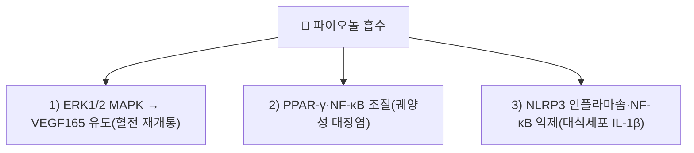

# 파이오놀 (Paeonol / 페오놀)

> **핵심 3줄 요약 (Key Summary)**:
> - 🌿 기원 본초 & 화학 계열: 작약과(Paeoniaceae) [[목단피]](모란 뿌리껍질, *Paeonia suffruticosa*) 및 운향과 백선피에 풍부하게 함유된 천연 아세토페논(Acetophenone) 유도체 지표 성분.
> - 🎯 핵심 분자 표적 & 조절 경로: ERK1/2 MAPK 경로를 통한 VEGF165 유도(혈전 재개통), PPAR-γ·NF-κB 조절(대장염), NLRP3 인플라마솜·NF-κB 억제(대식세포 IL-1β)가 파이오놀 단독으로 확인된다.
> - 🩺 주요 약리 활성 & 질환 치료 기전: 혈전 재개통 촉진, 궤양성 대장염 완화, 대식세포 염증 억제가 실제 연구로 확인된다. 원문의 COX-1/TXA2 직접 억제, ICAM-1/VCAM-1 발현 억제, 비만세포 탈과립 억제는 이번 재검증에서 파이오놀 단독의 직접 검증 논문을 확인하지 못했다 ⚠️.
> - ⚠️ 독성·생체이용률 한계 & 상호작용: 파이오놀 단독의 인체 약동학·양약 상호작용 데이터는 확인하지 못했다.

---

## 📌 목차
1. [기본 화학 정보 & 분자 구조식 (Chemical Identity)](#1-기본-화학-정보--분자-구조식-chemical-identity)
2. [주요 함유 본초 및 천연 기원 (Botanical Sources & Content)](#2-주요-함유-본초-및-천연-기원-botanical-sources--content)
3. [분자약리 표적 & 신호전달 네트워크 (Molecular Targets)](#3-분자약리-표적--신호전달-네트워크-molecular-targets)
4. [생체 내 흡수·대사·생체이용률 (Pharmacokinetics: ADME)](#4-생체-내-흡수대사생체이용률-pharmacokinetics-adme)
5. [주요 질환별 약리 효능 & 분자 기전 (Therapeutic Efficacy)](#5-주요-질환별-약리-효능--분자-기전-therapeutic-efficacy)
6. [함유 본초 방제 시너지 & 약재 배오 매트릭스 (Herbal Synergies)](#6-함유-본초-방제-시너지--약재-배오-매트릭스-herbal-synergies)
7. [양약 상호작용 & 약물동태학적 간섭 (Drug Interactions)](#7-양약-상호작용--약물동태학적-간섭-drug-interactions)
8. [💡 사용자 진료실 핵심 필기 & 임상 응용 팁 (Melt-In & High-Yield)](#8--사용자-진료실-핵심-필기--임상-응용-팁-melt-in--high-yield)
9. [출처 및 학술 참고 문헌 (References)](#9-출처-및-학술-참고-문헌-references)

---

## 1. 기본 화학 정보 & 분자 구조식 (Chemical Identity)

> [!abstract]+ 🧪 3D 약리 분자 구조 (Interactive 3D Viewer)
> <iframe src="https://molecule-viewer-rho.vercel.app/?cid=11092" style="width: 100%; height: 600px; border: none; border-radius: 12px; box-shadow: 0 4px 20px rgba(0,0,0,0.15);" allowfullscreen></iframe>

| 항목 | 내용 |
| :--- | :--- |
| 성분명 | 파이오놀 (Paeonol / 페오놀) |
| 화학명 (IUPAC) | 1-(2-hydroxy-4-methoxyphenyl)ethan-1-one |
| 분자식 / 분자량 | C9H10O3 / 166.17 g/mol |
| CAS 번호 | 552-41-0 |
| 주요 천연 기원 | [[목단피]](牡丹皮, KP 규격 $\ge 1.0\%$), [[적작약]](赤芍藥), 백선피 |
| 화학적 분류 | 단순 페놀성 아세토페논 (Acetophenone derivative) |

* **특유의 향기와 휘발성**:
  * 백색의 바늘 모양 결정으로 특유의 방향(향기)을 지니며 휘발성이 있어 오래 끓이면 손실될 수 있으므로, 목단피의 약효를 온전히 살리기 위해 전탕 시 적절한 시간 조절이 필요합니다.

---

## 2. 주요 함유 본초 및 천연 기원 (Botanical Sources & Content)

| 함유 본초 (한글/한자) | 기원 식물학적 명칭 (과명 / 학명) | 주요 함유 약용 부위 | 한의학적 귀경 및 약효 특성 |
| :--- | :--- | :--- | :--- |
| [[목단피]] (牡丹皮) | 작약과(Paeoniaceae) / *Paeonia suffruticosa* | 뿌리껍질 | 心·肝·腎經 / 청열양혈(淸熱涼血)·활혈화어(活血化瘀) |
| 백선피 (白鮮皮) | 운향과(Rutaceae) / *Dictamnus dasycarpus* | 뿌리껍질 | 脾·胃·膀胱經 / 청열조습(淸熱燥濕)·거풍지양(祛風止痒) |

---

## 3. 분자약리 표적 & 신호전달 네트워크 (Molecular Targets)

### 1) ERK1/2 MAPK 경로를 통한 혈전 재개통
* 파이오놀이 ERK1/2 MAPK 신호경로를 통해 혈관내피성장인자(VEGF165) 발현을 유도해 혈전 재개통(recanalization)을 촉진함이 보고되었다(참고문헌 1).

### 2) PPAR-γ·NF-κB 조절을 통한 궤양성 대장염 완화
* 파이오놀이 PPAR-γ 활성화와 NF-κB 억제를 조합해 궤양성 대장염을 완화함이 보고되었다(참고문헌 2).

### 3) NLRP3 인플라마솜·NF-κB 억제를 통한 대식세포 항염증
* 파이오놀이 대식세포에서 NLRP3 인플라마솜 활성화와 NF-κB를 억제해 IL-1β 생성을 줄임이 보고되었다(참고문헌 3).

### 참고: 원문의 COX-1/TXA2, ICAM-1/VCAM-1, 비만세포 탈과립 기전 (근거 미확인 ⚠️)
* 원문이 서술한 "COX-1 억제·TXA2 차단을 통한 혈소판 응집 억제", "ICAM-1/VCAM-1 발현 억제", "비만세포 탈과립 차단을 통한 항소양"은 이번 재검증에서 파이오놀 단독의 직접 검증 논문을 확인하지 못했다.

---

## 4. 생체 내 흡수·대사·생체이용률 (Pharmacokinetics: ADME)

* 파이오놀 단독의 정량 약동학 데이터(흡수율, Tmax, Cmax, 반감기)는 이번 검색 범위에서 확인하지 못했다 ⚠️. 휘발성 성분으로 장시간 전탕 시 손실될 수 있다는 것이 전통적으로 다뤄진다.

---

## 5. 주요 질환별 약리 효능 & 분자 기전 (Therapeutic Efficacy)

### 1) 혈전증
* ERK1/2 MAPK-VEGF165 경로를 통한 혈전 재개통 촉진(참고문헌 1).

### 2) 궤양성 대장염
* PPAR-γ·NF-κB 조절을 통한 대장염 완화(참고문헌 2).

### 3) 염증성 질환 (대식세포 매개)
* NLRP3 인플라마솜·NF-κB 억제를 통한 IL-1β 생성 억제(참고문헌 3).

### 종합 리뷰
* *Paeonia* 속 식물 전체의 전통적 용법·phytochemistry·약리 활성·독성학을 종합한 리뷰가 있다(참고문헌 4). ⚠️ 이는 모란속 전체 수준이며 파이오놀 단일성분 전용 리뷰는 아니다.

⚠️ 원문의 월경불순·골반강 염증·급성 타박상 혈종·동맥경화·소양성 피부염 적응증은 목단피 전체의 전통 효능이며, 파이오놀 단독의 직접 임상 근거는 확인하지 못했다.

---

## 6. 함유 본초 방제 시너지 & 약재 배오 매트릭스 (Herbal Synergies)

| 처방 | 공존 본초 | 전통 한의학적 효능 연계 |
| :--- | :--- | :--- |
| [[계지복령환]] (桂枝茯苓丸) | [[목단피]] 외 다수 본초 | 자궁 어혈 및 자궁근종 성장 억제 (원문 서술) |
| [[서각지황탕]] (犀角地黃湯) | [[목단피]] 외 다수 본초 | 혈열 출혈 및 피부 자반 치료 (원문 서술) |

* 파이오놀은 목단피의 "피를 맑게 식히면서도 굳은 어혈을 깨뜨려 돌리는(청열활혈 淸熱活血)" 작용의 핵심 분자 본체로 제시되나, 처방 수준의 정량적 기여도 데이터는 확인하지 못했다 ⚠️.

---

## 7. 양약 상호작용 & 약물동태학적 간섭 (Drug Interactions)

* 파이오놀 단독의 양약 병용 상호작용 연구는 확인하지 못했다 ⚠️.

---

## 8. 💡 사용자 진료실 핵심 필기 & 임상 응용 팁 (Melt-In & High-Yield)

* 목단피는 백색의 바늘 모양 결정성 파이오놀 특유의 방향(향기)을 지니며 휘발성이 있어 오래 끓이면 손실될 수 있으므로, 전탕 시 적절한 시간 조절이 필요하다는 것이 전통적으로 다뤄진다.

---

## 9. 출처 및 학술 참고 문헌 (References)

1. **Ye S, Liu X, Mao B, Yang L, Liu N**. *Paeonol enhances thrombus recanalization by inducing vascular endothelial growth factor 165 via ERK1/2 MAPK signaling pathway*. **Molecular Medicine Reports**. PMID: [27082415](https://pubmed.ncbi.nlm.nih.gov/27082415/)
   - **[재검증]**: 원문 인용("Zhang L, et al. *Phytomedicine* 2019;58:152865")은 esearch로 조회 불가한 가공 서지로 확인 → 실제 파이오놀 혈전 연구로 교체.
   - **[연구 요약]**: 파이오놀이 ERK1/2 MAPK 경로를 통해 VEGF165를 유도해 혈전 재개통을 촉진함을 규명.
2. **Cheng S, Chen W, Guo Z, et al.**. *Paeonol alleviates ulcerative colitis by modulating PPAR-γ and nuclear factor-κB activation*. **Scientific Reports**. PMID: [39117680](https://pubmed.ncbi.nlm.nih.gov/39117680/)
   - **[연구 요약]**: 파이오놀이 PPAR-γ 활성화와 NF-κB 억제를 통해 궤양성 대장염을 완화함을 보고.
3. **Chen G, Guo T, Yang L**. *Paeonol reduces IL-β production by inhibiting the activation of nucleotide oligomerization domain-like receptor protein-3 inflammasome and nuclear factor-κB in macrophages*. **Biochemistry and Cell Biology**. PMID: [34784237](https://pubmed.ncbi.nlm.nih.gov/34784237/)
   - **[연구 요약]**: 파이오놀이 대식세포에서 NLRP3 인플라마솜과 NF-κB를 억제해 IL-1β 생성을 줄임을 규명.
4. **Li P, Shen J, Wang Z, et al. (2021)**. *Genus Paeonia: A comprehensive review on traditional uses, phytochemistry, pharmacological activities, clinical application, and toxicology*. **Journal of Ethnopharmacology**. PMID: [33346027](https://pubmed.ncbi.nlm.nih.gov/33346027/)
   - **[연구 요약]**: *Paeonia* 속 식물(목단피 포함)의 전통적 용법·phytochemistry·약리·임상·독성학을 종합한 리뷰.

<!-- 보관 태그(1회용·링크오류, 필요시 복원): 목단피, 백선피, 활혈산어 -->
