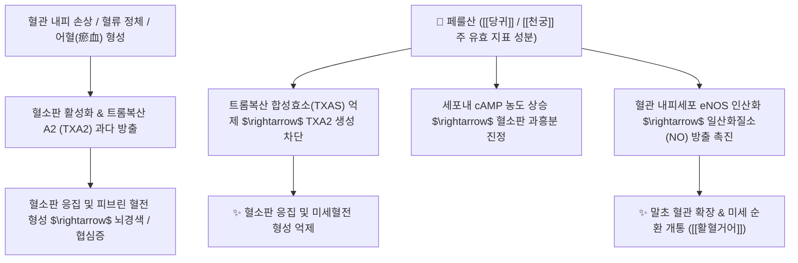

# 💊 [[페룰산]] (Ferulic Acid)

> **핵심 요약 (Key Summary)**:
> 당귀, 천궁 등 산형과 본초 및 미강(쌀겨)에 풍부하게 함유된 대표적인 하이드록시신남산계 천연 페놀성 화합물.
> 트롬복산 A2(TXA2) 억제를 통한 혈소판 응집 차단, eNOS 활성화 및 Nrf2/HO-1 항산화 경로 활성화로 혈관 내피와 뇌신경을 보호.
> 허혈성 뇌졸중, 관상동맥 질환 및 월경통 치료의 핵심 표적 성분이자 당귀와 천궁의 보혈활혈(補血活血)을 분자 수준에서 매개하는 핵심 물질.

---

## 📌 목차
1. [기본 화학 정보 & 분자 구조식 (Chemical Identity)](#1-기본-화학-정보--분자-구조식-chemical-identity)
2. [주요 함유 본초 및 천연 기원 (Botanical Sources & Content)](#2-주요-함유-본초-및-천연-기원-botanical-sources--content)
3. [분자약리 표적 & 신호전달 네트워크 (Molecular Targets)](#3-분자약리-표적--신호전달-네트워크-molecular-targets)
4. [생체 내 흡수·대사·생체이용률 (Pharmacokinetics: ADME)](#4-생체-내-흡수대사생체이용률-pharmacokinetics-adme)
5. [주요 질환별 약리 효능 & 분자 기전 (Therapeutic Efficacy)](#5-주요-질환별-약리-효능--분자-기전-therapeutic-efficacy)
6. [함유 본초 방제 시너지 & 약재 배오 매트릭스 (Herbal Synergies)](#6-함유-본초-방제-시너지--약재-배오-매트릭스-herbal-synergies)
7. [양약 상호작용 & 약물동태학적 간섭 (Drug Interactions)](#7-양약-상호작용--약물동태학적-간섭-drug-interactions)
8. [💡 사용자 진료실 핵심 필기 & 임상 응용 팁 (Melt-In & High-Yield)](#8--사용자-진료실-핵심-필기--임상-응용-팁-melt-in--high-yield)
9. [출처 및 학술 참고 문헌 (References)](#9-출처-및-학술-참고-문헌-references)

---
## 1. 기본 화학 정보 & 분자 구조식 (Chemical Identity)

> [!abstract]+ 🧪 3D 약리 분자 구조 (Interactive 3D Viewer)
> <iframe src="https://molecule-viewer-rho.vercel.app/?cid=445858" style="width: 100%; height: 600px; border: none; border-radius: 12px; box-shadow: 0 4px 20px rgba(0,0,0,0.15);" allowfullscreen></iframe>

| 항목 | 상세 정보 |
| :--- | :--- |
| **화학명 (IUPAC)** | (2E)-3-(4-Hydroxy-3-methoxyphenyl)prop-2-enoic acid |
| **분자식 및 분자량** | C10H10O4 / 194.18 g/mol |
| **CAS 등록번호** | 1135-24-6 (trans-형) |
| **기원 본초** | 산형과(*Apiaceae*) [[당귀]](*Angelica gigas* / *Angelica sinensis*), [[천궁]](*Ligusticum chuanxiong*)의 근경 |
| **화학 분류** | 페닐프로파노이드(Phenylpropanoid) 유래 하이드록시신남산 유도체 |

![[페룰산_1_구조식.png|450]]
> [그림 1: 페룰산의 2D 구조식 — 신남산 골격에 3-메톡시·4-수산기가 치환된 하이드록시신남산 — 출처: PubChem — CID 445858 (Compound Summary, 2D Structure)]

---
## 2. 주요 함유 본초 및 천연 기원 (Botanical Sources & Content)

| 함유 본초 (한글/한자) | 기원 식물학적 명칭 (과명 / 학명) | 주요 함유 약용 부위 | 한의학적 귀경 및 약효 특성 |
| :--- | :--- | :--- | :--- |
| [[당귀]] (當歸) | 산형과(Apiaceae) / *Angelica gigas* / *Angelica sinensis* | 뿌리(근경) | 肝·心·脾經 / 補血·活血·調經止痛 |
| [[천궁]] (川芎) | 산형과(Apiaceae) / *Ligusticum chuanxiong* | 뿌리줄기 | 肝·心包經 / 活血行氣·祛風止痛 |

![[페룰산_2_당귀절단.jpg|450]]
> [그림 2: 당귀 절단 약재 — 황갈색 횡단면과 방사상 무늬가 보인다 — 출처: Wikimedia Commons — File:Angelicae radix 021014.jpg (CC BY-SA 3.0 de)]

![[페룰산_2_당귀근.jpg|450]]
> [그림 3: 당귀(Angelica sinensis) 건조 뿌리 — 페룰산은 당귀·천궁의 근경에 함유된다 — 출처: Wikimedia Commons — File:Angelicae1.JPG (CC BY-SA 3.0)]

![[페룰산_2_천궁.jpg|450]]
> [그림 4: 천궁(Ligusticum sinense 'Chuanxiong') 근경의 코르크질 표면 — 원형 뿌리 자국이 불규칙하게 패여 있다. 페룰산은 당귀와 함께 천궁의 지표 성분군에 속한다 — 출처: Wikimedia Commons — File:Ligusticum sinense 'Chuanxiong' slices.jpg (CC0)]

---
## 3. 분자약리 표적 & 신호전달 네트워크 (Molecular Targets)

* **항혈소판 및 항혈전 작용**:
  * 아라키돈산 대사 과정에서 트롬복산 합성효소(TXAS)를 선택적으로 억제하여 강력한 혈관 수축 및 혈소판 응집 촉진 물질인 TXA2의 방출을 억제합니다.
  * 혈소판 내 아데닐산 시클라아제(Adenylyl cyclase)를 자극하여 [[cAMP]] 농도를 유지시킴으로써 혈전 형성을 차단합니다.

* **혈관 내피 보호 및 [[Nrf2]]/HO-1 항산화**: 페놀성 수산기를 통한 활성산소([[ROS]]) 직접 소거, Keap1-Nrf2 해리를 통한 HO-1·GSH·SOD 유도가 종설에서 다뤄진다(참고문헌 1).
* **뇌허혈-재관류 신경보호**: 뇌경색 모델에서 [[ICAM-1]] mRNA 발현을 억제해 산화스트레스 관련 세포자멸사를 줄이고 신경을 보호함이 실제 연구로 확인된다(참고문헌 2).

⚠️ 원문의 "TXAS 선택적 억제를 통한 TXA2 차단", "혈소판 아데닐산 시클라아제 자극" 세부 분자결합 데이터, "미세아교세포 과활성화·TNF-α/[[IL-1β]] 차단"은 이번 재검증에서 페룰산 단독의 직접 검증 논문을 확인하지 못했다 ⚠️.

---

## 4. 생체 내 흡수·대사·생체이용률 (Pharmacokinetics: ADME)

* 낮은 분자량과 비교적 높은 지용성으로 경구 복용 후 혈뇌장벽(BBB)을 통과할 수 있다는 것이 신경보호 연구의 전제로 다뤄진다(참고문헌 2). 정량적 흡수율·Tmax·Cmax·반감기는 이번 검색 범위에서 확인하지 못했다 ⚠️.

---

## 5. 주요 질환별 약리 효능 & 분자 기전 (Therapeutic Efficacy)

### 1) 항혈전·혈소판 응집 억제
* 트롬복산 합성효소(TXAS) 억제를 통한 TXA2 차단, cAMP 상승을 통한 혈소판 진정이 원문에 서술되어 있으나, 이번 재검증에서 페룰산 단독의 직접 검증 논문을 확인하지 못했다 ⚠️.

### 2) 허혈성 뇌졸중
* 뇌허혈-재관류 손상 모델에서 ICAM-1 mRNA 발현 억제를 통한 신경보호 효과가 실제 연구로 확인된다(참고문헌 2).

### 3) 혈관 내피 보호·항산화
* Nrf2/HO-1 경로 활성화를 통한 항산화 효과가 종설에서 다뤄진다(참고문헌 1).

⚠️ 원문의 관상동맥 질환·[[월경통]] 적응증은 당귀·천궁 전체의 전통 효능이며, 페룰산 단독의 직접 임상 근거는 확인하지 못했다.

---
## 6. 함유 본초 방제 시너지 & 약재 배오 매트릭스 (Herbal Synergies)

* **당귀(보혈)와 천궁(행혈)의 상호 상승 메커니즘**:
  * 한의학에서 당귀는 피를 만들고(補血), 천궁은 피를 돌리는(行血) 대표적 약대(藥對)입니다.
  * 두 본초 모두에 페룰산이 고농도로 함유되어 있어, 보혈과 활혈 작용이 페룰산의 조혈 촉진 및 혈류 개선 효과를 통해 완벽히 합치됩니다.
* **대표 한의 처방**:
  * [[사물탕]]** (四物湯)**: 당귀, 천궁의 페룰산이 백작약의 페오니플로린과 결합하여 혈허(빈혈) 및 월경불순을 치료.
  * [[당귀수산]]** (當歸鬚散)**: 타박상 및 교통사고 후 어혈성 동통을 신속히 소산.
  * [[보양환오탕]]** (補陽還五湯)**: 황기의 다당류와 [[당귀미]]·천궁의 페룰산이 협동하여 [[뇌졸중 후유증]](반신불수)의 신경 재생 촉진.

---

## 7. 양약 상호작용 & 약물동태학적 간섭 (Drug Interactions)

* 페룰산 단독의 양약 병용 상호작용 연구는 확인하지 못했다 ⚠️.

---

## 8. 💡 사용자 진료실 핵심 필기 & 임상 응용 팁 (Melt-In & High-Yield)

* 현재 별도로 기록된 원장님 임상 필기가 없습니다.

---

## 9. 출처 및 학술 참고 문헌 (References)

1. **Mancuso C, Santangelo R (2014)**. *Ferulic acid: pharmacological and toxicological aspects*. **Food and Chemical Toxicology**, 65, 185-195. PMID: [24373826](https://pubmed.ncbi.nlm.nih.gov/24373826/)
   - `[연구 요약]` 페룰산의 항산화, 항염증, 혈관 내피 보호 및 신경 보호 약리 기전과 약동학적 특성 총괄.
2. **Cheng CY, Su SY, Tang NY, et al. (2008)**. *Ferulic acid provides neuroprotection against oxidative stress-related apoptosis after cerebral ischemia/reperfusion injury by inhibiting ICAM-1 mRNA expression in rats*. **Brain Research**, 1209, 136-150. PMID: [18400211](https://pubmed.ncbi.nlm.nih.gov/18400211/)
   - `[연구 요약]` 페룰산이 뇌허혈-재관류 손상 모델에서 혈관 부착 분자(ICAM-1) mRNA 발현 억제 및 항세포사멸을 통해 뇌신경을 보호함을 입증.
3. **대한민국약전(KP) 제12개정 (2022)**. 의약품각조 제2부: 당귀 및 천궁 분석법.
   - `[공정서 규격]` 당귀와 천궁의 지표 성분으로서 페룰산(Ferulic acid)의 HPLC 정량 표준 규격 명시(약전 원문 온라인 대조는 하지 못함 ⚠️).
