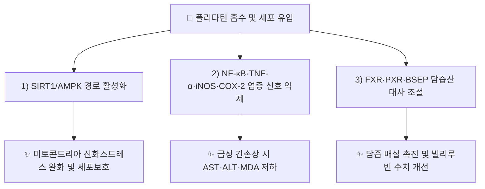

# 🔬 폴리다틴 (Polydatin / Piceid, C₂₀H₂₂O₈)

> **핵심 3줄 요약 (Key Summary)**:
> - 🌿 기원 본초 & 화학 계열: [[레스베라트롤]]의 3-O-β-D-글루코시드 배당체로, 스틸벤(stilbenoid) 화학 골격. [[호장근]](Polygoni Cuspidati Rhizoma, KP 지표성분 ≥1.5%)의 핵심 지표성분이며 [[에모딘]]과 함께 호장근의 양대 지표물질을 구성합니다.
> - 🎯 핵심 분자 표적 & 조절 경로: SIRT1 활성화를 축으로 한 산화스트레스 방어([[SIRT1]]/AMPK 경로), NF-κB·TNF-α·iNOS·COX-2 염증 신호 억제, FXR·PXR·BSEP 등 담즙산 대사 조절이 보고되어 있습니다.
> - 🩺 주요 약리 활성 & 질환 치료 기전: 사염화탄소 유발 급성 간손상 보호(AST·ALT·MDA 저하), 담즙정체성 간손상·황달 개선, SIRT1 매개 전신 항산화·세포보호 효과가 리뷰 및 동물실험에서 확인됩니다.
> - ⚠️ 근거 수준: 아래 References는 동물실험(사염화탄소 간손상 모델) 및 리뷰(SIRT1 총설, 담즙정체성 간손상 총설) 수준입니다. 폴리다틴 단독 성분의 인체 임상시험 근거는 확인하지 못했습니다. 레스베라트롤 대비 폴리다틴 고유의 독립적 약리 우위를 입증하는 직접 비교 연구는 본 노트에서 확보하지 못했습니다.

---

## 📌 목차
1. [기본 화학 정보 & 분자 구조식 (Chemical Identity)](#1-기본-화학-정보--분자-구조식-chemical-identity)
2. [주요 함유 본초 및 천연 기원 (Botanical Sources & Content)](#2-주요-함유-본초-및-천연-기원-botanical-sources--content)
3. [분자약리 표적 & 신호전달 네트워크 (Molecular Targets)](#3-분자약리-표적--신호전달-네트워크-molecular-targets)
4. [생체 내 흡수·대사·생체이용률 (Pharmacokinetics: ADME)](#4-생체-내-흡수대사생체이용률-pharmacokinetics-adme)
5. [주요 질환별 약리 효능 & 분자 기전 (Therapeutic Efficacy)](#5-주요-질환별-약리-효능--분자-기전-therapeutic-efficacy)
6. [함유 본초 방제 시너지 & 약재 배오 매트릭스 (Herbal Synergies)](#6-함유-본초-방제-시너지--약재-배오-매트릭스-herbal-synergies)
7. [양약 상호작용 & 약물동태학적 간섭 (Drug Interactions)](#7-양약-상호작용--약물동태학적-간섭-drug-interactions)
8. [💡 사용자 진료실 핵심 필기 & 임상 응용 팁 (Melt-In & High-Yield)](#8--사용자-진료실-핵심-필기--임상-응용-팁-melt-in--high-yield)
9. [출처 및 학술 참고 문헌 (References)](#9-출처-및-학술-참고-문헌-references)

---
## 1. 기본 화학 정보 & 분자 구조식 (Chemical Identity)

> 🖼️ **이미지 미첨부 안내**: 금회 작성 시점 네트워크 제약으로 PubChem 구조식 이미지를 조달하지 못했습니다. 추후 `폴리다틴_1_구조식.png`(PubChem CID 5281718 PNG)을 `_첨부·자료\첨부파일\`에 저장 후 보완 필요. 호장근.md §1에는 이미 ASCII 구조 개념도가 있어 교차 참조 가능합니다.

| 항목 | 상세 내용 |
| :--- | :--- |
| **IUPAC 명칭** | 3-Hydroxy-5-[(E)-2-(4-hydroxyphenyl)ethen-1-yl]phenyl β-D-glucopyranoside |
| **분자식 / 분자량** | C₂₀H₂₂O₈ / 390.39 g/mol |
| **PubChem CID** | [5281718](https://pubchem.ncbi.nlm.nih.gov/compound/5281718) |
| **CAS 등록 번호** | 27208-80-6 |
| **화학 골격 분류** | 스틸벤 O-배당체(Resveratrol-3-O-β-D-glucoside) — [[레스베라트롤]]의 당전이 배당체, [[THSG]](2,3,5,4′-테트라하이드록시스틸벤-2-O-글루코시드)와 하이드록실·배당 위치가 다른 동일 스틸벤 골격 계열 |
| **물리화학적 성상** | 백색~미황색 결정성 분말, 수용성이 아글리콘(레스베라트롤)보다 높아 생체이용률 측면에서 상대적으로 유리 |
| **식물 내 생합성 경로** | 페닐알라닌 경로의 스틸벤 신타아제(STS)로 레스베라트롤이 생합성된 뒤, UDP-글루코오스 의존성 당전이효소(UGT)에 의해 3-OH 위치가 글루코실화되어 생성 |

---

## 2. 주요 함유 본초 및 천연 기원 (Botanical Sources & Content)

| 함유 본초 (한글/한자) | 기원 식물학적 명칭 (과명 / 학명) | 주요 함유 약용 부위 | 지표 함량 (%) | 한의학적 귀경 및 약효 특성 |
| :--- | :--- | :--- | :--- | :--- |
| [[호장근]] (虎杖根) | 마디풀과 / *Reynoutria japonica* (= *Polygonum cuspidatum*) | 뿌리 및 뿌리줄기 | KP 규격 1.5% 이상 | 肝·膀胱經, 활혈거어·청열이습·거담지해 |

> **[함유 특성]**: 폴리다틴은 호장근의 2대 지표성분(폴리다틴·에모딘) 중 하나로, [[레스베라트롤]]·[[에모딘]]과 함께 SIRT1/AMPK 경로 활성화 및 담즙 배설 촉진을 통해 호장근의 활혈거어·청열이습 효능을 분자약리학적으로 설명하는 핵심 성분입니다.

---

## 3. 분자약리 표적 & 신호전달 네트워크 (Molecular Targets)

### 1) 핵심 분자 표적 (Molecular Targets)
* **SIRT1 활성화를 통한 산화스트레스 억제**: 폴리다틴은 SIRT1(NAD⁺-의존성 디아세틸라아제)을 활성화하여 FOXO3·PGC-1α 등 하위 전사인자를 조절, 미토콘드리아 생합성과 항산화 효소 발현을 증대시킴 (Liu et al. 2024, *J Ethnopharmacol* 총설).
* **NF-κB 염증 신호 억제**: 사염화탄소(CCl₄) 유발 급성 간손상 마우스 모델에서 폴리다틴이 TNF-α·IL-1β·COX-2·iNOS·NF-κB 발현을 억제하여 간세포 보호 효과를 나타냄 (Zhang et al. 2012, *PLoS One*).
* **FXR/PXR/BSEP 담즙산 대사 조절**: 호장근 유래 스틸벤(폴리다틴·레스베라트롤) 및 안트라퀴논(에모딘)이 FXR·PXR·BSEP 등 담즙산 전달체·수용체를 조절하여 담즙정체성 간손상·황달을 개선하는 기전이 종설에서 정리됨 (Zhang et al. 2025, *Fitoterapia*).

---

## 4. 생체 내 흡수·대사·생체이용률 (Pharmacokinetics: ADME)

* **장관 흡수 및 아글리콘 전환**:
  * 배당체 형태(폴리다틴)는 아글리콘(레스베라트롤)보다 수용성이 높아 장관 내 용해도가 유리하나, 체내에서는 상당 부분이 장관 β-글루코시다아제 및 장내 미생물총에 의해 레스베라트롤로 가수분해되어 흡수되는 것으로 알려져 있습니다.
  * 레스베라트롤로 직접 전환·추출하는 생물전환 연구가 보고되어 있어(호장근.md §7 교차 참조), 폴리다틴을 "레스베라트롤 전구체(prodrug 유사)"로 보는 관점이 있습니다.
* **간 대사 및 배설**:
  * 흡수 후 간에서 UGT·SULT에 의한 2상 포합 반응을 거쳐 글루쿠론산·황산 결합체로 배설되며, 담즙을 통한 배설 경로도 FXR/BSEP 조절과 연계되어 있습니다(⚠️ 반감기 등 정량 약동학 수치는 본 노트에서 확인하지 못함).

---

## 5. 주요 질환별 약리 효능 & 분자 기전 (Therapeutic Efficacy)

### 1) 급성 간손상 (화학적 간독성)
* CCl₄ 유발 급성 간손상 마우스 모델에서 폴리다틴 투여 시 AST·ALT·MDA(지질과산화 지표) 수치가 저하되고, TNF-α·IL-1β·COX-2·iNOS·NF-κB 발현이 억제되어 간세포가 보호됨 (Zhang et al. 2012, PMID 23029551).
### 2) 담즙정체성 간손상·황달
* 호장근 유래 스틸벤·안트라퀴논이 FXR·PXR·BSEP 등 담즙산 대사 조절 경로를 통해 담즙정체성 간손상과 황달을 개선하는 기전이 종설로 정리됨 (Zhang et al. 2025, PMID 41106787) — 호장근의 청열이습·퇴황(退黃) 효능과 직접 연계.
### 3) 산화스트레스 관련 세포보호 (전신)
* SIRT1 활성화를 통한 항산화·세포보호 기전이 다양한 산화스트레스 관련 질환 모델에서 보고되어 있음 (Liu et al. 2024, PMID 38729537 총설) — 간 외 조직(심혈관·신경계 등)으로의 확장 가능성이 제시되나 조직별 개별 검증은 본 노트에서 전수 확인하지 못함.

---

## 6. 함유 본초 방제 시너지 & 약재 배오 매트릭스 (Herbal Synergies)

| 함유 본초 / 방제 | 공존 유효 성분군 | 분자약리 시너지 기전 | 전통 한의학적 효능 연계 |
| :--- | :--- | :--- | :--- |
| [[호장근]] | [[레스베라트롤]], [[에모딘]], 피시온(Physcion) | SIRT1/AMPK 활성화(폴리다틴·레스베라트롤) + 담즙 배설 촉진(에모딘)의 다표적 시너지 | 청열이습, 활혈거어, 퇴황 |

---

## 7. 양약 상호작용 & 약물동태학적 간섭 (Drug Interactions)

* **간 대사 약물과의 병용 주의**:
  * 간손상 보호 효과가 전제된 동물실험 결과이므로, 간독성 위험이 있는 양약(아세트아미노펜·일부 항결핵제 등)과의 병용 시 상호작용은 인체 자료가 없어 임상적 권고를 보류합니다(⚠️ 근거 미확인).
* **항응고·항혈소판제 병용 시 고려사항**:
  * 스틸벤 계열([[레스베라트롤]] 등)은 혈소판 응집 억제 가능성이 문헌상 논의되나, 폴리다틴 단독의 항응고 상호작용 자료는 확인하지 못했습니다.

---

## 8. 💡 사용자 진료실 핵심 필기 & 임상 응용 팁 (Melt-In & High-Yield)

* **임상 적용 시 주의점**:
  * 호장근 전탕액 투여 시의 간보호·퇴황 효능은 폴리다틴·레스베라트롤·에모딘의 복합 작용이므로, 폴리다틴 단독 효능으로 과대 해석하지 않도록 주의가 필요합니다.
  * 레스베라트롤 전구체 성격을 고려할 때, 체내 전환율이 개인차(장내 미생물총 조성)에 따라 달라질 수 있습니다.

---

## 9. 출처 및 학술 참고 문헌 (References)

1. **Liu K, Liu J, Xu A, et al. (2024)**. *The role of polydatin in inhibiting oxidative stress through SIRT1 activation: A comprehensive review of molecular targets*. **Journal of Ethnopharmacology**, 331, 118322. [PMID 38729537](https://pubmed.ncbi.nlm.nih.gov/38729537/)
   - **[연구 요약]**: 폴리다틴의 SIRT1 활성화를 통한 산화스트레스 억제 분자 표적을 종합 정리한 총설.
2. **Zhang H, Yu CH, Jiang YP, et al. (2012)**. *Protective effects of polydatin from Polygonum cuspidatum against carbon tetrachloride-induced liver injury in mice*. **PLoS One**, 7(9), e46574. [PMID 23029551](https://pubmed.ncbi.nlm.nih.gov/23029551/)
   - **[연구 요약]**: CCl₄ 유발 급성 간손상 마우스에서 폴리다틴이 AST·ALT·MDA를 낮추고 TNF-α·IL-1β·COX-2·iNOS·NF-κB 발현을 억제하여 간세포를 보호함을 확인.
3. **Zhang Z, Yang X, Fu Y, et al. (2025)**. *Protective effects of Polygonum cuspidatum bioactive constituents against cholestatic liver injury: A mechanistic review*. **Fitoterapia**, 187, 106938. [PMID 41106787](https://pubmed.ncbi.nlm.nih.gov/41106787/)
   - **[연구 요약]**: 호장근의 스틸벤(폴리다틴·레스베라트롤)·안트라퀴논(에모딘)이 FXR·PXR·BSEP 등 담즙산 대사 조절을 통해 담즙정체성 간손상과 황달을 개선하는 기전을 정리.
4. **대한민국약전(KP) 제12개정 (2022)**. 의약품각조: 호장근(虎杖根) 규격 — 폴리다틴 1.5% 이상·에모딘 0.60% 이상 함유.
   - **[공정서 규격]**: 호장근의 2대 지표성분 함량 기준.

> 검증 메모 (2026-10-18): 다빈치 노트 신규 생성. 상기 PMID 3건은 [[호장근]]·[[레스베라트롤]]·[[THSG]] 노트에서 2026-10-03 다빈치가 이미 PubMed 실존을 확인한 서지를 그대로 재사용함(허위 서지 'Du 2013'을 교체한 검증 이력 확인). PubChem CID 5281718·CAS 27208-80-6·분자식 C₂₀H₂₂O₈·MW 390.39는 Wikipedia(Piceid) 화학 인포박스로 금회 재확인(호장근.md 기재 분자식과 일치).
