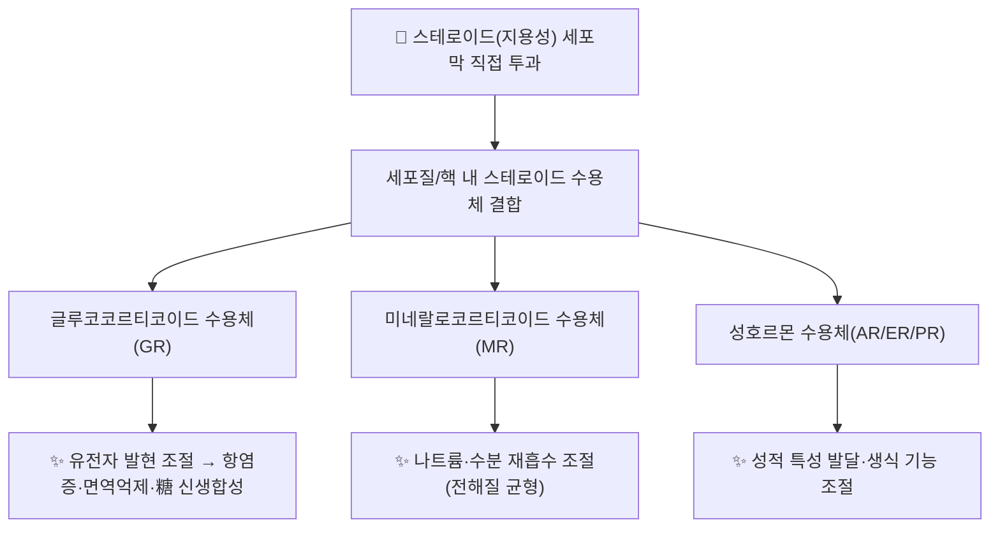

# 🔬 [[스테로이드]] (Steroid, 사이클로펜타노페난트렌 고리 화합물군)

> **핵심 3줄 요약 (Key Summary)**:
> - 🌿 화학 계열: 단일 화합물이 아닌 **화학 분류(class)**. 사이클로펜타노퍼하이드로페난트렌(cyclopentanoperhydrophenanthrene) 4환 고리 골격을 공유하는 [[콜레스테롤]]·담즙산·스테로이드 호르몬·식물스테롤의 총칭입니다.
> - 🎯 핵심 분자 표적 & 조절 경로: 지용성 특성으로 세포막을 직접 통과해 세포질·핵 내 스테로이드 수용체(글루코코르티코이드 수용체 GR, 미네랄로코르티코이드 수용체 MR, 성호르몬 수용체 등)에 결합, 유전자 발현을 직접 조절하는 핵수용체(nuclear receptor) 기전을 공유합니다.
> - 🩺 주요 약리 활성 & 질환 치료 기전: 물질대사·염증·면역·수분·전해질 균형·성적 특성 발달을 조절하며, 합성 글루코코르티코이드는 강력한 항염증·면역억제 효과로 널리 처방됩니다.
> - ⚠️ 독성·생체이용률 한계 & 상호작용: 전신 글루코코르티코이드 장기 복용 후 갑작스런 중단 시 시상하부-뇌하수체-부신(HPA) 축 억제로 인한 금단 증상(정신 증상 포함)이 발생할 수 있어 점진적 감량(tapering)이 필요합니다.

> **사용자 원문 필기 (보존)**:
> - 사이클 펜타노하이드로페난트렌 고리를 가진 구조의 화합물로 [[콜레스테롤]], 담즙산, 호르몬 등이 포함된다.
> - 이는 여러 부신피질호르몬([[코르티솔]], [[알도스테론]], [[안드로겐]], [[에스트로겐]], [[프로게스테론]])으로 분류되며, 물질대사, 염증, 면역 기능, 염분과 수분의 균형, 성적 특성 발달 작용이 있다.
> - 스테로이드는 구조상 지용성이기에 세포 내로 침투하기 용이하며, 이는 항염증 작용에 많이 이용된다.
> - [[노르에피네프린]]은 간단한 구조를, [[옥시토신]]과 같은 펩타이드 호르몬은 아미노산으로 구성, [[성장호르몬]]과 같은 단백 호르몬은 단백질로 구성된다.
> - 보통 스테로이드 호르몬은 진통 작용을 하지만 [[단백질]]을 녹여서 혈당을 올리는 작용도 한다. 수술 후 스테로이드 복용 환자가 스테로이드를 끊으면 정신 증상이 부작용으로 발생할 수 있다(한 달 정도 있으면 괜찮아짐).

![[스테로이드-20240518005940384.png|424]]
> [그림 1: 스테로이드 4환 기본 골격 구조 — 원장님 필기]

![[스테로이드-20240518010701652.png|395]]
> [그림 2: 스테로이드 지용성·세포막 투과 모식도 — 원장님 필기]

---

## 📌 목차
1. [기본 화학 정보 & 분류 (Chemical Identity & Classification)](#1-기본-화학-정보--분류-chemical-identity--classification)
2. [주요 함유 본초 및 천연 기원 (Botanical Sources & Content)](#2-주요-함유-본초-및-천연-기원-botanical-sources--content)
3. [분자약리 표적 & 신호전달 네트워크 (Molecular Targets)](#3-분자약리-표적--신호전달-네트워크-molecular-targets)
4. [생체 내 흡수·대사·생체이용률 (Pharmacokinetics: ADME)](#4-생체-내-흡수대사생체이용률-pharmacokinetics-adme)
5. [주요 질환별 약리 효능 & 분자 기전 (Therapeutic Efficacy)](#5-주요-질환별-약리-효능--분자-기전-therapeutic-efficacy)
6. [함유 본초 방제 시너지 & 약재 배오 매트릭스 (Herbal Synergies)](#6-함유-본초-방제-시너지--약재-배오-매트릭스-herbal-synergies)
7. [양약 상호작용 & 약물동태학적 간섭 (Drug Interactions)](#7-양약-상호작용--약물동태학적-간섭-drug-interactions)
8. [💡 사용자 진료실 핵심 필기 & 임상 응용 팁 (Melt-In & High-Yield)](#8--사용자-진료실-핵심-필기--임상-응용-팁-melt-in--high-yield)
9. [출처 및 학술 참고 문헌 (References)](#9-출처-및-학술-참고-문헌-references)

---

## 1. 기본 화학 정보 & 분류 (Chemical Identity & Classification)

> [!info] 🧪 3D 뷰어 미적용
> 스테로이드는 단일 화합물이 아닌 화학 분류(class)라 대표 CID를 쓰지 않습니다. 개별 성분(예: [[베타시토스테롤]], [[스티그마스테롤]], [[에르고스테롤]])은 각 노트를 참고하세요.

| 분류 | 탄소수 | 예시 | 비고 |
| :--- | :--- | :--- | :--- |
| 성호르몬(안드로겐·에스트로겐) | C18~C19 | [[안드로겐]], [[테스토스테론]], [[에스트로겐]] | 안드로겐 C19, 에스트로겐 C18 |
| 황체호르몬(프로게스토겐) | C21 | [[프로게스테론]] | 코르티코스테로이드와 전구체 공유 |
| 부신피질호르몬(코르티코스테로이드) | C21 | [[코르티솔]], [[코르티손]], [[알도스테론]] | 당질코르티코이드(GR)·염류코르티코이드(MR) |
| 담즙산 | C24 | [[콜산]], [[데옥시콜산]] | 간에서 콜레스테롤로부터 합성 |
| 동물스테롤 | C27~C30 | [[콜레스테롤]], [[라노스테롤]] | 세포막 구성·스테로이드 호르몬 전구체 |
| 식물스테롤 | C28~C29 | [[베타시토스테롤]], [[에르고스테롤]] | 장관에서 콜레스테롤 흡수 경쟁적 억제 |

> ⚠️ 정정: 기존 노트의 "황체호르몬(21) — 코르티손·코르티졸·알도스테론" 행은 실제로는 황체호르몬(프로게스토겐)이 아닌 **부신피질호르몬(코르티코스테로이드)** 분류이므로 별도 행으로 분리했습니다. "콜레세테롤"은 "콜레스테롤"의 오타, "컬신"은 담즙산 "콜산"의 오타로 추정되어 정정했습니다.

---

## 2. 주요 함유 본초 및 천연 기원 (Botanical Sources & Content)

| 함유 본초 (한글/한자) | 기원 식물학적 명칭 (과명 / 학명) | 주요 함유 약용 부위 | 지표 함량 (%) | 한의학적 귀경 및 약효 특성 |
| :--- | :--- | :--- | :--- | :--- |
| — | 스테로이드는 단일 본초 지표 성분이 아닌 화학 분류이므로 "함유 본초"는 개별 성분 노트(예: [[베타시토스테롤]]) 참고 | — | — | — |

---

## 3. 분자약리 표적 & 신호전달 네트워크 (Molecular Targets)

* **핵수용체(nuclear receptor) 기전**: 스테로이드의 지용성 특성으로 세포막을 직접 통과하며, 세포질 또는 핵 내 특이적 수용체와 결합해 호르몬-수용체 복합체를 형성하고 DNA 반응요소(response element)에 결합해 유전자 전사를 직접 조절합니다(PMID 32809732, PMID 32644386). 이는 펩타이드·단백 호르몬(막수용체 경유 2차 전달자 기전)과 구별되는 핵심 차이입니다.
* **글루코코르티코이드 수용체(GR)**: 코르티솔 등이 결합해 항염증·면역억제·포도당 신생합성 촉진(단백질 분해를 통한 혈당 상승) 작용을 매개합니다(PMID 32809732).
* **미네랄로코르티코이드 수용체(MR)**: 알도스테론이 결합해 신장 원위세뇨관에서 나트륨 재흡수·칼륨 배출을 촉진해 전해질·수분 균형을 조절합니다.

---

## 4. 생체 내 흡수·대사·생체이용률 (Pharmacokinetics: ADME)

* **흡수**: 지용성이므로 경구·경피·흡입 등 다양한 경로로 세포막을 직접 통과해 흡수됩니다.
* **대사**: 간에서 CYP450 효소(주로 CYP3A4)에 의해 대사되며, 코르티솔은 11β-HSD(11β-hydroxysteroid dehydrogenase)에 의해 활성(코르티솔)↔불활성(코르티손) 형태로 상호 전환됩니다.
* **HPA축 음성 피드백**: 외인성 글루코코르티코이드 장기 투여 시 시상하부-뇌하수체-부신(HPA) 축이 억제되어, 급격한 중단 시 부신기능부전 유사 금단 증상(피로·근육통·정신 증상)이 나타날 수 있습니다(PMID 32809732).

---

## 5. 주요 질환별 약리 효능 & 분자 기전 (Therapeutic Efficacy)

### 1) 항염증·면역조절 (합성 글루코코르티코이드)
* GR 매개 전사 조절을 통해 염증성 사이토카인 생성을 억제하고 면역세포 기능을 조절하여 자가면역질환·알레르기·급성 염증 상태에 광범위하게 처방됩니다(PMID 32809732).

### 2) 전해질·수분 균형 (미네랄로코르티코이드)
* 알도스테론은 MR을 통해 나트륨 재흡수를 촉진하여 혈압·체액량을 조절합니다.

### 3) 생식·성적 특성 발달 (성호르몬)
* 프로게스테론은 자궁내막 분비기 변화·임신 유지에 핵심적이며(PMID 32644386), 안드로겐·에스트로겐은 2차 성징 발달을 조절합니다.

⚠️ 내용 검토 필요: "스테로이드 호르몬이 진통 작용을 한다"는 원문 필기는 코르티코스테로이드의 항염증 작용에 따른 2차적 통증 완화로 해석되며, 오피오이드 유사 직접 진통 기전은 확인되지 않았습니다.

---

## 6. 함유 본초 방제 시너지 & 약재 배오 매트릭스 (Herbal Synergies)

> **⚠️ 안내**: 스테로이드는 화학 분류이므로 한약 방제 배오 매트릭스는 개별 성분 노트([[베타시토스테롤]], [[에르고스테롤]] 등)를 참고하십시오.

---

## 7. 양약 상호작용 & 약물동태학적 간섭 (Drug Interactions)

* **CYP3A4 상호작용**: 강력한 CYP3A4 유도제·억제제와 병용 시 전신 글루코코르티코이드의 혈중농도가 변동될 수 있습니다.
* **NSAIDs 병용**: 글루코코르티코이드와 NSAIDs 병용 시 위장관 출혈·궤양 위험이 상가적으로 증가할 수 있어 임상적 주의가 필요합니다.
* **갑작스런 중단 금기**: 장기(통상 2~3주 이상) 전신 글루코코르티코이드 투여 후에는 HPA축 억제로 인해 반드시 점진적 감량(tapering)이 필요합니다.

---

## 8. 💡 사용자 진료실 핵심 필기 & 임상 응용 팁 (Melt-In & High-Yield)

* **사용자 원문 필기**: 수술 후 스테로이드 복용 환자가 스테로이드를 끊으면 정신 증상이 부작용으로 발생할 수 있다(한 달 정도 있으면 괜찮아짐) — 이는 HPA축 억제로 인한 금단 증상으로 해석되며, 급격한 중단보다 점진적 감량이 권장됩니다.
* **진료실 실전 처방 & 임상 응용 팁**: 전신 스테로이드 복용 중/후 환자에서 정신 증상(불안·우울·과민) 발생 시, 정신과적 1차 질환보다 HPA축 억제 가능성을 먼저 감별하고 복용력(용량·기간·중단 시점)을 확인합니다.

---

## 9. 출처 및 학술 참고 문헌 (References)

1. (2023, 2023년 1월 갱신). Physiology, Glucocorticoids. *StatPearls* (NCBI Bookshelf). PMID: [32809732](https://pubmed.ncbi.nlm.nih.gov/32809732/)
   - **[연구 요약]**: 글루코코르티코이드의 생합성·GR 매개 유전자 조절·HPA축 피드백 기전을 정리한 StatPearls 개설서.
2. (2023, 2023년 1월 갱신). Physiology, Progesterone. *StatPearls* (NCBI Bookshelf). PMID: [32644386](https://pubmed.ncbi.nlm.nih.gov/32644386/)
   - **[연구 요약]**: 프로게스테론의 생리·수용체 기전·생식계 작용을 정리한 StatPearls 개설서.

> ⚠️ 내용 검토 필요 (2026-10-12 클로드): 원문 필기는 §본문 상단에 100% 보존했습니다. 기존 "황체호르몬" 분류표 오류(코르티코스테로이드 예시 혼입), "콜레세테롤"·"컬신" 오타를 정정했습니다. 1섹션(필기)→9섹션 템플릿으로 확장하며 StatPearls 생리학 개설서 2건을 신규 검증·추가했습니다.

<!-- 보관 태그(1회용·링크오류, 필요시 복원): 콜레스테롤, 담즙산, 부신피질호르몬 -->
