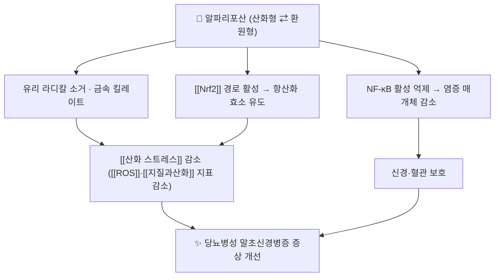

# 🔬 알파리포산 (Alpha-Lipoic Acid, Thioctic Acid, A16AX01)

> **핵심 요약 (Key Summary)**:
> 🔬 화학: 디티올란 고리와 카복실산 곁사슬을 가진 유황 함유 지질 유도체(C8H14O2S2, 206.3 g/mol). 산화형·환원형이 서로 전환되며 산화환원 쌍으로 작동한다.
> 📍 기전: 미토콘드리아 피루브산 탈수소효소 복합체의 보조인자이고, 유리 라디칼 소거·금속 킬레이트·항산화 방어계 재생([[Nrf2]] 경로)을 통해 [[산화 스트레스]]를 낮춘다.
> 🎯 임상 의의: [[당뇨병성 말초신경병증]]에서 경구 보충 근거가 축적된 대표적 비약물성 대사 보조제다(메타분석 근거).
> ⚠️ 주의: 혈당 강하제가 아니며, 신경병증 증상 개선 폭은 작다. 위장장애·저혈당 위험(인슐린·설폰요소제 병용 시)과 감각 저하 환자의 족부 관리 소홀을 함께 관리한다.

---

## 1. 기본 화학 정보 & 분자 구조식

![[알파리포산_01_구조식2D.png|320]]
> [그림 1: 알파리포산(티옥트산)의 2D 화학 분자 구조식 — PubChem CID 864 (PubChem PNG 정본)]

| 항목 | 상세 정보 |
| :--- | :--- |
| 이명 | 알파리포산, α-lipoic acid, thioctic acid, 티옥트산 |
| PubChem CID | [864](https://pubchem.ncbi.nlm.nih.gov/compound/864) |
| 화학식 / 분자량 | C8H14O2S2 / 206.3 g/mol |
| ATC 코드 | [A16AX01](https://atcddd.fhi.no/atc_ddd_index/?code=A16AX01) (기타 소화기·대사 제품) |
| 구조적 특징 | 1,2-디티올란 고리 + 펜탄산 곁사슬. 산화형(디설파이드)–환원형(디하이드로리포산) 산화환원 쌍 |
| 특성 | 지용성·수용성 겸용 항산화제, R 이성질체가 생리 활성형 |

## 2. 기원·함유 식품

- 내인성 대사체: 사람에서 소량이 합성되며, 주로 피루브산 탈수소효소 복합체·α-케토글루타르산 탈수소효소 복합체의 리포일 잔기로 존재한다.
- 식품 급원: 시금치·브로콜리·토마토 등 채소, 소 간·신장 등 내장육, 효모.
- 보충제 제형: 라세미체(R/S 혼합)와 R-이성질체 단일 제품이 유통된다. 제품별 함량·순도 차이가 커서 성분 표기가 확인되지 않으면 근거를 그대로 옮기기 어렵다.
- 한약·본초와의 관계: 특정 본초의 지표성분이 아니라 대사 보조 분자다. 그래서 본초 노트가 아니라 약리성분으로 분류한다 — 볼트 분류 기준상 '단일 화학 성분'에 해당한다.

## 3. 분자약리 표적 & 신호전달 네트워크

- 환원형(디하이드로리포산)이 라디칼을 직접 소거하고, 동시에 [[산화 스트레스]] 방어계(글루타티온·비타민 C/E)를 재생한다 → [[산화 스트레스]] · [[ROS]]
- 항염 축: NF-κB 활성 억제 → [[NF-κB]] · [[IL-6]] 감소 방향이 전임상에서 보고되어 있다.
- 당뇨병성 신경병증의 병태생리(폴리올경로·최종당화산물·미세혈관 허혈) 가운데 산화 스트레스 축에 대응하는 기전이다 → [[당뇨병성 말초신경병증]]

## 4. 생체 내 흡수·대사·생체이용률

| 구분 | 내용 |
| :--- | :--- |
| 경구 흡수 | 빠르게 흡수되나 생체이용률이 낮다(개체차 큼, 단일 값 단정 금지) |
| 대사 | β-산화와 S-메틸화를 거쳐 대사되며 조직에 분포한다 |
| 제형 차이 | 경구 600 mg/일 용량대가 신경병증 시험들에서 가장 흔히 쓰인다 |
| 주사 제형 | 국내·해외에서 정맥 제형(티옥트산)이 급성기 보조로 쓰인다 — 허가사항 확인 항목 |

## 5. 주요 질환별 약리 효능 & 분자 기전

- [[당뇨병성 말초신경병증]]: 경구 알파리포산의 메타분석·체계적 고찰이 축적되어 있다. 증상 점수(총증상점수 TSS)·신경병증 장애 점수 개선 방향으로 보고되나 효과 크기는 작고 연구 간 이질성이 있다 → [[NPRS]] · [[MDNS]]
- 대사 지표: [[인슐린 저항성]]·[[HbA1c]] 개선은 일관되지 않다 — 이 분자는 혈당 강하제가 아니다 → [[HbA1c]]
- 기타: 산화 스트레스 지표(MDA 등) 감소, [[지질과산화]] 감소가 보고되어 있다.

## 6. 제형·함량 및 병용 위치

| 임상 상황 | 병용 위치 |
| :--- | :--- |
| DPN 초기·경증 | 기반 치료([[메코발라민]])와 함께 대사 보조 축 |
| 한약 병용 | 익기활혈 처방([[목단과립]] 대응 처방)과 역할이 겹치지 않는다 — 처방은 증상·변증 축, 알파리포산은 산화 스트레스 축 |
| 당뇨발 위험 | 감각 저하 환자는 저림 개선만 보고 족부 관리([[당뇨발]])를 소홀히 하지 않는다 |

## 7. 양약 상호작용 & 약물동태학적 간섭

- **항당뇨제 병용**: 인슐린·설폰요소제와 병용 시 저혈당 위험 상승 보고 → [[저혈당]]
- **갑상선 호르몬**: 흡수·작용 간섭 가능성이 제기되어 시간차 복용을 검토한다.
- **기타 항산화제**: 비타민 C/E와 병용 시 상호 재생 작용(시너지) 설명이 있으나 임상 결과 개선 근거는 약하다.
- 한약 병용: 특별한 금기 조합은 알려져 있지 않으나 다제복용 환자에서는 간수치·위장 증상을 점검한다 → [[CYP3A4]]

## 8. 💡 사용자 진료실 핵심 필기 & 임상 응용

- "항산화제를 쓰면 신경이 살아난다"로 설명하지 않는다. 알파리포산은 저림 점수를 몇 점 낮추는 보조 축이고, 혈당 조절이 기본이라는 순서를 먼저 말한다.
- 경구 600 mg/일 용량대가 시험에서 흔히 쓰였으나, 제품별 이성질체·함량 표기를 확인하고 무표기 제품은 권하지 않는다.
- 병용 위험 확인 두 가지: ① 인슐린·설폰요소제 복용자의 저혈당 ② 위장장애·속쓰림.
- 4주 단위로 저림·화끈거림 [[NPRS]]를 기록해 방향성으로 판단한다 — 감각 이상이 줄어도 발 관리는 계속한다 → [[당뇨발]]

## 9. 출처 및 학술 참고 문헌 (References)

1. **Effects of Oral Alpha-Lipoic Acid Treatment on Diabetic Polyneuropathy: A Meta-Analysis and Systematic Review.** *Nutrients*. 2023;15(16). [PMID 37630823](https://pubmed.ncbi.nlm.nih.gov/37630823/)
   - [연구 요약] 경구 알파리포산의 당뇨병성 다발신경병증 증상 개선을 종합한 메타분석 — §5 효능 서술의 근거다.
2. **A systematic review and meta-analysis of α-lipoic acid in the treatment of diabetic peripheral neuropathy.** *Eur J Endocrinol*. 2012. [PMID 22837391](https://pubmed.ncbi.nlm.nih.gov/22837391/)
   - [연구 요약] 알파리포산 치료의 신경병증 지표 개선을 정량한 초기 메타분석 — 효과 크기가 작다는 해석의 근거다.
3. **WHO ATC/DDD Index — A16AX01 thioctic acid.** [링크](https://atcddd.fhi.no/atc_ddd_index/?code=A16AX01)
   - [연구 요약] 티옥트산의 ATC 코드·분류 확인(2026-10-15 조회).
4. **PubChem Compound Summary — Alpha-lipoic acid (CID 864).** [링크](https://pubchem.ncbi.nlm.nih.gov/compound/864)
   - [연구 요약] 분자식 C8H14O2S2·분자량 206.3 g/mol·2D 구조식(그림 1) 확인.
5. **Efficacy and safety of Mudan granules for diabetic peripheral neuropathy.** *J Ethnopharmacol*. 2026;368:121754. [PMID 42069162](https://pubmed.ncbi.nlm.nih.gov/42069162/)
   - [연구 요약] 같은 질환에서 메코발라민 기반 치료에 한약을 더한 시험 — 알파리포산과 역할 층위를 비교하는 맥락 근거다.

## 함께 보기
- [[당뇨병성 말초신경병증]] · [[메코발라민]] · [[목단과립]] · [[산화 스트레스]] · [[ROS]] · [[Nrf2]] · [[지질과산화]] · [[NF-κB]] · [[당뇨발]]
- [[2026-10-15_통합의학약리학_심층리뷰]] 1번
