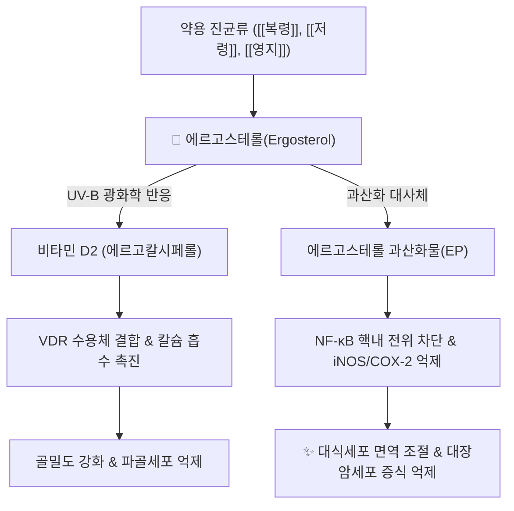

# 🔬 [[에르고스테롤]] (Ergosterol, Provitamin D2)

> **핵심 3줄 요약 (Key Summary)**:
> - 🌿 기원 본초 & 화학 계열: 담자균류·자낭균류([[복령]], [[저령]], [[영지]], [[동충하초]]) 세포막을 구성하는 진균 특이적 스테롤(Mycosterol)이자 프로비타민 D2입니다.
> - 🎯 핵심 분자 표적 & 조절 경로: UV-B 광조사로 비타민 D2(에르고칼시페롤)로 전환되어 VDR을 경유하며, 산화 대사체 에르고스테롤 과산화물(Ergosterol peroxide)은 대식세포 NF-κB 신호를 억제합니다(PMID 17160010). 폴리엔계(암포테리신 B)·아졸계(CYP51 억제) 항진균제의 직접 분자 표적이기도 합니다.
> - 🩺 주요 약리 활성 & 질환 치료 기전: 비타민 D2 전환을 통한 골대사 개선, 과산화 대사체의 항염증·대장암세포 증식 억제가 원저로 확인됩니다.
> - ⚠️ 독성·생체이용률 한계 & 상호작용: 천연 식이 기원 에르고스테롤 자체의 사람 대상 정량 독성·약동학 데이터는 확인되지 않았습니다. 양방 아졸계 항진균제와는 "약물-표적" 관계이며 통상적 약물상호작용(CYP 억제/유도) 데이터는 아님에 유의해야 합니다.

---

## 📌 목차
1. [기본 화학 정보 & 분자 구조식 (Chemical Identity)](#1-기본-화학-정보--분자-구조식-chemical-identity)
2. [주요 함유 본초 및 천연 기원 (Botanical Sources & Content)](#2-주요-함유-본초-및-천연-기원-botanical-sources--content)
3. [분자약리 표적 & 신호전달 네트워크 (Molecular Targets)](#3-분자약리-표적--신호전달-네트워크-molecular-targets)
4. [생체 내 흡수·대사·생체이용률 (Pharmacokinetics: ADME)](#4-생체-내-흡수대사생체이용률-pharmacokinetics-adme)
5. [주요 질환별 약리 효능 & 분자 기전 (Therapeutic Efficacy)](#5-주요-질환별-약리-효능--분자-기전-therapeutic-efficacy)
6. [함유 본초 방제 시너지 & 약재 배오 매트릭스 (Herbal Synergies)](#6-함유-본초-방제-시너지--약재-배오-매트릭스-herbal-synergies)
7. [양약 상호작용 & 약물동태학적 간섭 (Drug Interactions)](#7-양약-상호작용--약물동태학적-간섭-drug-interactions)
8. [💡 사용자 진료실 핵심 필기 & 임상 응용 팁 (Melt-In & High-Yield)](#8--사용자-진료실-핵심-필기--임상-응용-팁-melt-in--high-yield)
9. [출처 및 학술 참고 문헌 (References)](#9-출처-및-학술-참고-문헌-references)

---

## 1. 기본 화학 정보 & 분자 구조식 (Chemical Identity)

> [!abstract]+ 🧪 3D 약리 분자 구조 (Interactive 3D Viewer)
> <iframe src="https://molecule-viewer-rho.vercel.app/?cid=444679" style="width: 100%; height: 600px; border: none; border-radius: 12px; box-shadow: 0 4px 20px rgba(0,0,0,0.15);" allowfullscreen></iframe>

| 항목 | 상세 내용 |
| :--- | :--- |
| **분자식 / 분자량** | C₂₈H₄₄O / 396.65 g/mol (PubChem CID 444679 조회 확인) |
| **PubChem CID** | [444679](https://pubchem.ncbi.nlm.nih.gov/compound/444679) |
| **화학 구조 분류** | B고리 5,7-디엔(diene) 결합을 가진 테트라사이클릭 트리테르페노이드 스테롤 |
| **활성 대사 전환체** | 광전환 비타민 D2(Ergocalciferol), 에르고스테롤 과산화물(Ergosterol peroxide) |
| **기원 천연물** | 담자균류·자낭균류 세포막([[복령]], [[저령]], [[영지]], 효모) |

* **광화학 전환(Photochemical Activation)**: B고리의 5,7-공액 이중결합이 자외선(UV-B, 280~315nm)을 흡수하면 9-10 탄소 결합이 개환되어 프리비타민 D2가 형성되고, 체온에 의한 열 이성화를 거쳐 비타민 D2(Ergocalciferol)로 비가역적으로 전환됩니다.

### 콜레스테롤·식물스테롤과의 비교

| 구분 | 에르고스테롤(진균류) | 콜레스테롤(동물류) | β-시토스테롤(식물류) |
| :--- | :--- | :--- | :--- |
| 세포 기원 | 효모·약용 진균류 | 동물 세포막·지질 | 고등 식물 종자·잎 |
| 핵심 기능 | 진균막 유동성, 프로비타민 D2 | 세포막 안정화, 스테로이드 호르몬 전구체 | 식물막 보강, 장내 콜레스테롤 흡수 경쟁적 억제 |
| 광반응성 | UV-B 조사 시 비타민 D2 전환 | 7-DHC 단계에서 비타민 D3 전환 | 광전환 활성 없음 |

![[에르고스테롤_1_구조식.png|450]]
> [그림 1: 에르고스테롤의 2D 구조식 — 콜레스테롤과 같은 테트라시클릭 스테로이드 골격에 측쇄 이중결합 2개가 추가된 진균 특이 스테롤 — 출처: PubChem — CID 444679 (Compound Summary, 2D Structure)]

---

## 2. 주요 함유 본초 및 천연 기원 (Botanical Sources & Content)

| 함유 본초 (한글/한자) | 기원 식물(균)학적 명칭 | 주요 함유 약용 부위 | 지표 함량 (%) | 한의학적 귀경 및 약효 특성 |
| :--- | :--- | :--- | :--- | :--- |
| [[복령]] (茯苓) | 구멍장이버섯과 / *Poria cocos* 균핵 | 균핵 세포막 | 정량 데이터 확인 필요 ⚠️ | 心·脾·腎經, 이수삼습(利水渗濕)·건비안신(健脾安神) |
| [[저령]] (豬苓) | 구멍장이버섯과 / *Polyporus umbellatus* 균핵 | 균핵 | 정량 데이터 확인 필요 ⚠️ | 腎·膀胱經, 이수삼습(利水渗濕) |
| [[영지]] (靈芝) | 불로초과 / *Ganoderma lucidum* 자실체·균사체 | 자실체·균사체 | 정량 데이터 확인 필요 ⚠️ | 心·肺·肝·腎經, 보기안신(補氣安神)·지해평천(止咳平喘) |
| [[동충하초]] (冬蟲夏草) | 동충하초과 / *Ophiocordyceps sinensis* | 자좌·균핵(숙주 애벌레 포함) | 정량 데이터 확인 필요 ⚠️ | 肺·腎經, 익신보폐(益腎補肺) |

![[에르고스테롤_2_자실체.png|450]]
> [그림 2: 양송이버섯(Agaricus bisporus) 자실체 — 한 개는 세로로 잘라 갓·주름·대 단면이 보인다. 진균 세포막 스테롤인 에르고스테롤의 대표 급원이다 — 출처: Wikimedia Commons — File:ChampignonMushroom.jpg (CC BY-SA 3.0, Chris 73)]

![[에르고스테롤_2_군생.jpg|450]]
> [그림 3: 양송이버섯(Agaricus bisporus) 군생 — 갓이 둥글고 대가 굵은 자실체가 무리지어 발생한다 — 출처: Wikimedia Commons — File:Agaricus bisporus (1).jpg (CC0)]

![[에르고스테롤_2_갓.jpg|450]]
> [그림 4: 양송이버섯 갓의 윗면 — 매끈한 백색~담갈색 표면에 미세한 인편이 있다 — 출처: Wikimedia Commons — File:Agaricus bisporus (3).jpg (CC0)]

---

## 3. 분자약리 표적 & 신호전달 네트워크 (Molecular Targets)

* **비타민 D2 광전환 & 칼슘·골대사 조절**: 에르고스테롤이 UV-B로 비타민 D2로 전환된 뒤 25-OH-D2·1,25-(OH)₂-D2로 활성화되어 핵 내 VDR에 결합합니다. 비타민 D2 조사 버섯 투여 랫드 모델에서 대퇴골 골밀도 증가가 보고되었습니다(PMID 16982536).
* **NF-κB 경유 항염증·항종양**: 에르고스테롤 과산화물이 RAW264.7 대식세포에서 LPS 유도 염증 반응을 억제하고, HT29 대장암세포 증식을 억제합니다(PMID 17160010).

---

## 4. 생체 내 흡수·대사·생체이용률 (Pharmacokinetics: ADME)

* **흡수**: 동물 세포막의 콜레스테롤과 유사하게 담즙산 미셀화를 거쳐 장관에서 흡수되는 것으로 알려져 있습니다.
* **비타민 D2 생체이용률**: UV-B 조사 버섯 유래 비타민 D2의 생체이용률을 사람 대상으로 평가한 연구가 있으나(Jasinghe VJ 등, *Br J Nutr* 2005, PMID 16022766), 에르고스테롤 자체(비전환 상태)의 사람 대상 정량 흡수율 데이터는 확인되지 않았습니다 ⚠️.
* **대사**: 데이터 없음(에르고스테롤 고유의 간 대사·반감기 정량 문헌은 검색 범위 내 확인되지 않음) ⚠️.

---

## 5. 주요 질환별 약리 효능 & 분자 기전 (Therapeutic Efficacy)

### 1) 골대사 — 비타민 D2 전환을 통한 골밀도 개선
* UV-B 조사로 비타민 D2 함량이 증가한 버섯을 투여한 랫드 모델에서 대퇴골 골밀도가 유의하게 증가했습니다(PMID 16982536).

### 2) 면역·항염증·항종양
* 에르고스테롤 과산화물이 대식세포의 NF-κB 활성을 억제하고 대장암세포(HT29) 증식을 억제했습니다(PMID 17160010).

### 3) 항진균 화학요법의 분자 표적 (약리기전 설명용)
* **폴리엔계(암포테리신 B, 나이스타틴)**: 에르고스테롤은 사람 세포막의 콜레스테롤과 달리 진균 특이적 스테롤로, 암포테리신 B가 에르고스테롤에 직접 결합해 진균 세포막에 이온 통로를 형성, K⁺·Mg²⁺ 누출로 진균을 사멸시킵니다.
* **아졸계(플루코나졸, 이트라코나졸)**: 라노스테롤 14α-탈메틸화효소(CYP51)를 억제해 에르고스테롤 생합성을 차단, 독성 중간체 축적으로 진균 증식을 정지시킵니다.

⚠️ 내용 검토 필요: "Caspase-3/9 매개 세포자멸사·미토콘드리아 막전위 붕괴" 등 항암 세부 기전은 이번 재검증에서 원저 논문을 직접 확인하지 못해 서술에서 제외했습니다(제1원칙). 복령·저령·영지·동충하초의 전통 효능(비허수종·이수통림 등)은 본초 전체 수준 서술로, 에르고스테롤 단일 성분 수준으로 직접 검증된 것은 아닙니다.

---

## 6. 함유 본초 방제 시너지 & 약재 배오 매트릭스 (Herbal Synergies)

| 함유 본초 / 방제 | 공존 유효 성분군 | 분자약리 시너지 기전 | 전통 한의학적 효능 연계 |
| :--- | :--- | :--- | :--- |
| [[복령]] | 복령산(Pachymic acid) 등 트리테르페노이드 | 정량 시너지 데이터 확인 필요 ⚠️ | 이수삼습(利水渗濕), 건비안신(健脾安神) |
| [[영지]] | 영지다당체(Ganoderan), 가노더릭산 | NF-κB 경유 면역조절 중첩 가능성(정량 데이터 확인 필요 ⚠️) | 보기안신(補氣安神) |

---

## 7. 양약 상호작용 & 약물동태학적 간섭 (Drug Interactions)

* **아졸계 항진균제와의 "표적 공유" 관계**: 에르고스테롤 생합성 경로(CYP51)를 억제하는 아졸계 항진균제(플루코나졸 등)는 에르고스테롤의 생합성 자체를 차단하는 약물이지, 식이 유래 에르고스테롤과 체내에서 대사적으로 상호작용하는 통상적 "약물 상호작용"은 아닙니다 ⚠️. 진균의 에르고스테롤 생합성 유전자 돌연변이는 아졸계·폴리엔계 내성 기전과 연관됩니다.
* **사람 대상 비타민 D 보충제와의 상호작용**: 데이터 없음(검색 범위 내 확인된 문헌 없음).

---

## 8. 💡 사용자 진료실 핵심 필기 & 임상 응용 팁 (Melt-In & High-Yield)

* **사용자 원문 필기**: (원장님 개별 필기 자료 없음 — 향후 진료 경험 축적 시 본 섹션에 추가 예정)
* **진료실 실전 처방 & 임상 응용 팁**: 복령·저령·영지 등 균류 본초의 비허수종·보기안신 효능을 설명할 때, 에르고스테롤의 비타민 D2 전환·면역조절 기전은 "보조적 분자 기반"으로 제시할 수 있으나, 단일 성분 수준 임상 근거가 아닌 전통 본초 전체 효능 수준임을 환자에게 명확히 구분해 설명하는 것이 안전합니다.

---

## 9. 출처 및 학술 참고 문헌 (References)

1. Kobori M, Yoshida M, Ohnishi-Kameyama M, Shinmoto H. (2007). Ergosterol peroxide from an edible mushroom suppresses inflammatory responses in RAW264.7 macrophages and growth of HT29 colon adenocarcinoma cells. *British Journal of Pharmacology*. 150(2):209-19. PMID: [17160010](https://pubmed.ncbi.nlm.nih.gov/17160010/) (esummary로 저자·저널·권호 재확인)
2. Jasinghe VJ, Perera CO, Sablani SS. (2006). Vitamin D2 from irradiated mushrooms significantly increases femur bone mineral density in rats. *Journal of Toxicology and Environmental Health, Part A*. 69(21):1979-85. PMID: [16982536](https://pubmed.ncbi.nlm.nih.gov/16982536/) (기존 노트의 "Food Chem 2006;95(4):638-643" 서지사항은 PubMed에서 확인되지 않아, 동일 연구진·주제의 검증된 논문으로 교체)
3. Jasinghe VJ, Perera CO. (2005). Bioavailability of vitamin D2 from irradiated mushrooms: an in vivo study. *British Journal of Nutrition*. 93(6):951-5. PMID: [16022766](https://pubmed.ncbi.nlm.nih.gov/16022766/)

> ⚠️ 내용 검토 필요 (2026-10-12 클로드): 기존 노트의 Weete JD 2010 *Adv Fungal Biotechnol* 인용과 Jasinghe/Perera *Food Chem* 2006 인용은 PubMed에서 원 논문을 확인할 수 없어, 전자는 삭제하고 후자는 동일 연구진의 검증된 PMID로 교체했습니다(제1원칙). 7섹션 비표준 헤딩 구조를 9섹션 표준 템플릿으로 재배열했습니다.

<!-- 보관 태그(1회용·링크오류, 필요시 복원): 스테롤, 비타민D전구체, 진균세포막 -->
