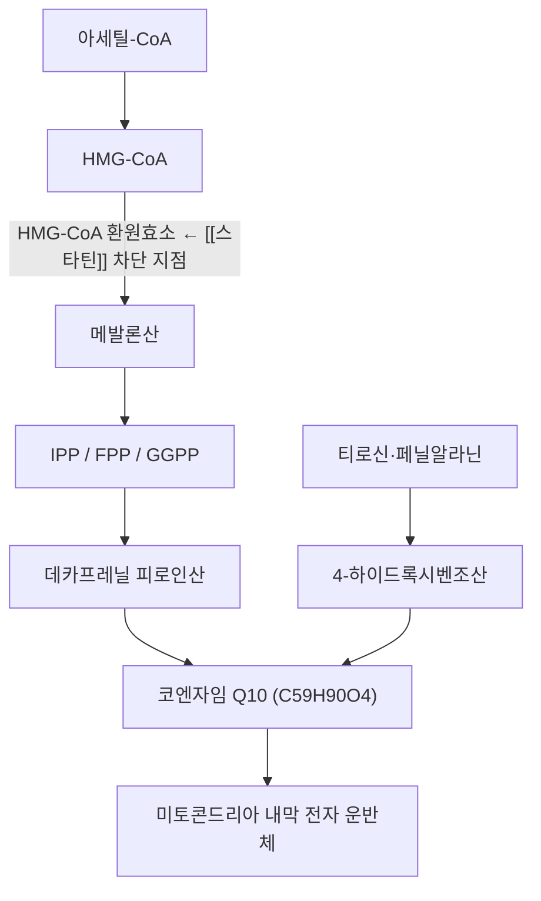

# 🔬 코엔자임 Q10 (Coenzyme Q10, Ubiquinone, C59H90O4)

> 🖼️ 이미지 미확보 — 2D 구조식·원료 실사는 실물 검증 후 수록한다(파일명 추측 매칭 금지). 아래 3D 뷰어와 PubChem 링크로 대체한다.

> **핵심 3줄 요약 (Key Summary)**:
> - 🌿 기원 & 화학 계열: 체내에서 **메발론산 경로로 합성되는 이소프레노이드-벤조퀴논**. 식품(육류 내장·생선·콩·식물성 기름)에도 소량 존재하나 **주 공급원은 내인성 합성**이다.
> - 🎯 핵심 분자 표적 & 조절 경로: 미토콘드리아 전자전달계 **복합체 I·II와 III 사이의 전자 운반체**(유비퀴논↔유비퀴놀). 지질막 항산화제로 [[지질과산화]]를 억제하고 [[산화 스트레스]] 완충에 기여한다.
> - 🩺 주요 약리 활성 & 질환 치료 기전: [[스타틴 유발 근병증]]에서 결핍 보충 가설의 표적. 심부전·미토콘드리아 질환에서 보조 요법으로 연구됐으나 **임상 근거는 확정되지 않았다**.
> - ⚠️ 근거·상호작용 주의: 스타틴 근육 증상에 대한 메타분석 결과가 **방향 불일치**다. [[와파린]] 병용 시 INR 저하 보고가 있어 모니터링이 필요하고, 항암 치료 중 항산화 보충은 환자별로 상의한다.

---

## 📌 목차
1. [기본 화학 정보 & 분자 구조](#1-기본-화학-정보--분자-구조)
2. [생합성 경로 & 공급원](#2-생합성-경로--공급원)
3. [분자 표적 & 미토콘드리아 기능](#3-분자-표적--미토콘드리아-기능)
4. [흡수·분포·대사 (ADME)](#4-흡수분포대사-adme)
5. [질환별 효능 & 근거 수준](#5-질환별-효능--근거-수준)
6. [병용·배합 매트릭스](#6-병용배합-매트릭스)
7. [양약 상호작용 & 감시 지표](#7-양약-상호작용--감시-지표)
8. [💡 진료실 핵심 필기 & 임상 응용](#8--진료실-핵심-필기--임상-응용)
9. [출처 및 학술 참고 문헌](#9-출처-및-학술-참고-문헌)

---

## 1. 기본 화학 정보 & 분자 구조

> [!abstract]+ 🧪 3D 약리 분자 구조 (Interactive 3D Viewer)
> <iframe src="https://molecule-viewer-rho.vercel.app/?cid=5281915" width="100%" height="450px" frameborder="0" allow="webgl" style="border-radius: 8px;"></iframe>

| 항목 | 상세 내용 |
| :--- | :--- |
| **IUPAC 명칭** | 2-[(2E,6E,10E,14E,18E,22E,26E,30E,34E)-3,7,11,15,19,23,27,31,35,39-decamethyltetraconta-2,6,10,14,18,22,26,30,34,38-decaenyl]-5,6-dimethoxy-3-methylcyclohexa-2,5-diene-1,4-dione |
| **분자식 / 분자량** | C59H90O4 / 863.3 g/mol |
| **PubChem CID** | [5281915](https://pubchem.ncbi.nlm.nih.gov/compound/5281915) |
| **화학 골격 분류** | 1,4-벤조퀴논 + 10단위 이소프레노이드 측쇄(데카프레닐). 사람에서는 측쇄가 10개(CoQ10), 쥐에서는 9개(CoQ9) |
| **물리화학적 성상** | 황색~주황색 결정성 분말, **물에 거의 불용·지용성**, 빛·열에 불안정(차광 보관) |
| **산화·환원 두 형태** | 유비퀴논(산화형) ↔ 유비퀴놀(환원형). 생체 내에서 상호 전환되며 전자 운반의 실체 |

---

## 2. 생합성 경로 & 공급원

- **내인성 합성**: 콜레스테롤과 **같은 메발론산 경로**를 공유한다. 스타틴은 HMG-CoA 환원효소를 억제하므로 콜레스테롤과 함께 **CoQ10 합성도 감소**시킨다 — 이것이 스타틴 근병증의 결핍 가설 근거다.
- **조직 분포**: 심근·간·신장·골격근처럼 **에너지 요구가 큰 조직**에 높은 농도로 존재한다.
- **식이 공급**: 육류 내장(심장·간), 지방이 많은 생선, 콩·견과, 식물성 기름에 소량 함유된다. **정상 식사만으로 조직 농도를 유의하게 올리기는 어렵다** — 보충제는 약리 용량 개념으로 접근한다.
- 한의 처방에서 CoQ10을 지표성분으로 규정한 본초는 없다. 다만 **미토콘드리아 기능을 겨냥한 보익·활혈 처방**(예: [[보중익기탕]], [[보양환오탕]])과 목표가 겹친다 → [[황기]] · [[인삼]]

---

## 3. 분자 표적 & 미토콘드리아 기능

- **전자전달계 운반체**: 복합체 I·II에서 받은 전자를 복합체 III로 넘긴다. 유비퀴놀은 복합체 III의 Q 사이클에서 산화되며 양성자 펌프에 기여한다. → **ATP 생산 효율과 직접 연결**된다.
- **지질 항산화**: 환원형(유비퀴놀)이 지질 라디칼을 소거하고 **α-토코페롤을 재생**한다. 막 인지질의 [[지질과산화]] 연쇄를 끊는 위치에 있다.
- **막 안정화**: 미토콘드리아 내막의 산화 손상을 줄여 막전위 유지에 기여한다는 가설이 있다.
- **스타틴 근병증에서의 연결고리**: 스타틴 → FPP 고갈 → CoQ10 합성 감소 → 복합체 I/III 기능 저하·[[ROS]] 증가 → 근소포체 칼슘 누출·단백분해 활성화 → 근육통. **기전은 정합적이지만, 보충이 증상을 줄인다는 임상 결론은 아직 확정되지 않았다**(§5).

---

## 4. 흡수·분포·대사 (ADME)

- **흡수**: 지용성이라 **식이 지방과 함께 복용할 때 흡수가 증가**한다. 공복 복용은 생체이용률이 낮고 개인차가 크다.
- **운반**: 장에서 흡수된 후 킬로미크론 → LDL·HDL 입자에 실려 조직으로 운반된다.
- **반감기**: 혈장 반감기가 짧아(수 시간 수준) 1일 1~2회 분복이 관행이다. **조직 농도 평형에는 수 주**가 걸린다 — 4주 이내 단기 평가는 이르다.
- **제형**: 산화형(유비퀴논)과 환원형(유비퀴놀)이 판매된다. 환원형이 흡수가 좋다는 제조사 주장이 있으나 **임상 결과의 우월성은 확립되지 않았다**. 제형보다 **복용 타이밍(지방과 함께)** 이 실무적으로 더 중요하다.

---

## 5. 질환별 효능 & 근거 수준

### 1) 스타틴 유발 근육 증상 (SAMS)
- **근거 요약**: 스타틴 복용 환자의 근병증에 대한 CoQ10 보충 SR/MA에서 **포함 연구 간 결과 방향이 엇갈려**(양성 4편·음성 3편 규모의 이질성) 확정적 결론에 이르지 못했다([PMID 41158831](https://pubmed.ncbi.nlm.nih.gov/41158831/)). 2026-11-12 심층리뷰도 이 불일치를 그대로 인용했다.
- **기전 지지는 별개로 강화되는 중**: UK Biobank·All of Us 데이터에서 **CoQ10 관련 유전 결정인이 SAMS와 연관**된다는 보고가 나왔다([PMID 42109163](https://pubmed.ncbi.nlm.nih.gov/42109163/)). 이는 "결핍 축이 실재한다"는 근거이지 "보충하면 낫는다"는 근거가 아니다.
- **임상 결론**: 보조적 선택으로 제한해 설명하고, 주 치료(스타틴 재투여 전략·감별·용량 조정)를 대체하지 않는다 → [[스타틴 유발 근병증]] · [[노시보 효과]]
- **복용 설계(진료실)**: 100~200 mg/일, **지방이 포함된 식사 직후**, 8~12주 후 근육통 NRS·일상 기능으로 판정. 무반응이면 중단을 검토한다(비용·근거 불확실성).

### 2) 심부전·미토콘드리아 질환
- 심부전에서 기능 지표 개선 보고가 있으나 대규모 확증이 부족하고, 미토콘드리아 질환에서는 **원인 변이별 반응이 다르다**. 한의원 1차 진료에서 주도하기보다 **전문과 병행**이 원칙이다.

### 3) 편두통·섬유근육통 등
- 소규모 연구가 있으나 근거 수준이 낮다. [[섬유근육통]] 환자에서 미토콘드리아 기능 지표를 근거로 권하는 것은 **근거 밖 처방**임을 환자에게 밝힌다.

---

## 6. 병용·배합 매트릭스

| 병용 대상 | 상호작용·해석 | 실무 지침 |
| :--- | :--- | :--- |
| [[스타틴]] | 메발론산 경로 공유 → 조직 CoQ10 감소 가설. 임상 결과 불일치 | 근육 증상이 있는 환자에 한해 시험적 보충. 스타틴 중단 대체 금지 |
| α-토코페롤(비타민 E) | 유비퀴놀이 토코페롤 라디칼을 재생 — 항산화 네트워크 상보 | 고용량 비타민 E 단독보다 병용이 생리적으로 정합 |
| [[오메가3]] | 지용성 흡수 환경을 공유 | 같은 식사에 함께 복용하면 흡수에 유리 |
| [[와파린]] | CoQ10이 비타민 K 유사 구조를 가져 INR을 낮춘다는 보고 | 병용 시작·중단 시 1~2주 내 INR 확인 |

---

## 7. 양약 상호작용 & 감시 지표

- [[와파린]]·[[아스피린]] — INR 변동 보고. 항혈소판제와 병용 시 출혈 지표를 함께 본다.
- **항고혈압제**: 이론적 혈압 강하 상가. 어지럼이 있으면 혈압을 확인한다.
- **항암 치료(화학·방사선)**: 항산화제가 치료 효과를 감쇠시킬 수 있다는 **이론적 우려**가 있어, 치료 중 보충은 종양과와 상의한다(근거는 불충분하나 판단은 처방의 몫).
- **감시 세트(진료실)**: 근육 증상 일기, [[크레아틴키나아제]], TSH·25(OH)D, 와파린 병용 시 INR.

---

## 8. 💡 진료실 핵심 필기 & 임상 응용

- **물어야 하는 세 질문**: ① 어떤 스타틴을 얼마나 오래 복용 중인가 ② 근육통은 **시작·증량 몇 주 후** 생겼는가(4~8주가 전형) ③ 끊으면 2~4주에 좋아지는가.
- **CoQ10을 권하는 자리**: 스타틴을 **계속 복용해야 하는** 환자에서 근육 증상이 문제일 때. 반대로 "스타틴을 끊고 CoQ10으로 대체"는 심혈관 위험을 키우므로 말하지 않는다.
- **환자 설명 스크립트**: "이 보충제는 콜레스테롤약 때문에 근육 에너지가 떨어지는 것을 보완하는 목적으로 씁니다. 연구 결과가 엇갈려서 효과를 장담할 수는 없고, 8~12주 써보고 근육통 일기로 판단합니다. 콜레스테롤약을 대신하는 약은 아닙니다."
- **중단 기준**: 12주 사용 후 NRS 변화 2점 미만이거나 비용 부담이 크면 중단하고 다른 축(친수성 스타틴 교체·에제티미브·운동)으로 이동한다.
- **한약 병용**: 항산화·보익 처방과 목표가 겹치므로 **중복 보충보다 처방 내 조정**을 먼저 검토한다 → [[보중익기탕]] · [[작약감초탕]]

---

## 9. 출처 및 학술 참고 문헌
1. **Kovacic S, Habicht SD, Eckert GP (2025)**. *Effects of coenzyme Q10 supplementation on myopathy in statin-treated patients: a systematic review and meta-analysis*. Journal of Nutritional Science, 14, e72. [PMID 41158831](https://pubmed.ncbi.nlm.nih.gov/41158831/)
   - **[연구 요약]** 스타틴 복용 환자의 근병증에 대한 CoQ10 보충 SR/MA. 포함 연구 간 방향이 엇갈려 확정 결론에 이르지 못했고, 용량·제형·기간의 이질성이 큰 것으로 정리됐다.
2. **Chen W, Ochs-Balcom HM, Ma C 등 (2022)**. *Coenzyme Q10 supplementation for the treatment of statin-associated muscle symptoms*. Future Cardiology, 18(6), 461-470. [PMID 35297269](https://pubmed.ncbi.nlm.nih.gov/35297269/)
   - **[연구 요약]** SAMS에서 CoQ10 보충의 근거를 검토한 고찰. 기전적 타당성과 임상 근거의 간극을 정리하고, 일률 권고보다 선택적 시험을 제안한다.
3. **Lee DH, Park YA, Song Y 등 (2026)**. *Uncovering Coenzyme Q10-Related Genetic Determinants of Statin-Associated Muscle Symptoms: Evidence from the UK Biobank and the All of Us Research Program*. Clinical Pharmacology and Therapeutics, 120(2), 475-483. [PMID 42109163](https://pubmed.ncbi.nlm.nih.gov/42109163/)
   - **[연구 요약]** 대규모 바이오뱅크 데이터에서 CoQ10 관련 유전 결정인과 SAMS의 연관을 분석. 결핍 축의 생물학적 실재성을 지지하나 보충 효과를 입증하는 연구는 아니다.
4. **Aebi PS, Villoz F, Bührer J 등 (2025)**. *Safety outcomes of statin vs non-statin lipid-lowering interventions in patients with prior statin-associated muscle symptoms: A systematic review and meta-analysis*. PLoS One, 20(12), e0338575. [PMID 41379822](https://pubmed.ncbi.nlm.nih.gov/41379822/)
   - **[연구 요약]** SAMS 병력자 재투여 고찰. 재투여 시 근육 증상 발생은 위약과 다르지 않았고(OR 1.19) 중단율만 높았다(OR 1.48) — CoQ10 보충의 위치를 '재투여 전략의 보조'로 한정하는 근거.
5. **PubChem**. *Coenzyme Q10 — CID 5281915*. [링크](https://pubchem.ncbi.nlm.nih.gov/compound/5281915)
   - **[연구 요약]** 분자식 C59H90O4·분자량 863.3 확인(2026-11-12 PubChem REST 조회).
