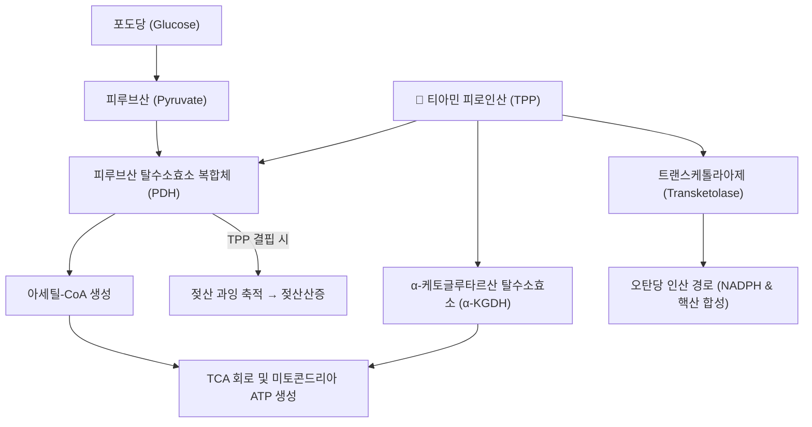

# 🔬 [[티아민]] (Thiamine, Vitamin B1, Aneurine)

> **핵심 3줄 요약 (Key Summary)**:
> - 🌿 기원 본초 & 화학 계열: 수용성 비타민 B군의 첫 번째 성분(비타민 B1)으로, [[맥아]]·[[의이인]] 등 곡류 배아·콩류·효모에 풍부한 티아졸륨계 화합물입니다.
> - 🎯 핵심 분자 표적 & 조절 경로: 생체 내 활성형 티아민 피로인산(TPP)으로 전환되어 피루브산 탈수소효소(PDH)·α-케토글루타르산 탈수소효소(α-KGDH)·트랜스케톨라아제의 필수 조효소로 작용합니다(PMID 25564426, PMID 16550223).
> - 🩺 주요 약리 활성 & 질환 치료 기전: 탄수화물 에너지 대사·TCA 회로 가동, 결핍 시 베르니케-코르사코프 증후군·각기병을 유발합니다.
> - ⚠️ 독성·생체이용률 한계 & 상호작용: 수용성 비타민으로 경구 독성은 거의 없으나, 고용량 정맥 주사 시 드물게 아나필락시스 유사 반응이 보고됩니다. 루프계 이뇨제 장기 복용자는 신장 배설 증가로 결핍 위험이 높아집니다.

---

## 📌 목차
1. [기본 화학 정보 & 분자 구조식 (Chemical Identity)](#1-기본-화학-정보--분자-구조식-chemical-identity)
2. [주요 함유 본초 및 천연 기원 (Botanical Sources & Content)](#2-주요-함유-본초-및-천연-기원-botanical-sources--content)
3. [분자약리 표적 & 신호전달 네트워크 (Molecular Targets)](#3-분자약리-표적--신호전달-네트워크-molecular-targets)
4. [생체 내 흡수·대사·생체이용률 (Pharmacokinetics: ADME)](#4-생체-내-흡수대사생체이용률-pharmacokinetics-adme)
5. [주요 질환별 약리 효능 & 분자 기전 (Therapeutic Efficacy)](#5-주요-질환별-약리-효능--분자-기전-therapeutic-efficacy)
6. [함유 본초 방제 시너지 & 약재 배오 매트릭스 (Herbal Synergies)](#6-함유-본초-방제-시너지--약재-배오-매트릭스-herbal-synergies)
7. [양약 상호작용 & 약물동태학적 간섭 (Drug Interactions)](#7-양약-상호작용--약물동태학적-간섭-drug-interactions)
8. [💡 사용자 진료실 핵심 필기 & 임상 응용 팁 (Melt-In & High-Yield)](#8--사용자-진료실-핵심-필기--임상-응용-팁-melt-in--high-yield)
9. [출처 및 학술 참고 문헌 (References)](#9-출처-및-학술-참고-문헌-references)

---

## 1. 기본 화학 정보 & 분자 구조식 (Chemical Identity)

> [!abstract]+ 🧪 3D 약리 분자 구조 (Interactive 3D Viewer)
> <iframe src="https://molecule-viewer-rho.vercel.app/?cid=1130" style="width: 100%; height: 600px; border: none; border-radius: 12px; box-shadow: 0 4px 20px rgba(0,0,0,0.15);" allowfullscreen></iframe>

| 항목 | 상세 내용 |
| :--- | :--- |
| **IUPAC 명칭** | 3-[(4-amino-2-methylpyrimidin-5-yl)methyl]-5-(2-hydroxyethyl)-4-methylthiazol-3-ium |
| **분자식 / 분자량** | C₁₂H₁₇N₄OS⁺ / 265.36 g/mol (PubChem CID 1130 조회 확인, 염산염 337.27 g/mol) |
| **PubChem CID** | [1130](https://pubchem.ncbi.nlm.nih.gov/compound/1130) |
| **화학 골격 분류** | 티아졸륨계 수용성 비타민(비타민 B1) |
| **생체 내 활성형** | 티아민 피로인산(TPP, Thiamine Pyrophosphate) |
| **천연 기원** | [[맥아]](麥芽), [[의이인]](薏苡仁), 미강(쌀겨), 대두, 효모, 돼지고기, 견과류 |

---

## 2. 주요 함유 본초 및 천연 기원 (Botanical Sources & Content)

| 함유 본초 (한글/한자) | 기원 식물학적 명칭 (과명 / 학명) | 주요 함유 약용 부위 | 지표 함량 (%) | 한의학적 귀경 및 약효 특성 |
| :--- | :--- | :--- | :--- | :--- |
| [[맥아]] (麥芽) | 벼과(Poaceae) / *Hordeum vulgare* 발아 종자 | 발아 종자 | 정량 데이터 확인 필요 ⚠️ | 脾·胃經, 소식화중(消食和中) |
| [[의이인]] (薏苡仁) | 벼과(Poaceae) / *Coix lacryma-jobi* | 성숙 종인 | 정량 데이터 확인 필요 ⚠️ | 脾·胃經, 건비삼습(健脾滲濕) |

---

## 3. 분자약리 표적 & 신호전달 네트워크 (Molecular Targets)

* **탄수화물 대사 및 미토콘드리아 ATP 생성**: TPP는 피루브산이 아세틸-CoA로 전환되는 필수 관문인 PDH의 필수 보효소입니다. 결핍 시 유산소 호흡이 중단되고 젖산이 축적되어 대사성 산증과 근육 피로를 초래합니다(PMID 25564426).
* **TCA 회로 가동 및 신경전달물질 합성**: α-KGDH 활성을 지탱해 ATP 생성 및 글루타메이트·GABA·아세틸콜린 합성을 정상화합니다(PMID 16550223).
* **오탄당 인산 경로 조효소**: 트랜스케톨라아제 활성을 매개해 신경세포막 수초(Myelin sheath) 유지와 NADPH 생합성에 기여합니다(PMID 16550223).

---

## 4. 생체 내 흡수·대사·생체이용률 (Pharmacokinetics: ADME)

* **흡수**: 공장(Jejunum)에서 능동 수송체(THTR-1, THTR-2) 및 고농도 시 단순 확산으로 흡수됩니다(PMID 25564426).
* **저장 및 반감기**: 체내 저장량이 약 30mg으로 매우 적어(간·골격근·뇌), 반감기 10~20일로 지속 공급이 필수적입니다.
* **배설**: 과잉 섭취 시 신장을 통해 소변으로 신속 배설됩니다.

---

## 5. 주요 질환별 약리 효능 & 분자 기전 (Therapeutic Efficacy)

### 1) 베르니케-코르사코프 증후군(Wernicke-Korsakoff Syndrome)
* 만성 알코올 중독 및 영양실조로 발생합니다. 급성기 안구운동마비·운동실조·의식혼탁(베르니케)과 만성기 불가역적 기억상실·작화증(코르사코프)이 나타납니다(PMID 25564426).
* **응급 수칙**: 저혈당 혼수 환자에게 포도당 수액을 단독 투여하면 급격한 티아민 소모로 뇌병증이 악화되므로, 포도당 투여 전·동시에 티아민을 먼저 투여합니다.

### 2) 각기병(Beriberi)
* 건성 각기병: 말초신경병증, 사지 무력, 감각 이상, 반사 소실.
* 습성 각기병: 심근 대사 부전으로 인한 고박출성 심부전, 폐부종, 전신 부종.

### 3) 당뇨병성 신경병증 및 만성 피로
* 지용성 유도체(벤포티아민 등)가 고혈당 유발 혈관 내피 손상 억제 및 당뇨 합병증 완화와 관련해 논의됩니다(PMID 16550223).

---

## 6. 함유 본초 방제 시너지 & 약재 배오 매트릭스 (Herbal Synergies)

| 함유 본초 / 방제 | 공존 유효 성분군 | 분자약리 시너지 기전 | 전통 한의학적 효능 연계 |
| :--- | :--- | :--- | :--- |
| [[오적산]] | [[맥아]] 등 소식 본초 | 정량 시너지 데이터 확인 필요 ⚠️ | 각기충심(脚氣衝心) 등 비위습열 관련 병증 |
| [[위령탕]] | [[의이인]] 등 이수 본초 | 정량 시너지 데이터 확인 필요 ⚠️ | 비위습열(脾胃濕熱) 개선 |

> 한의학에서 각기병(脚氣衝心 등)은 중초 비위의 습담이 하지 경락을 막고 심장으로 치밀어 오르는 병증으로 인식되며, 곡류 배아를 보양하는 식이 처방이 티아민 결핍 해소와 밀접하게 맞물립니다.

---

## 7. 양약 상호작용 & 약물동태학적 간섭 (Drug Interactions)

* **이뇨제**: 루프계 이뇨제(Furosemide 등) 장기 복용 환자는 티아민의 신장 배설이 증가해 결핍 위험이 높아지므로 추가 보충이 권고됩니다.
* **주사제 알레르기**: 고용량 정맥 주사 시 드물게 아나필락시스 유사 쇼크 반응이 발생할 수 있어 천천히 투여해야 합니다.

---

## 8. 💡 사용자 진료실 핵심 필기 & 임상 응용 팁 (Melt-In & High-Yield)

* **사용자 원문 필기**: (원장님 개별 필기 자료 없음 — 향후 진료 경험 축적 시 본 섹션에 추가 예정)
* **진료실 실전 처방 & 임상 응용 팁**: 만성 알코올 중독 환자나 영양실조 환자에서 포도당 수액을 투여하기 전 반드시 티아민을 먼저 투여해야 함을 숙지합니다. 만성 피로·당뇨병성 신경병증 환자에서 티아민 결핍 여부를 선별하는 것이 실질적입니다.

---

## 9. 출처 및 학술 참고 문헌 (References)

1. Frank LL. (2015). Thiamin in Clinical Practice. *JPEN Journal of Parenteral and Enteral Nutrition*. 39(5):503-20. PMID: [25564426](https://pubmed.ncbi.nlm.nih.gov/25564426/)
   - **[연구 요약]**: 티아민의 분자생화학적 대사 경로, 결핍 시 나타나는 뇌병증과 심부전의 병태생리 및 임상 수액 투여 가이드를 정리.
2. Lonsdale D. (2006). A review of the biochemistry, metabolism and clinical benefits of thiamin(e) and its derivatives. *Evidence-Based Complementary and Alternative Medicine*. 3(1):49-59. PMID: [16550223](https://pubmed.ncbi.nlm.nih.gov/16550223/)
   - **[연구 요약]**: 티아민과 지용성 유도체(벤포티아민)의 미토콘드리아 에너지 대사 조절 및 만성 퇴행성 질환 예방 메커니즘을 정리.

> ⚠️ 내용 검토 필요 (2026-10-12 클로드): PMID 2건 모두 esummary로 재확인해 완전 일치. 6섹션 비표준 구조를 9섹션 표준 템플릿으로 재배열했습니다.

<!-- 보관 태그(1회용·링크오류, 필요시 복원): 수용성비타민, 탄수화물대사, 뇌신경대사, 각기병, 베르니케코르사코프 -->
