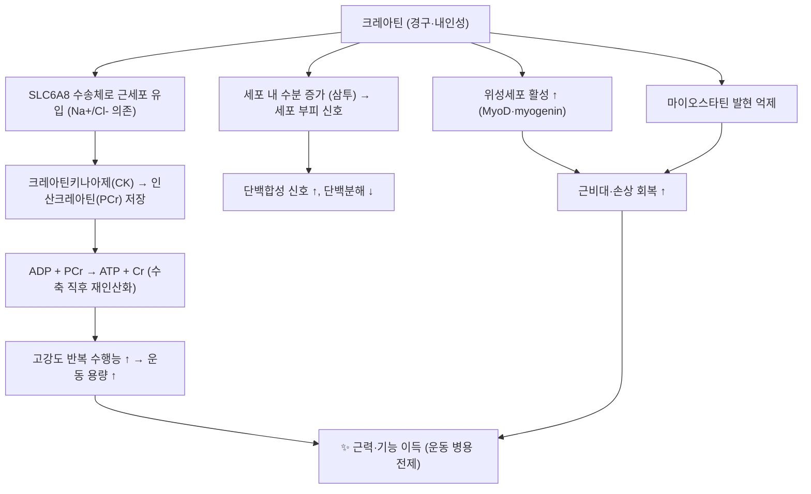

# 🔬 크레아틴 (Creatine, C₄H₉N₃O₂ / 2-[carbamimidoyl(methyl)amino]acetic acid)

> **핵심 3줄 요약 (Key Summary)**:
> 크레아틴은 글리신·아르기닌·메티오닌(SAM)에서 합성되는 내인성 구아니딘 화합물로, 체내 총량의 약 95%가 골격근에 인산크레아틴(PCr) 형태로 저장된다.
> 인산크레아틴 셔틀을 통해 ADP를 ATP로 재인산화해 **단시간 고강도 수축의 에너지 완충**을 담당한다. 즉 "운동을 대신하는 약"이 아니라 "운동 용량을 늘려 주는 증폭기"다.
> 2026년 슬관절 골관절염 RCT에서 물리치료·[[저항운동]]에 add-on했을 때 4주째 VAS·낙상위험·[[KOOS]] 총점·등척성 신전근력이 위약보다 더 개선됐다(표본 40명·4주·단일기관).

---

## 📌 목차
1. [기본 화학 정보 & 분자 구조식](#1-기본-화학-정보--분자-구조식)
2. [주요 함유 본초 및 천연 기원](#2-주요-함유-본초-및-천연-기원)
3. [분자약리 표적 & 신호전달 네트워크](#3-분자약리-표적--신호전달-네트워크)
4. [생체 내 흡수·대사·생체이용률](#4-생체-내-흡수대사생체이용률)
5. [주요 질환별 약리 효능 & 분자 기전](#5-주요-질환별-약리-효능--분자-기전)
6. [함유 본초 방제 시너지 & 병용 중재 매트릭스](#6-함유-본초-방제-시너지--병용-중재-매트릭스)
7. [양약 상호작용 & 검사실 간섭](#7-양약-상호작용--검사실-간섭)
8. [💡 사용자 진료실 핵심 필기 & 임상 응용 팁](#8--사용자-진료실-핵심-필기--임상-응용-팁)
9. [출처 및 학술 참고 문헌](#9-출처-및-학술-참고-문헌)

---

## 1. 기본 화학 정보 & 분자 구조식 (Chemical Identity)

| 항목 | 내용 |
| :--- | :--- |
| **IUPAC명** | 2-[carbamimidoyl(methyl)amino]acetic acid |
| **분자식 / 분자량** | C₄H₉N₃O₂ / 131.13 |
| **PubChem CID** | 586 |
| **CAS** | 57-00-1 (모노하이드레이트는 6020-87-7) |
| **분류** | 구아니딘 유도체(아미노산 대사산물) — 파이토케미컬이 아닌 내인성 분자 |
| **시판 형태** | 크레아틴 모노하이드레이트가 표준. 염산염·구연산염·에틸에스테르는 흡수 우위 근거가 없다 |

![[크레아틴_01_구조식.png|420]]
> [그림 1: 크레아틴 2D 구조식 — 글리신 골격의 아미노기에 메틸기와 구아니디노기(C(=NH)NH₂)가 붙은 구조. 카복실산·구아니딘 두 극성단이 수소결합과 세포 내 삼투압에 관여한다 — PubChem CID 586 PNG]

> **[구조적 특징]** 세 개의 질소가 만드는 구아니딘기는 강염기성 양전하를 띠어 인산기와 가역적으로 결합한다. 이 성질이 인산크레아틴의 "인산 저장" 기능의 화학적 토대다. 친수성이 높아 물에는 녹지만 지용성은 거의 없으므로 세포막 통과는 반드시 전용 수송체(SLC6A8)에 의존한다.

---

## 2. 주요 함유 본초 및 천연 기원 (Botanical Sources & Content)

> ⚠️ 이 항목은 다른 약리성분 노트와 성격이 다르다. 크레아틴은 **어떤 본초의 지표성분도 아니다**. 본초 기원 항목은 "해당 없음"으로 두고, 실제 공급원을 식품·내인성 합성으로 대체한다.

* **내인성 합성**: 신장에서 아르기닌 + 글리신 → 구아니디노아세트산(GAA, AGAT 효소) → 간에서 SAM 의존 메틸화(GAMT) → 크레아틴. 하루 약 1 g 내외가 합성된다.
* **식품 급원**: 육류·어류(특히 청어·연어·소고기)에 풍부하고, 식이로 하루 1~2 g(육식 위주)에서 0.5 g 이하(채식)까지 차이가 난다.
* **임상적 함의**: 채식주의자·고령자는 근육 저장량이 낮아 보충 이득이 상대적으로 크다. 반대로 이미 포화된 젊은 육식 운동선수는 추가 이득이 작다.
* **한약재와의 관계**: 한약 처방으로 크레아틴을 "보충"하는 개념은 성립하지 않는다. 한약은 운동 수행·근감소 축에서 보익약 계열로 접근하고, 크레아틴은 별도 영양 전략으로 다룬다.

---

## 3. 분자약리 표적 & 신호전달 네트워크 (Molecular Targets)

### 1) 핵심 분자 표적 (Molecular Targets)
* **크레아틴키나아제(CK)**: PCr + ADP ⇌ Cr + ATP. 골격근 CK-MM 동형이 주 담당으로, 수축 개시 수 초의 ATP를 PCr에서 충당한다.
* **SLC6A8(CRT)**: 크레아틴 전용 수송체. 근육 포화 속도를 결정하며, 개인 간 반응 차이의 상당 부분을 설명한다.
* **위성세포**: 크레아틴은 휴지기 위성세포를 직접 분열시키기보다, 운동으로 활성화된 위성세포의 증식·분화 신호를 증폭하는 방향으로 작용한다.
* **마이오스타틴**: 근성장 억제 인자. 크레아틴 보충 시 발현이 낮아진다는 보고가 있으며, 이는 근비대 이득의 한 경로로 해석된다.

---

## 4. 생체 내 흡수·대사·생체이용률 (Pharmacokinetics: ADME)

* **흡수**: 경구 복용 시 위장관에서 잘 흡수되지만, 고용량을 한 번에 먹으면 흡수가 포화돼 소변으로 배설된다. 그래서 적재기에 5 g씩 4회 분복이 표준이다.
* **분포**: 흡수 후 근육으로 분배되며, 근육 포화까지 **5 g/일 유지 시 3~4주**, **20 g/일 적재 시 5~7일**이 걸린다.
* **대사·배설**: 크레아틴과 PCr이 비가역적으로 크레아티닌으로 전환돼 신장으로 배설된다. 이 때문에 보충 시 **혈청 크레아티닌이 상승**하고 eGFR이 낮게 계산될 수 있다 — 실제 신기능 저하와 구별해야 한다.
* **세포 내 수분**: 근육 1 g당 약 3 g의 물을 끌어들여 체중이 1~2 kg 늘 수 있다. 지방 증가가 아니다.

---

## 5. 주요 질환별 약리 효능 & 분자 기전 (Therapeutic Efficacy)

> 템플릿의 대사·심혈관·염증 3분류는 크레아틴의 실제 근거 분포와 맞지 않는다. 근거가 존재하는 축으로 재편해 서술한다.

### 1) 슬관절 골관절염 (운동 병용 add-on) — 이번 회차의 핵심
* 2026년 RCT(40명, 4주, 이중눈가림): 양군 모두 물리치료 + 저항운동(주 3회 감독 + 주 4일 가정)을 받고 크레아틴(적재 20 g/일 → 유지 5 g/일) 또는 위약(말토덱스트린)을 추가했다.
* 결과: VAS 6.30→1.75 cm 대 6.05→2.55 cm, 낙상위험 점수 3.41→2.33 대 3.34→3.15, 환측 슬관절 신전 등척성 근력 90.75→141.25 대 93.50→128.15, KOOS 총점 군×시간 상호작용 유의(p<0.001).
* 이득이 없던 항목: 관절가동범위(p=0.875), 5회 앉았다 일어나기 시간(p=0.793), KOOS 삶의 질 하위척도(p=0.051).
* 해석: 크레아틴은 **통증·근력·낙상위험** 축에서 더했고, **가동범위·기립 속도**에는 더하지 못했다. 연골 대사나 관절 내 염증을 직접 바꾼 근거는 이 시험에 없다.

### 2) 근감소·노인 근력
* 저항운동과 병용할 때 제지방량·근력 이득이 위약보다 크다는 보고가 누적돼 있다. 단독으로는 효과가 미미하다.
* 고령자는 근육 저장량이 낮아 반응이 클 수 있으나, 신기능·수분 상태를 먼저 확인해야 한다.

### 3) 스포츠 수행·회복
* 단시간·고강도·반복 스프린트 계열에서 이득이 가장 일관적이다. 지구성 유산소 수행능 개선 근거는 상대적으로 약하다.

---

## 6. 함유 본초 방제 시너지 & 병용 중재 매트릭스 (Herbal Synergies)

본초 배오 대신, 실제 임상에서 크레아틴과 **함께 처방해야 하는 중재**를 매트릭스로 정리한다.

| 병용 중재 | 근거 수준 | 실제 처방 형태 | 주의점 |
| :--- | :--- | :--- | :--- |
| [[저항운동]] | 높음 (필수 전제) | 8RM의 80%, 3세트×8회, 주 3회 감독 | 운동 없는 크레아틴은 효과 없음 |
| 단백질 섭취 | 중간 | 1일 1.2~1.5 g/kg 분산 | 신질환자에서는 별도 제한 |
| [[비타민 D]] 교정 | 중간 | 결핍 확인 후 보충 | 근력 해석의 교란 요인 제거 |
| 보익약 계열 한약 | 낮음 (경험적) | 변증에 따른 보기·보혈 | 크레아틴 대체가 아니라 병행 |

---

## 7. 양약 상호작용 & 검사실 간섭 (Drug Interactions)

* **신독성 약물 병용**: [[NSAIDs]]·아미노글리코사이드·사이클로스포린 등과 함께 쓸 때 신장 부담이 가중될 수 있다는 이론적 우려가 있다. 신기능이 정상인 사람에서 임상적 근거는 약하지만, 신질환자에서는 병용을 피한다.
* **검사실 간섭 (가장 중요)**: 크레아틴 → 크레아티닌 전환 때문에 혈청 크레아티닌이 상승하고 eGFR이 실제보다 낮게 산출된다. 보충 중인 환자의 "신기능 악화"는 **시스타틴 C**로 재확인한다.
* **이뇨제·탈수**: 이뇨제 병용 시 탈수·전해질 교란 위험이 커진다. 여름철·고령자에서 특히 주의.
* **카페인**: 길항 작용이 보고된 바 있으나 재현성이 낮다. 임상적으로는 수면·심박 항진 위주로 관찰한다.

---

## 8. 💡 사용자 진료실 핵심 필기 & 임상 응용 팁 (Melt-In & High-Yield)

* **재현 가능한 처방 세트 (이 시험 프로토콜)**:
  * 크레아틴 모노하이드레이트 적재 20 g/일(5 g × 4회 분복) → 유지 5 g/일. 원문은 적재기·유지기 각각의 세부 일수를 명시하지 않았다(ISSN 표준 제시).
  * 저항운동: 8RM의 80%로 3세트 × 8회, 반복 간 10~15초·세트 간 1~2분 휴식, 주 3회 감독 + 주 4일 가정, 총 4주, **매주 8RM 재측정**.
  * 조정 규칙: 8회를 2세트 연속 깔끔히 못 하면 중량 10% 하향. 세션 중 통증 NRS가 2점 이상 오르면 해당 동작은 건너뛴다.
  * 구성: 워밍업 걷기 10분 → 레그프레스·동심성/등척성 슬관절 신전·굴곡·미니 스쿼트·고정식 자전거 → 종료 시 말기 슬관절 신전.
* **금기·중단 기준**: eGFR 30 미만, 신장질환 병력, 탈수 경향, 심부전·부종성 질환, 임신·수유(근거 부족). 보충 후 체중이 2주에 2 kg 이상 늘고 부종이 동반되면 중단하고 체성분을 확인한다.
* **환자 스크립트**: "이건 관절약이 아니라 근육의 에너지 저장고를 채우는 영양제입니다. 운동을 똑같이 하시면서 드시면 같은 운동으로 더 많은 힘을 얻습니다. 대신 물을 충분히 드시고, 체중이 1~2 kg 늘 수 있는데 지방이 아니라 근육 안의 물입니다."
* **해석 주의**: 등척성 근력 수치의 원문 단위 표기가 mmHg로 돼 있어(통상 N·m 표기) 절대값보다 **변화 방향과 군간 차이**로 읽는다. 표본 40명·4주·단일기관이므로 효과크기는 과대평가됐을 수 있다.

---

## 9. 출처 및 학술 참고 문헌 (References)

1. **Osama M, Afridi S, Bonnechère B, et al. (2025)**. *Additional Benefits of Creatine Supplementation with Physical Therapy and Resistance Exercise in Knee Osteoarthritis: A Randomized Controlled Trial*. **Journal of Clinical Medicine**, 14(23):8538. [PMID 41375841](https://pubmed.ncbi.nlm.nih.gov/41375841/) · doi:10.3390/jcm14238538
   - **[연구 요약]**: 슬관절 골관절염 환자 40명(40~70세)을 크레아틴·위약으로 나눠 4주간 물리치료 + 저항운동에 add-on한 이중눈가림 RCT. VAS·낙상위험·KOOS 총점·등척성 신전근력에서 크레아틴군 우세, 관절가동범위·5회 앉았다 일어나기·KOOS 삶의 질은 차이 없음. 이상반응은 관찰되지 않았다.
2. **PubChem CID 586 — Creatine**. [https://pubchem.ncbi.nlm.nih.gov/compound/586](https://pubchem.ncbi.nlm.nih.gov/compound/586)
   - **[화학 정보]**: 분자식 C₄H₉N₃O₂, 분자량 131.13, 2D 구조 확인. 본 노트 그림 1의 출처.

> 검증 메모 (2026-11-19): PMID 41375841은 NCBI esummary로 제목·저널·연도를 대조했고, CID 586은 PubChem 명칭 조회(`/compound/name/creatine/cids/TXT`)로 확인했다. ISSN 포지션 스탠드·개별 약동학 논문은 원문 리뷰에 실린 범위를 넘어서므로 인용하지 않았다.
