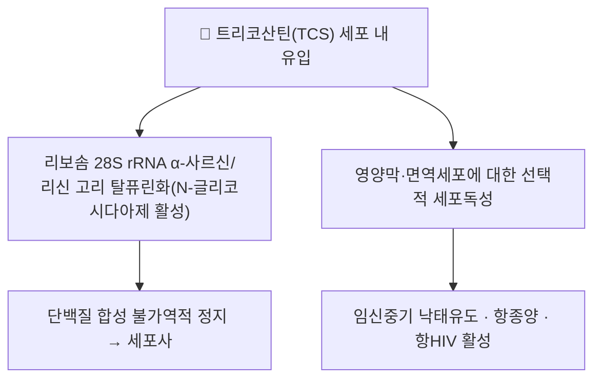

# 🔬 트리코산틴 (Trichosanthin, TCS)

> **핵심 3줄 요약 (Key Summary)**:
> - 🌿 기원 본초 & 화학 계열: 박과 하눌타리(*Trichosanthes kirilowii*)의 뿌리(天花粉, [[천화분]])에서 추출되는 Type 1 리보솜 불활성화 단백질(Ribosome-Inactivating Protein, RIP). 전구체는 약 289개 아미노산(~27 kDa)이며, N말단 신호펩티드(23 잔기)와 C말단 펩티드(19 잔기)가 제거된 성숙형은 약 247개 아미노산으로 구성된다. 같은 식물의 씨앗([[과루인]])·열매 추출물과는 별도로 다뤄지는 뿌리 유래 단백질 성분이다.
> - 🎯 핵심 분자 표적 & 조절 경로: RNA N-글리코시다아제로서 리보솜 28S rRNA의 α-사르신/리신 고리(α-sarcin/ricin loop)에서 아데닌 잔기를 탈퓨린화(depurination)하여 단백질 합성을 불가역적으로 정지시킨다. 리보솜 줄기 P단백질의 C말단 꼬리에 결합하며, 핵심 촉매 잔기는 Tyr70·Tyr111·Glu160·Arg163·Phe192로 보고된다.
> - 🩺 주요 약리 활성 & 질환 치료 기전: 중국 전통의학에서 수백 년간 임신 중기 낙태유도제로 사용되어 왔으며, 현대 연구에서는 항종양(리보솜 불활성화를 통한 세포독성)·항HIV(1상/2상 임상에서 혈청 p24 항원 감소·CD4+ 수 증가 보고)·면역조절(T세포 반응에 영향) 활성이 연구되었다.
> - ⚠️ 독성·생체이용률 한계 & 상호작용: 광범위한 종양세포 독성과 함께 항원성(면역원성)·짧은 반감기·낮은 종양 표적성·낮은 세포 투과성이 임상 전환의 걸림돌로 지적된다. 낙태유도 활성로 인해 임신부 금기 성분이며, 단백질 제제 고유의 과민반응·발열 등 전신 이상반응 가능성이 있다. 정량적 인체 약동학 수치와 양약과의 상호작용 자료는 이번 검색에서 확인하지 못했다.

---

## 📌 목차
1. [기본 화학 정보 & 분자 구조식 (Chemical Identity)](#1-기본-화학-정보--분자-구조식-chemical-identity)
2. [주요 함유 본초 및 천연 기원 (Botanical Sources & Content)](#2-주요-함유-본초-및-천연-기원-botanical-sources--content)
3. [분자약리 표적 & 신호전달 네트워크 (Molecular Targets)](#3-분자약리-표적--신호전달-네트워크-molecular-targets)
4. [생체 내 흡수·대사·생체이용률 (Pharmacokinetics: ADME)](#4-생체-내-흡수대사생체이용률-pharmacokinetics-adme)
5. [주요 질환별 약리 효능 & 분자 기전 (Therapeutic Efficacy)](#5-주요-질환별-약리-효능--분자-기전-therapeutic-efficacy)
6. [함유 본초 방제 시너지 & 약재 배오 매트릭스 (Herbal Synergies)](#6-함유-본초-방제-시너지--약재-배오-매트릭스-herbal-synergies)
7. [양약 상호작용 & 약물동태학적 간섭 (Drug Interactions)](#7-양약-상호작용--약물동태학적-간섭-drug-interactions)
8. [💡 사용자 진료실 핵심 필기 & 임상 응용 팁 (Melt-In & High-Yield)](#8--사용자-진료실-핵심-필기--임상-응용-팁-melt-in--high-yield)
9. [출처 및 학술 참고 문헌 (References)](#9-출처-및-학술-참고-문헌-references)

---

## 1. 기본 화학 정보 & 분자 구조식 (Chemical Identity)

> [!info] 🧪 3D 뷰어 미적용
> 트리코산틴은 약 25~27 kDa급 단백질로 PubChem 소분자(Compound) 항목이 없어 PubChem CID 기반 3D 뷰어를 삽입하지 않습니다. 단백질 구조는 아래 PDB 항목(RCSB)을 참고하세요.

| 항목 | 상세 내용 |
| :--- | :--- |
| **분류** | Type 1 리보솜 불활성화 단백질(RIP) — 단일 사슬 RNA N-글리코시다아제 |
| **구조** | 단일 사슬, 2개 도메인 구조. 전구체 ~289 aa(~27 kDa) → N말단 신호펩티드(23 잔기)·C말단 펩티드(19 잔기) 절단 후 성숙형 ~247 aa |
| **IUPAC 명칭** | 해당 없음(단백질) |
| **분자식 / 분자량** | 해당 없음(단백질). 성숙형 기준 약 247개 아미노산(전구체 ~27 kDa) |
| **PubChem CID** | 해당 없음(단백질) |
| **CAS 등록 번호** | ⚠️ 내용 검토 필요 — 확인하지 못함 |
| **결정 구조 (PDB)** | [1GIS](https://www.rcsb.org/structure/1GIS) · [1GIU](https://www.rcsb.org/structure/1GIU) · [2JDL](https://www.rcsb.org/structure/2JDL) 리보솜 줄기 P단백질 복합체 |
| **화학 골격 분류** | 단백질(Type 1 RIP, 단일 사슬) |
| **핵심 촉매 잔기** | Tyr70, Tyr111, Glu160, Arg163, Phe192 |
| **물리화학적 성상** | ⚠️ 원문에 구체적 성상 기재 없음 |

---

## 2. 주요 함유 본초 및 천연 기원 (Botanical Sources & Content)

| 함유 본초 (한글/한자) | 기원 식물학적 명칭 (과명) | 주요 함유 약용 부위 | 한의학적 귀경 및 약효 특성 |
| :--- | :--- | :--- | :--- |
| [[천화분]](天花粉) | 박과(Cucurbitaceae) / *Trichosanthes kirilowii* | 뿌리(괴경) | 肺·胃經, 청열생진(淸熱生津)·소종배농(消腫排膿) — 트리코산틴 단백질의 주 공급원 |
| [[과루인]] (瓜蔞仁) | 박과 / *Trichosanthes kirilowii* | 씨앗 | 肺·胃·大腸經, 청열화담(淸熱化痰)·윤조통변(潤燥通便) — 씨앗 자체에는 지방유·쿠쿠르비타신 계열이 주이며, 트리코산틴은 뿌리(천화분) 유래 단백질이 교차 인용되는 경우가 있어 부위 구분에 주의가 필요하다 |

* ⚠️ 하눌타리(瓜蔞) 한 식물에서 뿌리([[천화분]], 天花粉)·씨앗([[과루인]])·열매껍질(瓜蔞皮)이 각기 다른 효능으로 쓰이며, **트리코산틴 단백질은 뿌리([[천화분]]) 추출물의 핵심 활성 성분**으로 보고된다(참고문헌 3). 볼트 내 [[과루인]] 노트에도 트리코산틴이 함유 성분으로 교차 언급되어 있으나, 이는 하눌타리 전체 식물의 대표 활성물질로 포괄 인용된 것으로 읽는 것이 정확하다.

---

## 3. 분자약리 표적 & 신호전달 네트워크 (Molecular Targets)

* **리보솜 불활성화**: 트리코산틴은 RNA N-글리코시다아제로서 쥐 간 리보솜 28S rRNA의 α-사르신/리신 고리에서 아데닌 잔기(위치 4324 상당)를 탈퓨린화하여 리보솜을 불활성화, 단백질 합성을 정지시킨다. 리보솜 줄기 P단백질의 C말단 꼬리에 결합하며 Tyr70·Tyr111·Glu160·Arg163·Phe192가 핵심 촉매 잔기로 보고된다(참고문헌 1).
* **영양막 세포 선택적 독성**: 임신 영양막(trophoblast) 세포에 대한 선택적 독성이 전통적 낙태유도 활성의 분자적 기반으로 다뤄지며, 생쥐 복강 투여 시 배아 착상 전 발달을 교란해 유산을 유도한다(참고문헌 2).
* **면역조절**: T세포 반응에 영향을 미치는 면역억제성 작용이 보고되며, 항HIV 활성과 관련한 사이토카인(케모카인) 상호작용 연구도 이뤄졌다(참고문헌 1).

---

## 4. 생체 내 흡수·대사·생체이용률 (Pharmacokinetics: ADME)

* 단백질 제제로서 경구 투여 시 소화관에서 분해되어 생체이용률이 극히 낮을 것으로 예상되며, 임상에서는 주사(근육/정맥) 경로로 투여된다.
* 짧은 반감기·낮은 종양 조직 투과성이 임상 전환의 제한 요인으로 지적되나, 구체적 반감기·분포용적 등 정량적 인체 약동학 수치는 이번 검색 범위에서 확인하지 못했다 ⚠️.
* PEG화(PEGylation)가 반감기 연장을 목적으로 시도되었으나, 항HIV 효력이 시험관 내에서 감소하는 trade-off가 보고된다(참고문헌 1).

---

## 5. 주요 질환별 약리 효능 & 분자 기전 (Therapeutic Efficacy)

### 1) 임신중기 낙태유도(전통 한의학·현대 임상 공통)
* 생쥐에 임신 1~3일째 복강 투여(0.20~0.25 mg/25 g 용량) 시 64~80%에서 유산이 유도되고 배아의 착상 전 발달이 교란되었으며, 완전 유산한 개체의 이후 임신·출산은 정상이었다(참고문헌 2). 중국에서는 임신중기 인공유산 및 포상기태·융모암 보조치료에 임상적으로 활용되어 왔다(참고문헌 1).

### 2) 항HIV
* 1상/2상 임상시험에서 지도부딘(AZT)·디다노신과 병용 또는 단독 투여 시 AIDS·AIDS 관련 증후군 환자의 혈청 p24 항원 감소 및 CD4+ T세포 수 증가가 보고되었다. 다만 항원성·면역원성이 반복 투여의 제한 요인으로 지적된다(참고문헌 1).

### 3) 항종양
* 광범위한 종양세포주에 대한 리보솜 불활성화 기반 세포독성이 보고되나, 낮은 종양 표적성·짧은 반감기로 인해 단독 임상 적용에는 한계가 있는 것으로 다뤄진다(참고문헌 1).

> ⚠️ 항HIV·항종양 효능은 주로 초기 임상시험 및 세포·동물 연구 단계이며, 현재 표준치료로 확립된 근거는 확인하지 못했다.

---

## 6. 함유 본초 방제 시너지 & 약재 배오 매트릭스 (Herbal Synergies)

| 함유 본초 / 방제 | 공존 유효 성분군 | 전통 한의학적 효능 연계 |
| :--- | :--- | :--- |
| [[천화분]] | (뿌리 유래 단백질 분획), [[쿠쿠르비타신]] B/D | 청열생진(淸熱生津)·소종배농(消腫排膿) — 인슐린 감수성 개선·면역세포 자멸사 유도·종양 신생혈관 차단 보고(천화분 노트 §2 참조) |
| [[과루인]] | [[쿠쿠르비타신]](Cucurbitacin B/D), 트리코산산(Trichosanic acid) 등 지방유 | 청열화담(淸熱化痰)·윤조통변(潤燥通便) — 트리코산틴과는 함유 부위가 구분됨 |

---

## 7. 양약 상호작용 & 약물동태학적 간섭 (Drug Interactions)

* 지도부딘(AZT)·디다노신과의 병용 임상시험이 보고되었으나, 이는 상호작용 연구라기보다 병용 투여 유효성·내약성 평가 중심이었다(참고문헌 1).
* 단백질 제제 고유의 면역원성으로 인해 반복 투여 시 항체 형성·과민반응 위험이 있으며, 이 경우 효력 저하나 전신 이상반응으로 이어질 수 있다는 점이 지적되나 정량적 상호작용 데이터는 확인하지 못했다 ⚠️.

---

## 8. 💡 사용자 진료실 핵심 필기 & 임상 응용 팁 (Melt-In & High-Yield)

* 현재 별도로 기록된 원장님 임상 필기가 없습니다.

---

## 9. 출처 및 학술 참고 문헌 (References)

1. Shi WW, Wong KB, Shaw PC. (2018). Structural and Functional Investigation and Pharmacological Mechanism of Trichosanthin, a Type 1 Ribosome-Inactivating Protein. *Toxins (Basel)*, 10(8):335. DOI: 10.3390/toxins10080335. PMID: [30127254](https://pubmed.ncbi.nlm.nih.gov/30127254/)
   - [연구 요약] 트리코산틴의 구조(단일 사슬 Type 1 RIP, 전구체 ~289 aa)·리보솜 탈퓨린화 기전(핵심 촉매 잔기 Tyr70·Tyr111·Glu160·Arg163·Phe192)·전통 낙태유도 활용·항HIV 임상시험·항원성 등 임상 전환의 한계를 정리한 종설.
2. Chan WY, Ng TB, Yeung HW. (1993). Examination of the mechanisms underlying the antiimplantation and anti-pregnancy effect of trichosanthin in mice. *International Journal of Fertility and Menopausal Studies*, 38(2):99-107. PMID: [8097505](https://pubmed.ncbi.nlm.nih.gov/8097505/)
   - [연구 요약] 생쥐에 임신 1~3일째 트리코산틴을 복강 투여한 결과 0.20~0.25 mg/25 g 용량에서 64~80%가 유산되었고 배아 착상 전 발달이 교란되었으나, 완전 유산 개체의 이후 임신·출산은 정상이었음을 규명(볼트 내 [[과루인]] 노트 §9 기확인 문헌, 교차 인용·검증 메모 2026-10-03 확인).
3. Lu JQ, Wong KB, Shaw PC. (2022). A Sixty-Year Research and Development of Trichosanthin, a Ribosome-Inactivating Protein. *Toxins (Basel)*, 14(3):178. DOI: 10.3390/toxins14030178. PMID: [35324675](https://pubmed.ncbi.nlm.nih.gov/35324675/)
   - [연구 요약] 트리코산틴 발견 이후 60년간의 연구사를 정리한 총설 — 정제·아미노산 서열·결정구조·리보솜 불활성화 기전, 항HIV·항종양 가능성, 면역원성·짧은 반감기·낮은 표적특이성 등 임상 전환의 한계와 이를 극복하려는 면역독소·서열 변형·고분자 결합 공학적 접근을 정리(볼트 내 [[천화분]] 노트 §9 기확인 문헌, 교차 인용).
