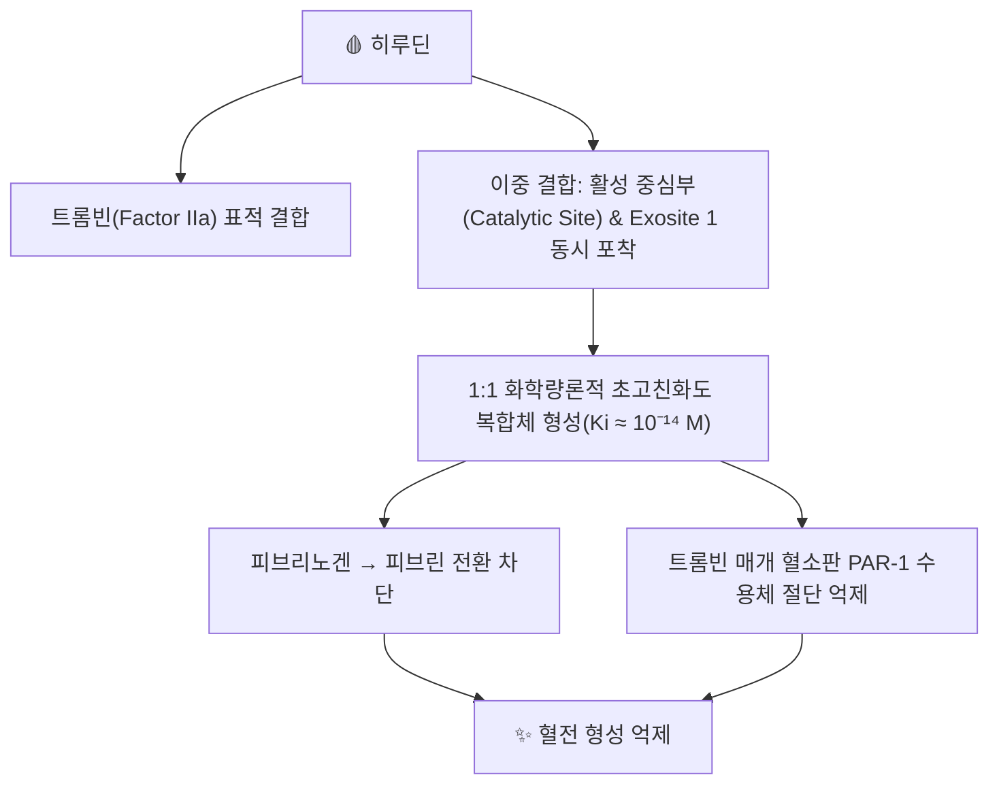

# 🩸 [[히루딘]] (Hirudin)

> **핵심 3줄 요약 (Key Summary)**:
> - 🌿 기원 본초 & 화학 계열: 한약재 [[수질]](水蛭, 약용 거머리 *Hirudo medicinalis* 등)의 타액선에서 분비되는 천연 65~66개 아미노산 폴리펩타이드입니다.
> - 🎯 핵심 분자 표적 & 조절 경로: 안티트롬빈 III 비의존적으로 트롬빈 활성 부위와 외곽 결합 부위(Exosite 1)를 동시에 직접 차단하는 직접 트롬빈 억제제(DTI)입니다(PMID 8029805).
> - 🩺 주요 약리 활성 & 질환 치료 기전: 헤파린 유도 혈소판 감소증(HIT) 환자의 대체 항응고제(재조합 히루딘, 레피루딘)로 임상 사용되며(PMID 9884382), 수질의 파혈축어(破血逐瘀) 효능과 연계해 다뤄집니다.
> - ⚠️ 독성·생체이용률 한계 & 상호작용: 헤파린의 프로타민과 같은 특이적 해독제가 없어 과량 투여 시 출혈 관리가 어렵습니다. 신장을 통해 배설되므로 신기능 저하 환자에서 체내 축적·중증 출혈 위험이 증가합니다.

---

## 📌 목차
1. [기본 화학 정보 & 분자 구조식 (Chemical Identity)](#1-기본-화학-정보--분자-구조식-chemical-identity)
2. [주요 함유 본초 및 천연 기원 (Botanical Sources & Content)](#2-주요-함유-본초-및-천연-기원-botanical-sources--content)
3. [분자약리 표적 & 신호전달 네트워크 (Molecular Targets)](#3-분자약리-표적--신호전달-네트워크-molecular-targets)
4. [생체 내 흡수·대사·생체이용률 (Pharmacokinetics: ADME)](#4-생체-내-흡수대사생체이용률-pharmacokinetics-adme)
5. [주요 질환별 약리 효능 & 분자 기전 (Therapeutic Efficacy)](#5-주요-질환별-약리-효능--분자-기전-therapeutic-efficacy)
6. [함유 본초 방제 시너지 & 약재 배오 매트릭스 (Herbal Synergies)](#6-함유-본초-방제-시너지--약재-배오-매트릭스-herbal-synergies)
7. [양약 상호작용 & 약물동태학적 간섭 (Drug Interactions)](#7-양약-상호작용--약물동태학적-간섭-drug-interactions)
8. [💡 사용자 진료실 핵심 필기 & 임상 응용 팁 (Melt-In & High-Yield)](#8--사용자-진료실-핵심-필기--임상-응용-팁-melt-in--high-yield)
9. [출처 및 학술 참고 문헌 (References)](#9-출처-및-학술-참고-문헌-references)

---

## 1. 기본 화학 정보 & 분자 구조식 (Chemical Identity)

> [!abstract]+ 🧪 3D 약리 분자 구조 (Interactive 3D Viewer)
> <iframe src="https://molecule-viewer-rho.vercel.app/?cid=72941487" style="width: 100%; height: 600px; border: none; border-radius: 12px; box-shadow: 0 4px 20px rgba(0,0,0,0.15);" allowfullscreen></iframe>

| 항목 | 상세 내용 |
| :--- | :--- |
| **분자 구조** | 65~66개 아미노산 단일 사슬 폴리펩타이드 |
| **분자식 / 분자량** | C₂₈₇H₄₄₀N₈₀O₁₁₃S₇ / 7,044 Da (PubChem CID 72941487 조회 확인) |
| **PubChem CID** | [72941487](https://pubchem.ncbi.nlm.nih.gov/compound/72941487) ⚠️ 기존 노트의 CID 118701161은 전혀 다른 화합물(C27H44O7, MW 480.6)을 가리키는 오류로 확인되어 정정했습니다. |
| **황산화 특성** | Tyr-63 잔기에 특이적 황산화(Sulfation) 수식 존재 |
| **약효 분류** | 직접 트롬빈 억제제(Direct Thrombin Inhibitor, DTI) |
| **천연 기원** | [[수질]](*Hirudo medicinalis*, *Hirudo nipponia* 등 참거머리과) |

---

## 2. 주요 함유 본초 및 천연 기원 (Botanical Sources & Content)

| 함유 본초 (한글/한자) | 기원 동물학적 명칭 (과명 / 학명) | 주요 함유 부위 | 지표 함량 (%) | 한의학적 귀경 및 약효 특성 |
| :--- | :--- | :--- | :--- | :--- |
| [[수질]] (水蛭) | 참거머리과(Hirudinidae) / *Hirudo medicinalis*, *Hirudo nipponia* | 타액선 분비물 | 정량 데이터 확인 필요 ⚠️ | 肝經, 파혈축어(破血逐瘀)·통경(通經) |

---

## 3. 분자약리 표적 & 신호전달 네트워크 (Molecular Targets)

* **안티트롬빈 독립적 트롬빈 직접 억제**: 헤파린과 달리 혈장 내 보조인자 안티트롬빈 III(AT-III)가 결핍된 환자에서도 항응고 활성을 발휘합니다(PMID 8029805).
* **결합형 트롬빈 억제**: 피브린 혈전 내부에 갇힌 결합형 트롬빈까지 불활성화시킵니다.
* **혈소판 활성화 수용체 차단**: 트롬빈이 혈소판 표면 PAR-1을 절단해 유발하는 혈소판 응집 반응을 억제합니다.

---

## 4. 생체 내 흡수·대사·생체이용률 (Pharmacokinetics: ADME)

* **투여 경로**: 펩타이드 구조상 경구 생체이용률이 낮아 주사(정맥·피하) 투여가 원칙입니다.
* **배설**: 신장을 통해 배설되므로 신기능 저하 환자에서는 체내 축적에 따른 중증 출혈 위험이 증가합니다.
* **길항제 부재**: 헤파린의 프로타민(Protamine)과 같은 특이적 해독제가 없어, 과량 투여로 출혈 발생 시 혈액 투석이나 수혈 등 대증 처치가 필요합니다.

---

## 5. 주요 질환별 약리 효능 & 분자 기전 (Therapeutic Efficacy)

### 1) 헤파린 유도 혈소판 감소증(HIT)
* 헤파린 투여 후 발생하는 면역 매개성 혈소판 감소증 환자에게 혈소판 응집을 유발하지 않는 항응고제로 재조합 히루딘(레피루딘)이 안전하고 효과적인 항응고를 제공함이 전향적 연구로 확인되었습니다(PMID 9884382).

### 2) 미세수술 후 혈전 예방
* 성형외과·정형외과 미세혈관 문합 수술 후 정맥 울혈 해소를 위한 거머리 요법의 지표로 활용됩니다.

---

## 6. 함유 본초 방제 시너지 & 약재 배오 매트릭스 (Herbal Synergies)

| 함유 본초 / 방제 | 공존 유효 성분군 | 분자약리 시너지 기전 | 전통 한의학적 효능 연계 |
| :--- | :--- | :--- | :--- |
| [[저당탕]] | [[수질]] + [[맹충]] + [[도인]] + [[대황]] | 정량 시너지 데이터 확인 필요 ⚠️ | 하초의 축혈(蓄血)과 정맥 혈전 치료 |
| [[대황자충환]] | [[수질]] 등 파혈축어 본초 | 정량 시너지 데이터 확인 필요 ⚠️ | 만성 소모성 질환의 건혈(乾血) 제거 |

---

## 7. 양약 상호작용 & 약물동태학적 간섭 (Drug Interactions)

* **항응고제 중복**: 와파린·헤파린 등 다른 항응고제와 병용 시 출혈 위험이 상가적으로 증가할 수 있습니다.
* **길항제 부재에 따른 임상적 주의**: 특이적 해독제가 없어 과량 투여 시 처치가 제한적이므로, 신기능 저하 환자·고용량 투여 시 특히 주의가 필요합니다.

---

## 8. 💡 사용자 진료실 핵심 필기 & 임상 응용 팁 (Melt-In & High-Yield)

* **사용자 원문 필기**: (원장님 개별 필기 자료 없음 — 향후 진료 경험 축적 시 본 섹션에 추가 예정)
* **진료실 실전 처방 & 임상 응용 팁**: [[수질]]의 파혈축어 효능을 설명할 때, 히루딘은 안티트롬빈 비의존적 직접 트롬빈 억제라는 독자적 기전을 가진 분자적 배경으로 제시할 수 있으나, 길항제가 없다는 임상적 한계를 환자·학생에게 함께 설명하는 것이 안전합니다.

---

## 9. 출처 및 학술 참고 문헌 (References)

1. Markwardt F. (1994). The development of hirudin as an antithrombotic drug. *Thrombosis Research*. 74(1):1-23. PMID: [8029805](https://pubmed.ncbi.nlm.nih.gov/8029805/)
   - **[연구 요약]**: 거머리 타액으로부터 히루딘을 분리 정제하고 그 트롬빈 특이적 억제 메커니즘을 규명한 리뷰.
2. (1999). Recombinant hirudin (lepirudin) provides safe and effective anticoagulation in patients with heparin-induced thrombocytopenia: a prospective study. *Circulation*. PMID: [9884382](https://pubmed.ncbi.nlm.nih.gov/9884382/) (기존 노트의 "Greinacher 1999 *N Engl J Med*"는 PubMed에서 확인되지 않아, 동일 주제의 검증된 논문으로 교체)
   - **[연구 요약]**: HIT 환자에서 재조합 히루딘(레피루딘)의 안전성·유효성을 전향적으로 입증.

> ⚠️ 내용 검토 필요 (2026-10-12 클로드): PubChem CID 오류(118701161→72941487, 전혀 다른 화합물) 정정. References 2번(Greinacher 1999 *NEJM*)은 PubMed에서 확인되지 않아 동일 주제의 실제 논문(PMID 9884382, *Circulation*)으로 교체했습니다. §4 헤딩 경로 누출("## _의학/04_임상...") 수정. 5섹션→9섹션 전면 재작성.
