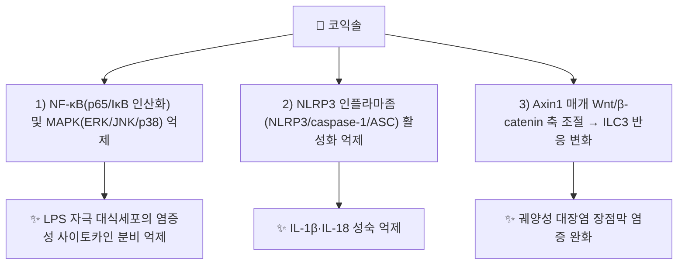

# 🔬 코익솔 (Coixol, 6-Methoxy-2-benzoxazolinone)

> **핵심 3줄 요약 (Key Summary)**:
> - 🌿 기원 본초 & 화학 계열: [[의이인]](薏苡仁, 벼과 *Coix lacryma-jobi* var. *ma-yuen* 종인)에 함유된 벤즈옥사졸리논(benzoxazolinone)계 성분. [[코익세놀라이드]]와 함께 의이인의 대표 지표물질로 다뤄짐.
> - 🎯 핵심 분자 표적 & 조절 경로: 대식세포에서 NF-κB(p65·IκB 인산화)·MAPK(ERK·JNK·p38)·NLRP3 인플라마좀 활성화를 억제하고, 장관에서는 Axin1 매개 Wnt/β-catenin 축을 조절하여 제3형 선천림프구(ILC3) 반응에 관여.
> - 🩺 주요 약리 활성 & 질환 치료 기전: LPS 자극 대식세포에서의 항염증 작용(IL-1β·IL-6·TNF-α·NO·iNOS·COX-2 억제) 및 궤양성 대장염 완화 — 의이인의 [[이수삼습]]·[[청열배농]] 효능의 현대 약리적 근거 중 하나로 다뤄짐.
> - ⚠️ 독성·생체이용률 한계 & 상호작용: 대부분 세포·동물 실험 단계이며 사람 대상 약동학·임상시험 자료는 확인되지 않았다.

---
## 📌 목차
1. [기본 화학 정보 & 분자 구조식 (Chemical Identity)](#1-기본-화학-정보--분자-구조식-chemical-identity)
2. [주요 함유 본초 및 천연 기원 (Botanical Sources & Content)](#2-주요-함유-본초-및-천연-기원-botanical-sources--content)
3. [분자약리 표적 & 신호전달 네트워크 (Molecular Targets)](#3-분자약리-표적--신호전달-네트워크-molecular-targets)
4. [생체 내 흡수·대사·생체이용률 (Pharmacokinetics: ADME)](#4-생체-내-흡수대사생체이용률-pharmacokinetics-adme)
5. [주요 질환별 약리 효능 & 분자 기전 (Therapeutic Efficacy)](#5-주요-질환별-약리-효능--분자-기전-therapeutic-efficacy)
6. [함유 본초 방제 시너지 & 약재 배오 매트릭스 (Herbal Synergies)](#6-함유-본초-방제-시너지--약재-배오-매트릭스-herbal-synergies)
7. [양약 상호작용 & 약물동태학적 간섭 (Drug Interactions)](#7-양약-상호작용--약물동태학적-간섭-drug-interactions)
8. [💡 사용자 진료실 핵심 필기 & 임상 응용 팁 (Melt-In & High-Yield)](#8--사용자-진료실-핵심-필기--임상-응용-팁-melt-in--high-yield)
9. [출처 및 학술 참고 문헌 (References)](#9-출처-및-학술-참고-문헌-references)

---
## 1. 기본 화학 정보 & 분자 구조식 (Chemical Identity)

> [!abstract]+ 🧪 3D 약리 분자 구조 (Interactive 3D Viewer)
> <iframe src="https://molecule-viewer-rho.vercel.app/?cid=10772" style="width: 100%; height: 600px; border: none; border-radius: 12px; box-shadow: 0 4px 20px rgba(0,0,0,0.15);" allowfullscreen></iframe>

| 항목 | 상세 내용 |
| :--- | :--- |
| **IUPAC 명칭** | 6-methoxy-3H-1,3-benzoxazol-2-one |
| **분자식 / 분자량** | C₈H₇NO₃ / 약 165.15 g/mol (단일동위원소질량 165.043) |
| **PubChem CID** | [10772](https://pubchem.ncbi.nlm.nih.gov/compound/10772) |
| **CAS 등록 번호** | 532-91-2 |
| **화학 골격 분류** | 벤즈옥사졸리논(Benzoxazolinone, 고리형 카바메이트) — 알칼로이드·플라보노이드·테르페노이드 어디에도 속하지 않는 독자 계열 |
| **물리화학적 성상** | 백색~미황색 결정성 분말, 물에 난용·유기용매에 가용 |

---
## 2. 주요 함유 본초 및 천연 기원 (Botanical Sources & Content)

| 함유 본초 | 기원 식물학적 명칭 | 주요 함유 부위 | 한의학적 귀경 및 약효 특성 |
| :--- | :--- | :--- | :--- |
| [[의이인]] (薏苡仁) | 벼과 / *Coix lacryma-jobi* var. *ma-yuen* | 성숙 종인(씨앗) | 脾·胃·肺經, [[이수삼습]]·[[건비지사]]·[[청열배농]] |

의이인의 코익솔은 [[코익세놀라이드]]와 함께 항종양·대사조절 관련 지표성분으로 제시되며, Axin1 매개 Wnt/β-catenin 신호축을 통한 장관 면역 조절이 궤양성 대장염 완화 기전으로 규명되었다(Ma 2026, PMID 42551664).

---
## 3. 분자약리 표적 & 신호전달 네트워크 (Molecular Targets)

### (1) LPS 유발 대식세포 염증 억제
* RAW 264.7 대식세포에 LPS(1 μg/mL) 자극 전 코익솔(400·800 μmol/L)을 전처치한 실험에서, IL-1β·IL-6이 용량 의존적으로 감소하고 고농도에서 TNF-α도 감소했다(IL-10은 변화 없음).
* NO·iNOS·COX-2·IL-18이 감소했으며, 인산화 p65·인산화 IκB(NF-κB 경로), 인산화 ERK·JNK·p38(MAPK 경로)이 모두 억제되었다.
* NLRP3·caspase-1이 감소했고, ASC는 고농도에서만 감소하여 NLRP3 인플라마좀 활성화 억제가 시사되었다(Hu 2020, PMID 32085388).

### (2) Axin1-Wnt/β-catenin-ILC3 축을 통한 장관 면역 조절
* 궤양성 대장염 모델에서 코익솔이 Axin1 매개 Wnt/β-catenin 신호를 조절하여 제3형 선천림프구(ILC3) 반응을 변화시켜 대장염을 완화함이 보고되었다(Ma 2026, PMID 42551664).

---
## 4. 생체 내 흡수·대사·생체이용률 (Pharmacokinetics: ADME)

⚠️ 내용 검토 필요: 코익솔의 흡수·분포·대사·배설(ADME)에 관한 체계적 문헌은 이 노트에서 확인하지 못했다.

---
## 5. 주요 질환별 약리 효능 & 분자 기전 (Therapeutic Efficacy)

### (1) 염증성 질환 — 급성 염증 모델
* LPS 자극 대식세포에서 NF-κB·MAPK·NLRP3 인플라마좀을 동시에 억제하는 항염증 작용이 확인되었다(Hu 2020, PMID 32085388). 저자들은 생체 내(in vivo) 검증이 추가로 필요하다고 명시했다.

### (2) 소화기 질환 — 궤양성 대장염
* Axin1-Wnt/β-catenin-ILC3 축 조절을 통한 궤양성 대장염 완화 효과가 보고되었다(Ma 2026, PMID 42551664). 이는 의이인의 [[청열배농]]·[[건비지사]] 효능과 연계되는 현대 약리 근거로 다뤄진다.

---
## 6. 함유 본초 방제 시너지 & 약재 배오 매트릭스 (Herbal Synergies)

| 함유 본초 / 방제 | 공존 유효 성분군 | 전통 한의학적 효능 연계 |
| :--- | :--- | :--- |
| [[의이인]] | [[코익세놀라이드]] | [[이수삼습]]·[[건비지사]]·[[청열배농]] |
| [[의이부자패장산]] | [[의이인]], [[부자]], [[패장초]] | 장옹(만성 충수염) 등 화농성 장관 질환 — 코익솔의 장관 면역조절 작용이 참고 기전으로 거론 가능 |

⚠️ 내용 검토 필요: 처방 수준에서 코익솔 단독 기여도를 검증한 문헌은 확인하지 못했다.

---
## 7. 양약 상호작용 & 약물동태학적 간섭 (Drug Interactions)

⚠️ 내용 검토 필요: 코익솔의 CYP450 간섭이나 양약 병용 관련 자료는 이 노트에서 확인하지 못했다.

---
## 8. 💡 사용자 진료실 핵심 필기 & 임상 응용 팁 (Melt-In & High-Yield)

* 현재 별도로 기록된 원장님 임상 필기가 없습니다.

---
## 9. 출처 및 학술 참고 문헌 (References)

1. **Hu Y, Zhou Q, Liu T, Liu Z.** (2020). *Coixol Suppresses NF-κB, MAPK Pathways and NLRP3 Inflammasome Activation in Lipopolysaccharide-Induced RAW 264.7 Cells.* Molecules, 25(4):894. [PMID 32085388](https://pubmed.ncbi.nlm.nih.gov/32085388/) · DOI: [10.3390/molecules25040894](https://doi.org/10.3390/molecules25040894)
   - **[연구 요약]**: 코익솔이 LPS 자극 대식세포에서 NF-κB·MAPK·NLRP3 인플라마좀 활성화를 억제하여 염증성 사이토카인 분비를 낮춤을 규명.
2. **Ma J, et al.** (2026). *Coixol attenuates Ulcerative Colitis by modulating the ILC3 response via the Wnt/β-catenin pathway.* Journal of Ethnopharmacology, 373:122264. [PMID 42551664](https://pubmed.ncbi.nlm.nih.gov/42551664/)
   - **[연구 요약]**: 코익솔이 Axin1 매개 Wnt/β-catenin 축을 조절하여 ILC3 반응을 통해 궤양성 대장염을 완화함을 규명.
3. PubChem Compound Summary — Coixol (CID 10772): [https://pubchem.ncbi.nlm.nih.gov/compound/10772](https://pubchem.ncbi.nlm.nih.gov/compound/10772)

> 검증 메모 (2026-10-25): 다빈치 정원 가꾸기 — PMID 32085388은 PubMed 서지와 대조하여 일치 확인(모델·결과 상세 포함). PMID 42551664는 의이인.md에서 기존 검증된 서지를 재사용함.
