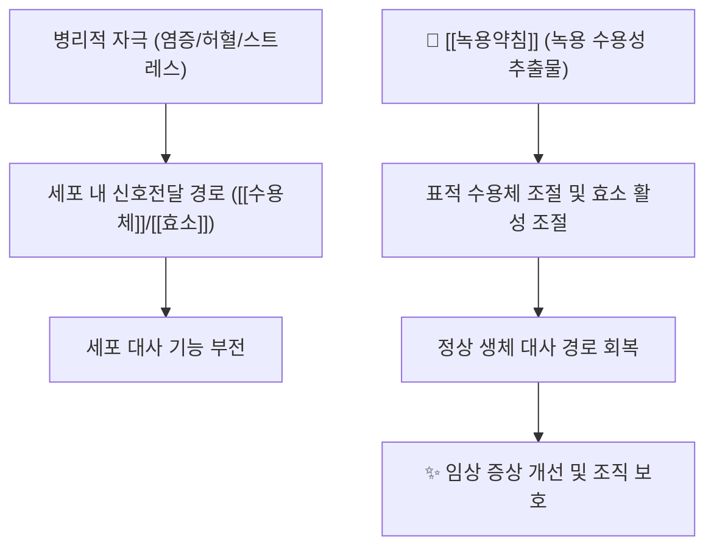

# 녹용약침 (鹿茸藥鍼, Cervi Parvum Cornu Pharmacopuncture)

> **핵심 요약 (Key Summary)**:
> 사슴과(Cervidae) 매화록(*Cervus nippon*)·마록(*Cervus elaphus*) 수컷의 **미골화 어린 뿔([[녹용]], 鹿茸)** 을 수용성으로 추출하여 근육주사용으로 제조한 [[약침]] **제제**다.
> 전통적으로 [[補腎壯陽]]·[[益精血]]·[[强筋骨]]의 효능으로 [[腎陽虛]]·[[精血虧虛]]·[[筋骨痿弱]] 병증에 응용되어 온 보익(補益) 계열 본초를 약침화한 것이다.
> 제공된 논문 기준 근거는 **리뷰 1편**(참고문헌 1), **단회 근육주사 독성시험 2편**(참고문헌 2·4), **복합 약침 성분분석·in vitro 활성 1편**(참고문헌 3)으로, **분자 기전·임상 효능에 대한 정량적 근거는 아직 제한적**이며 상당 부분이 전통 본초학 기술에 의존한다.

## 목차
1. [기본 본초 정보 & 화학 구조 (Pharmacognosy)](#1-기본-본초-정보--화학-구조-pharmacognosy)
2. [핵심 분자약리 기전 & 대사 네트워크](#2-핵심-분자약리-기전--대사-네트워크)
3. [해부생체역학 / 근육·신경 대사 연계](#3-해부생체역학--근육신경-대사-연계)
4. [사상의학 및 체질별 임상 응용 (적응증 vs 금기)](#4-사상의학-및-체질별-임상-응용-적응증-vs-금기)
5. [상한론 『약징(藥徵)』 분석 및 배오 원리](#5-상한론-약징藥徵-분석-및-배오-원리)
6. [핵심 처방 비교 매트릭스 및 함께 보기](#6-핵심-처방-비교-매트릭스-및-함께-보기)
7. [출처](#7-출처)

## 1. 기본 본초 정보 & 화학 구조 (Pharmacognosy)
> [!abstract]+ 🧪 핵심 지표성분 3D 분자 구조 (Interactive 3D Viewer)
> <iframe src="https://molecule-viewer-rho.vercel.app/?cid=750" width="100%" height="450px" frameborder="0" allow="webgl" style="border-radius: 8px;"></iframe>

| 항목 | 상세 내용 |
| :--- | :--- |
| **기원 동물** | 사슴과(Cervidae). 매화록 *Cervus nippon* Temminck 또는 마록 *Cervus elaphus* Linnaeus (수컷) |
| **약용 부위** | 아직 **골화되지 않은 어린 뿔(鹿茸)** — 혈관·연골·결합조직이 풍부하고 연골모세포 증식이 활발한 시기의 뿔. 골화가 진행된 [[녹각]](鹿角)과는 구분된다 |
| **성미 (性味)** | 甘·鹹, 溫 — 달고 짠맛이며 성질은 따뜻하다 |
| **귀경 (歸經)** | [[腎經]], [[肝經]] — 신·간 두 장부에 귀경하여 精血·筋骨과 직결된다 |
| **효능 (Actions)** | [[補腎壯陽]], [[益精血]], [[强筋骨]], [[調衝任]], [[托瘡毒]] |
| **주요 성분** | • **대표 저분자 성분**: [[글리신]](glycine)을 비롯한 아미노산군 (콜라겐 구성 성분) • **유효 활성 성분군**: [[강글리오사이드]](gangliosides), [[IGF-1]] 계열 성장인자, [[콜라겐]] 펩타이드, [[콘드로이틴황산]], [[우론산]] 등 • **공정서 지표성분 및 규격 함량**: 제공된 4편의 논문 및 본 노트에서 확인 불가 → **근거 미확인** |
| **약침 제제 특성** | 원생약을 **수용성 용매로 추출**하여 정제한 뒤 생리식염수 등에 배합, 주로 **근육주사(intramuscular)** 경로로 투여한다. 유효 성분의 분자량·지용성에 따라 추출 효율이 달라지며, 제제별 규격은 **근거 미확인** |
| **PubChem CID** | [750](https://pubchem.ncbi.nlm.nih.gov/compound/750) (글리신 기준) |

### 주요 지표물질 화학 구조
- **[구조적 특징 및 활성]**: 녹용은 단일 저분자 화합물이 아니라 **단백질·펩타이드·당지질·다당류·미네랄의 복합체**이므로 단일 지표성분으로 전체 활성을 대표시키기 어렵다. 위 3D 뷰어에는 콜라겐 삼중나선의 약 3분의 1을 차지하는 [[글리신]](PubChem CID 750)을 저분자 대표 성분으로 표시하였다. 글리신은 분자량이 작고 수용성이 높아 수용성 약침 추출물에 안정적으로 이행되지만, 녹용약침의 공식 지표성분 규격 여부는 **근거 미확인**이며 [[강글리오사이드]]·[[IGF-1]] 등 고분자 성분의 제제별 회수율 비교 데이터도 미확인 상태다.

## 2. 핵심 분자약리 기전 & 대사 네트워크

- **표적 수용체 및 신호전달 경로**: 녹용의 성분군([[강글리오사이드]]·성장인자 유사 펩타이드·[[콜라겐]] 유래 펩타이드)은 전통적으로 조골세포·연골세포 증식 촉진, 혈관신생, 면역 조절과 연결되어 설명되어 왔다. 그러나 **제공된 4편의 논문에는 특정 수용체·신호전달 경로(kinase·cytokine·[[eNOS]] 등)를 정량 규명한 데이터가 없어 기전 수준 근거 미확인**이다.
- **복합 제제 및 국내 리뷰**: [[SU어혈약침]]에 대한 화학적 성분 분석과 in vitro 생물학적 활성 평가(참고문헌 3)는 복합 약침 제제의 분석 방법론을 제시하나 녹용 단독 약침 기전을 직접 규명한 것은 아니며, 한국 내 녹용약침 연구·임상 현황 리뷰(참고문헌 1)가 존재하나 개별 연구의 효과 크기·기전 세부 수치는 미확인이다.

## 3. 해부생체역학 / 근육·신경 대사 연계

![[녹용약침_1.jpg|540]]
> [그림 1: Anatomy and physiology of animals Deer antler.jpg]

- **근육 섬유 대사**: [[强筋骨]] 효능은 근육·건·골의 위약감(痿弱), 만성 피로, 회복 지연 상태에 대한 응용 근거로 제시되나, 미토콘드리아 지방산 산화·칼슘 채널·젖산 대사·근섬유형 전환에 대한 직접 측정 데이터는 **근거 미확인**이다.
- **신경 및 혈관계 조절**: [[eNOS]] 활성·자율신경·말초순환 개선 효과는 녹용 계열 생약에서 언급되나 참조 문헌 4편에서는 해당 지표를 확인할 수 없다(**근거 미확인**).
- **국소 투여(약침) 안전성**: 약침은 경구 투여 대비 근육 내 국소 농도를 높여 근육·근막·관절 주변 병변을 표적으로 하는 [[근육주사 약침 요법]]의 제형적 원리를 따른다. 랫드 단회 근육주사 독성시험에서 수용성 [[홍화약침]]·[[녹용약침]] 배합(참고문헌 2) 및 [[SU어혈약침]](참고문헌 4) 모두 일반증상·체중·부검 소견상 특이 독성이 관찰되지 않았으나, 세부 용량·LD50 수치는 미확인이다.

## 4. 사상의학 및 체질별 임상 응용 (적응증 vs 금기)
- **최적 적응증**: [[腎陽虛]]·[[精血虧虛]]로 인한 만성 허로·냉증·골·관절 위약감, 근골격계 만성 통증·회복 지연 병변에 대한 국소 근육주사 보익 요법(단, 체질별·증후별 임상시험 데이터는 **근거 미확인**).
- **신중 투여 및 금기**: 陰虛火旺·實熱·濕熱 패턴(溫補 약재 특성상 악화 우려), 外感(감염성 발열기)·급성 염증기, 조절되지 않는 고혈압·혈전성 위험·악성종양·자가면역 질환, 자침부 국소 감염·항응고제 복용자(주사부 통증·국소 발적·부종·드물게 알레르기 반응 주의).
- **사상의학적 위치**: [[동의수세보원]]([[이제마]]) 체계에서 녹용은 허증 보익 계열 약재로 분류되나 체질별 귀속([[태음인]]/[[소음인]]/[[소양인]]/[[태양인]])은 문헌별 이견이 있고 제공 논문에도 체질 데이터가 없어 **근거 미확인**으로 둔다.

## 5. 상한론, 『약징(藥徵)』 분석 및 배오 원리
- **고전 문헌상 위치**: [[녹용]]은 [[상한론]] 처방(113방) 및 [[길익동동]]의 『[[약징]]』 수록 약물에 포함되지 않아 해당 조문이 없다. 본초학적 서술은 『[[신농본초경]]』·『[[본초강목]]』·『[[동의보감]]』·『[[방약합편]]』 계통의 補腎·益精血·强筋骨 효능에 근거한다.
- **핵심 배오**:
  - [[녹용]] + [[당귀]] → 補血·養血로 精血雙補(만성 허로·빈혈성 피로).
  - [[녹용]] + [[산수유]] → 補肝腎·收斂으로 腰膝酸軟·遺精·頻尿.
  - [[녹용]] + [[사향]] → 芳香開竅 배오로 補而不滯([[공진단]] 구성 논리).
  - [[녹용]] + [[홍화]](약침 배합) → 活血 + 補益으로 어혈 동반 근골격계 병변 응용(참고문헌 2, 시너지 정량 근거 미확인).

## 6. 핵심 처방 비교 매트릭스 및 함께 보기
| 처방명 / 제제 | 구성 약재 | 주치 병증 및 임상 타깃 | 특징 및 감별점 |
| :--- | :--- | :--- | :--- |
| [[공진단]] (경구 처방) | [[녹용]], [[당귀]], [[산수유]], [[사향]] | 精血虧虛, 심신 피로, 健忘·불면, 노화 허증 | 芳香開竅의 [[사향]] 배오로 補而不滯. 경구 투여 제형 |
| [[녹용약침]] 단독 | [[녹용]] 수용성 추출물 | 만성 허증 기반 근골격계 통증·위약감 | 근육주사로 국소 농도 제고(참고문헌 1 리뷰 대상) |
| [[홍화약침]] + [[녹용약침]] | [[홍화]], [[녹용]] | 어혈·순환장애 동반 근골격계 병변 | 랫드 단회 근육주사 독성시험 특이 소견 없음(참고문헌 2) |
| [[SU어혈약침]] | 복합 생약 추출물 | 어혈 병태 관련 제반 증상 | 성분분석·in vitro 활성(참고문헌 3) 및 단회 독성시험(참고문헌 4) |

- **함께 보기**: [[약침]] · [[녹용]] · [[녹각]] · [[홍화약침]] · [[SU어혈약침]] · [[봉약침]] · [[자하거약침]] · [[오공약침]] · [[공진단]] · [[당귀]] · [[산수유]] · [[사향]] · [[글리신]] · [[강글리오사이드]] · [[IGF-1]] · [[콜라겐]] · [[콘드로이틴황산]] · [[근육주사 약침 요법]] · [[腎陽虛]] · [[精血虧虛]] · [[상한론]] · [[동의보감]] · [[동의수세보원]]

<!-- 보관 태그(1회용·링크오류, 필요시 복원): 녹용, pharmacopuncture -->

## 7. 출처
1. Lee DJ, Hwangbo M. (2013). Review of cervi cornu parvum pharmacopuncture in korean medicine. *J Pharmacopuncture*. 16(2):7-14. PMID: 25780662

2. Park S, Sun SH. (2015). Single-dose Intramuscular-injection Toxicology Test of Water-soluble Carthami-flos and Cervi cornu parvum Pharmacopuncture in a Rat Model. *J Pharmacopuncture*. 18(3):42-48. PMID: 26392912

3. Shin S, Kim NS. (2024). Chemical Analysis of SU-Eohyeol Pharmacopuncture and Its In Vitro Biological Activities. *Int J Med Sci*. 21(13):2562-2577. PMID: 39439454

4. Hwang JH, Ku J. (2022). Single-Dose Intramuscular Toxicity Study of SU-Eohyeol Pharmacopuncture in Rats. *J Pharmacopuncture*. 25(3):268-275. PMID: 36186091
