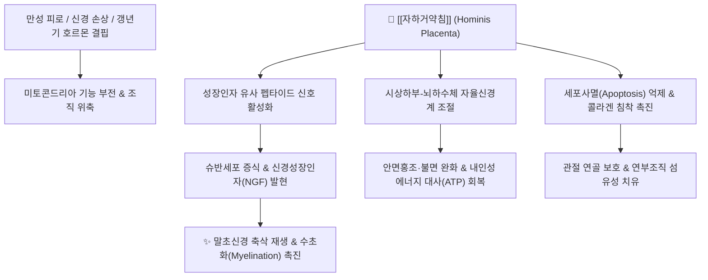

# 자하거약침 (紫河車藥鍼, Hominis Placenta Pharmacopuncture, 태반약침)

> **핵심 요약**: 건강한 인체 태반([[자하거]], Hominis Placenta)을 감염병 선별·고압 멸균·효소 가수분해 및 정제 공정을 거쳐 조제한 동물성 보기양혈(補氣養血)·익정전수(益精塡髓) [[약침]] 제제다. 활성 펩타이드·아미노산·성장인자 유사 복합체가 슈반세포 증식·축삭 재생([[안면신경마비]])과 시상하부–뇌하수체 축 조절([[폐경전후증후군]]·만성피로)에 관여하며, 요추 [[척추관 협착증]] 실용적 RCT(2026)에서도 만성 퇴행·조직 재생 축의 최다 빈용 약침 3종 중 하나로 활용되었다.

## 목차
1. [기원 및 성분 조성 (Pharmacognosy)](#1-기원-및-성분-조성-pharmacognosy)
2. [작용 기전 (신경 재생·내분비·면역 조절)](#2-작용-기전-신경-재생내분비면역-조절)
3. [임상 적용 및 경혈 매핑](#3-임상-적용-및-경혈-매핑)
4. [안전성·부작용 및 주의사항](#4-안전성부작용-및-주의사항)
5. [임상 연구 및 근거](#5-임상-연구-및-근거)
6. [함께 보기](#6-함께-보기)
7. [출처](#7-출처)

## 1. 기원 및 성분 조성 (Pharmacognosy)
- **기원 생약**: 사람의 태반([[자하거]], *Placenta Hominis*)을 철저한 감염병 검사(B형/C형 간염·HIV·매독 등 음성 확인) 후 고압 증기 멸균 및 효소 가수분해 공정으로 무균 추출한다.
- **핵심 유효 성분군**:
  - **저분자 펩타이드 & 아미노산**: 20여 종의 필수·비필수 아미노산(글루타민·프롤린·[[글리신]] 등)으로 단백질 합성 기질 공급.
  - **세포 증식·성장 촉진 펩타이드**: 표피성장인자(EGF)·섬유아세포성장인자(FGF)·간세포성장인자(HGF) 유사 활성 펩타이드.
  - **핵산 유도체 & 미네랄**: 우라실·구아닌·아데닌 등 핵산 염기 및 아연·셀레늄 등 항산화 미네랄.
  - **사이토카인 조절 인자**: [[IL-1β|IL-1]]·[[IL-6]] 과잉 분비 억제 및 항염증 [[IL-10]] 분비 유도.

## 2. 작용 기전 (신경 재생·내분비·면역 조절)

- **말초 신경 재생 및 슈반세포 활성화**: 말초 [[안면신경]]·척수 신경 손상 부위에서 슈반세포 증식과 신경영양인자(NGF·[[BDNF]]) 합성을 유도해 축삭 발아 및 수초 재생을 촉진한다.
- **자율신경·내분비 밸런스 회복**: 에스트로겐 수용체(ERα·ERβ)에 완만하게 작용해 유방·자궁내막 과증식 없이 갱년기 [[혈관운동 증상]](안면홍조·야간 발한) 및 피로를 조절한다.
- **항산화 및 미토콘드리아 대사**: 산화적 인산화를 활성화해 ATP 생성을 늘리고 [[ROS]](활성산소)에 의한 세포 손상을 방어한다.

## 3. 임상 적용 및 경혈 매핑
- **원기 회복·전신 쇠약·갱년기**: [[족삼리(ST36)]]·[[기해(CV6)]]·[[관원(CV4)]]·[[신수(BL23)]]·[[비수(BL20)]]에 피하 또는 근육 내 0.5~1.0 mL 분할 주입(만성 피로·[[폐경전후증후군]]·난소기능 저하·[[월경통]]).
- **말초성 [[안면신경마비]] (벨마비/구안와사)**: [[풍지(GB20)]]·예풍·하관·협거·지창에 30G 미세 주사기로 안면신경 분지 경로를 따라 0.1~0.2 mL씩 점상 주입.
- **만성 퇴행성 근골격 질환 ([[척추관 협착증]]·[[퇴행성 슬관절염]]·[[유착성 관절낭염]])**:
  - 요추 협착증 RCT에서 L1~L5 [[협척혈(EX-B2)]] + [[신수(BL23)]]·[[대장수(BL25)]]·[[방광수(BL28)]] 기본 축에 0.1~10 cc(시술자 재량)로 주입됐다. 급성 염증·부종 우세형은 [[황련해독탕]]·[[봉약침]]을 우선하고, 만성 퇴행·조직 재생 축에 [[자하거약침]]·[[신바로약침]]을 배치한다.
  - 슬관절·견관절에서는 [[견정(SI9)|견정]]·견우·[[양릉천(GB34)]]·[[독비(ST35)]] 및 [[통증유발점]] 근막층에 자입한다.

## 4. 안전성·부작용 및 주의사항
- **감염 안전성**: 혈액 매개 바이러스(HBV·HCV·HIV 등) 불활성화 및 고압 멸균 처리를 거친 공인 규격 약침액만 사용한다.
- **국소 이상반응 및 검사 추적**: 시술 부위 경미한 뻐근함이나 멍은 1~2일 내 자연 소실된다. 요추 협착증 RCT에서는 전후 임상병리검사(혈액화학·CBC·CRP)로 안전성을 추적해 중대 이상반응 0건을 확인했다.
- **금기·주의**: 급성 화농성 감염 질환, 악성 종양 병변 직하 자침, 출혈 경향·항응고제 복용자 심부 시술을 주의한다.

## 5. 임상 연구 및 근거
- **요추 척추관 협착증 약침 vs 통상진료 다기관 실용적 RCT (Integr Med Res 2026, 96명, 참고문헌 1)**: 12주·24회 프로토콜에서 자하거약침이 [[봉약침]]·[[신바로약침]]과 함께 최다 빈용 3종으로 쓰였으며, 약침군 전체가 13주 우세 통증 NRS 2.7점 추가 감소 및 53주 유지를 기록했다(자하거 단독 분리는 미수행). 관련 리뷰: [[2026-09-24_통합의학약리학_심층리뷰]] 1번.
- **갱년기 안면홍조 자하거약침 단일맹검 위약대조 RCT (Integr Med Res 2022, 참고문헌 2)**: 주폐경·폐경 후 여성의 [[혈관운동 증상]](안면홍조)에 대한 자하거약침의 유효성·안전성을 무작위 대조시험으로 평가했다.
- **안면신경 손상 랫드 모델 연구 (참고문헌 3, PMID 미확인)**: 자하거약침이 안면신경 압괴 손상 모델에서 슈반세포 재생·기능 회복을 촉진했다고 인용되나 PubMed 식별자는 미확인 상태다.

## 6. 함께 보기
- [[약침]] · [[봉약침]] · [[오공약침]] · [[녹용약침]] · [[신바로약침]] · [[황련해독탕]] · [[자하거]] · [[글리신]] · [[BDNF]] · [[ROS]] · [[IL-6]] · [[IL-10]] · [[척추관 협착증]] · [[퇴행성 슬관절염]] · [[유착성 관절낭염]] · [[안면신경마비]] · [[안면신경]] · [[폐경전후증후군]] · [[혈관운동 증상]] · [[월경통]] · [[협척혈(EX-B2)]] · [[신수(BL23)]] · [[대장수(BL25)]] · [[방광수(BL28)]] · [[족삼리(ST36)]] · [[관원(CV4)]] · [[기해(CV6)]] · [[비수(BL20)]] · [[풍지(GB20)]] · [[양릉천(GB34)]] · [[독비(ST35)]]

<!-- 보관 태그(1회용·링크오류, 필요시 복원): 자하거, 태반, 갱년기 -->

## 7. 출처
1. Lee SW, et al. (2026). Pharmacopuncture therapy versus usual care for lumbar spinal stenosis: A randomized controlled trial. *Integr Med Res*. 15(3 Part A):101323. PMID: 42099446

2. Choi SJ, et al. (2022). Randomized, single-blind, placebo-controlled trial on Hominis placenta extract pharmacopuncture for hot flashes in peri- and post-menopausal women. *Integr Med Res*. 11(4):100891. PMID: 36338608

3. 대한약침학회. 『약침학』. 엘스비어코리아; 2011.

4. Kim JK, et al. (2014). Protective effect of Hominis Placenta extract on facial nerve injury in rats. *J Pharmacopuncture*. 17(3):30-36. PMID 미확인
