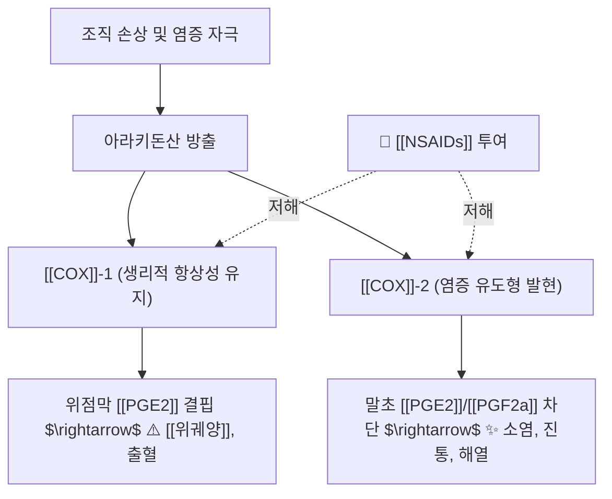

# 💊 [[NSAIDs]] (Non-Steroidal Anti-Inflammatory Drugs, 비스테로이드성 소염진통제)

> **핵심 3줄 요약 (Key Summary)**:
> 🧪 주성분·분류: 시클로옥시게나아제([[COX]]) 효소를 억제하여 프로스타글란딘([[PGE2]]) 생합성을 차단하는 비스테로이드성 소염·진통·해열제군. 비선택적 COX 억제제([[이부프로펜]], [[나프록센]], [[덱시부프로펜]], [[아스피린]]) 및 선택적 COX-2 억제제([[세레콕시브]])로 대별된다.
> 📍 작용 기전: 아라키돈산 대사 경로에서 COX-1 및 COX-2를 경쟁적·비가역적으로 저해하여 말초 통각수용기 감작을 해소하고 전염증 매개체를 차단한다.
> 🎯 임상 적응증: 급만성 근골격계 통증, 퇴행성 관절염, 요추 추간판 탈출증, 염좌, 치통, 월경통의 1차 대증 치료제.
> ⚠️ 주의사항: COX-1 억제로 인한 위점막 [[PGE2]] 고갈로 [[위궤양]]·위장관 출혈, 신혈류 저하에 따른 급성 신손상 및 심혈관 혈전 색전 위험.

---

## 1. 약물 기본 정보 및 시판 제품 (Brand Identification)

> [!abstract]+ 🧪 3D 약리 분자 구조 (Interactive 3D Viewer)
> <iframe src="https://molecule-viewer-rho.vercel.app/?cid=3672" style="width: 100%; height: 600px; border: none; border-radius: 12px; box-shadow: 0 4px 20px rgba(0,0,0,0.15);" allowfullscreen></iframe>

비스테로이드성 소염진통제(NSAIDs)는 마약성 진통제(Opioids)나 부신피질호르몬제(Corticosteroids)와 달리 중독성이나 스테로이드 내분비계 부작용 없이 염증과 통증을 신속히 완화하는 현대 의학의 대표적인 1차 치료 약물군이다.

![[NSAID-20240814023841803.png|450]]
> [그림 1: NSAIDs의 COX 경로 차단 및 위점막 손상·궤양 발생 병태생리 — 원본 필기 도판]

### 1.1 화학 구조 및 작용 선택성별 분류

| 분류군 | 대표 약물 성분 | 주요 특징 및 임상 용도 |
| :--- | :--- | :--- |
| **살리실산계** | [[아스피린]] (Aspirin) | [[COX]]-1 비가역적 억제, 저용량(100mg) 항혈전제 다용 |
| **프로피온산계** | [[이부프로펜]], [[덱시부프로펜]], [[나프록센]] | 해열·진통·소염 균형 우수, 근골격계 및 생리통 1차 다용 |
| **아세트산계** | [[아세클로페낙]], [[디클로페낙]], 인도메타신 | 강력한 항염 작용, 정형외과 관절염 처방 1위 다용 |
| **에놀산계 (Oxicam)** | 멜록시캄, 피록시캄 | 긴 반감기(1일 1회 복용), 만성 관절염 장기 유지 요법 |
| **선택적 COX-2 저해제** | [[세레콕시브]] (Celecoxib) | 위장관 궤양 위험 대폭 감소, 심혈관 혈전 위험 주의 |

---

## 2. 분자 약리 기전 및 작용 경로 (Mechanism of Action)

1. **COX 효소 억제 (Inhibition of Prostaglandin Synthesis)**:
   - 인지질 분해로 생성된 아라키돈산이 [[COX]] 효소에 의해 $PGH_2$로 전환되는 첫 단계를 경쟁적 또는 비가역적으로 억제한다.
2. **말초 진통 작용 (Peripheral Analgesia)**:
   - 손상 조직에서 1차 감각신경 C-섬유 말단 유해수용체(Nociceptor)를 감작시키는 [[PGE2]] 생성을 차단하여 통각 과민(Hyperalgesia)을 신속히 해소한다.
3. **시상하부 체온 설정점 복구 (Antipyretic Effect)**:
   - [[IL-1]], [[TNF-B|TNF-α]] 등 발열원(Pyrogen)에 반응하는 시상하부 시각전야 혈관 내피세포의 [[PGE2]] 생성을 차단하여 체온 조절 중추의 설정점(Set-point)을 정상으로 하강시킨다.

### 2.1 국소 NSAID vs 경구 NSAID의 층위 비교 (OARSI 가이드라인 근거)
- **유효성**: 무릎 골관절염 네트워크 메타분석(122편 RCT, 47,113명 대상)에서 국소 NSAID([[디클로페낙]] 겔 등)는 [[아세트아미노펜]]보다 기능 개선이 유의하게 우수했으며(SMD −0.29), **경구 NSAID와 통계적으로 동등한 진통 효과(SMD 0.03)** 를 입증했다.
- **안전성**: 전신 흡수율이 경구제의 5~10% 미만에 불과하여 위장관 출혈, 신독성, 심혈관 이상반응 발생률(RR 0.46)이 경구제 대비 현저히 낮다. 고령자 및 심혈관·신장 질환자에서 국소 제형 우선 적용이 표준이다.

---

## 3. 약동학적 특성 (Pharmacokinetics: ADME)
- **흡수 (Absorption)**: 경구 투여 시 위장관에서 신속히 흡수되며, 음식물 섭취 시 흡수 속도는 다소 지연되나 총 흡수량(AUC)은 유지된다. 지용성이 높아 생체이용률은 대부분 80% 이상이다.
- **분포 (Distribution)**: 혈장 알부민 결합률이 98~99% 이상으로 극히 높다. 관절염 치료 시 염증 부위 관절 활액(Synovial fluid)으로 양호하게 이행되어 혈중 농도보다 관절강 내 농도가 장시간 유지된다.
- **대사 (Metabolism)**: 간의 시토크롬 P450 효소계(CYP2C9 등) 및 글루쿠론산 포합 반응을 통해 주로 불활성 대사체로 전환된다.
- **배설 (Excretion)**: 대사산물 형태로 80~90% 이상 신장을 통해 소변으로 배설된다. 신기능 저하 환자에서는 배설 지연으로 혈중 축적 위험이 커진다.

---

## 4. 용법·용량 및 처방 가이드 (Dosage & Administration)
- **원칙**: 이상반응 위험을 최소화하기 위해 **'치료 목적을 달성할 수 있는 최소 유효 용량을 최단 기간 동안 투여'** 하는 것을 절대 원칙으로 한다.
- **주요 경구 약제 상용 용량**:
  - [[이부프로펜]]: 1회 200~400mg, 1일 3~4회 식후 복용 (1일 최대 3,200mg).
  - [[덱시부프로펜]]: 1회 300mg, 1일 2~4회 식후 복용 (1일 최대 1,200mg).
  - [[나프록센]]: 1회 250~500mg, 1일 2회 12시간 간격 복용 (1일 최대 1,250mg).
  - [[세레콕시브]]: 1회 100~200mg, 1일 1~2회 복용 (1일 최대 400mg).
- **국소 도포제**: 1일 3~4회 통증 관절 부위에 부드럽게 마사지하듯 도포한다.

---

## 5. 부작용, 경고 및 약물 상호작용 (Adverse Effects & Interactions)
1. **위장관 독성 (Gastrointestinal Toxicity)**:
   - COX-1 억제로 인한 위점막 혈류 감소, 점액 및 중탄산염 분비 저하로 위염, 미란, [[위궤양]], 위장관 출혈이 발생한다.
   - 고령자, 소화성 궤양 병력자, 항응고제 병용자는 반드시 PPI(양성자펌프억제제)를 병용하거나 선택적 COX-2 억제제를 선택해야 한다.
2. **신독성 (Renal Toxicity & Fluid Retention)**:
   - 신장 수입소세동맥 확장 인자인 [[PGE2]] 및 $PGI_2$ 결핍으로 사구체 여과율(GFR)이 급감하며, 급성 신손상(AKI), 고칼륨혈증, 나트륨·수분 저류에 따른 부종 및 혈압 상승이 유발된다.
3. **심혈관 혈전 위험 (Cardiovascular Thrombotic Events)**:
   - 선택적 COX-2 억제제 및 고용량 NSAIDs는 혈관 내피의 항혈전 인자인 $PGI_2$ 생성을 억제하는 반면 혈소판의 혈전 촉진 인자인 $TXA_2$는 억제하지 못하여 심근경색, 뇌졸중 위험을 높인다. 관상동맥 우회술(CABG) 전후 투여는 절대 금기이다.

---

## 6. 한의 치료 연계 및 병용/테이퍼링 프로토콜 (Integrative Medicine)
- **위장관 보호를 위한 한약 배오**:
  - 장기간 NSAIDs를 복용하여 속쓰림, 소화불량, 식욕 부진이 발생한 환자에게 [[평위산]], [[반하사심탕]], [[사군자탕]]을 배오하여 소화기 점막 손상을 방어한다.
- **진통 시너지 및 약물 절감 (Tapering)**:
  - 활혈거어 및 청열소종 약재인 [[현호색]], [[당귀수산]], [[서경탕]]을 연계하여 침 치료를 병행하면 관절강 국소 혈류를 개선하고 통증 역치를 높여 NSAIDs 복용량을 유의하게 경감시킬 수 있다.
  - 고령 만성 요통 환자를 대상으로 한 대규모 RCT에서 **침 치료 및 물리치료 병행군은 통상 약물 단독군 대비 NSAIDs 복용량이 58% 유의하게 감소**했다.
- **신경병증성 통증 환자의 복합 전략**:
  - 추간판 탈출증 환자에서 NSAIDs(염증성 침해 통증 조절) 기반 위에 $\alpha_2\delta$ 리간드([[미로가발린]])나 침 치료를 융합하면 말초와 중추 감작을 다층적으로 동시 차단하여 단일 약제 고용량 사용을 회피할 수 있다.

---

## 7. 💡 사용자 진료실 핵심 필기 & 실전 임상 체크리스트
### 7.1 실전 복약 지도 및 문진 포인트
1. "소염진통제를 드실 때는 빈속에 드시지 마시고 식사 직후에 물을 충분히 함께 드셔야 위장을 보호할 수 있습니다."
2. "일반 약국에서 사드시는 복합 진통제([[게보린]], 판피린 등)나 종합 감기약에 이미 소염진통제 성분이 중복되어 있을 수 있으므로 성분을 꼭 확인해야 합니다."
3. "변 색깔이 자장면처럼 검게 변하거나(흑색변), 어지럼증, 숨가쁨이 나타나면 위장관 출혈의 신호이므로 즉시 복용을 중단하고 내원하셔야 합니다."

### 7.2 임상 모니터링 체크리스트
- [ ] 소화성 궤양, 위장관 출혈, 염증성 장질환 병력 확인
- [ ] 고혈압, 심부전, 허혈성 심장질환 등 심혈관 질환 병력 확인
- [ ] 혈청 크레아티닌(eGFR) 및 혈압 정기 측정
- [ ] 아스피린, 와파린, NOAC 등 항응고·항혈소판제 병용 여부 점검

### 함께 보기
- [[이부프로펜]]
- [[덱시부프로펜]]
- [[나프록센]]
- [[세레콕시브]]
- [[아스피린]]
- [[아세트아미노펜]]
- [[국소 NSAID]]
- [[반하사심탕]]
- [[평위산]]

---

## 8. 출처 및 학술 참고 문헌 (References)
1. **Vane JR**, et al. (1971). Inhibition of prostaglandin synthesis as a mechanism of action for aspirin-like drugs. *Nat New Biol*, 231(25):232-235. [PMID: 5284360](https://pubmed.ncbi.nlm.nih.gov/5284360/)

2. **Zeng C**, et al. (2021). Comparative efficacy and safety of acetaminophen, topical and oral non-steroidal anti-inflammatory drugs for knee osteoarthritis: evidence from a network meta-analysis of randomized controlled trials and real-world data. *Osteoarthritis Cartilage*, 29(9):1242-1251. [PMID: 34174454](https://pubmed.ncbi.nlm.nih.gov/34174454/)

3. **Suzuki H**, et al. (2025). Efficacy and Safety of Mirogabalin as an Add-on to Nonsteroidal Anti-inflammatory Drugs for Neuropathic Pain Caused by Lumbar Disc Herniation: A Randomized Controlled Study (Miro-Hers). *Pain Ther*, 14(1):245-261. [PMID: 41102508](https://pubmed.ncbi.nlm.nih.gov/41102508/)

## 📎 개념 학습 보충 (2026-11-26 논문 연계)

- 논문에서의 역할: Cochrane 2026 [[강황]] 고찰([PMID 43051256](https://pubmed.ncbi.nlm.nih.gov/43051256/))에서 4편이 [[NSAIDs]]를 활동성 대조로 삼았다. 이 고찰의 질문은 "위약보다 낫나"와 "NSAIDs만큼 하나" 두 축이다.
- 읽는 법: 초록에는 NSAIDs 대조의 통증 차이가 통합 보고되지 않았다. "강황이 NSAIDs와 동등"이라 말하려면 원문 부록의 대조별 분석을 확인해야 한다.
- 임상 위치: 무릎 [[퇴행성 슬관절염]]에서 NSAIDs는 여전히 표준 진통 축이다. 보충제 근거가 약하다는 사실이 NSAIDs의 위장관·신장·심혈관 위험을 상쇄하지는 않는다.
- 병용 상담: 항응고·항혈소판제 복용자의 [[강황]] 병용 문의가 잦다. 출혈 경향 우려는 이 고찰로 판단할 수 없으므로 별도 확인 후 진행한다.
- 관련: [[아세트아미노펜]] · [[커큐민]] · [[2026-11-26_통합의학약리학_개념학습]]
