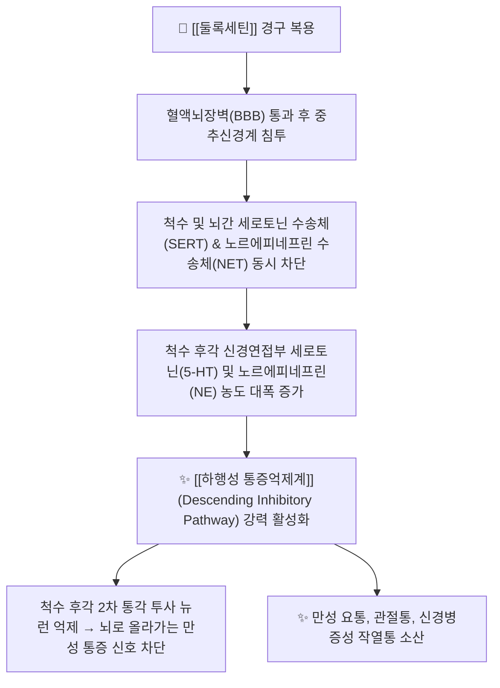

# 💊 [[둘록세틴]] (Duloxetine, 심발타 / Cymbalta, N06AX21)

> **핵심 3줄 요약 (Key Summary)**:
> - 🧪 약물 분류 & 표적: 세로토닌-노르에피네프린 재흡수 억제제(SNRI), 세로토닌 수송체([[세로토닌|SERT]]) 및 노르에피네프린 수송체([[노르에피네프린|NET]])를 동시 차단하여 **[[하행성 통증억제계]](Descending Pain Pathway) 강화**.
> - 🎯 주요 적응증 & 원내외 처방 패턴: **만성 근골격계 요통, [[골관절염]] 통증, 섬유근육통, [[당뇨병성 말초신경병증]](DPN), [[항암치료 유발 말초신경병증]](CIPN)** 및 주요 우울장애 ([[신경병증성 통증]] 1차 치료제).
> - 🔬 분자약리 기전 & 약동학(PK/PD): 뇌간에서 척수 후각으로 투사되는 모노아민 신호를 증폭시켜 통각 신호 상행 전달을 억제하며, 간 CYP1A2 및 CYP2D6 대사를 거쳐 신장(70%) 및 분변(20%)으로 배설.
> - ⚠️ 블랙박스 경고 & 주요 부작용: 복용 초기 오심(구역 20%), 입마름, 변비, 졸림, 혈압 상승, 자살 관념 모니터링(소아·청년층), [[트라마돌]] 병용 시 **세로토닌 증후군(Serotonin Syndrome)** 위험.

---

## 1. 약물 기본 정보 및 시판 제품 (Brand Identification)

> [!abstract]+ 🧪 3D 약리 분자 구조 (Interactive 3D Viewer)
> <iframe src="https://molecule-viewer-rho.vercel.app/?cid=60835" style="width: 100%; height: 600px; border: none; border-radius: 12px; box-shadow: 0 4px 20px rgba(0,0,0,0.15);" allowfullscreen></iframe>

| 항목 | 상세 정보 |
| :--- | :--- |
| **일반명 (Generic Name)** | [[둘록세틴]] (Duloxetine Hydrochloride, INN/USAN) |
| **약효 분류 (Class)** | 세로토닌-노르에피네프린 재흡수 억제제 (SNRI) & 만성 통증 조절제 |
| **ATC 코드** | N06AX21 (Other antidepressants) / 117 정신신경용제 (전문의약품) |
| **약국 시판 제품 (OTC 일반약)** | 전문의약품(ETC)으로 처방전 필수 (일반약 없음) |
| **병원 처방 의약품 (ETC 전문약)** | • **오리지널 장용캡슐**: **[[심발타]]캡슐(Cymbalta Cap, 한국릴리 오리지널 30mg, 60mg)** • **제네릭 캡슐**: 듀록셉캡슐, 드록틴캡슐, 심발레트캡슐 (30mg, 60mg) |
| **상용 용법·용량** | • **당뇨병성 신경병증 / 만성 요통 / 골관절염**: 1일 1회 30mg으로 시작하여 1주 후 1일 1회 60mg으로 증량 (식사와 무관하게 복용, 1일 최대 120mg 이하) • **섬유근육통**: 1일 1회 30mg 1주 투여 후 60mg/day 유지 |

### 1.1 대표 시판 제품 및 병용 처방 매핑 (Brand Identification)

| 구분 | 대표 제품명 / 브랜드 | 함유 성분 및 1회당 함량 | 제형 및 특징 | 주요 적응증 및 복약 지도 핵심 |
| :--- | :--- | :--- | :--- | :--- |
| **오리지널 장용캡슐 (ETC)** | [[심발타]] (한국릴리) | 둘록세틴염산염 (30mg / 60mg) | 백색/청색 장용과립 경질캡슐 | 만성 요통, 관절염 통증, 신경병증 1차약, 초기 오심 주의 |
| **제네릭 캡슐 (ETC)** | 듀록셉, 드록틴, 심발레트 | [[둘록세틴]] (30mg / 60mg) | 장용캡슐 | 캡슐을 열어 과립을 씹거나 부수지 말 것 |
| **신경병증 2제 병용** | 심발타 + 리리카 병용요법 | [[둘록세틴]] (30mg) + [[프레가발린]] (75mg) | 개별 캡슐 병용 | 하행성 억제 + 시냅스전 칼슘 차단 상보적 통증 제어 시너지 |

![[둘록세틴_패키지_박스.jpg|400]]
> [그림 1: 정형외과 및 통증의학과에서 만성 근골격계 통증에 널리 처방되는 심발타캡슐(둘록세틴) 시판 패키지 외형]

![[둘록세틴_캡슐_알약.jpg|400]]
> [그림 2: 식품의약품안전처·약학정보원 공인 심발타캡슐(둘록세틴) 낱알 및 PTP 블리스터 성상 (30mg 청·백색 캡슐, 60mg 청·황색 캡슐)]

---

## 2. 분자 약리 기전 및 작용 경로 (Mechanism of Action)

![[둘록세틴_화학구조.png|300]]
> [그림 3: 둘록세틴의 2D 평면 화학 분자 구조식 ((3S)-N-methyl-3-naphthalen-1-yloxy-3-thiophen-2-ylpropan-1-amine, 분자량 297.41 g/mol, PubChem CID 60835)]

### 1) 하행성 통증 억제계 (Descending Inhibitory Pathway) 강화
* 만성 통증 환자는 뇌간(청반핵, 봉선핵)에서 척수 후각으로 내려오는 내인성 억제 신호가 고갈되어 중추 감작(Central Sensitization)이 발생합니다.
* 둘록세틴은 **[[세로토닌]](5-HT)과 [[노르에피네프린]](NE)의 재흡수를 강력히 억제**하여 척수 후각의 $\alpha_2$-아드레날린 수용체 및 $5-\text{HT}_{1A/1B}$ 수용체를 자극함으로써, 통증 신호가 대뇌로 전달되는 경로를 하행성으로 억제합니다.

### 2) 프레가발린과의 상보적 병용 시너지 원리
* **[[프레가발린]](리리카)**: 시냅스전 $\alpha_2\delta$ 채널을 막아 글루타메이트 등 흥분성 신경전달물질의 유리를 억제(Pre-synaptic blockade).
* **[[둘록세틴]](심발타)**: 시냅스후 하행성 억제계를 촉진(Post-synaptic descending enhancement).
* 기전이 완전히 다르므로 **저용량 교차 증량 병용**이 이론적으로 상보적이며 난치성 신경통증 환자의 통증 반응률을 극대화합니다.

---

## 3. 약동학적 특성 (Pharmacokinetics: ADME)

| 약동학 파라미터 | 수치 및 임상적 의미 |
| :--- | :--- |
| **생체이용률 (Bioavailability, F)** | 약 50% (위산에 불안정하므로 장용 코팅 과립 제형 필수) |
| **최고혈중농도 도달시간 (Tmax)** | 복용 후 **약 6.0 시간** (지연 흡수) |
| **혈장 단백결합률 (Protein Binding)** | **> 96%** (혈청 알부민 및 $\alpha_1$-산성 당단백질 결합) |
| **간 대사 효소 (Metabolism)** | **CYP1A2 및 CYP2D6**에 의해 광범위 산화 및 포합 비활성 대사 |
| **소실 반감기 (Elimination t1/2)** | **약 12.1 시간** (1일 1회 아침 또는 저녁 복용) |
| **주요 배설 경로 (Excretion)** | 투여량의 약 70%가 신장 소변으로, 약 20%가 분변(담즙)으로 배설 |

---

## 4. 용법·용량 및 처방 가이드 (Dosage & Administration)

### 4.1 표준 용법 및 임상 적응증별 투여 요법
* **[[당뇨병성 말초신경병증]](DPN) / 만성 요통 / [[골관절염]]**:
  * 초기: 1일 1회 30mg 식후 복용으로 시작하여 위장관 내약성을 확인.
  * 유지: 1주일 후 1일 1회 60mg으로 증량하여 유지 (1일 최대 120mg 이하).
* **[[항암치료 유발 말초신경병증]](CIPN, 확립된 1차 약물)**:
  * 1주차 30mg 1일 1회 → 2주차부터 60mg 1일 1회(또는 30mg 1일 2회)로 증량하여 4~8주간 유지.
  * 확립된 통증 완화 효과(VAS/NRS 유의미 감소)를 보이나 예방 목적 효과는 입증되지 않음.
* **섬유근육통**:
  * 1일 1회 30mg으로 1주간 투여 후 1일 1회 60mg으로 증량.

### 4.2 진료과별 다빈도 처방 패턴 & 최적 적응증 (Sweet Spot vs 금기)
* **[✅ 최적 적응증 (Sweet Spot)]**:
  * **우울감, 불면, 만성 피로가 동반된 만성 척추관절 통증 환자**.
  * **[[NSAIDs]] 복용이 불가능한 소화성 궤양·심혈관 고위험 환자**.
  * **NeuPSIG 2025 1차 치료 권고**: NNT 7.4 (95% CI 5.6~10.9), NNH 13.9 (10.9~19.0).
* **[⚠️ 신중 투여 및 금기 (Caution / Contraindication)]**:
  * **말기 신부전 환자(eGFR < 30 mL/min) 및 중증 간장애 환자 금기**.
  * **조절되지 않는 폐쇄각 녹내장 환자 금기** (동공 산대 유발).
  * **MAO 억제제 복용자 절대 금기** (세로토닌 독성).

---

## 5. 부작용, 경고 및 약물 상호작용 (Adverse Effects & Interactions)

### 5.1 주요 부작용 프로파일
* **소화기계**: 오심(Nausea 약 20%, 복용 초기 가장 흔함), 식욕부진, 구강건조, 변비.
* **신경정신계**: 어지럼, 졸림, 두통, 불면, 피로, 초기 자살 충동 모니터링(소아 및 젊은 성인).
* **자율신경계 및 심혈관계**: 혈압 상승, 빈맥, 발한, [[기립시의 어지러움 또는 현기증|기립성 저혈압]](특히 노인 및 침 시술 직후 주의).

### 5.2 약물 상호작용 매트릭스

| 병용 약물 / 물질 | 상호작용 기전 | 임상적 위험 및 결과 | 처방 및 티칭 가이드 |
| :--- | :--- | :--- | :--- |
| 오피오이드계 진통제 ([[트라마돌]]) | 세로토닌 재흡수 차단 시너지 | **세로토닌 증후군** (고열, 근경련, 혼돈) 유발 | **병용 시 최저용량 시작 및 활력징후 밀착 감시** |
| 강한 CYP1A2 억제제 (시프로플록사신) | 둘록세틴 간 대사 차단 | 둘록세틴 혈중 농도 2.5배 급상승 → 독성 위험 | 병용 투여 금기 |
| 가바펜티노이드 ([[프레가발린]]) | 상보적 통증 차단 경로 시너지 | 통증 조절 시너지 및 개별 약물 요구량 감소 | 난치성 신경병증 환자에게 권장되는 병용 조합 |
| 가바펜티노이드 신약 ([[미로가발린]]) | 시냅스전 α2δ 차단 기전 | 임상 시험상 상호 간섭 배제 목적으로 병용 통제되기도 함 | 협진 시 기전 중복 및 이상반응 모니터링 |
| 간기울결 한약 ([[가미소요산]], [[시호가용골모려탕]]) | 자율신경 안정 및 소화기 완충 | 둘록세틴 복용 초기 불안·오심 완화 | **양약 복용 1시간 후 한약 복용** |

---

## 6. 한의 치료 연계 및 병용/테이퍼링 프로토콜 (Integrative Medicine)

* **만성 요통 및 섬유근육통 통합 침구 치료**:
  * 척추 기립근 및 관절 주위 아시혈 침치료, 전침 치료, 신바로약침, 중성어혈약침, 자하거약침을 병용하여 국소 허혈과 근막 통증을 개선.
* **항암 유발 말초신경병증(CIPN) 한의 협진**:
  * CIPN 환자에게 둘록세틴 복용을 유지하면서 팔사혈, 팔풍혈 자침 및 자하거약침을 병행하여 말초 미세순환을 촉진.
  * 침 치료 직후 [[기립시의 어지러움 또는 현기증|기립성 저혈압]] 발생 여부를 평가하고 천천히 일어나도록 지도.
* **심인성 통증 한약 배오 및 단계적 테이퍼링 (Melt-In)**:
  * 만성 통증과 우울·불안이 동반된 환자에게 [[가미소요산]], [[귀비탕]], [[분심기음]]을 처방하여 신경계를 안정화.
  * 통증 안정화 시 심발타를 60mg → 30mg → 격일 복용으로 4주 이상 서서히 감량 후 단약 유도 (급격 중단 시 감전 유사 저림, 반동성 불안 등 금단 증상 주의).
* **고령·다약제 환자 국소 요법 우선 전략**:
  * 전신 부작용 위험이 높은 노인에게는 경구 둘록세틴 증량에 앞서 [[리도카인]] 5% 패치 또는 [[캡사이신]] 국소 도포 요법을 1차 고려.

---

## 7. 💡 사용자 진료실 핵심 필기 & 실전 임상 체크리스트

* **진료실 실전 문진 체크리스트 (3대 핵심 질문)**:
  1. **"병원에서 처방받으신 약 중에 '심발타(30mg/60mg)'가 들어있나요?"**:
     * 환자가 우울증약으로 오해하여 복용을 거부하거나 불안해하는 경우가 많으므로 "만성 신경 통증과 척추관절통을 가라앉히는 전문 통증 조절제"임을 명확히 설명.
  2. **"약을 드시고 속이 메스껍거나 입이 바짝 마르지 않으신가요?"**:
     * 초기 오심(20%) 및 구강건조 부작용 유무를 체크하여 반드시 식사 직후 복용하도록 지도.
  3. **"기분이 가라앉거나 불면증이 통증과 함께 개선되셨나요?"**:
     * 중추 감작 및 심리적 통증 반응 호전도를 평가.

* **환자 상담 언어 (NNT·NNH 수치 번역 티칭)**:
  * *"둘록세틴은 대규모 연구에서 **약 7명 중 1명이 통증이 절반 이상 의미 있게 호전(NNT 7.4)**되고, **14명 중 1명 정도가 메스꺼움이나 어지럼증으로 약을 중단(NNH 13.9)**하는 것으로 입증된 표준 치료제입니다. 처음 1~2주는 속이 다소 울렁거릴 수 있으나 식후 즉시 복용하시면 점차 적응되니 안심하고 드셔보세요."*

---

## 8. 출처 및 학술 참고 문헌 (References)

1. **식품의약품안전처 (MFDS)**. 의약품 품목허가사항: 둘록세틴염산염 제제 (2023).
2. **Finnerup NB, et al. (2025)**. Pharmacotherapy and non-invasive neuromodulation for neuropathic pain: a systematic review and meta-analysis of randomised, double-blind, placebo-controlled trials. *The Lancet Neurology*, 24(5), 413-428. PMID: 40252663.
   - [PubMed](https://pubmed.ncbi.nlm.nih.gov/40252663/) | [DOI](https://doi.org/10.1016/S1474-4422(25)00039-6)
   - **[연구 요약]**: NeuPSIG 2025 개정 가이드라인. 313개 RCT(48,789명) 메타분석에서 SNRI(둘록세틴 11편)가 신경병증성 통증 1차 강한 권고(NNT 7.4, NNH 13.9)로 유지됨을 확립.
3. **Skljarevski V, et al. (2010)**. Efficacy and safety of duloxetine in patients with chronic low back pain. *Spine (Phila Pa 1976)*, 35(13), E578-E585. PMID: 20461028.
   - [PubMed](https://pubmed.ncbi.nlm.nih.gov/20461028/) | [DOI](https://doi.org/10.1097/BRS.0b013e3181d32247)
   - **[연구 요약]**: 만성 요통 환자 대상 대규모 무작위 위약 대조 임상시험에서 둘록세틴(60mg/일)의 유의미한 요통 완화 및 신체 기능 개선 입증.
4. **Tesfaye S, et al. (2022)**. Comparison of amitriptyline supplemented with pregabalin, pregabalin supplemented with amitriptyline, and duloxetine supplemented with pregabalin for the treatment of diabetic peripheral neuropathic pain (OPTION-DM). *Lancet*, 400(10353), 680-690. PMID: 36007534.
   - [PubMed](https://pubmed.ncbi.nlm.nih.gov/36007534/) | [DOI](https://doi.org/10.1016/S0140-6736(22)01472-6)
   - **[연구 요약]**: 신경병증성 통증 환자에서 둘록세틴 단독 및 프레가발린 병용 요법의 임상적 유효성 및 안전성 검증.
5. **Dworkin RH, et al. (2026)**. Systematic review of pharmacotherapy for chemotherapy-induced peripheral neuropathy. *Pharmacology Research & Perspectives*, 14(5), e70327. PMID: 42755421.
   - [PubMed](https://pubmed.ncbi.nlm.nih.gov/42755421/)
   - **[연구 요약]**: 항암 유발 말초신경병증(CIPN) 환자에서 둘록세틴의 유의미한 통증 점수 개선 및 1차 치료제로서의 임상적 근거 확인.

<!-- 보관 태그(1회용·링크오류, 필요시 복원): 만성통증치료제, 신경병증 -->

---

## 📎 개념 학습 보충 (2026-11-20 논문 연계)

**논문에서의 역할** — SENZA-PDN 배경 약물에 포함된 SNRI(PMID 33818600).

- 세로토닌·노르에피네프린 재흡입 억제로 [[하행성 통증억제계]]를 강화한다. 척수 국소 자극([[척수자극술]])과 작용 층위가 달라 병용이 성립한다.
- 금기·주의: 협착성 요로·녹내장, MAOI 병용, 간질환, 혈압 상승. 고령·당뇨 환자에서 야간 혈압·어지럼 확인.
- 감량 시 중단 증상(어지럼·불안·감각이상)이 있어 서행.
- 관련: [[프레가발린]] · [[하행성 통증억제계]] · [[신경병증성 통증]] · [[척수자극술]]
