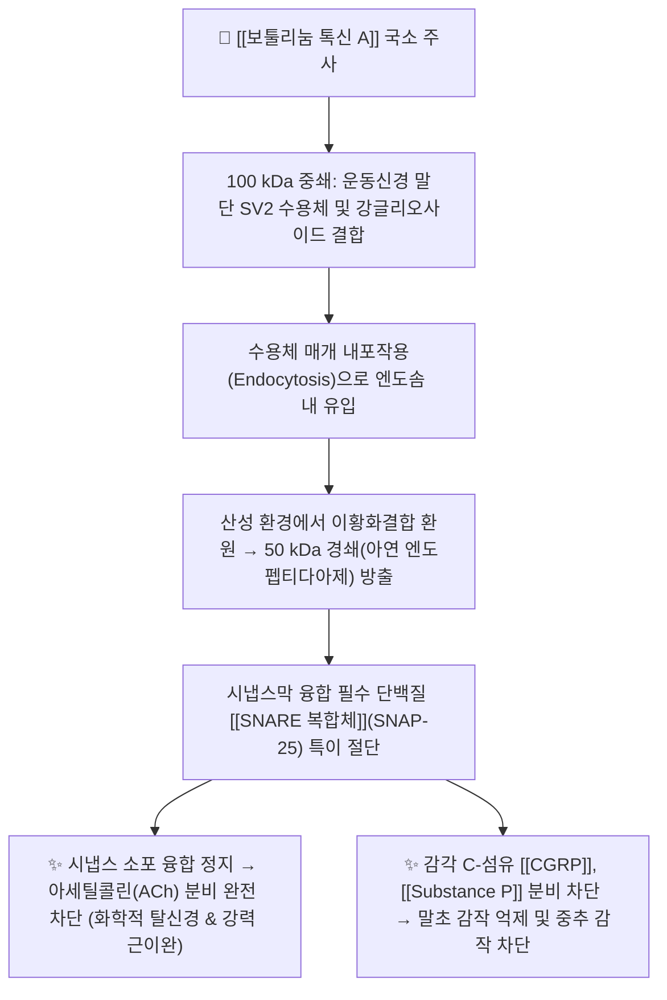

# 💊 [[보툴리눔 톡신 A]] (OnabotulinumtoxinA / Botox, M03AX01)

> **핵심 3줄 요약 (Key Summary)**:
> - 🧪 약물 분류 & 표적: 그람양성 혐기성균인 *Clostridium botulinum*이 생성하는 신경외독소 단백질, 신경근접합부 및 감각신경 말단의 **[[SNARE 복합체]](SNAP-25)를 절단**하여 아세틸콜린(ACh) 및 통증 신경펩타이드([[CGRP]], [[Substance P]]) 유리를 차단.
> - 🎯 주요 적응증 & 원내외 처방 패턴: **만성 편두통 예방(PREEMPT 프로토콜 31곳 분할 주사), 뇌졸중 후 상하지 경직, 경부근긴장이상(사경), 안검경련, 난치성 [[삼차신경통]], 국소성 [[신경병증성 통증]]**.
> - 🔬 분자약리 기전 & 약동학(PK/PD): 150 kDa 신경독소(중쇄 100 kDa + 경쇄 50 kDa)가 시냅스 전막에 결합·내포된 후 화학적 탈신경(Chemical denervation)을 유도하며, 주사 1~2주째 최대 효과 후 3~4개월간 지속(축삭 발아로 신경 재생).
> - ⚠️ 블랙박스 경고 & 주요 부작용: 주사 부위 인접 근육 침윤(안검하수, 경부 위약), 드물게 원위부 확산 시 치명적 연하곤란 및 호흡마비(Black Box Warning), 중화항체 형성 방지를 위해 **최소 12주(3개월) 투여 간격 엄수**.

---

## 1. 약물 기본 정보 및 시판 제품 (Brand Identification)

> [!abstract]+ 🧪 3D 약리 분자 구조 (Interactive 3D Viewer)
> <iframe src="https://molecule-viewer-rho.vercel.app/?cid=16130953" style="width: 100%; height: 600px; border: none; border-radius: 12px; box-shadow: 0 4px 20px rgba(0,0,0,0.15);" allowfullscreen></iframe>

| 항목 | 상세 정보 |
| :--- | :--- |
| **일반명 (Generic Name)** | OnabotulinumtoxinA (Botulinum toxin type A, INN/USAN) |
| **약효 분류 (Class)** | 말초 작용성 신경근 차단 근이완제 (Peripherally acting muscle relaxant) & 신경펩타이드 억제제 |
| **ATC 코드** | M03AX01 (Other muscle relaxants, peripherally acting agents) |
| **분자량 / 단백질 구조** | 활성 신경독소 단백질 약 150 kDa (100 kDa 중쇄 + 50 kDa 경쇄가 이황화 결합으로 연결), 천연 복합체 약 900 kDa |
| **대표 시판 브랜드 (ETC 전문약)** | • **오리지널**: **보톡스주(Botox, 엘러간/애브비, 50U/100U/200U)** • **복합단백질 제거 정제형**: 제오민주(Xeomin, 항체 형성 위험 경감) • **기타 제제**: 디스포트(Dysport), 보툴렉스, 메디톡신, 나보타 |
| **제형 및 조제 특성** | 백색 동결건조 분말 바이알 (방부제가 없는 멸균 생리식염수에 거품이 일지 않도록 완만히 희석하여 즉시 국소 주사) |
| **상용 투여 프로토콜** | • **만성 편두통 (PREEMPT)**: 총 155~195U를 두경부 31~39개 부위에 피내/근육 내 분할 주사 (12주 간격) • **경부 사경증 / 뇌졸중 경직**: 목표 근육 크기 및 긴장도에 따라 100~300U 분할 주사 |

![[보톡스_임상시술.jpg|350]]
> [그림 1: 경부 근긴장이상증(사경) 환자에서 보툴리눔 톡신(보톡스) 국소 근육 내 피하 주사 시술 임상 사진]

![[보툴리눔_03_A1NTNHA복합체.png|300]]
> [그림 2] 보툴리눔 독소 A1형과 NTNHA(비독소성 단백질) 복합체의 3차원 구조 (PDB: 3V0A) — 경구 섭취 시 독소를 위산으로부터 보호하는 복합체 형태 (출처: Wikimedia Commons, Botulinum A1 with NTNHA 3V0A.png, CC0)

![[보툴리눔_독소구조.png|300]]
> [그림 3: 보툴리눔 독소 A형(BoNT/A) 단백질의 3차원 분자 결정 구조 (PDB: 3BTA, 중쇄 및 경쇄 복합체)]

---

## 2. 분자 약리 기전 및 작용 경로 (Mechanism of Action)

### 1) 신경근접합부 아세틸콜린(ACh) 분비 차단 (화학적 탈신경)
* **결합 및 세포 내 유입**: 100 kDa 중쇄(Heavy chain)가 시냅스 전 운동신경 말단의 SV2(Synaptic vesicle glycoprotein 2) 수용체에 고친화도로 결합하여 엔도솜 내부로 유입됩니다.
* **SNAP-25 절단**: 50 kDa 경쇄(Light chain)가 시냅스 소포 융합 단백질인 **[[SNARE 복합체]]의 SNAP-25**(Synaptosomal-associated protein 25)의 특정 펩타이드 결합을 절단합니다.
* 소포가 신경세포막과 융합하지 못하므로 활동전위가 도달해도 **아세틸콜린(ACh)이 방출되지 않아 근육이 이완**(화학적 탈신경, Chemical denervation)됩니다.

### 2) 감각 침해수용기 신경펩타이드 억제 및 중추 감작 차단 (이중 효과)
* 운동신경뿐만 아니라 삼차신경 및 척수 후각 신경절의 일차 무수 C 섬유 및 $A\delta$ 섬유 말단에서도 [[SNARE 복합체]]를 절단합니다.
* 유해 자극 시 분비되는 혈관확장 및 통증 전달 펩타이드인 **[[CGRP]](칼시토닌 유전자 관련 펩타이드), [[Substance P]], 글루타메이트 유리를 강력 억제**합니다.
* [[말초 감작]]을 억제하고 뇌간 삼차신경 척수로핵으로의 상행성 통증 입력을 차단하여 뇌신경계의 **중추 감작(Central Sensitization)**을 근원적으로 차단합니다.

---

## 3. 약동학적 특성 (Pharmacokinetics: ADME)

| 약동학 파라미터 | 수치 및 임상적 의미 |
| :--- | :--- |
| **작용 발현 시간 (Onset)** | 주사 후 **24 ~ 72시간** 내 근이완 및 통증 완화 시작 |
| **최대 효과 도달 (Peak)** | 주사 후 **1 ~ 2 주**째 최대 치료 반응 도달 |
| **효과 지속 기간 (Duration)** | 통상 **3 ~ 4 개월 (12 ~ 16주)** 유지 |
| **가역적 신경 회복 (Recovery)** | 차단된 신경 말단에서 새로운 축삭 발아(Axonal sprouting)가 일어나고 운동 종판이 재생되면서 근기능 회복 |
| **전신 흡수 및 대사** | 국소 근육 및 피내 결합률이 극히 높아 권장량 투여 시 전신 순환 혈중 농도는 측정 불가 수준, 국소 단백분해효소에 의해 분해 |
| **재투여 권장 주기** | 중화항체 형성 방지를 위해 **최소 12주(3개월) 간격 엄수** |

---

## 4. 용법·용량 및 처방 가이드 (Dosage & Administration)

### 4.1 임상 적응증별 표준 주사 요법
* **만성 편두통 예방 (PREEMPT 프로토콜)**:
  * 대상: 1개월에 15일 이상 두통이 발생하고 그중 8일 이상이 편두통성인 만성 환자.
  * 30G 주사침을 사용하여 7개 두경부 근육군, **총 31~39곳에 각 5U씩 (총 155~195U)** 분할 주사:
    * 전두근(4곳), 추미근(2곳), 비근근(1곳), 측두근(양측 각 4곳), 후두근(양측 각 3곳), 경추 추골주위근(양측 각 2곳), [[승모근]](양측 각 3곳).
* **경부 근긴장이상증 (사경, Cervical Dystonia)**:
  * 비정상적 경추 회전 및 굴곡을 유발하는 [[흉쇄유돌근]], [[두판상근]], [[승모근]], [[견갑거근]] 등에 초음파 또는 근전도 유도하에 분할 주사.
* **난치성 [[삼차신경통]] (3차 옵션)**:
  * 통증이 발생하는 삼차신경 분지 영역에 국소 다점(Multi-point, 25~75U) 피내·점막하 주입 (용량-반응 차이가 없으므로 저용량 25U 권장).
* **뇌졸중 후 상하지 경직**:
  * 굴곡근 연축(수근굴근, 상완이두근, 비복근 등)에 투여하여 관절 구축 방지 및 가동역 확보.

### 4.2 처방 가이드 및 신경병증성 통증 가이드라인 내 위치
* **NeuPSIG 2025 개정 가이드라인 (Lancet Neurol 2025)**:
  * **3차 치료제 (약한 권고)**: 국소 주입 NNT 2.7 (95% CI 1.8~5.1), NNH 216.3.
  * **임상적 평가**: NNT가 2.7로 모든 신경병증성 통증 약물 중 가장 강력한 효과 크기를 보이며 NNH가 216.3으로 매우 안전하나, 표준화된 주입 프로토콜 확립 필요성으로 인해 3차 옵션으로 분류됨.

---

## 5. 부작용, 경고 및 약물 상호작용 (Adverse Effects & Interactions)

### 5.1 국소 부작용 및 인접 근육 침윤
* **안검하수(Ptosis) 및 복시**: 전두부 및 눈 주위 주사 시 약액이 안검거근으로 확산되어 발생 (2~4주 후 가역적 호전).
* **경부 위약감(Neck weakness)**: 경추 주위근 및 승모근 고용량 주사 후 고개를 가누기 어려운 일시적 근력 저하.
* **표정 비대칭 및 입꼬리 처짐**: 삼차신경통이나 안면부 주사 시 표정근 침윤 주의.

### 5.2 전신 확산 위험 (Black Box Warning) 및 금기
* **원위부 독소 확산 경고**: 주사 부위를 벗어나 전신으로 확산될 경우 **연하곤란(음식 삼킴 장애), 발음 장애, 호흡곤란, 전신 마비** 등 보툴리눔 독소증(Botulism) 위험 초래.
* **절대 금기**:
  * 중증 근무력증(Myasthenia Gravis), 근위축성 측삭경화증(ALS), 람베르트-이튼 증후군 등 신경근접합부 질환자.
  * 주사 부위 감염 환자, 임산부 및 수유부.
* **중화항체 형성(내성) 방지**: 고용량 빈번 투여 시 항체가 형성되어 효과가 영구 소실되므로 **1회 최소 유효량 사용 및 12주 간격 준수**.

---

## 6. 한의 치료 연계 및 병용/테이퍼링 프로토콜 (Integrative Medicine)

* **보톡스 주사 요법과 한방 근막 치료의 시기별 조율 (Melt-In)**:
  * 보톡스 주사와 한의 복합 중재(침, [[전침]], [[약침]], [[추나]])는 근막 연축 완화와 신경 압박 해소라는 상보적 목표를 가지므로, 시술 간격을 체계적으로 조율합니다.
  * **주사 직후 급성기 (1~2주)**: 독소의 인접 근육 확산을 막기 위해 주사 부위의 강한 지압, 마사지, 뜸, 핫팩, 온열 물리치료를 엄격히 금지.
  * **화학적 근이완 골든타임 (2~8주)**: 과긴장된 주동근이 이완된 상태에서, 길항근 강화 전침 치료와 관절 가동 추나 치료를 집중 시행하여 정상 운동 패턴 재교육.
* **안전 시차 운용 원칙 (중복 자극 회피)**:
  * 삼차신경통이나 두경부 통증 부위에 [[약침]]이나 [[아시혈]] 자침을 병행할 때는 **보톡스 주입일과 최소 1주일 이상의 시간차**를 두어 국소 자극 중첩과 이상반응 판정 혼선을 예방.
* **한약 치료 연계**:
  * 만성 편두통 환자에게 [[천궁]], [[당귀]], [[백지]] 등이 배오된 두통 처방([[청상견통탕]], [[조등산]])을 병용하여 뇌혈류 미세순환을 개선하고 보톡스 효과 소실기(3개월 이후)의 두통 반동을 완충.

---

## 7. 💡 사용자 진료실 핵심 필기 & 실전 임상 체크리스트

* **진료실 실전 문진 체크리스트 (3대 핵심 질문)**:
  1. **"최근 3개월 이내에 정형외과, 신경과, 피부과에서 보톡스 주사를 맞으신 적이 있나요?"**:
     * 12주 이내 재투여 시 중화항체 발생 위험을 차단하고, 주사 부위 인접부 자침 시 시간차를 확보.
  2. **"주사를 맞으신 후 눈꺼풀이 처지거나 음식을 삼키기 힘든 증상이 있었나요?"**:
     * 안검하수 및 연하곤란 등 약액 원위 확산 부작용 병력 평가.
  3. **"얼굴 통증(삼차신경통)의 경우 양측성이거나 40세 이전에 발병하셨나요?"**:
     * 삼차신경통 진료 시 양측성이거나 젊은 연령 발병인 경우 다발성 경화증 등 이차성 중추 원인을 먼저 배제.

* **환자 티칭 스크립트 (원문 보존)**:
  > *"보톡스 주사는 약 3~4개월 동안 흥분된 신경 전달을 차단하여 근육과 통증을 진정시켜 주는 임상적 완충 장치입니다. 주사를 맞으신 후 최소 3~5일 동안은 약물이 주변으로 번지지 않도록 주사 부위를 세게 문지르거나 찜질하지 마십시오. 근육이 부드러워져 있는 이 3개월의 골든타임 동안 침과 추나 치료, 자세 교정 운동을 병행하셔야 약효가 끝난 뒤에도 통증이 재발하지 않습니다."*

---

## 8. 출처 및 학술 참고 문헌 (References)

1. **Aurora SK, et al. (2010)**. OnabotulinumtoxinA for treatment of chronic migraine: results from the double-blind, randomized, placebo-controlled phase of the PREEMPT 1 trial. *Cephalalgia*, 30(7), 793-803. PMID: 20647170.
   - [PubMed](https://pubmed.ncbi.nlm.nih.gov/20647170/) | [DOI](https://doi.org/10.1177/0333102410364676)
   - **[연구 요약]**: 만성 편두통 환자 대상 대규모 3상 무작위 배정 이중눈가림 위약 대조 PREEMPT 1 임상시험을 통해 온아보툴리눔톡신A 주사의 두통 일수 유의적 감소 및 안전성 입증.
2. **Diener HC, et al. (2010)**. OnabotulinumtoxinA for treatment of chronic migraine: results from the double-blind, randomized, placebo-controlled phase of the PREEMPT 2 trial. *Cephalalgia*, 30(7), 804-814. PMID: 20647171.
   - [PubMed](https://pubmed.ncbi.nlm.nih.gov/20647171/) | [DOI](https://doi.org/10.1177/0333102410364677)
   - **[연구 요약]**: PREEMPT 2 다기관 임상시험을 통해 만성 편두통 예방 치료에서 155~195U 주사 투여군의 두통 빈도 급감 및 삶의 질 지표 개선 효능 재검증.
3. **Pringsheim T, et al. (2026)**. Systematic Review of Pharmacologic Treatment for Migraine Prevention in Adults: Report of the AAN Guidelines Subcommittee and the American Headache Society. *Neurology*, 106(8), e218112. PMID: 42673559.
   - [PubMed](https://pubmed.ncbi.nlm.nih.gov/42673559/) | [DOI](https://doi.org/10.1212/WNL.0000000000218112)
   - **[연구 요약]**: 미국신경과학회(AAN) 및 미국두통학회의 성인 편두통 예방 가이드라인에서 만성 편두통에 대해 온아보툴리눔톡신A의 높은 치료 신뢰도(High confidence) 권고 부여.
4. **Finnerup NB, et al. (2025)**. Pharmacotherapy and non-invasive neuromodulation for neuropathic pain: a systematic review and meta-analysis of randomised, double-blind, placebo-controlled trials. *The Lancet Neurology*, 24(5), 413-428. PMID: 40252663.
   - [PubMed](https://pubmed.ncbi.nlm.nih.gov/40252663/) | [DOI](https://doi.org/10.1016/S1474-4422(25)00039-6)
   - **[연구 요약]**: NeuPSIG 2025 개정 가이드라인. 신경병증성 통증에서 보툴리눔 톡신 국소 주입의 강력한 효과 크기(NNT 2.7, NNH 216.3) 및 3차 권고 확립.
5. **Morra ME, et al. (2024)**. Botulinum Toxin Type A for the Treatment of Trigeminal Neuralgia: A Systematic Review and Meta-analysis. *The Clinical Journal of Pain*, 40(6), 375-385. PMID: 38385501.
   - [PubMed](https://pubmed.ncbi.nlm.nih.gov/38385501/) | [DOI](https://doi.org/10.1097/AJP.0000000000001205)
   - **[연구 요약]**: 난치성 삼차신경통 환자에서 보툴리눔 톡신 A 국소 다점 주입의 유의미한 통증 점수 감소 및 용량 무관성(25U vs 75U 동등성) 규명.

<!-- 보관 태그(1회용·링크오류, 필요시 복원): 신경독소, 보툴리눔, 보톡스, 만성편두통, SNARE, 사경 -->

---

## 📎 개념 학습 보충 (2026-11-20 논문 연계)

**논문에서의 역할** — BOTNEP은 반복 주입 프로토콜을 수치로 확립한 무작위 대조 시험(PMID 26947719).

- 용량·농도: 100 U을 4 mL 생리식염수에 희석(25 U/mL). 0.2 mL당 5 U, 1.5~2 cm 간격, 최대 60부위·300 U. 실제 평균 199 U/39.8부위.
- 일정: 12주 간격 총 2회. 1차 무반응자도 2차에 22%가 반응했다.
- 안전성: 근력약화 0례, 이상반응은 주사부위 통증 위주. 즉 국소 주입은 근이완 용량보다 훨씬 낮은 총량으로 운용된다.
- 기전: [[SNAP-25]] 절단으로 [[Substance P]]·[[CGRP]]·[[글루타메이트]] 유리 억제 + [[TRPV1]]·[[P2X3 수용체]] 막 수송 감소. 혈청 [[Substance P]]·[[CGRP]]는 불변 — 국소 작용의 방증.
- 국내 위계: 보툴리눔 주입은 한의원 시술 범위 밖이다. 근거를 알아두되 **의뢰·병행 관리** 관점으로 활용한다. [[삼차신경통]]에도 메타분석 근거가 있다(PMID 31541518).
- 관련: [[신경병증성 통증]] · [[이질통]] · [[말초 감작]] · [[SNAP-25]]
