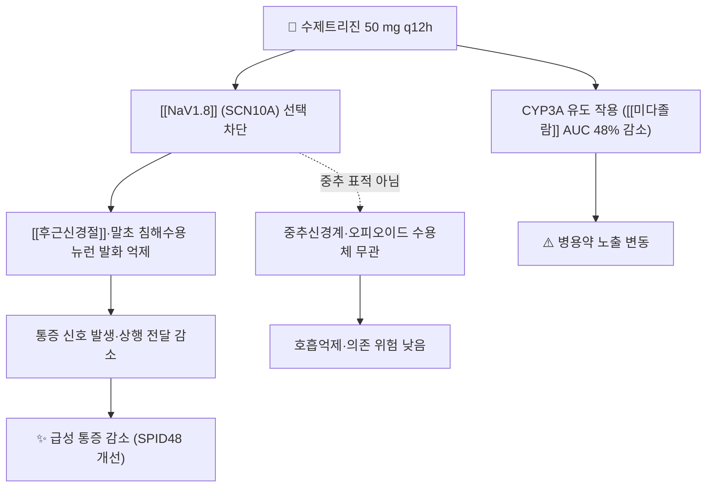

# 💊 수제트리진 (Suzetrigine, VX-548, Journavx)

> **핵심 요약 (Key Summary)**:
> 🧪 주성분·제형: 말초 감각뉴런의 [[NaV1.8]] 전압개폐 나트륨통로를 선택적으로 차단하는 first-in-class 비오피오이드 진통제. 50 mg 경구 정제, 2025년 미국 FDA 승인(상품명 Journavx).
> 📍 작용 기전: [[후근신경절]]과 말초 침해수용 뉴런의 [[NaV1.8]]을 차단해 통증 신호 발생 자체를 줄인다. 중추 오피오이드 수용체와 무관해 호흡억제·의존 위험이 낮다.
> 🎯 임상 적응증: 중등도~중증 급성 통증(수술 후 통증 모델) — 초회 100 mg, 이후 50 mg 12시간마다, 최대 14일.
> ⚠️ 주의사항: [[하이드로코돈]]/[[아세트아미노펜]] 대비 우월하지 않다. CYP3A 유도 작용이 있어 병용약 노출이 달라지고, 만성 통증에서의 장기 사용은 근거 밖이다. 국내 허가는 이 리뷰 시점에 확인되지 않았다.

---

## 1. 약물 기본 정보 및 시판 제품 (Brand Identification)

![[수제트리진_02_구조식2D.png|320]]
> [그림 1: 수제트리진의 2D 화학 분자 구조식 — PubChem CID 156445116 (PubChem PNG 정본)]

> 🖼️ 이미지 미확보 — 시판 완제품 **패키지 실사·PTP 알약 성상**은 이번 회차에 확보하지 못했다(국내 미허가로 국내 제품 이미지 없음, 해외 제품 사진은 검증된 출처에서 확인되지 않음). 다른 약 사진으로 대체하지 않고 사유를 남긴다.

| 항목 | 상세 정보 |
| :--- | :--- |
| 일반명 (Generic Name) | 수제트리진(한글) / Suzetrigine (개발코드 VX-548) |
| 대표 상품명 (Brand Names) | Journavx (미국) — 국내 시판 품목 없음 |
| ATC 코드 / 분류 | WHO ATC/DDD Index 조회 결과 미등재(2026-10-15 확인) — 임상 분류는 비오피오이드 진통제 |
| PubChem CID | [156445116](https://pubchem.ncbi.nlm.nih.gov/compound/156445116) |
| 화학식 / 분자량 | C21H20F5N3O4 / 473.4 g/mol |
| 주요 제형 및 함량 | 경구 정제 50 mg |
| 승인 적응증(FDA) | 중등도~중증 급성 통증(2025년 승인) |

### 1.1 허가 용법·프로토콜

| 구분 | 내용 |
| :--- | :--- |
| 초회 용량 | 100 mg(50 mg 정 2정) 경구 |
| 유지 용량 | 초회 12시간 후부터 50 mg을 12시간마다(1일 2회) |
| 복용법 | 씹거나 부수지 않고 통째로 삼킨다 |
| 사용 기간 | 가능한 짧게 — 최대 14일 또는 통증 소실까지 |
| 3상 시험 프로토콜 | 수술 후 100 mg 초회 → 50 mg 12시간마다, 48시간 추적, 주요 지표 SPID48 |

---

## 2. 분자 약리 기전 및 작용 경로 (Mechanism of Action)

- [[NaV1.8]]은 [[후근신경절]]과 말초 침해수용 뉴런에 주로 발현되어 통증 신호의 상행 전달을 담당한다. 수제트리진은 이 통로를 선택적으로 차단해 통증 신호 발생 자체를 줄이고, 중추신경계·오피오이드 수용체와 무관해 호흡억제·의존 위험이 낮다 → [[오피오이드]] · [[말초 감작]]
- 허가 라벨은 CYP3A 매개 상호작용을 명시한다: 수제트리진 50 mg을 12시간마다 반복 투여했을 때 민감한 CYP3A 기질인 [[미다졸람]]의 AUC가 48% 감소해 CYP3A 유도 작용이 있음을 보여준다 → [[CYP3A4]]
- 침해수용(nociception) 층위에서 한의 중재(침·전침의 말초·중추 감작 조절)와는 겨냥 지점이 다르다 — 대체 관계가 아니라 서로 다른 표적을 다루는 병용 축으로 이해한다.

---

## 3. 약동학적 특성 (Pharmacokinetics)

| 약동학 파라미터 | 수치 및 임상적 의미 |
| :--- | :--- |
| 생체이용률 (Bioavailability) | 경구 투여가 표준 경로(정제) |
| 최고혈중농도 도달시간 (Tmax) | 경구 후 수 시간 내 도달(개별 수치는 허가사항 확인) |
| 혈장 단백결합률 | 허가사항 확인 항목 — 본 노트는 단일 값으로 단정하지 않는다 |
| 간 대사 | CYP3A 경로와 겹친다 — 강력 CYP3A 저해제·유도제 병용 시 용량·병용 조정 필요 |
| 배설 반감기 (t1/2) | 12시간 간격 투여 설계의 근거가 되는 반감기(허가사항 확인) |
| 주요 배설 경로 | 허가사항 확인 항목 |

> ⚠️ 원문 메타분석·리뷰에는 개별 약동학 수치가 제시되지 않았다. 추정값을 적지 않고 허가사항 확인 항목으로 남긴다.

---

## 4. 용법·용량 및 처방 가이드 (Dosage & Administration)

| 임상 상황 | 용법·용량 | 근거 층위 |
| :--- | :--- | :--- |
| 급성 중등도~중증 통증(수술 후) | 100 mg 초회 → 50 mg 12시간마다 | 3상 2건(복부성형술·무지외반절제술) 및 SR·MA 5편 |
| 간기능 저하 | 중등도 이상 저하 시 용량 조정 | 허가사항 |
| 사용 기간 | 최대 14일 또는 통증 소실까지 | 허가사항 |
| 만성 통증 | 사용하지 않는다(근거 밖) | SR·MA는 급성 통증만 포함 |

- 효과 크기를 정확히 읽어야 한다: 위약 대비 SPID48 SMD 0.42(95% CI 0.31~0.53, I²=9%)로 작음~중등도이고, 임상적으로 의미 있는 2점 이상 감소 도달 시간은 위약 480분 대비 복부성형술 119분·무지외반절제술 240분이었다.

---

## 5. 부작용, 경고 및 약물 상호작용 (Adverse Effects & Interactions)

### 5.1 주요 이상반응
- **흔한 이상반응**: 오심, 어지럼. 대부분 경증~중등도였다.
- **이상반응 위험 비교**: 위약 대비 RR 0.86(0.77~0.96), [[하이드로코돈]]/[[아세트아미노펜]] 대비 RR 0.81(0.74~0.89)로 낮았다.
- **어지럼 관리**: 어지럼을 유발하는 다른 약과 겹치면 낙상 위험을 점검한다.

### 5.2 주요 병용·상호작용
- **CYP3A**: 강력 저해제·유도제와 병용 시 노출이 달라진다. 수제트리진 자체가 CYP3A 유도 작용을 보인다([[미다졸람]] AUC 48% 감소) → [[CYP3A4]]
- **다제복용 환자**: 처방 전 복용약 전체를 확인하고 상호작용 여부를 진료기록에 남긴다.
- **오피오이드 대체 아님**: [[하이드로코돈]]/[[아세트아미노펜]] 대비 우월성이 입증되지 않았다 — 다각적 진통 요법의 한 축으로 위치시킨다 → [[오피오이드]]

---

## 6. 한의 치료 연계 및 병용/테이퍼링 프로토콜 (Integrative Medicine)

- 기전이 말초([[NaV1.8]])라는 점은 한의 임상과 접점이 흥미롭지만 대체 관계는 아니다. 침·전침은 말초·중추 감작을 조절하는 방향으로, 수제트리진은 말초 통로를 직접 차단하는 방향으로 작동한다 → [[전침]] · [[중추 감작]] · [[말초 감작]]
- 급성 근골격 통증에서 비오피오이드 선택지가 늘어난 만큼, 환자가 오피오이드 처방을 요구할 때 대안 설명의 폭이 넓어진다.
- 한의 임상의 기본 순서는 바뀌지 않는다: 소염진통제를 안전하게 조정하면서 침·도수·운동을 함께 하고, 신약은 상황에 따른 추가 옵션으로 둔다 → [[NSAIDs]] · [[아세트아미노펜]]

---

## 7. 💡 사용자 진료실 핵심 필기 & 실전 임상 체크리스트

### 7.1 진료실 문진 체크리스트
1. 통증의 성질이 급성인지 만성인지 — 이 약의 근거는 급성(수술 후 모델)뿐이다.
2. 복용 중인 약 전체 확인(CYP3A 저해제·유도제, 어지럼 유발 약, 오피오이드).
3. 신기능·간기능 저하 여부, 어지럼·낙상 위험.

### 7.2 환자 티칭 스크립트
> "오피오이드(마약성 진통제) 없이 급성 통증을 잡는 새로운 진통제가 나왔습니다. 수술 후 통증에서 위약보다 통증을 더 줄였고 부작용도 적었지만, 기존 코데인 계열 복합제보다 더 강하지는 않았습니다. 즉 '의존성 없는 대안'이라는 의미가 크고, 만성 통증에는 아직 충분히 검증되지 않았습니다. 그래서 지금 진료에서는 소염진통제를 안전하게 조정하면서 침·도수·운동을 함께 하는 방법이 기본이고, 이 신약은 상황에 따라 선택할 수 있는 추가 옵션으로 이해하시면 됩니다."

---

## 8. 출처 및 학술 참고 문헌 (References)

1. **Safety and efficacy of Suzetrigine (VX-548) for acute moderate to severe pain in adults; a systematic review and meta-analysis.** *Journal of Clinical Anesthesia*. 2026;111:112156. [PMID 41785614](https://pubmed.ncbi.nlm.nih.gov/41785614/) · [DOI 10.1016/j.jclinane.2026.112156](https://doi.org/10.1016/j.jclinane.2026.112156)
   - [연구 요약] RCT 5편·2,855명. 위약 대비 이상반응 RR 0.86, SPID48 SMD 0.42(I²=9%), [[하이드로코돈]]/[[아세트아미노펜]] 대비 우월성은 없었다 — 본 노트 §4·§5 수치의 근거다.
2. **Suzetrigine, a Nonopioid NaV1.8 Inhibitor for Treatment of Moderate-to-severe Acute Pain: Two Phase 3 Randomized Clinical Trials.** *Anesthesiology*. 2025;142(6):1085-1099. [PMID 40117446](https://pubmed.ncbi.nlm.nih.gov/40117446/) · [DOI 10.1097/ALN.0000000000005460](https://doi.org/10.1097/ALN.0000000000005460)
   - [연구 요약] 복부성형술 1,118명·무지외반절제술 1,073명 3상. 위약 대비 SPID48 최소제곱평균 차 48.4·29.3, 2점 이상 감소 도달 시간 119분·240분.
3. **Modulation of human dorsal root ganglion neuron firing by the NaV1.8 inhibitor suzetrigine.** *Proc Natl Acad Sci U S A*. 2025. [PMID 40424150](https://pubmed.ncbi.nlm.nih.gov/40424150/)
   - [연구 요약] 사람 [[후근신경절]] 뉴런 발화 조절을 통한 작용 기전 확인 — 본 노트 §2 기전 서술의 근거다.
4. **Suzetrigine: The first NaV1.8 inhibitor approved for the treatment of moderate to severe acute pain.** *Drug Discoveries & Therapeutics*. 2025. [PMID 40010720](https://pubmed.ncbi.nlm.nih.gov/40010720/)
   - [연구 요약] 최초 승인 [[NaV1.8]] 억제제의 승인 배경·임상 위치 정리.
5. **FDA 허가사항(Journavx) — 용량·CYP3A 상호작용·주의사항 전문.** [PDF](https://www.accessdata.fda.gov/drugsatfda_docs/label/2025/219209s000lbl.pdf)
   - [연구 요약] 초회 100 mg → 50 mg 12시간마다, 최대 14일, CYP3A 병용 주의를 확인한 1차 출처다(2026-10-15 접속 확인).
6. **PubChem Compound Summary — Suzetrigine (CID 156445116).** [링크](https://pubchem.ncbi.nlm.nih.gov/compound/156445116)
   - [연구 요약] 분자식 C21H20F5N3O4·분자량 473.4 g/mol·2D 구조식(그림 1) 확인.

## 함께 보기
- [[NaV1.8]] · [[후근신경절]] · [[오피오이드]] · [[하이드로코돈]] · [[미다졸람]] · [[CYP3A4]] · [[NPRS]] · [[신경병증성 통증]]
- [[2026-10-15_통합의학약리학_심층리뷰]] 3번
