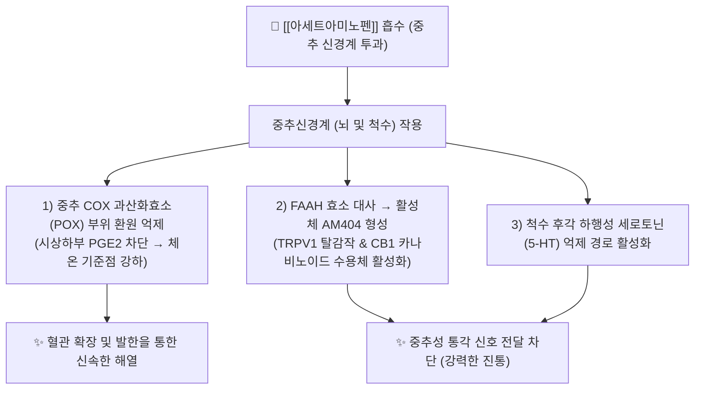
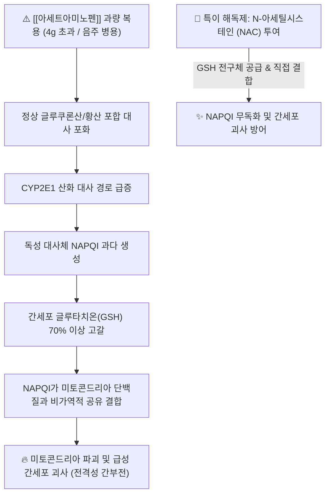

# 💊 [[아세트아미노펜]] (Acetaminophen / Paracetamol, AAP, N02BE01)

> **핵심 3줄 요약 (Key Summary)**:
> - 🧪 약물 분류 & 표적: 아닐린(Aniline) 유도체 계열의 대표적 비마약성 중추성 해열진통제, 중추신경계 COX 과산화효소(POX) 억제, 내인성 카나비노이드(AM404 $\rightarrow$ TRPV1/CB1) 신호 조절 및 세로토닌 하행 억제 경로 활성화.
> - 🎯 주요 적응증 & 원내외 처방 패턴: 경도~중등도의 급만성 통증([[두통]], [[근막통증증후군]], 치통, 관절통) 및 발열, 위장관 궤양이나 출혈 위험으로 [[NSAIDs]]를 쓰지 못하는 환자의 1차 선택제, 임상시험의 표준 구제약(Rescue Analgesic).
> - 🔬 분자약리 기전 & 약동학(PK/PD): 말초 항염 작용은 거의 없으며 중추성 진통·해열 작용 발휘, 간에서 90% 이상 글루쿠론산·황산 포합 대사, 5~10%가 CYP2E1에 의해 독성 대사체 NAPQI로 산화 후 간내 글루타치온(GSH)에 의해 해독.
> - ⚠️ 블랙박스 경고 & 주요 부작용: **1일 최대 복용량(4,000mg) 초과 시 또는 음주 후 복용 시** CYP2E1 유도 및 글루타치온 고갈로 치명적인 급성 간부전(간소엽 중심 괴사) 유발 (특이 해독제: N-아세틸시스테인, NAC).

---

## 1. 약물 기본 정보 및 시판 제품 (Brand Identification)

> [!abstract]+ 🧪 3D 약리 분자 구조 (Interactive 3D Viewer)
> <iframe src="https://molecule-viewer-rho.vercel.app/?cid=1983" style="width: 100%; height: 600px; border: none; border-radius: 12px; box-shadow: 0 4px 20px rgba(0,0,0,0.15);" allowfullscreen></iframe>

| 항목 | 상세 정보 |
| :--- | :--- |
| **일반명 (Generic Name)** | Acetaminophen (USAN) / Paracetamol (INN) / [[아세트아미노펜]] |
| **약효 분류 (Class)** | 비마약성 중추성 해열진통제 (Aniline derivative antipyretic analgesic) |
| **ATC 코드** | N02BE01 (Analgesics, Other antipyretics and analgesics) |
| **화학식 / 분자량** | C8H9NO2 / 151.16 g/mol (PubChem CID 1983) |
| **약국 시판 제품 (OTC 일반약)** | • **단일제**: **타이레놀정 500mg**, **타이레놀 8시간 ER 서방정 650mg**, 타세놀정, 세토펜현탁액 • **복합 진통제**: 게보린정(AAP+IPA+카페인), 펜잘큐정, 우먼스타이레놀(AAP+파마브롬) • **종합 감기약**: 판피린큐액(300mg 함유), 판콜에스, 테라플루, 타이레놀콜드 |
| **병원 처방 의약품 (ETC 전문약)** | • **단일제**: 세토펜정 325mg/500mg, 아세트아미노펜정 • **마약성/비마약성 복합제**: **울트라셋정** / **파라마셋정** (트라마돌 37.5mg + AAP 325mg), **울트라셋이알서방정** (트라마돌 75mg + AAP 650mg) |
| **상용 용법·용량** | • **속방정 (500mg)**: 1회 1~2정(500~1,000mg), 4~6시간 간격 복용 (**1일 최대 4,000mg 이하**) • **서방정 (ER 650mg)**: 1회 2정(1,300mg), 8시간 간격 복용 (1일 최대 6정, 3,900mg) • **울트라셋 복합제**: 1회 1~2정, 1일 최대 8정 이하 |

### 1.1 대표 시판 제품 및 함유 복합제 매핑 (Brand Identification)

| 구분 | 대표 제품명 / 브랜드 | 함유 성분 및 1회당 함량 | 제형 및 방출 특성 | 주요 적응증 및 복약 지도 핵심 |
| :--- | :--- | :--- | :--- | :--- |
| **단일제 (OTC/ETC)** | [[타이레놀]] (500mg/ER 650mg), [[세토펜]] | [[아세트아미노펜]] 단일 (500mg / 650mg) | 속방정, 이중서방정, 소아시럽 | 발열·두통 1차 선택, 1일 최대 4,000mg 준수 |
| **복합 진통제 (OTC)** | [[게보린]], 펜잘큐 | [[아세트아미노펜]] (300mg) + [[이소프로필안티피린]] + [[카페인무수물]] | 정제 | 신속한 두통·치통 완화, 15세 미만 금기 |
| **생리통 복합제 (OTC)** | [[우먼스타이레놀]] | [[아세트아미노펜]] (500mg) + [[파마브롬]] (25mg) | 속방정 | 원발성 생리통 및 부종·하복부 팽만감 완화 |
| **종합감기약 (OTC)** | [[판피린]], [[판콜]] | [[아세트아미노펜]] (300~325mg) + 복합성분 | 액제, 정제 | 타이레놀 중복 복용에 따른 간독성 위험 필수 교육 |
| **처방 전문약 (ETC)** | 울트라셋, 파라마셋 | [[아세트아미노펜]] (325mg) + [[트라마돌]] (37.5mg) | 정제, 서방정 | 중등도 이상 급만성 통증, 변비·어지럼 모니터링 |

![[타이레놀_한국형_패키지.jpg|400]]
> [그림 1: 대한민국 약국 및 편의점에서 가장 널리 유통되는 타이레놀(Tylenol) 500mg 상용 패키지 외형]

![[아세트아미노펜_블리스터_알약.jpg|400]]
> [그림 2: 아세트아미노펜 500mg 정제 알약 외형 및 PTP 블리스터 포장]

---

## 2. 분자 약리 기전 및 작용 경로 (Mechanism of Action)

![[아세트아미노펜_화학구조.png|320]]
> [그림 3: 아세트아미노펜의 2D 화학 구조식 (N-(4-hydroxyphenyl)acetamide, 분자량 151.16 g/mol, PubChem CID 1983)]

### 1) 중추성 COX 효소 POX 부위 억제
* 말초 염증 조직에는 고농도의 지질 과산화물(Peroxide)이 존재하여 아세트아미노펜의 효소 억제능을 무력화하므로 **말초 소염 작용은 거의 없습니다.**
* 반면 과산화물 농도가 낮은 뇌와 척수 등 중추신경계에서는 COX 효소의 과산화효소 활성 부위(Peroxidase, POX)를 선택적으로 환원 차단하여 시상하부 발열 기준점을 정상화하고 통증 신호 전달을 억제합니다.

### 2) 활성 대사체 AM404 형성 및 카나비노이드/TRPV1 신호 조절
* 뇌세포에서 지방산 아미드 가수분해효소(FAAH)에 의해 아라키돈산과 결합하여 활성 대사체인 **AM404**로 전환됩니다.
* AM404는 내인성 카나비노이드 $\text{CB}_1$ 수용체를 활성화하고 통증 수용체인 [[TRPV1]] 채널을 탈감작시켜 척수 후각에서의 통증 상행 전도를 강력히 차단합니다.

---

## 3. 약동학적 특성 (Pharmacokinetics: ADME)

| 약동학 파라미터 | 수치 및 임상적 의미 |
| :--- | :--- |
| **생체이용률 (Bioavailability, F)** | **약 88 ~ 90%** (소장에서 지연 없이 신속 흡수) |
| **최고혈중농도 도달시간 (Tmax)** | 속방정 **30 ~ 60분**, ER 서방정 **1 ~ 2시간** |
| **혈장 단백결합률 (Protein Binding)** | **10 ~ 25%** (매우 낮아 혈액뇌장벽 BBB 신속 투과) |
| **간 대사 경로 (Metabolism)** | • **안전한 포합 대사 (90~95%)**: 글루쿠론산 포합(55~60%) 및 황산 포합(30~35%) • **독성 산화 대사 (5~10%)**: **CYP2E1**에 의해 반응성 중간체인 **NAPQI**로 전환 $\rightarrow$ 간내 글루타치온(GSH)에 의해 해독 |
| **소실 반감기 (Elimination t1/2)** | **약 2.0 ~ 3.0 시간** |
| **주요 배설 경로 (Excretion)** | 투여량의 90% 이상이 24시간 이내에 신장 소변으로 배설 (글루쿠론산/황산 포합체) |

---

## 4. 용법·용량 및 처방 가이드 (Dosage & Administration)

### 4.1 표준 용법 및 제형별 투여 요법
* **속방정 (500mg)**:
  * 성인 및 12세 이상: 1회 500~1,000mg을 4~6시간 간격으로 경구 투여 (**1일 최대 4,000mg 이하**).
* **서방정 (ER 650mg)**:
  * 성인: 1회 1,300mg(2정)을 8시간 간격으로 복용 (1일 최대 6정, 3,900mg 이하, 씹거나 부수지 말고 통째로 삼킴).
* **임상 연구 내 표준 구제약(Rescue Medication) 프로토콜 (Melt-In)**:
  * **무릎 골관절염 네트워크 메타분석**: 전통적으로 1차약으로 권고되었으나, 국소 NSAID 대비 기능 개선 및 장기 심혈관·위장관 안전성에서 열위함이 대규모 코호트에서 규명됨 (Osteoarthritis and Cartilage 2021).
  * **만성 경부통 추나 RCT**: 5주간 구제약으로 아세트아미노펜(최대 4g/일)을 허용하고 복용량을 추적하여 추나요법의 통증 완화 및 진통제 절감 효과를 객관적으로 입증 (JAMA Netw Open 2021).
  * **PHN 전침 RCT**: 유일 허용 구제약으로 아세트아미노펜 ≤2g/일을 규정하여 전침 치료군의 구제약 복용 일수 유의미 감소를 입증 (JAMA Neurol 2026).

### 4.2 진료과별 처방 패턴 & 최적 적응증 (Sweet Spot vs 금기)
* **[✅ 최적 적응증 (Sweet Spot)]**:
  * **소화성 궤양 및 위장장애 환자**: NSAIDs 복용 시 속쓰림, 위출혈 병력이 있는 환자의 안전한 통증 조절.
  * **출혈 경향 및 항응고제([[와파린]], [[NOAC]]) 복용 환자**: 혈소판 기능 저해 없음.
  * **임산부, 수유부 및 소아 환자**: 라이 증후군 위험이 없어 전 연령대 1차 선택 해열진통제.
* **[⚠️ 신중 투여 및 금기 (Caution / Contraindication)]**:
  * **중증 간장애 환자 및 간부전 환자 절대 금기**.
  * **만성 음주자 주의**: 매일 3잔 이상 술을 마시는 환자는 CYP2E1이 유도되어 통상 용량에서도 급성 간독성 위험.

---

## 5. 부작용, 경고 및 약물 상호작용 (Adverse Effects & Interactions)

### 5.1 부작용 및 간독성 발현 기전

* **급성 간부전 진행 단계**:
  * 초기(0~24시간): 무증상 또는 경미한 오심, 구토, 식은땀.
  * 잠복기(24~72시간): 증상이 일시 완화되나 우상복부 압통 및 AST/ALT, 빌리루빈 급상승.
  * 극기(72~96시간): 황달, 혈액응고장애, 간성뇌증, 신부전 및 사망 위험.
* **특이 해독제**: **N-아세틸시스테인 (NAC, N-acetylcysteine)** 복용 후 8시간 이내 투여 시 100% 간세포 보호.

### 5.2 약물 상호작용 매트릭스

| 병용 약물 / 물질 | 상호작용 기전 | 임상적 위험 및 결과 | 처방 및 티칭 가이드 |
| :--- | :--- | :--- | :--- |
| **[[알코올]] (술)** | 간내 CYP2E1 효소 유도 + 글루타치온 고갈 | 독성 대사체 NAPQI 대량 생성 → **급성 간괴사** | **음주 전후 복용 절대 금기 (최소 24시간 간격)** |
| 종합감기약 ([[판피린]], [[판콜]]) | 동일 성분 중복 투여 | 1일 허용량(4,000mg) 초과 간독성 급증 | **처방 전 복용 중인 모든 일반 감기약 전수 확인** |
| 마약성 진통제 ([[하이드로코돈]], [[트라마돌]]) | 복합제 내 아세트아미노펜 함유 | 총 누적 용량 증가에 따른 간독성 위험 | 복합제 복용 시 단일제 타이레놀 추가 복용 금지 |
| 간보호 한약 ([[갈근]], [[인진호]]) | 간세포 글루타치온(GSH) 합성 촉진 및 항산화 | 약인성 간 손상 완충 및 해독 시너지 | **양약 복용 1~2시간 후 투약** |

---

## 6. 한의 치료 연계 및 병용/테이퍼링 프로토콜 (Integrative Medicine)

* **만성 통증 한의 치료 코스 내 진통제 사용량 추적 (Melt-In)**:
  * 추나요법, 침, 전침, 약침 치료 코스(4~6주)를 진행할 때 환자가 복용하는 아세트아미노펜의 일일 복용량 및 구제약 복용 일수를 기록.
  * 통증 강도(NRS/VAS) 감소와 함께 **1주 단위로 복용량을 1/2씩 단계적으로 감량(테이퍼링)**하여 환자의 자기관리 능력을 신장시킴.
* **음주 후 숙취 두통 환자 대체 처방**:
  * 음주 후 두통 환자가 타이레놀을 복용하면 치명적 간 손상이 유발되므로, 타이레놀 대신 [[갈근해기탕]], [[대금음자]], [[반하백출천마탕]]을 처방하여 간내 알코올 대사를 촉진하고 안전하게 두통을 해소.
* **관절염 고령 환자의 국소제 및 한방 요법 전환**:
  * 장기 아세트아미노펜 복용 환자에서 통증 조절이 불충분할 경우, 무작정 증량하지 않고 [[국소 NSAID]](디클로페낙 겔/패치) 또는 침·약침 치료로 전환하여 전신 독성을 배제.

---

## 7. 💡 사용자 진료실 핵심 필기 & 실전 임상 체크리스트

* **진료실 실전 문진 체크리스트 (3대 핵심 질문)**:
  1. **"하루에 타이레놀을 몇 알 드시나요?"**:
     * 500mg 정제 기준 하루 8알(4,000mg) 초과 여부, 650mg 서방정 기준 하루 6알 초과 여부 필수 확인.
  2. **"약국이나 편의점에서 사신 감기약, 두통약도 같이 드시나요?"**:
     * 판피린, 판콜, 게보린, 테라플루 등에 모두 아세트아미노펜이 중복 함유되어 있음을 환자에게 경고.
  3. **"어제 술을 드셨거나, 평소 주 3회 이상 음주를 하시나요?"**:
     * 음주 상태에서는 간세포의 해독 물질(글루타치온)이 고갈되어 통상 용량의 타이레놀로도 급성 간손상이 올 수 있으므로 복용 엄금.

* **환자 티칭 스크립트 (원문 보존)**:
  > *"타이레놀은 위장에는 가장 안전한 진통제이지만, **하루 8알(4,000mg)을 넘기거나 술을 마신 뒤 드시면 간에 치명적인 손상**을 줄 수 있습니다. 특히 감기약(판피린, 판콜 등)에도 같은 성분이 들어있어 무심코 함께 드시다가 용량을 넘기는 경우가 많으니, 감기약을 드실 때는 타이레놀을 따로 드시지 마십시오."*

---

## 8. 출처 및 학술 참고 문헌 (References)

1. **식품의약품안전처 (MFDS)**. 의약품 품목허가사항 및 안전성 서한: 아세트아미노펜 제제 (2023).
2. **Larson AM, et al. (2005)**. Acetaminophen-induced acute liver failure: results of a United States multicenter, prospective study. *Hepatology*, 42(6), 1364-1372. PMID: 16317692.
   - [PubMed](https://pubmed.ncbi.nlm.nih.gov/16317692/) | [DOI](https://doi.org/10.1002/hep.20948)
   - **[연구 요약]**: 아세트아미노펜 과량 복용 및 복합제 중복 투약이 급성 간부전(ALF)의 주된 원인임을 대규모 전향적 코호트로 입증하고 1일 최대 4,000mg 용량 제한의 중요성 제시.
3. **Heard KJ. (2008)**. Acetylcysteine for acetaminophen poisoning. *New England Journal of Medicine*, 359(3), 285-292. PMID: 18635433.
   - [PubMed](https://pubmed.ncbi.nlm.nih.gov/18635433/) | [DOI](https://doi.org/10.1056/NEJMct0708342)
   - **[연구 요약]**: 아세트아미노펜 중독 시 N-아세틸시스테인(NAC)의 글루타치온 보충 및 반응성 독성 대사체(NAPQI) 해독 프로토콜 총괄 가이드라인.
4. **Zeng C, et al. (2021)**. Comparative efficacy and safety of topical non-steroidal anti-inflammatory drugs for osteoarthritis: a systematic review and network meta-analysis of randomised controlled trials. *Osteoarthritis and Cartilage*, 29(9), 1242-1251. PMID: 34174454.
   - [PubMed](https://pubmed.ncbi.nlm.nih.gov/34174454/) | [DOI](https://doi.org/10.1016/j.joca.2021.06.004)
   - **[연구 요약]**: 무릎 골관절염에서 국소 NSAID가 경구 아세트아미노펜 대비 우수한 기능 개선 및 유의미하게 낮은 전신 사망·심혈관 위해를 가짐을 규명.
5. **Lee J, et al. (2021)**. Chuna Manual Therapy for Persistent Neck Pain: A Randomized Controlled Trial. *JAMA Network Open*, 4(7), e2113757. PMID: 34259850.
   - [PubMed](https://pubmed.ncbi.nlm.nih.gov/34259850/) | [DOI](https://doi.org/10.1001/jamanetworkopen.2021.13757)
   - **[연구 요약]**: 만성 경부통 환자 대상 무작위 배정 임상시험에서 아세트아미노펜을 표준 구제약으로 통제하여 추나요법의 통증 완화 및 진통제 복용량 감소 효과를 규명.

<!-- 보관 태그(1회용·링크오류, 필요시 복원): 해열진통제, 중추성진통제, 타이레놀, NAPQI -->

## 📎 개념 학습 보충 (2026-11-26 논문 연계)

- 논문에서의 역할: Cochrane 2026 고찰([PMID 43051256](https://pubmed.ncbi.nlm.nih.gov/43051256/))에서 1편이 [[아세트아미노펜]]을 대조약으로 사용했다. 9편 중 1편뿐이라 대조별 결론의 무게가 가장 가볍다.
- 해석: "위약보다 조금 낫다"와 "아세트아미노펜만큼 한다"는 다른 주장이다. 후자는 이 고찰에서 확립되지 않았다.
- 임상 활용: 위장관·신장 위험으로 [[NSAIDs]]를 못 쓰는 환자에서 [[강황]] 보충제를 권할 때도 아세트아미노펜을 먼저 중단하지 않는다. 1일 상한과 간질환·음주력을 함께 확인한다.
- 관련: [[강황]] · [[NSAIDs]] · [[퇴행성 슬관절염]] · [[2026-11-26_통합의학약리학_개념학습]]
