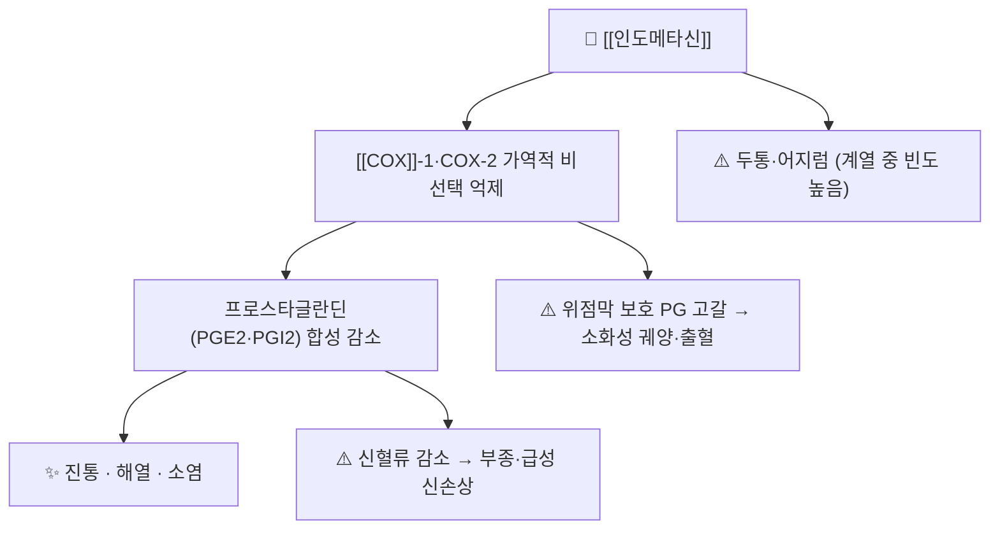

# 💊 인도메타신 (Indomethacin, Indocid / M01AB01·M02AA23)

> **핵심 3줄 요약 (Key Summary)**:
> 🧪 주성분·제형: 아세트산 유도체 계열 비선택적 NSAID. 경구 캡슐·서방캡슐, 좌제, 외용 겔·크림·카타플라스마, 안과 점안제로 시판된다.
> 📍 작용 기전: COX-1·COX-2 비선택적 억제로 프로스타글란딘 합성을 차단. 진통·해열·소염 작용을 내지만 위장관·신장·혈소판 부작용이 계열 중에서도 두드러진다.
> 🎯 임상 적응증: 국내 허가로는 퇴행성관절염·어깨관절주위염·건초염·상완골상과염·근육통·외상 후 종창·동통의 국소 치료제가 실용적 위치를 차지한다.
> ⚠️ 주의: 아스피린·NSAID 과민(천식·기관지경련) 병력, 14세 미만(외용 제품), 병변 피부·점막 도포, 밀봉붕대법은 금기다.

---

## 1. 약물 기본 정보 및 시판 제품 (Brand Identification)

![[인도메타신_03_시판제품.jpg|360]]
> [그림 1: 국내 시판 인도메타신 캡슐의 성상 — 상·하반 이색 캡슐. 출처: 식약처 의약품안전나라 제품 이미지(인도메타캡슐, 한국피엠지제약) https://nedrug.mfds.go.kr/pbp/cmn/itemImageDownload/146031049862800065 — 패키지 외형 사진은 미확보]

![[인도메타신_02_입체구조.png|360]]
> [그림 2: 인도메타신의 3D 볼-앤-스틱 모델 — File:Indomethacin sticks-model.png, Wikimedia Commons, CC0]

![[인도메타신_01_구조식.png|360]]
> [그림 3: 인도메타신의 2D 화학 분자 구조식 — PubChem CID 3715 정본]

> [!abstract]+ 🧪 3D 약리 분자 구조 (Interactive 3D Viewer)
> <iframe src="https://molecule-viewer-rho.vercel.app/?cid=3715" width="100%" height="450px" frameborder="0" allow="webgl" style="border-radius: 8px;"></iframe>

| 항목 | 상세 정보 |
| :--- | :--- |
| 일반명 (Generic Name) | 인도메타신(Indomethacin, INN 표기 Indometacin) |
| 대표 상품명 (Brand Names) | 인도메타캡슐, 인타신첩부제, 인도톱카타플라스마, 단아팬에프카타플라스마, 메타플러스첩부제, 바이겔크림, 메타겔크림 / 해외 Indocid, Indocin |
| ATC 코드 / 분류 | M01AB01(경구) · M02AA23(국소 외용) · S01BC01(안과) / 식약처 분류 114 해열·진통·소염제 |
| PubChem CID | [3715](https://pubchem.ncbi.nlm.nih.gov/compound/3715) |
| 화학식 / 분자량 | C19H16ClNO4 / 357.79 g/mol (CAS 53-86-1) |
| 주요 제형 및 함량 | 경구 캡슐 25 mg, 서방캡슐 75 mg, 좌제, 외용 겔·크림·카타플라스마, 점안액 |
| 식약처 허가 적응증 (외용) | 퇴행성관절염(골관절염), 어깨관절주위염, 건·건초염, 건주위염, 상완골상과염, 근육통, 외상 후 종창·동통의 진통·소염 |

### 1.1 대표 시판 제품 및 함유 복합제 매핑

| 구분 | 대표 제품명 | 함유 성분 | 제형 및 특징 | 적응증·복약 지도 핵심 |
| :--- | :--- | :--- | :--- | :--- |
| 경구 단일제 | 인도메타캡슐 | 인도메타신 단일 | 캡슐, 서방캡슐 | 전신 소염진통. 위장관·신장 부담 커 단기·최소용량 원칙 |
| 외용 카타플라스마 | 인타신첩부제 | 인도메타신 단일 | 습포형 첩부제 | 1일 2회 부착. 밀봉붕대법 금지, 병변 피부 금기 |
| 외용 카타플라스마 | 인도톱카타플라스마, 단아팬에프카타플라스마, 메타플러스첩부제 | 인도메타신 단일 | 습포형 첩부제 | 국소 관절통·근육통. 부착 부위 교대 필요 |
| 외용 겔·크림 | 바이겔크림, 메타겔크림 | 인도메타신 단일 | 겔·크림 | 1일 수회 환부 도포. 14세 미만 사용 금지 |
| 계열 내 대안 | [[디클로페낙]] 젤, 케토프로펜 겔 | 다른 NSAID | 겔·첩부제 | 자극이 강한 인도메타신 대신 1차 선택으로 쓰는 경우가 많다 |

- 국내에서 인도메타신은 경구보다 외용 카타플라스마·겔 형태로 더 자주 만난다. 2021년 조사마 카타플라스마 시험의 활성 대조군이 바로 이 제형이다 → [[카타플라스마제]]

---

## 2. 분자 약리 기전 및 작용 경로 (Mechanism of Action)

- 비선택적 COX 억제: COX-1 억제가 위점막 보호·신혈류 유지·혈소판 기능을 함께 떨어뜨린다. 그래서 [[아세트아미노펜]]이나 선택적 COX-2 억제제([[세레콕시브]])보다 위장관 위험이 크다.
- 국소 제형: 각질층을 통과한 약물이 활막·관절주위 연부조직에서 국소 COX를 억제한다. 전신 노출이 낮아 위장관·신장 부담이 줄지만, 피부 자극·접촉 피부염이 대가다 → [[국소 NSAID]]
- 계열 특이 부작용: 두통이 가장 흔한 신경계 이상반응이며, 어지럼·집중력 저하가 동반될 수 있다. 고령자에서는 섬망·인지 저하를 유발할 수 있어 주의한다.

---

## 3. 약동학적 특성 (Pharmacokinetics: ADME)

| 약동학 파라미터 | 수치 및 임상적 의미 |
| :--- | :--- |
| 생체이용률 (Bioavailability) | 경구 흡수는 빠르고 거의 완전하나 제형·식후 상태에 따라 변동. 서방캡슐은 75 mg 1일 1회 설계 |
| 최고혈중농도 도달시간 (Tmax) | 속방 캡슐에서 1~2시간대. 식후 복용 시 지연 |
| 혈장 단백결합률 (Protein Binding) | 약 99% — 유리약물이 적어 다른 고단백결합 약과 치환 경쟁 시 작용이 증폭될 수 있다 |
| 간 대사 효소 (Metabolism) | 탈메틸·탈벤조일·탈메틸탈벤조일 대사체 생성 + 글루쿠론산 포합 |
| 배설 반감기 (Elimination t1/2) | 평균 약 4.5시간 |
| 주요 배설 경로 (Excretion) | 요 중 약 60%(인도메타신 및 글루쿠론산 포함 26%), 변 중 약 33%(미변화체 1.5%). 장간순환 있음 |

- 출처: FDA 라벨(DailyMed, 2025년 5월 갱신). 반감기가 짧아 하루 여러 번 투여하거나 서방형을 쓰는 이유가 여기에 있다.

---

## 4. 용법·용량 및 처방 가이드 (Dosage & Administration)

| 임상 적응증 | 표준 용법·용량 | 최대 용량·기간 |
| :--- | :--- | :--- |
| 외용 카타플라스마(국내 인타신첩부제) | 1일 2회 환부 부착 | 제품 지침 준수, 장기 연속 부착 회피 |
| 외용 겔·크림 | 1일 수회 환부 도포 | 도포 후 손 씻기, 점막 접촉 금지 |
| 경구 류마티스관절염·강직성척추염·골관절염(서방캡슐) | 75 mg 1일 1회 | 최소 유효 용량·최단 기간 원칙 |
| 경구 급성 통증성 어깨(점액낭염·건염) | 75 mg 1일 1~2회 | 단기 |

- 한의원에서는 경구 제형을 새로 시작하지 않는 것이 원칙이다. 환자가 이미 복용 중이면 용량·복용 기간·위장관 증상을 확인한다.

---

## 5. 부작용, 경고 및 약물 상호작용 (Adverse Effects & Interactions)

### 5.1 주요 부작용 및 독성 경고
- 위장관: 소화성 궤양·출혈·천공. 고령자와 궤양·출혈 병력자에서 위험이 크다(FDA 박스 경고).
- 심혈관: 심근경색·뇌졸중 위험 증가, CABG 수술 전후 금기(FDA 박스 경고).
- 신장: 신혈류 감소로 부종·고칼륨혈증·급성 신손상. 심부전·탈수·고령에서 위험.
- 피부(외용): 가려움, 발적, 발진, [[접촉 피부염]], 습진. 드물게 광과민증·아나필락시스. 국소 제형에서도 발생하므로 첫 1주 관찰이 필요하다.
- 신경계: 두통, 어지럼. 드물게 무균성 뇌막염(발열·두통·경부 강직).
- 특수: 건선 환자에서 병변 악화 가능.

### 5.2 주요 병용 금기 및 상호작용
- 아스피린·다른 NSAID와 병용 시 위장관 위험 상가 — 한 부위에 외용 NSAID 두 제품을 겹치지 않는다.
- [[와파린]]·DOAC·항혈소판제: 출혈 위험. 외용은 전신 노출이 낮지만 피부 박리 시 흡수가 늘 수 있다.
- 이뇨제·ACE 억제제·ARB: 신기능 악화(삼중 수염 위험).
- 리튬·메토트렉세이트: 배설 지연으로 혈중 농도 상승.
- 디곡신: 혈중 농도 상승·반감기 연장(FDA 라벨).

---

## 6. 한의 치료 연계 및 병용·테이퍼링 프로토콜 (Integrative Medicine)

### 6.1 한약·양약 병용 안전성 및 시너지
- 외용 인도메타신과 [[조사마]] 카타플라스마는 같은 기전 축(국소 COX·NF-κB)을 공유한다. 두 제품을 동시에 붙이면 자극만 가산되므로, 시간대를 나누거나 한 제품만 쓴다.
- 경구 NSAID 복용자에서 침·약침·추나를 병행할 때는 위장관 증상(속쓰림·흑색변)을 매 방문 확인한다.

### 6.2 양약 감량 및 한의 전환(테이퍼링) 가이드
- 경구 NSAID를 줄이는 순서: ① 통증 일지를 2주 수집 ② 외용제·물리치료로 통증 조절 폭 확보 ③ 경구약을 격일 → 중단 ④ 중단 후 2주는 통증 재상승 감시.
- 위장관 출혈 병력자·신기능 저하자(CrCl 저하)에서는 외용 카타플라스마가 첫 대체 카드다.

---

## 7. 💡 진료실 핵심 필기 & 실전 임상 체크리스트

### 7.1 진료실 3대 핵심 문진 체크리스트
1. 아스피린·NSAID 과민 병력(천식 발작·비염·맥관부종) 확인 — 외용이라도 금기다.
2. 현재 복용 중인 경구 NSAID·항응고제·이뇨제 확인. 같은 성분 외용제 중복 여부도 확인.
3. 피부 상태 확인 — 습진·상처·화상·감염 병변에는 붙이지 않는다.

### 7.2 환자 티칭 스크립트
> "이 파스는 소염진통 성분이 피부를 통해 국소에서만 작용하는 제품입니다. 하루 두 번 붙이시되, 같은 자리에 계속 붙이면 피부가 빨개지니 붙이는 자리를 조금씩 옮겨 주십시오. 피부가 벗겨지거나 진물이 나면 바로 떼고 알려 주십시오. 천식이나 아스피린 알레르기가 있으시면 사용 전에 꼭 말씀해 주세요."

---

## 8. 출처 및 학술 참고 문헌 (References)

1. **FDA / DailyMed (2025 갱신)**. *INDOMETHACIN — indomethacin capsule, extended release (Full Prescribing Information)*. [DailyMed](https://dailymed.nlm.nih.gov/dailymed/drugInfo.cfm?setid=12f62bae-5fc0-4f8d-a8b4-446524bd53d1)
   - [연구 요약] 박스 경고(심혈관·위장관), 금기, 약동학(단백결합 99%, 반감기 약 4.5시간, 요 60%·변 33% 배설), 적응증·용량의 1차 근거.
2. **식품의약품안전처 의약품안전나라**. *인타신첩부제(인도메타신) 허가사항* / *바이겔크림(인도메타신) 허가사항*. [nedrug.mfds.go.kr](https://nedrug.mfds.go.kr)
   - [연구 요약] 국내 외용 제품의 효능·효과(퇴행성관절염, 어깨관절주위염, 건초염, 상완골상과염, 근육통, 외상 후 종창·동통), 용법(첩부제 1일 2회), 금기(14세 미만, 병변 피부, 밀봉붕대법).
3. **Derry S, et al. (2016)**. *Topical NSAIDs for chronic musculoskeletal pain in adults*. Cochrane Database of Systematic Reviews, (4), CD007400. [PMID 27103611](https://pubmed.ncbi.nlm.nih.gov/27103611/)
   - [연구 요약] 만성 근골격 통증에서 국소 NSAID는 위약보다 우수하고 경구 NSAID와 유사한 진통을 보이면서 전신 이상반응이 적다. 국소 제형 선택의 근거.
4. **Kim 등 (2015)**. *Effect of a topical copper indomethacin gel on inflammatory parameters in a rat model of osteoarthritis*. Drug Design, Development and Therapy, 9, 1979-1988. [PMID 25792809](https://pubmed.ncbi.nlm.nih.gov/25792809/)
   - [연구 요약] 동물 골관절염 모델에서 국소 인도메타신 겔이 염증 지표를 낮춤. 국소 제형의 항염 기전을 뒷받침하는 전임상 자료.

## 함께 보기
- [[국소 NSAID]] · [[NSAIDs]] · [[카타플라스마제]] · [[조사마]] · [[퇴행성 슬관절염]] · [[접촉 피부염]] · COX-2 · [[디클로페낙]] · [[세레콕시브]]
- [[2026-10-20_근골격계-사지말초_심층리뷰]] 1번 · [[2026-10-20_근골격계-사지말초_개념학습]]
