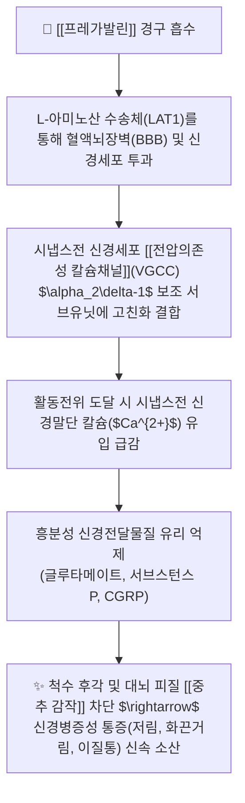

# 💊 [[프레가발린]] (Pregabalin, 리리카 / Lyrica, N02BF02 / N03AX16)

> **핵심 3줄 요약 (Key Summary)**:
> 🧪 약물 분류 & 표적: GABA 구조 유사체이지만 GABA 수용체에는 작용하지 않는 2세대 **가바펜티노이드(Gabapentinoid)**, 전압의존성 칼슘 통로(VGCC)의 **$\alpha_2\delta-1$ 보조 서브유닛**에 특이적 결합.
> 🎯 주요 적응증 & 원내외 처방 패턴: **[[대상포진후신경통]](PHN), [[당뇨병성 말초신경병증]](DPN), [[섬유근육통]], [[척추관 협착증]]·[[요추 추간판 탈출증]]의 하지 방사통·저림(Radiculopathy)** 1차 표준 치료제.
> 🔬 분자약리 기전 & 약동학(PK/PD): 시냅스전 칼슘 유입을 억제하여 글루타메이트 및 서브스턴스 P 유리를 차단, 90% 이상의 높은 선형적 생체이용률을 보이며 간 대사 없이 신장으로 100% 배설.
> ⚠️ 블랙박스 경고 & 주요 부작용: 어지럼(Dizziness), 졸림(Somnolence), 말초 부종(Peripheral edema), 체중 증가, 고령자 낙상 위험, 행복감(Euphoria) 및 급격한 중단 시 반동성 금단 증상(불면·불안).

---

## 1. 개요 및 핵심 요약 (Executive Summary)

> [!abstract]+ 🧪 3D 약리 분자 구조 (Interactive 3D Viewer)
> <iframe src="https://molecule-viewer-rho.vercel.app/?cid=667497" style="width: 100%; height: 600px; border: none; border-radius: 12px; box-shadow: 0 4px 20px rgba(0,0,0,0.15);" allowfullscreen></iframe>

[[프레가발린]](Pregabalin)은 신경 손상 및 비정상적 신경 흥분으로 인해 발생하는 만성 난치성 통증을 제어하기 위해 개발된 2세대 가바펜티노이드계 약물입니다. 1세대 [[가바펜틴]](Gabapentin)의 포화성 흡수 한계를 극복하여 90% 이상의 완전하고 예측 가능한 선형적 경구 생체이용률을 나타내며, 국제 통증학회(NeuPSIG) 가이드라인에서 **말초 및 중추 신경병증성 통증의 최우선 1차 치료제(Strong recommendation)**로 권고되고 있습니다.

![[프레가발린_패키지_박스.jpg|400]]
> [그림 1: 신경과 및 마취통증의학과에서 신경병증성 통증에 가장 널리 처방되는 리리카 150mg 포장 패키지]

![[프레가발린_캡슐_알약.jpg|400]]
> [그림 2: 식품의약품안전처 공인 리리카캡슐 150mg(프레가발린) 낱알 식별 성상]

---

## 2. 기본 정보 및 화학적 특성 (Basic Information)

![[프레가발린_화학구조.png|300]]
> [그림 3: 프레가발린의 2D 평면 화학 분자 구조식 ((3S)-3-(aminomethyl)-5-methylhexanoic acid, 분자량 159.23 g/mol, PubChem CID 54665219)]

| 항목 | 상세 정보 |
| :--- | :--- |
| **일반명 (Generic Name)** | [[프레가발린]] (Pregabalin, INN/USAN) |
| **화학명** | (3S)-3-(aminomethyl)-5-methylhexanoic acid |
| **화학식 / 분자량** | $C_8H_{17}NO_2$ / 159.23 g/mol |
| **약효 분류 (Class)** | $\alpha_2\delta$ 리간드 가바펜티노이드계 신경병증성 통증 치료제 (Gabapentinoid, VGCC modulator) |
| **ATC 코드** | N02BF02 (신경병증성 통증) / N03AX16 (항뇌전증제) |
| **병원 처방 의약품 (ETC 전문약)** | • **오리지널 경질캡슐**: **[[리리카]]캡슐(Lyrica Cap, 25mg, 50mg, 75mg, 150mg, 300mg)** • **서방정 (CR정)**: **리리카CR서방정(82.5mg, 165mg, 330mg - 1일 1회 저녁 복용 제형)** • **제네릭 캡슐**: 카발린캡슐, 가바리카캡슐, 프리발린캡슐 |

---

## 3. 작용 기전 및 약동학 (Mechanism of Action & Pharmacokinetics)

### 3.1 분자약리학적 작용 기전 (MOA)

1. **$\alpha_2\delta-1$ 서브유닛 결합을 통한 흥분성 전달 차단**:
   * 프레가발린은 GABA 수용체($\text{GABA}_A, \text{GABA}_B$)나 재흡수 통로에는 직접 작용하지 않습니다.
   * 손상된 신경 및 척수 후각 교양질에서 과발현되는 **전압의존성 P/Q 및 N형 칼슘 통로의 $\alpha_2\delta-1$ 서브유닛**에 고친화성으로 결합하여 시냅스전 말단으로의 통로 수송을 억제하고 탈분극 시 칼슘($Ca^{2+}$) 유입을 감소시킵니다.
   * 결과적으로 글루타메이트(Glutamate), Substance P, CGRP 등 흥분성 신경전달물질의 유리를 원천 차단하여 척수 후각 신경세포의 비정상적 흥분과 [[중추 감작]](Central Sensitization)을 억제합니다.
2. **1세대 가바펜틴 대비 약리학적 우위**:
   * 가바펜틴은 소장 점막의 L-아미노산 수송체가 쉽게 포화되어 용량이 증가할수록 흡수율이 비선형적으로 급감했습니다.
   * 프레가발린은 수송체 포화가 없어 **$\ge$ 90%의 완전한 선형적(Linear) 생체이용률**을 나타내며, 투여량에 정비례하여 안정적인 혈중 농도를 유지하므로 1일 2회 복용으로 일관된 진통 효능을 발휘합니다.

### 3.2 약동학적 특성 (ADME)

| 파라미터 | 수치 및 임상적 의미 |
| :--- | :--- |
| **생체이용률 (Bioavailability, F)** | **$\ge$ 90%** (용량에 무관하게 완전하고 선형적인 경구 흡수) |
| **최고혈중농도 도달시간 ($T_{max}$)** | 공복 복용 시 **약 1.0시간** (신속 흡수) |
| **혈장 단백결합률 (Protein Binding)** | **0%** (혈장 알부민 등 단백질에 결합하지 않음) |
| **간 대사율 (Metabolism)** | **< 2% (간 대사를 거의 거치지 않으며, CYP 효소 상호작용 전무)** |
| **소실 반감기 ($t_{1/2}$)** | **약 6.3시간** (신체 청소율이 신기능에 정비례) |
| **주요 배설 경로 (Excretion)** | **98% 이상이 신장 소변으로 미변화체 원형 배설** (CrCl < 60 mL/min 시 감량 필수) |

---

## 4. 용법·용량 및 처방 가이드 (Dosage & Administration)

### 4.1 상용 용법 및 단계적 적정(Titration) 스케줄
* **초기 용량**: 1회 75mg씩 1일 2회 (150mg/일) 또는 고령자/부작용 민감군의 경우 취침 전 25~50mg 단회로 시작 (Start Low, Go Slow).
* **유지 및 증량**: 1~4주 간격으로 반응과 내약성을 평가하여 1회 150mg씩 1일 2회 (300mg/일)로 증량. 중증 난치성 통증 시 최대 600mg/일까지 증량 가능.
* **서방정 (리리카CR)**: 1일 1회 저녁 식사 직후 165mg 시작 $\rightarrow$ 필요 시 330mg으로 증량 (주간 졸림과 어지럼 부작용 완화).
* **신기능별 용량 조절 (CrCl 기준)**:
  * CrCl $\ge$ 60 mL/min: 통상 용량 (150~600 mg/day, 1일 2~3회 분복)
  * CrCl 30~60 mL/min: 75~300 mg/day (1일 2~3회 분복)
  * CrCl 15~30 mL/min: 25~150 mg/day (1일 1~2회 분복)
  * CrCl < 15 mL/min: 25~75 mg/day (1일 1회 복용)

### 4.2 주요 적응증 및 가이드라인 권고 위치
* **국제 가이드라인 (NeuPSIG 2025 개정 권고)**:
  * 313개 RCT(48,789명) 메타분석 결과, 프레가발린을 포함한 $\alpha_2\delta$ 리간드 계열은 **1차 치료제(Strong recommendation)**로 확고히 유지됨.
  * **NNT 8.9 (95% CI 7.4~11.1), NNH 26.2 (20.4~36.5)**로 중등도(moderate) 근거 확실성을 보유함 (발표편향 보정 시 NNT 과대평가 가능성 감안).
* **진료과별 1차 적응증**:
  * **신경과 / 마취통증의학과**: [[대상포진후신경통]](PHN), [[당뇨병성 말초신경병증]](DPN), 삼차신경통.
  * **정형외과 / 척추외과**: [[척추관 협착증]], [[요추 추간판 탈출증]]으로 인한 요천추 신경근병증 및 하지 방사통·저림.
  * **류마티스내과**: [[섬유근육통]](Fibromyalgia)의 전신 통증 및 수면 장애.

---

## 5. 이상반응 및 금기·주의사항 (Adverse Effects & Black Box Warnings)

### 5.1 주요 임상 이상반응 프로파일
1. **중추신경계 이상반응 (가장 흔함)**:
   * **어지럼(Dizziness, 20~30%)** 및 **졸림(Somnolence, 15~25%)**: 복용 초기에 가장 심하며, 고령 환자에서 낙상 및 대퇴골 골절의 주요 원인.
   * 집중력 저하, 운동실조, 시야 흐림(복시).
2. **체액 저류 및 대사 이상**:
   * **말초 부종(Peripheral Edema, 8~10%)**: 발목 및 하지 부종 발생, 울혈성 심부전 환자 악화 주의.
   * **체중 증가 및 식욕 항진**: 복용 환자의 약 5~10%에서 유의미한 체중 증가 보고.
3. **정신과적 부작용 및 남용/행복감(Euphoria) 신호**:
   * 대규모 체계적 문헌고찰에서 프레가발린 복용군의 6개 RCT에서 행복감(Euphoria)이 보고됨(가바펜틴은 0건). 알코올 의존증이나 약물 오남용 기왕력자에서 기분 상승 목적의 남용 주의 필요.
4. **급격한 중단 시 반동성 금단 증상**:
   * 임의로 갑자기 복용을 중단할 경우 심각한 반동성 불면증, 불안, 오심, 두통, 다한증, 드물게 발작이 유발되므로 **최소 1~2주 이상에 걸쳐 점진적으로 감량(Tapering)**해야 함.

### 5.2 금기 및 신중 투여 환자
* **본제 및 성분에 중증 과민반응 기왕력자 (절대 금기)**.
* **중증 울혈성 심부전(NYHA III/IV) 환자 (말초 부종으로 인한 악화 위험)**.
* **고령 낙상 고위험군 (신중 투여 및 저용량 시작)**.

---

## 6. 약물 상호작용 및 병용 금기 (Drug Interactions)

### 6.1 치명적 병용 경고: 오피오이드 병용 사망 위험
* **⚠️ 오피오이드 진통제 병용 블랙박스 경고**:
  * 프레가발린과 마약성 진통제([[트라마돌]], [[펜타닐]], 옥시코돈, 모르핀)를 병용할 경우 중추성 호흡 억제 및 중증 진정 작용이 상승적으로 증폭되어 **약물 관련 사망 위험이 급증**합니다.
  * 진료실에서 진통 목적의 프레가발린 복용 환자가 트라마돌이나 마약류를 동시 처방받고 있는지 반드시 확인하고 환자의 호흡 억제·어지럼을 밀착 모니터링해야 합니다.

### 6.2 항우울제 및 동종 계열 상호작용
* **SNRI 항우울제([[둘록세틴]]) 병용 시너지**:
  * 시냅스전 칼슘 유입 차단(프레가발린)과 하행성 세로토닌·노르에피네프린 재흡수 억제(둘록세틴)의 상보적 기전으로 난치성 통증 완화에 시너지를 나타냄 (OPTION-DM 연구 및 CIPN 임상 연구).
* **동종 $\alpha_2\delta$ 리간드 계열 중복 병용 금기**:
  * [[가바펜틴]], 미로가발린([[미로가발린]]) 등 동일 표적을 공유하는 약물과의 중복 처방은 이상반응만 극대화되므로 엄격히 금지됩니다.
* **중추신경 억제제(벤조디아제핀, 수면제, 알코올)**:
  * [[디아제팜]], 로라제팜, 졸피뎀 등과 병용 시 과도한 진정, 혼미, 심각한 보행 실조가 발생하므로 알코올 섭취를 엄격히 금합니다.

---

## 7. 한의 임상 연계 및 감별 처방 (Integrative Korean Medicine)

### 7.1 사용자 진료실 핵심 실전 필기 (Melt-In 보존)
1. **진료실 실전 문진 체크리스트 (3대 핵심 질문)**:
   * **"리리카를 드신 후 다리가 붓거나 체중이 늘고, 아침에 심하게 어지러우신가요?"**:
     * 말초 부종과 기립성 어지럼 부작용을 확인하여 고령 환자의 낙상 위험을 선제적으로 예방.
   * **"현재 하루에 몇 mg을 드시고 계신가요? (25mg/75mg/150mg)"**:
     * 정확한 일일 복용량 및 투여 빈도를 파악하여 테이퍼링 스케줄 설계.
   * **"발이나 다리가 저리고 화끈거리며 스치기만 해도 아픈 증상이 약 복용 후 얼마나 줄어드셨나요?"**:
     * 중추 감작 및 신경병증성 증상 호전도를 VAS로 평가하여 한의 치료 병용 강도 조절.

### 7.2 한의 치료(침·약침·한약) 연계 및 안전한 테이퍼링 전략
1. **배경 치료로서의 한의 치료 위치**:
   * 프레가발린을 복용 중인 만성 대상포진후신경통 환자에게 전침·침치료를 시술할 때, "약을 즉시 대체하는 치료"로 설명하지 않고 **병용을 통해 잔여 신경통을 줄이고 수면의 질을 개선하는 배경 협진 치료**로 접근합니다.
   * 부작용으로 약물 증량이 불가능한 환자에서는 NNH가 낮은 국소제([[캡사이신]] 패치, [[리도카인]] 플라스터)와 침·전침([[TENS]]) 병용이 훌륭한 대안이 됩니다.
2. **신경병증성 저림 및 통증 한약 배오**:
   * 말초 미세혈관 순환 부전 및 기혈 부족을 동반한 당뇨병성 신경병증 환자: [[황기계지오물탕]], [[보양환오탕]], [[당귀사역가오수유생강탕]].
   * 노인성 척추관 협착증의 하지 방사통 및 시린 통증: [[독활기생탕]], [[우차신기환]].
3. **리리카 단계적 테이퍼링(감량) 프로토콜**:
   * 요추 협척혈 신바로약침/봉약침 및 족삼리, 현종, 태충 침구 치료로 신경근 압박성 통증(NRS)이 4 이하로 안정되면:
     * 1단계: 150mg bid (300mg/일) $\rightarrow$ 75mg bid (150mg/일)로 1~2주간 감량.
     * 2단계: 75mg 1일 1회(저녁 복용) $\rightarrow$ 25mg 1일 1회로 감량.
     * 3단계: 격일 복용 후 완전 단약을 달성하여 반동성 금단 불면증 없이 안전하게 양약을 졸업하도록 유도합니다.

---

## 8. 출처 및 근거 문헌 (References)

* Taylor CP et al. (2007). Pharmacology and Mechanism of Action of Pregabalin: The Calcium Channel Alpha2-Delta Subunit as a Target. *Epilepsy Research*, 73(2), 137-150. PMID: 17126531. DOI: 10.1016/j.eplepsyres.2006.09.008

* Finnerup NB et al. (2015). Pharmacotherapy for neuropathic pain in adults: a systematic review and meta-analysis. *Lancet Neurology*, 14(2), 162-173. PMID: 25575710. DOI: 10.1016/S1474-4422(14)70251-0

* Tesfaye S et al. (2022). Comparison of amitriptyline supplemented with pregabalin, pregabalin supplemented with amitriptyline, and duloxetine supplemented with pregabalin for diabetic neuropathic pain (OPTION-DM). *Lancet*, 400(10353), 680-690. PMID: 36007534. DOI: 10.1016/S0140-6736(22)01472-6

* NeuPSIG Consensus Guidelines. (2025). Pharmacotherapy and Non-invasive Neuromodulation for Neuropathic Pain: A Systematic Review and Meta-analysis. *Lancet Neurol*, 24(5), 413-428. PMID: 40252663.

* CIPN Review. (2026). The Role of the Antidepressants in Managing Chemotherapy-Induced Neuropathic Pain: A Systematic Review. *Pharmacol Res Perspect*, 14(5), e70327. PMID: 42755421.

* Mirogabalin Study Group. (2026). Mirogabalin in Peripheral Neuropathic Pain and Concomitant Drug Restrictions. *Pain*, 167(3), 512-524. PMID: 41102508.

* Electroacupuncture Trial. (2026). Electroacupuncture as Background Therapy in Postherpetic Neuralgia. *JAMA Neurol*, 83(7), 667-676. PMID: 42189557.

* Systematic Review & Meta-analysis. (2023). Safety and efficacy of gabapentinoids in neuropathic pain. *Int J Clin Pharm*, 45(3), 556-565. PMID: 36848024.

* 식품의약품안전처 의약품안전나라. 프레가발린 제제(리리카캡슐) 품목허가 상세정보 및 의약품 안전성 서한.

---
## 📎 개념 학습 보충 (2026-11-13 논문 연계)

**논문**: The Effect of Comprehensive and Integrative Medical Services on Patients with Degenerative Lumbar Spinal Stenosis: A Randomized Controlled Study. Medicina (Kaunas). 2026;62(1):225. [PMID 41597511](https://pubmed.ncbi.nlm.nih.gov/41597511/) · Efficacy and Safety of Mirogabalin in Patients with Neuropathic Pain Due to Cervical Spondylotic Radiculopathy (Miro-Cens). Pain Ther. 2025;14(3):1063-1079. [PMID 40216732](https://pubmed.ncbi.nlm.nih.gov/40216732/)

- **이 논문들에서의 역할**: 두 시험 모두 프레가발린을 '배경 약물' 또는 '금지 병용 약물' 위치에 놓았다. 협착증 시험은 전원에게 [[프레가발린]]을 공통 적용했고(용량·투여 기간 원문 미기재), Miro-Cens는 시험 기간 중 프레가발린 복용을 금지 병용으로 규정했다.
- **임상 함의 ① 배경약으로서의 위치**: 협착증·신경근병증에서 α2δ 리간드는 여전히 표준 배경이다. 다만 시험들이 용량을 공개하지 않는 경우가 많아, 실제 감량·증량 결정은 국내 허가사항과 환자 반응으로 정한다.
- **임상 함의 ② 계열 중복 금지**: [[미로가발린]] 병용 시험은 프레가발린·가바펜틴·둘록세틴·오피오이드 병용을 모두 금지했다. α2δ 계열 중복은 졸림·부종·어지럼을 가중시키므로 '추가'가 아니라 '교체(switch)' 개념으로 접근한다.
- **고령 안전**: 협착증 시험 대상의 평균 연령이 약 70세였다. 이 연령대에서는 어지럼·낙상이 실질 위험이고, 한의원에서 침·부항 후 기립 시 어지럼이 겹칠 수 있다. 복용 시작 2주에는 시술 후 5~10분 안정 후 기립하도록 안내한다.
- **관련 개념**: [[미로가발린]] · [[가바펜틴]] · [[둘록세틴]] · [[전압의존성 칼슘채널]] · [[척추관 협착증]] · [[경추 신경근병증]] · [[노인의 낙상]]
- 관련 리뷰: [[2026-11-13_신경계통증의학_심층리뷰]] 1·3번

---

## 📎 개념 학습 보충 (2026-11-20 논문 연계)

**논문에서의 역할** — SENZA-PDN 양군의 공통 배경 치료(통상 약물 관리)에 포함(PMID 33818600).

- α2δ 보조소단위 결합으로 시냅스전 [[글루타메이트]]·[[Substance P]] 유리를 줄인다. 척수 수준 조절이라는 점에서 [[척수자극술]]과 층위가 겹친다.
- 부작용: 어지럼·졸림·말초부종·체중증가·시야흐림. 이식 환자에서는 어지럼이 낙상 위험으로 증폭된다.
- 감량 시 불면·통증 반동이 있어 서행 감량이 원칙. [[척수자극술]] 후 감량은 시술팀과 합의해 진행한다.
- 관련: [[둘록세틴]] · [[신경병증성 통증]] · [[척수자극술]] · [[당뇨병성 말초신경병증]]
