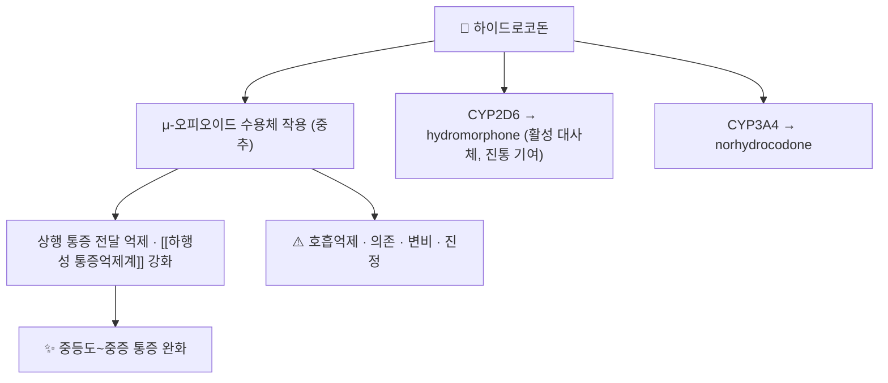

# 💊 하이드로코돈 (Hydrocodone, R05DA03)

> **핵심 요약 (Key Summary)**:
> 🧪 주성분·제형: 반합성 μ-오피오이드 작용제. 해외에서는 [[아세트아미노펜]]과의 복합제(5/325 mg 등)가 급성 통증에 널리 쓰인다.
> 📍 작용 기전: μ-오피오이드 수용체 작용으로 중추 진통을 일으키고, CYP2D6 대사로 활성 대사체 hydromorphone을 만든다.
> 🎯 임상 의의: 급성 중등도~중증 통증의 비교 대조군으로 임상시험에 자주 등장한다 — 2026-10-15 [[수제트리진]] 메타분석의 능동 대조가 이 복합제였다.
> ⚠️ 주의: 의존·내성·호흡억제 위험과 CYP2D6·CYP3A4 대사 상호작용을 함께 관리해야 한다. 국내 허가·시판 품목은 의약품안전나라에서 확인한다.

---

## 1. 약물 기본 정보 및 시판 제품 (Brand Identification)

![[하이드로코돈_02_구조식2D.png|320]]
> [그림 1: 하이드로코돈의 2D 화학 구조식 — PubChem CID 5284569 (PubChem PNG 정본)]

> 🖼️ 이미지 미확보 — 시판 완제품 패키지 실사·PTP 알약 성상은 이번 회차에 확보하지 못했다(국내 시판 품목 확인 필요, 제품 이미지 미검증). 다른 약 사진으로 대체하지 않고 사유를 남긴다.

| 항목 | 상세 정보 |
| :--- | :--- |
| 일반명 (Generic Name) | 하이드로코돈(한글) / Hydrocodone |
| 대표 상품명 (Brand Names) | 해외 복합제 다수([[아세트아미노펜]] 복합) — 국내 품목은 확인 필요 |
| ATC 코드 / 분류 | [R05DA03](https://atcddd.fhi.no/atc_ddd_index/?code=R05DA03) (WHO ATC/DDD 등재, DDD 15 mg 경구) |
| PubChem CID | [5284569](https://pubchem.ncbi.nlm.nih.gov/compound/5284569) |
| 화학식 / 분자량 | C18H21NO3 / 299.4 g/mol |
| 주요 제형 및 함량 | [[아세트아미노펜]] 복합 정제(예: 5/325 mg) 등 |
| 규제 | 해외에서 마약류(오피오이드)로 엄격 관리된다 |

### 1.1 임상시험에서의 위치

| 시험 | 대조 구성 |
| :--- | :--- |
| [[수제트리진]] 3상(복부성형술·무지외반절제술) | [[수제트리진]] vs 하이드로코돈/[[아세트아미노펜]] 5/325 mg 6시간마다 vs 위약, 48시간 추적 |
| 2026-10-15 메타분석(RCT 5편) | 위약 및 하이드로코돈/[[아세트아미노펜]] 대비 비교 |

---

## 2. 분자 약리 기전 및 작용 경로 (Mechanism of Action)

- μ-오피오이드 작용제로 중추에서 통증 전달을 억제한다 → [[오피오이드]]
- CYP2D6 활성 대사체(hydromorphone)가 진통에 기여한다. 따라서 CYP2D6 저해제 병용·대사 표현형 차이가 효과와 부작용 변동을 만든다 → [[CYP3A4]]
- 호흡억제·의존·변비는 계열 공통 부작용이며, 감시 없는 장기 사용은 권하지 않는다.

---

## 3. 약동학적 특성 (Pharmacokinetics)

| 약동학 파라미터 | 수치 및 임상적 의미 |
| :--- | :--- |
| 생체이용률 (Bioavailability) | 경구 흡수 양호(제형·복합 성분에 따라 차이) |
| 최고혈중농도 도달시간 (Tmax) | 경구 복합제 기준 수 시간(허가사항 확인 항목) |
| 혈장 단백결합률 | 낮음~중등도(허가사항 확인 항목) |
| 간 대사 | CYP2D6(활성 대사체)·CYP3A4 경로 — 다제복용 환자에서 상호작용 점검 |
| 배설 반감기 (t1/2) | 수 시간대(제형·복합 성분에 따라 변동) |
| 주요 배설 경로 | 소변(주) |

> ⚠️ 원문 시험·메타분석은 약동학 수치를 제시하지 않았다. 추정값을 적지 않고 허가사항 확인 항목으로 남긴다.

---

## 4. 용법·용량 및 처방 가이드 (Dosage & Administration)

| 임상 상황 | 용법·용량 | 비고 |
| :--- | :--- | :--- |
| 시험 프로토콜 | 5/325 mg 6시간마다 | [[수제트리진]] 3상의 능동 대조 |
| 해외 임상 관행 | 통증 정도에 따라 단기 처방 | 만성 통증 장기 사용은 피한다 |
| 국내 | 허가 품목·용법은 의약품안전나라 확인 | 본 노트는 국내 사용 전제로 쓰지 않는다 |

- 2026-10-15 메타분석에서 [[수제트리진]]은 하이드로코돈/[[아세트아미노펜]] 대비 **우월하지 않았다**. 즉 "신약이 기존 복합제보다 강하다"는 주장은 이 근거에서 나오지 않는다.

---

## 5. 부작용, 경고 및 약물 상호작용 (Adverse Effects & Interactions)

### 5.1 주요 부작용
- **호흡억제**: 고위험군(고령·수면무호흡·호흡기 질환·다른 중추억제제 병용)에서 위험이 커진다.
- **의존·내성·금단**: 장기 사용 시 문제가 된다. → [[오피오이드]]
- **위장관**: 변비·오심. 변비는 지속되므로 예방적 관리가 필요하다.
- **진정·어지럼**: 낙상 위험, 운전 제한.

### 5.2 주요 상호작용
- **중추억제제**: [[벤조디아제핀]]·알코올 병용 시 호흡억제 위험이 상승한다.
- **CYP2D6·CYP3A4**: 저해제·유도제 병용 시 진통·부작용 변동.
- **한약·본초 병용**: 진정·진통 축이 겹치는 처방([[연호색]] 등)과 병용 시 진정 중첩을 점검한다 → [[테트라하이드로팔마틴]]

---

## 6. 한의 치료 연계 및 병용/테이퍼링 프로토콜 (Integrative Medicine)

- 급성 통증에서 오피오이드 의존을 줄이는 방향이 임상 목표다. 한의 중재(침·약침·도수·운동)를 병행하면서 오피오이드 용량을 단계적으로 줄이는 설계가 현실적이다 → [[침]] · [[약침]] · [[운동요법]]
- 대체 전략의 근거로 [[수제트리진]] 같은 비오피오이드 옵션이 제시되지만, 효과 상한은 기존 복합제와 동등 수준이다 — 환자 설명에서 과장하지 않는다.
- 감량 시에는 금단 증상(불안·발한·근육통·설사)과 통증 재상승을 구분해 기록한다.

---

## 7. 💡 사용자 진료실 핵심 필기 & 실전 임상 체크리스트

### 7.1 문진 체크리스트
1. 복용 기간·일일 총량(복합제 안의 [[아세트아미노펜]] 총량 포함)과 임의 증량 여부.
2. 함께 복용하는 중추억제제·수면제·알코올.
3. 변비·어지럼·낮 시간 졸림 등 기능 저하 증상.

### 7.2 환자 티칭 스크립트
> "이 약은 마약성 진통제 계열로 통증을 확실히 줄이지만, 오래 쓰면 습관이 되고 숨쉬는 힘을 떨어뜨릴 수 있습니다. 감기약이나 수면제와 같이 드시면 위험이 커집니다. 저희는 침·약침·운동으로 통증을 조절하면서 이 약의 용량을 줄여나가는 방향으로 같이 가겠습니다. 변비가 생기면 미리 알려 주세요."

---

## 8. 출처 및 학술 참고 문헌 (References)

1. **Safety and efficacy of Suzetrigine (VX-548) for acute moderate to severe pain in adults; a systematic review and meta-analysis.** *Journal of Clinical Anesthesia*. 2026;111:112156. [PMID 41785614](https://pubmed.ncbi.nlm.nih.gov/41785614/)
   - [연구 요약] 하이드로코돈/[[아세트아미노펜]]이 능동 대조로 쓰였다. [[수제트리진]]은 이 대조 대비 우월하지 않았고(SPID48), 이상반응은 더 적었다(RR 0.81).
2. **Suzetrigine, a Nonopioid NaV1.8 Inhibitor: Two Phase 3 Randomized Clinical Trials.** *Anesthesiology*. 2025;142(6):1085-1099. [PMID 40117446](https://pubmed.ncbi.nlm.nih.gov/40117446/)
   - [연구 요약] 하이드로코돈/[[아세트아미노펜]] 5/325 mg 6시간마다를 대조로 48시간 추적한 3상 2건.
3. **WHO ATC/DDD Index — R05DA03 hydrocodone.** [링크](https://atcddd.fhi.no/atc_ddd_index/?code=R05DA03)
   - [연구 요약] ATC 코드와 DDD 15 mg(경구) 기준 확인(2026-10-15 조회).
4. **PubChem Compound Summary — Hydrocodone (CID 5284569).** [링크](https://pubchem.ncbi.nlm.nih.gov/compound/5284569)
   - [연구 요약] 분자식 C18H21NO3·분자량 299.4 g/mol·2D 구조식(그림 1) 확인.

## 함께 보기
- [[오피오이드]] · [[수제트리진]] · [[아세트아미노펜]] · [[코데인]] · [[트라마돌]] · [[벤조디아제핀]] · [[하행성 통증억제계]] · [[NPRS]]
- [[2026-10-15_통합의학약리학_심층리뷰]] 3번
