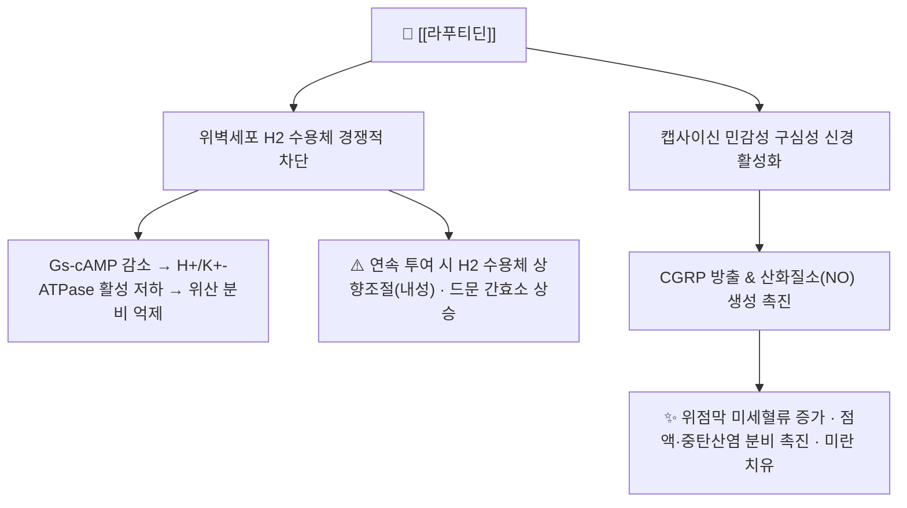

# 💊 [[라푸티딘]] (Lafutidine, 스토가/Stogar, ATC A02BA08)

> **핵심 3줄 요약 (Key Summary)**:
> - 🧪 주성분·제형: 2세대 히스타민 H2 수용체 길항제([[파모티딘]]과 동일 계열)로 국내에서는 주로 라푸티딘 10mg 정제([[스토가]]정 등)로 처방되는 전문의약품.
> - 📍 작용 기전: 위벽세포의 H2 수용체를 선택적·경쟁적으로 차단해 위산 분비를 억제하는 동시에, 캡사이신 민감성 위점막 구심성 신경을 활성화해 CGRP와 산화질소(NO) 분비를 촉진함으로써 위점막 혈류와 점액 분비를 늘리는 점막 방어 이중 기전을 갖는다.
> - 🎯 임상 적응증: [[위궤양]], [[십이지장궤양]], [[위식도역류질환]], 급·만성 [[위염]] 점막 병변 개선, 마취 전 투약; 성인 표준 1회 10mg 1일 2회 또는 취침 전 10~20mg 투여.
> - ⚠️ 주의사항: CYP3A4·CYP2D6 일부 대사 및 신장 배설이 병행되며, H2 차단제 장기 연속 투여 시 내성(Tachyphylaxis) 발생 가능성과 연하곤란·체중감소·흑변 등 위암·중증 궤양 경고 증상 은폐에 주의해야 한다.

---

## 1. 약물 기본 정보 및 시판 제품 (Brand Identification)
> [!abstract]+ 🧪 3D 약리 분자 구조 (Interactive 3D Viewer)
> <iframe src="https://molecule-viewer-rho.vercel.app/?cid=5282136" width="100%" height="450px" frameborder="0" allow="webgl" style="border-radius: 8px;"></iframe>

| 항목 | 상세 정보 |
| :--- | :--- |
| **일반명 (Generic Name)** | [[라푸티딘]] / Lafutidine |
| **대표 상품명 (Brand Names)** | **스토가(Stogar)**, 프로테카딘(Protecadin, 일본), 라푸딘, 위스토정 |
| **ATC 코드 / 분류** | **A02BA08** — H2-receptor antagonists / 식약처 분류 232 소화성궤양용제 |
| **PubChem CID** | [5282136](https://pubchem.ncbi.nlm.nih.gov/compound/5282136) |
| **화학식 / 분자량** | $\text{C}_{22}\text{H}_{29}\text{N}_3\text{O}_4\text{S}$ / 431.6 g/mol |
| **주요 제형 및 함량** | 정제 10mg (단일제 중심) |
| **식약처 허가 적응증** | [[위궤양]], [[십이지장궤양]], 급성·만성 [[위염]]의 위점막 병변(미란·출혈·발적·부종) 개선, [[위식도역류질환]], 마취 전 투약 |

### 1.1 대표 시판 제품 및 함유 복합제 매핑 (Brand Identification & Combinations)

| 구분 | 대표 제품명 / 브랜드 | 함유 성분 및 1회당 함량 | 제형 및 특징 | 주요 적응증 및 복약 지도 핵심 |
| :--- | :--- | :--- | :--- | :--- |
| **단일제 (ETC)** | [[스토가]]정 등 | 라푸티딘 10mg | 필름코팅정 | 1일 1~2회 식사 무관 또는 취침 전 복용 |
| **비교 표준제 (ETC)** | [[파모티딘]] (가스터 등) | 파모티딘 10mg / 20mg | 정제·주사제 | 순수 산 억제 직선형, 신기능(CrCl) 감량 기준 명확 |
| **병용 다빈도 소화기약** | [[모사프리드]], [[레바미피드]], [[에소메프라졸]] | 위장관 운동촉진제·점막보호제·PPI | 병용 처방 흔함 | PPI 야간 산돌파(NAB) 억제 목적 취침 전 추가 응용([PubMed 40603444](https://pubmed.ncbi.nlm.nih.gov/40603444/)) |

---

## 2. 분자 약리 기전 및 작용 경로 (Mechanism of Action)

* **주요 작용 기전 (Primary MoA)**:
  * **H2 수용체 길항 (산 분비 억제)**: 위벽세포 기저측막의 히스타민 H2 수용체에 결합해 아데닐산 고리화효소–cAMP 경로를 차단함으로써 기초·야간·식사 자극성 위산 분비를 억제합니다([PubMed 11436515](https://pubmed.ncbi.nlm.nih.gov/11436515/)). [[파모티딘]]과 비교해 3상 비열등성 시험에서 역류성 식도염 증상·내시경 치유율에서 대등한 효과를 보였습니다([PubMed 25532503](https://pubmed.ncbi.nlm.nih.gov/25532503/)).
* **하류 신호전달 및 점막 방어 기전 (Unique Gastroprotection)**:
  * 라푸티딘의 핵심 차별점은 위점막에 분포하는 **캡사이신 민감성 구심성 신경(TRPV1 경로 연계)** 을 자극해 신경말단에서 **CGRP(Calcitonin Gene-Related Peptide)** 분비를 유도하고 내피형 산화질소 합성효소(eNOS)/NO 경로를 활성화하는 것입니다([PubMed 11906962](https://pubmed.ncbi.nlm.nih.gov/11906962/)). 이를 통해 점막 미세혈류량, 표면 점액, 중탄산염 분비를 증가시켜 미란성 [[위염]]과 약물 유도 점막 손상에 방어력을 제공합니다.

---

## 3. 약동학적 특성 (Pharmacokinetics: ADME)

| 약동학 파라미터 | 수치 및 임상적 의미 |
| :--- | :--- |
| **최고혈중농도 도달시간 (Tmax)** | 경구 10mg 투여 후 약 0.8~1.3시간 (식후·공복 모두 비교적 빠른 발현, [PubMed 17473452](https://pubmed.ncbi.nlm.nih.gov/17473452/)) |
| **혈장 단백결합률 (Protein Binding)** | 약 88% |
| **간 대사 효소 (Metabolism)** | 주로 간 CYP3A4 및 CYP2D6에 의해 대사됨(과거 [[시메티딘]] 같은 강력한 범용 CYP 억제제와 달리 타 약물 저해 강도는 낮음) |
| **배설 반감기 (Elimination t1/2)** | 약 2~3시간(경구 10mg 기준; 산 억제 효과는 약 8~12시간 지속) |
| **주요 배설 경로 (Excretion)** | 주로 대사체 및 일부 미변화체로 소변과 대변으로 함께 배설 (파모티딘과 달리 신배설 단독 의존도가 낮음) |

---

## 4. 용법·용량 및 처방 가이드 (Dosage & Administration)

| 임상 적응증 | 성인 표준 용법·용량 | 1일 최대 한도 용량 |
| :--- | :--- | :--- |
| [[위궤양]] · [[십이지장궤양]] · [[위식도역류질환]] | 1회 10mg, 1일 2회 (아침 식후 및 취침 전) 경구 투여 | 통상 20mg/day |
| **급·만성 [[위염]] 위점막 병변 개선** | 1회 10mg, 1일 1회 취침 전(또는 1일 2회 증상에 따라 조절) | 20mg/day |
| **야간 산 분비 돌파(NAB) 보조** | 주간 PPI 복용 상태에서 취침 전 10mg 단기 추가([PubMed 40603444](https://pubmed.ncbi.nlm.nih.gov/40603444/)) | 장기 연용 시 내성 주의 |
| **고령자 · 간/신기능 저하 환자** | 신장애 시 [[파모티딘]] 대비 간 대사 비중이 크나, 중등도 이상 간·신장애 시 1일 10mg 1회 감량 고려 | 용량 감량 및 모니터링 |

---

## 5. 부작용, 경고 및 약물 상호작용 (Adverse Effects & Interactions)

### 5.1 주요 부작용 및 임상 경고
* **소화기 및 간기능 이상**: 변비, 설사, 복부팽만감, AST·ALT·ALP·총빌리루빈 상승이 드물게 보고되므로 간기능 저하 환자에서는 주기적 추적 검사가 필요합니다.
* **혈액학적 및 과민반응**: 드물게 백혈구·혈소판 감소, 발진, 가려움증, 두통·어지럼·졸음(고령자·신장애 시 중추신경 증상 관찰).
* **내성(Tachyphylaxis) 및 경고 증상 은폐**: H2 수용체 길항제를 매일 2~6주 이상 연속 투여하면 수용체 상향 조절로 산 억제력이 감소할 수 있습니다([PubMed 34807007](https://pubmed.ncbi.nlm.nih.gov/34807007/)). 또한 증상이 호전되더라도 연하곤란·체중감소·토혈·흑변·빈혈이 동반되면 내시경으로 위암·출혈성 궤양을 배제해야 합니다.

### 5.2 주요 병용 주의 및 약물 상호작용
* **위내 pH 상승에 따른 흡수 감소 약물**: 아졸계 항진균제([[케토코나졸]], 이트라코나졸), 철분제, 일부 항암제(TKI 등)는 위내 산도가 낮아지면 생체이용률이 떨어지므로 병용 시 시간 간격 분리 또는 대체제를 검토합니다.
* **CYP3A4·CYP2D6 대사 관련**: 라푸티딘 자체는 시메티딘 수준의 강한 CYP 억제제는 아니나 간 대사 경로(CYP3A4/2D6)를 이용하므로 중증 간질환이나 다약제 복용 시 추적합니다.
* [[NSAIDs]] 병용: 단순 위염 속쓰림에는 점막 방어 기전이 도움이 되나, 고위험군(궤양 기왕력·항응고제 병용·고령)의 NSAIDs 궤양 예방 표준은 여전히 PPI가 우선합니다([PubMed 34807007](https://pubmed.ncbi.nlm.nih.gov/34807007/)).

---

## 6. 한의 치료 연계 및 병용/테이퍼링 프로토콜 (Integrative Medicine)

### 6.1 한약·양약 병용 투여 안전성 및 시너지 배오
* **시간차 분리 복용 원칙**: 탕약·과립제의 고미 건위 또는 제산·탄닌 성분([[모려]], [[오적골]], [[감초]] 등)이나 pH 변화에 민감한 성분의 흡수 간섭을 줄이기 위해 **라푸티딘 복용과 한약 복용 사이 최소 1~2시간 간격**을 둡니다.
* **점막 보호·소화기 한약 연계**:
  * **비위습열·미란성 위염**: [[반하사심탕]], [[황련탕]] 계열과 병용해 점막 염증과 산 역류성 심하비를 함께 가라앉힙니다.
  * **NSAIDs·한약 병용 속쓰림 완충**: 근골격 통증으로 [[NSAIDs]]와 한약을 함께 복용하며 위점막 자극을 호소하는 환자에게 [[평위산]]·[[안중산]] 또는 [[작약감초탕]] 계열을 배합하면서 점막 회복을 돕습니다.

### 6.2 양약 감량 및 한의 전환(테이퍼링) 가이드
* **단계적 감량 원칙**: [[위식도역류질환]] 환자가 PPI 중단 후 반동성 산과다로 야간 속쓰림을 겪거나 라푸티딘 10mg 1일 2회 장기 복용으로 내성 징후를 보일 때, 주치의와 협의해 **아침 용량을 먼저 감량 → 취침 전 10mg 단회 유지 → 필요시(PRN) 복용** 순으로 감량하면서 [[반하사심탕]]·[[향사평위산]]과 횡격막·흉추 추나 및 복부 뜸 치료를 병행합니다.

---

## 7. 💡 사용자 진료실 핵심 필기 & 실전 임상 체크리스트

> [!tip] **파모티딘 vs 라푸티딘 실전 선택 메모 (기존 볼트 강의록 정본 반영)**
> - **언제 [[파모티딘]]을 우선하는가**: 야간 산돌파·PPI 테이퍼링·PRN 속쓰림의 표준 1차 약제. 혈중 농도–pH 반응이 선형적이고 신장 기능(eGFR/CrCl)별 감량 기준이 매우 명확하다.
> - **언제 라푸티딘을 선택하는가**: 내시경상 표재성 미란성 [[위염]]이 확인되었거나, [[NSAIDs]] 진통제 복용 후 점막 자극·속쓰림이 동반되어 **CGRP/NO 매개 점막 미세혈류·점액 보호**가 유리한 경우.

### 7.1 진료실 3대 핵심 문진 체크리스트
1. **복용 패턴 및 내성 여부**: 매일 빠짐없이 몇 주 이상 먹는데도 효과가 떨어지는지(내성), 아니면 증상 시 간헐 복용인지 확인.
2. **경고 증상(Alarm Signs) 선별**: 삼킴곤란, 원인 미상 체중 감소, 흑변, 빈혈, 50세 이상 신규 소화불량이면 즉시 상부위장관 내시경 의뢰.
3. **진통제·항혈전제 병용력**: 근골격 통증으로 복용 중인 [[NSAIDs]], [[아스피린]] 동반 여부와 실제 궤양 출혈 위험 평가.

### 7.2 환자 티칭 스크립트
> *"라푸티딘은 위산을 줄여줄 뿐 아니라 위점막 혈류와 보호 점액을 돕는 약이지만, 매일 오래 연속 복용하면 효과가 무뎌질 수 있고 근본 원인을 가릴 수도 있습니다. 속쓰림이 줄어든 뒤에는 주치의와 상의해 취침 전 또는 필요할 때만 복용하도록 줄이면서, 한약과 침 치료로 위장 운동과 점막 회복력을 함께 다져가겠습니다."*

---

## 8. 출처 및 학술 참고 문헌 (References)

1. Nishihara K, Nozawa Y, Nakano M et al. (2002). Sensitizing effects of lafutidine on CGRP-containing afferent nerves in the rat stomach. *British Journal of Pharmacology*, 135(6):1487-1494. [PMID: 11906962](https://pubmed.ncbi.nlm.nih.gov/11906962/)
   - **[연구 요약]**: 라푸티딘이 H2 차단과 독립적으로 캡사이신 민감성 구심성 신경의 CGRP 방출 및 NO 경로를 통해 위점막 혈류와 방어 기전을 강화함을 입증한 기전 연구.
2. Ikawa K, Shimatani T, Hayato S et al. (2007). Pharmacokinetic and pharmacodynamic properties of lafutidine after postprandial oral administration in healthy subjects: comparison with famotidine. *Biological & Pharmaceutical Bulletin*, 30(5):1003-1006. [PMID: 17473452](https://pubmed.ncbi.nlm.nih.gov/17473452/)
   - **[연구 요약]**: 건강한 피험자에서 식후 경구 투여 시 라푸티딘과 [[파모티딘]]의 혈중 약동학 및 위내 pH 상승 약력학 특성을 직접 비교한 연구.
3. Kim EH, Lee YC, Chang YW et al. (2015). Efficacy of Lafutidine Versus Famotidine in Patients with Reflux Esophagitis: A Multi-Center, Randomized, Double-Blind, Non-inferiority Phase III Trial. *Digestive Diseases and Sciences*, 60(6):1724-1732. [PMID: 25532503](https://pubmed.ncbi.nlm.nih.gov/25532503/)
   - **[연구 요약]**: 역류성 식도염 환자 대상 다기관 이중맹검 3상 무작위 대조시험에서 라푸티딘이 파모티딘 대비 비열등한 내시경 치유율과 증상 개선을 보임을 입증.
4. Wang D, Zhao Y et al. (2025). Addition of bedtime lafutidine inhibits nocturnal acid-breakthrough and improves sleep quality in gastroesophageal reflux disease patients on esomeprazole: a randomized controlled trial. *Scientific Reports*, 15(1):23286. [PMID: 40603444](https://pubmed.ncbi.nlm.nih.gov/40603444/)
   - **[연구 요약]**: 에소메프라졸 투여 중인 GERD 환자에서 취침 전 라푸티딘 병용 시 야간 위산 돌파 억제와 수면 질 개선 효과를 보고한 무작위 대조시험.
5. Katz PO, Dunbar KB, Schnoll-Sussman FH et al. (2022). ACG Clinical Guideline for the Diagnosis and Management of Gastroesophageal Reflux Disease. *The American Journal of Gastroenterology*, 117(1):27-56. [PMID: 34807007](https://pubmed.ncbi.nlm.nih.gov/34807007/)
   - **[연구 요약]**: 미국소화기학회 GERD 지침으로 PPI와 H2RA의 적응증 구분, 야간 산돌파 시 취침 전 H2RA 조건부 병용 및 내성 주의 원칙 제시.
6. 식품의약품안전처 의약품안전나라 의약품통합정보시스템 ([nedrug.mfds.go.kr](https://nedrug.mfds.go.kr)).
   - **[허가 정보]**: 라푸티딘 10mg(스토가정 등) 국내 허가 효능·효과, 용법·용량 및 사용상 주의사항 정본.
