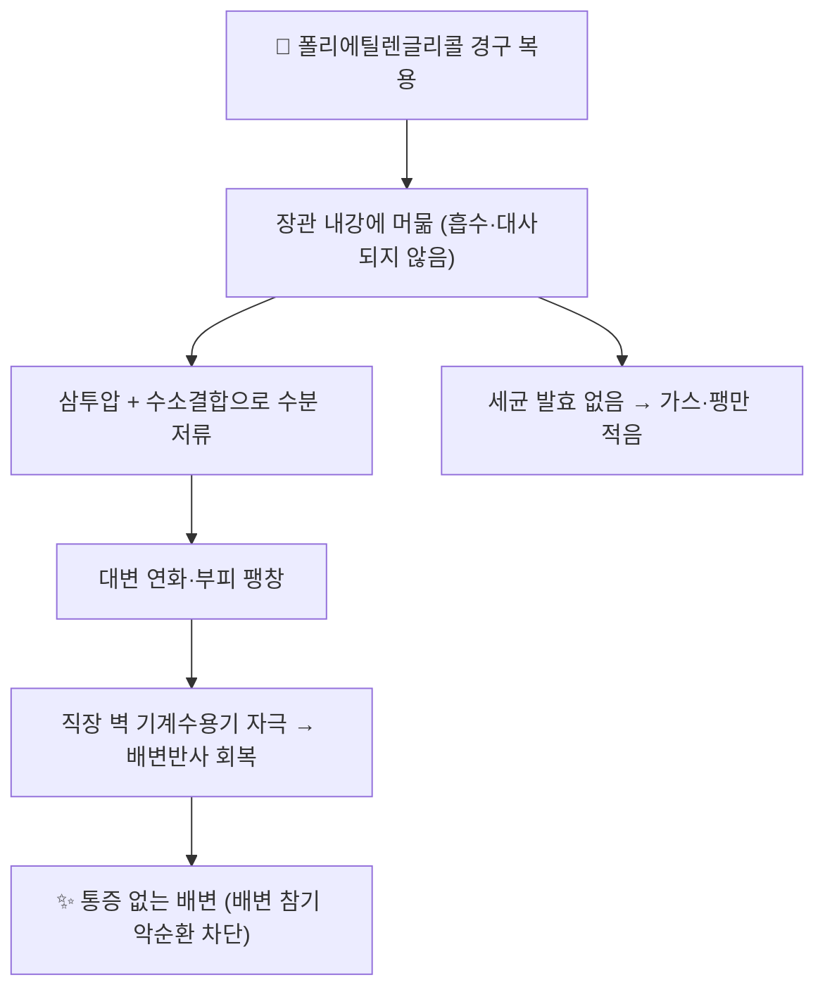

# 💊 폴리에틸렌글리콜 (Polyethylene glycol / Macrogol, ATC A06AD15)

> **핵심 3줄 요약 (Key Summary)**:
> - 🧪 성분·제형: 에틸렌옥사이드 중합체(분자량 3350 또는 4000 Da)로, 국내·외에서 **산제(사셰)** 형태가 주류다. 물에 녹여 복용하며 정제·블리스터 제형은 없다.
> - 🎯 작용 기전: 장점막을 통과하지 않는 비흡수성 고분자가 장관 내 수분을 삼투압과 수소결합으로 붙잡아 대변을 연화·팽창시킨다. 장내 세균에 의해 발효되지 않아 [[락툴로오스]]보다 가스·복부팽만이 적다.
> - ⚠️ 임상 핵심: 소아 [[기능성 변비]]의 **1차 표준**이다. 유지 0.4 g/kg/일(0.2~0.8), [[분변 매복]] 제거 1~1.5 g/kg/일 3~6일. 최소 2개월 유지 후 서서히 감량하지 않으면 재발한다.

![[폴리에틸렌글리콜_01_시판_산제_포장.jpg|320]]
> [그림 1: 마크로골 4000 산제(1포 4 g, 20포) 시판 포장 실사 — 아랍어판 Forlax 제품. 출처: Wikimedia Commons File:Forlax 4g Macrogol 4000-ar.jpg, CC BY-SA 4.0]

![[폴리에틸렌글리콜_02_구조식.png|320]]
> [그림 2: 폴리에틸렌글리콜의 반복 단위 구조식 [–CH₂–CH₂–O–]ₙ (말단 수산기 포함). 출처: Wikimedia Commons File:PEG Structural Formula V1.svg, Public Domain]

> 🖼️ PTP 블리스터·알약 각인 사진은 해당 제형이 없어(산제 전용) 확보 대상이 아니다. 정제형 완하제 성상 사진으로 대체하지 않는다.

## 1. 약물 기본 정보 및 시판 제품 (Brand Identification)

| 항목 | 상세 정보 |
| :--- | :--- |
| **일반명 (Generic Name)** | 폴리에틸렌글리콜 / Macrogol (Polyethylene glycol) |
| **대표 상품명 (Brand Names)** | Forlax, Movicol, Macrogol 3350·4000 산제(국내는 산제·액제로 유통) |
| **ATC 코드 / 분류** | A06AD15 (Macrogol) — 삼투성 완하제(oscillating osmotic laxative) |
| **화학식 / 분자량** | (C₂H₄O)ₙ·H₂O / 3350 또는 4000 Da (중합도에 따라 다름) |
| **주요 제형 및 함량** | 산제 4 g·6.9 g·17 g/포(물 100~250 mL에 용해), 소아용 저용량 산제 |
| **허가 적응증** | 만성 변비, 분변 매복(대변막힘)의 제거, 소아 기능성 변비 |

### 1.1 제형별 임상 위치

| 구분 | 제품 형태 | 특징 | 임상 위치 |
| :--- | :--- | :--- | :--- |
| 단일 산제 | 마크로골 3350/4000 산제 | 전해질 미포함, 맛 중립 | 소아·성인 만성 변비 1차 |
| 전해질 복합 산제 | 마크로골 + Na·K·Cl | 삼투 균형 보강 | 성인 대량 장정결·고령자 |
| 액제 | 고농도 용액 | 복용량 조절 쉬움 | 연하 곤란·영아(전문의 판단) |

## 2. 분자 약리 기전 및 작용 경로 (Mechanism of Action)

- **주요 작용 기전**: 분자량이 커 장점막 상피를 통과하지 못한다. 장내강에 남아 삼투 구배를 만들고, 에틸렌옥사이드 사슬의 산소 원자가 물분자와 수소결합을 형성해 수분을 구조적으로 붙잡는다. 결과적으로 대변 수분 함량이 올라가 연화되고 통과시간이 정상화된다.
- **락툴로오스와의 차이**: [[락툴로오스]]는 장내 세균에 의해 발효되어 유기산·가스를 만들어 삼투 효과를 낸다. 그래서 복부팽만·방귀가 잦고 단맛이 강하다. [[폴리에틸렌글리콜]]은 발효되지 않아 같은 삼투 효과를 내면서 가스가 적고, 순응도가 높다.
- **직장 생리 회복**: 팽창 자극이 직장 벽 기계수용기의 감각 역치를 정상화해, [[소아 변비]]의 핵심 병리인 "배변 통증 → 참기 → [[분변 매복]] → 더 참기"의 악순환을 끊는다.

## 3. 약동학적 특성 (Pharmacokinetics: ADME)

| 약동학 파라미터 | 수치 및 임상적 의미 |
| :--- | :--- |
| **생체이용률 (Bioavailability, F)** | 1% 미만 (장관 흡수 거의 없음) |
| **최고혈중농도 도달시간 (Tmax)** | 해당 없음 (전신 흡수가 치료 목적이 아님) |
| **혈장 단백결합률 (Protein Binding)** | 해당 없음 |
| **간 대사 효소 (Metabolism)** | 대사되지 않음 (CYP 관여 없음) |
| **배설 반감기 (Elimination t1/2)** | 혈중 반감기 개념이 적용되지 않음 |
| **주요 배설 경로 (Excretion)** | 대변으로 원형 그대로 배설 |

- 약동학적 특성 덕분에 **간·신 기능 저하 환자에서도 용량 조절 부담이 적다**. 대신 신장으로 배설되는 [[산화마그네슘]] 계열과 달리 [[고마그네슘혈증]] 위험이 없다.

## 4. 용법·용량 및 처방 가이드 (Dosage & Administration)

| 임상 상황 | 표준 용법·용량 | 기간·상한 |
| :--- | :--- | :--- |
| **소아 유지요법 (0~18세)** | 0.4 g/kg/1일 1회(또는 2회 분복), 반응에 따라 0.2~0.8 g/kg/1일 | 최소 2개월, 증상 완전 소실 1개월 후 감량 |
| **소아 분변 매복 제거** | 1~1.5 g/kg/1일 (최대 1일 6일 초과 금지) | 3~6일 연속 |
| **성인 만성 변비** | 마크로골 3350 기준 17 g/1일 1회, 필요 시 1일 2회 | 2~4주 후 반응 평가 |
| **성인 대량 장정결** | 전해질 복합 산제를 검사 프로토콜대로 분할 복용 | 시술 당일 한정 |

- 복용법: 산제를 물 100~250 mL에 완전히 녹여 마신다. **맹물 또는 투명 주스**에 녹이고, 유제품·점도 있는 음료에 타면 삼투 효과가 희석되고 맛이 나빠진다.
- 감량 원칙: 모든 증상이 1개월 이상 완전히 소실된 뒤 **2~4주 단위로 25%씩** 줄인다. 갑작스러운 중단은 [[분변 매복]] 재발의 가장 흔한 원인이다.

## 5. 부작용, 경고 및 약물 상호작용 (Adverse Effects & Interactions)

### 5.1 주요 부작용
- 흔함: 복부 팽만·고창, 장음 항진, 묽은 변·설사, 오심. 대부분 용량 의존적이며 감량으로 조절된다.
- 드묾: 구토, 복통 악화, 항문 자극, 과민반응(발진·소양감).
- 전해질: 단독 산제는 전해질 교란이 드물다. 전해질 복합 산제를 고령·이뇨제 복용자에게 대량 투여할 때는 나트륨·칼륨 확인이 필요하다.

### 5.2 금기 및 중단 기준
- **금기**: 확인되었거나 의심되는 장 천공, [[장폐색]](ileus), 독성 거대결장, 중증 염증성 장질환 급성기.
- **중단 후 평가**: 심한 복부팽만 + 구토 + 배변·가스 정지(폐색 의심), 지속성 설사로 인한 탈수·어지럼.
- **연령 주의**: 생후 6개월 미만에서는 전문의 판단 없이 시작하지 않는다(체액 균형 취약).

### 5.3 상호작용
- 다른 경구약과 같은 시간에 복용하면 위장관 통과가 빨라져 흡수가 일시적으로 달라질 수 있다. **최소 1~2시간 간격**을 두고 복용하도록 지도한다.
- [[한약]] 병용 시에도 같은 원칙을 적용한다(§6).

## 6. 한의 치료 연계 및 병용/테이퍼링 프로토콜 (Integrative Medicine)

### 6.1 병용 설계 — 2단 구성
- **초기 2~4주**: [[분변 매복]]·배변 통증 해소가 목표다. 한약(예: [[대승기탕]]·[[마자인환]] 계열의 공하·윤장)과 [[폴리에틸렌글리콜]]을 함께 쓰되, 복용 시간을 2시간 이상 띄운다.
- **유지기 2~6개월**: 약물은 폴리에틸렌글리콜(또는 [[락툴로오스]]·[[산화마그네슘]])로 유지하고, 한약은 [[증액탕]]·[[마자인환]] 가감으로 장조(腸燥)와 진액 부족을 다스린다. [[소아추나]]의 마복(摩腹)·퇴육부(退六腑)는 매일 가정에서 시행하도록 지도한다.
- **감량기**: 폴리에틸렌글리콜을 25%씩 줄이는 동안 한약·추나·배변 훈련을 유지해 반동을 막는다.

### 6.2 주의 배오
- 인삼·황기 위주의 보기 처방에서 복부팽만이 심해지면 삼투성 완하제와 겹쳐 팽만이 가중될 수 있다. 이때는 윤장 위주(마자인·결명자)로 전환한다.
- 녹용·육계 등 온열성 본초는 열성 변비(구취·설태 황조)에서 대변을 더 단단하게 만들 수 있어, 수분 섭취와 완하제 용량을 먼저 점검한다.

## 7. 💡 사용자 진료실 핵심 필기 & 실전 임상 체크리스트

### 7.1 진료실 3대 문진
1. **매복 여부를 먼저 확인** — 3일 이상 배변 없음 + 복통 + 좌하복부 종괴 촉지면 유지요법부터 시작하지 않는다. 매복 제거가 먼저다.
2. **복용 기간과 감량 이력** — "변비가 나았으니 끊었다"가 재발의 최대 원인이다. 최소 2개월·증상 소실 1개월 유지 원칙을 종이에 적어 준다.
3. **동반 약물** — [[오피오이드]]·[[철분제]]·항콜린제 복용 여부. 이들이 있으면 완하제 용량을 올리기 전에 원인 약물 조정을 먼저 검토한다.

### 7.2 부모 티칭 스크립트
> "아이 변비는 대부분 '아프니까 참고, 참으니까 더 단단해지는' 악순환입니다. 이 약은 장 속 수분을 붙잡아 두는 약이라 습관성이 생기지 않습니다. 변이 부드러워진 뒤에도 최소 두 달은 계속 쓰고, 그다음에 천천히 줄여야 재발이 적습니다. 화장실에서는 발받침으로 무릎이 엉덩이보다 높게 해 주세요."

### 7.3 상부에 담지 못한 고유 필기
- 산제를 물에 녹일 때 **미지근한 물**을 쓰면 덩어리지기 쉽다. 상온 맹물에 천천히 저어 녹인다.
- 등원·외출이 많은 아이는 **저녁 식후 1회**로 몰아주면 순응도가 올라간다(위대장반사 활용).
- 6세 이상에서 유분증이 동반되면 보호자가 체벌을 하고 있는 경우가 많다. 변지림이 **자의적이 아님**을 먼저 설명해야 치료가 시작된다.

## 8. 출처 및 학술 참고 문헌 (References)

- de Geus A, Gordon M, Sinopoulou V, et al. Efficacy and safety of pharmacological therapies for functional constipation in children: a systematic review and meta-analysis. *Lancet Child Adolesc Health*. 2025;9(12):848-856. [PMID 41101321](https://pubmed.ncbi.nlm.nih.gov/41101321/)
  - [연구 요약] RCT 59편·7,045명 분석에서 폴리에틸렌글리콜이 위약(RR 1.74)과 락툴로오스(RR 1.35)보다 우월해 1차 표준으로 확정됐다.
- Tabbers MM, DiLorenzo C, Berger MY, et al. Evaluation and treatment of functional constipation in infants and children: evidence-based recommendations from ESPGHAN and NASPGHAN. *J Pediatr Gastroenterol Nutr*. 2014;58(2):258-274. [PMID 24345831](https://pubmed.ncbi.nlm.nih.gov/24345831/)
  - [연구 요약] PEG 3350 유지 0.4 g/kg/일(0.2~0.8), 매복 제거 1~1.5 g/kg/일 3~6일 등 용량 체계의 원출처다.
- Gordon M, de Geus A, Boruta M, et al. ESPGHAN/NASPGHAN guidelines for treatment of functional constipation in children aged 0-18 years. *J Pediatr Gastroenterol Nutr*. 2026;83(2):335-366. [PMID 42159193](https://pubmed.ncbi.nlm.nih.gov/42159193/)
  - [연구 요약] 2014년 이후 근거를 재평가한 최신판으로, 폴리에틸렌글리콜의 1차 표준 지위를 유지했다.
- Gordon M, de Geus A, Banasiuk M, et al. ESPGHAN and NASPGHAN 2024 protocol for paediatric functional constipation treatment guidelines. *BMJ Paediatr Open*. 2025;9(1):e003045. [PMID 39904543](https://pubmed.ncbi.nlm.nih.gov/39904543/)
  - [연구 요약] 가이드라인 개정 표준운영절차(SOP)로, 권고 등급 산출 방법(GRADE)을 확인할 수 있다.
- 식품의약품안전처 의약품안전나라 의약품통합정보시스템 — [nedrug.mfds.go.kr](https://nedrug.mfds.go.kr)
  - [연구 요약] 국내 마크로골 산제의 품목별 허가사항·용법용량·금기 정보를 확인하는 공식 경로다.
