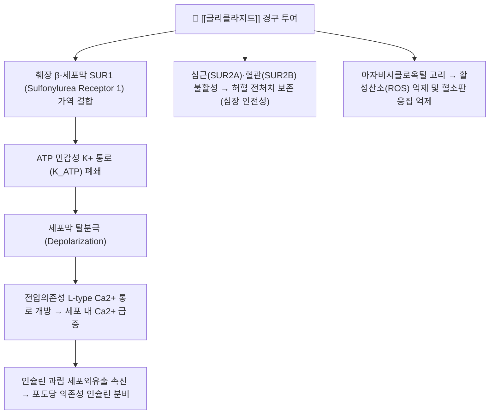
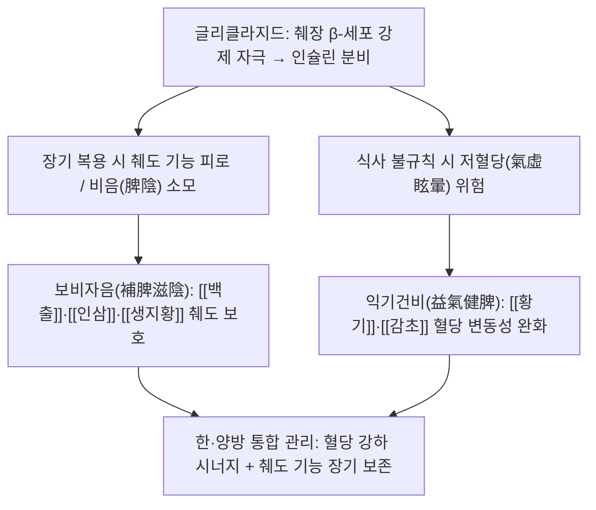

# 글리클라지드 (Gliclazide / 디아미크롱)

> **핵심 3줄 요약 (Key Summary)**:
> 🌿 분류 및 정의: 췌장 췌도 $\beta$-세포의 $K_{ATP}$ 통로에 작용하여 포도당 의존성 인슐린 분비를 촉진하는 제2세대 설포닐우레아계(Sulfonylurea, SU) 경구 혈당강하제.
> 🧪 작용 기전: 췌장 특이적 SUR1 서브유닛에 가역적·선택적으로 결합하여 세포막 탈분극 및 $Ca^{2+}$ 유입을 유도해 인슐린을 분비시키며, 심근(SUR2A) 및 혈관 평활근(SUR2B)에 작용하지 않아 심혈관 허혈 전처치(Ischemic preconditioning)를 방해하지 않는 우수한 심혈관계 안전성 보유.
> 🎯 주요 적응증 & 주의사항: [[제2형 당뇨병]] 치료제. 대규모 랜드마크 임상(ADVANCE)에서 신장 질환 등 미세혈관 합병증 감소 입증. 다른 설포닐우레아(글리벤클라미드 등) 대비 [[저혈당]] 빈도가 유의하게 낮으나, 불규칙한 식사 시 저혈당 모니터링 및 아침 식전/식사 중 복용 필수.

---

## 1. 기본 정보 및 식별 (Identification & Properties)

> [!abstract]+ 🧪 3D 약리 분자 구조 (Interactive 3D Viewer)
> <iframe src="https://molecule-viewer-rho.vercel.app/?cid=3475" style="width: 100%; height: 600px; border: none; border-radius: 12px; box-shadow: 0 4px 20px rgba(0,0,0,0.15);" allowfullscreen></iframe>

[[글리클라지드]](Gliclazide)는 2세대 설포닐우레아 중 아자비시클로옥틸(Azabicyclo-octyl) 고리를 함유한 독특한 화학 구조를 지녀, 강력한 혈당 강하 효과와 함께 항산화 및 혈소판 과응집 억제 특성을 나타내는 경구 혈당강하제이다. 한국세르비에의 **디아미크롱정** 및 **디아미크롱서방정(MR)**이 대표적인 오리지널 제제이다.

### 1.1 기본 화학 및 의약품 정보

| 항목 | 상세 정보 |
| :--- | :--- |
| **성분명** | [[글리클라지드]] (Gliclazide) |
| **영문 일반명** | Gliclazide |
| **ATC 코드** | A10BB09 (Sulfonylureas) |
| **화학식 / 분자량** | $C_{15}H_{21}N_3O_3S$ / 323.41 g/mol |
| **CAS 번호** | 21187-98-4 |
| **PubChem CID** | [3475](https://pubchem.ncbi.nlm.nih.gov/compound/3475) |
| **대표 상품명** | 디아미크롱서방정 30mg, 60mg (한국세르비에), 디아미크롱정 80mg, 글리클라정 |
| **주요 제형** | 속방형 정제 (80mg), 친수성 매트릭스 서방형 정제 (MR 30mg, 60mg) |
| **식약처 허가 적응증** | 식이요법, 운동요법만으로 혈당 조절이 불충분한 [[제2형 당뇨병]] 환자의 치료 |

### 1.2 제형별 외형 식별 정보

| 의약품명 | 성상 | 식별 표기 | 제약회사 |
| :--- | :--- | :--- | :--- |
| **디아미크롱서방정 30mg** | 백색의 장방형 정제 | 앞면: `DIA 30` / 뒷면: 세르비에 마크 | 한국세르비에 |
| **디아미크롱서방정 60mg** | 백색의 분할선이 있는 장방형 정제 | 앞면: `DIA 60` / 뒷면: 분할선 | 한국세르비에 |
| **디아미크롱정 80mg** | 백색의 원형 정제 | 앞면: 십자분할선 / 뒷면: `SERVIER` | 한국세르비에 |

---

## 2. 분자 약리 및 작용 기전 (Molecular Mechanism & PK/PD)

### 2.1 분자 표적 및 췌장 SUR1 선택적 결합 (Selectivity)
* **SUR1에 대한 높은 선택성과 가역성**:
  * 췌장 췌도 $\beta$-세포의 $K_{ATP}$ 채널은 4개의 기공 형성 Kir6.2 서브유닛과 4개의 조절 서브유닛인 SUR1으로 구성됩니다.
  * 글리클라지드는 **SUR1에만 고도로 선택적이고 가역적으로 결합**합니다(Gribble & Ashcroft, 1999).
  * 1세대 SU나 글리벤클라미드(Glibenclamide)와 달리, 결합 후 신속히 해리(Off-rate가 빠름)되므로 포도당 자극에 맞추어 인슐린 제1상(First-phase) 분비를 생리적으로 회복시키며, 지속적인 과분비로 인한 지연성·치명적 [[저혈당]]의 발생률이 현저히 낮습니다.
* **심혈관계 안전성 (Extrapancreatic Safety)**:
  * 심근 세포의 $K_{ATP}$ 채널(Kir6.2/SUR2A)과 혈관 평활근의 $K_{ATP}$ 채널(Kir6.1/SUR2B)에는 거의 결합하지 않습니다.
  * 따라서 심근 허혈 시 심장을 보호하는 내인성 방어 기전인 **허혈 전처치(Ischemic Preconditioning)**를 차단하지 않아 심근경색이나 부정맥 위험을 증가시키지 않습니다.

### 2.2 혈관 내피 보호 및 항산화 특성
* 분자 구조 내에 **아자비시클로옥틸(Azabicyclo-octyl) 고리**를 함유하고 있어 유리 라디칼(ROS)을 포획하는 독자적인 항산화 효능을 나타냅니다.
* 혈소판 과활성화 및 내피 부착을 억제하고 혈관 내 피브린 용해능을 개선하여 당뇨병성 미세혈관 합병증 지연에 기여합니다.

### 2.3 약동학적 특성 (Pharmacokinetics)

| 파라미터 | 서방정 (Diamicron MR) 기준 임상 특성 |
| :--- | :--- |
| **생체이용률** | 경구 흡수 완전, 서방형 제제로 24시간 동안 완만한 방출 프로파일 유지 |
| **최고혈중농도 도달시간 ($T_{max}$)** | 약 6.0시간 (혈중 농도 급상승에 의한 식전 저혈당 방지) |
| **혈장 단백결합률** | 약 95% (알부민에 고도 결합) |
| **대사 경로** | 간에서 시토크롬 P450 효소(주로 **CYP2C9**, 일부 CYP2C19)에 의해 7가지 불활성 대사체로 산화 대사 |
| **배설 경로** | 주로 신장을 통해 대사체 형태로 배설 (소변 60~70%, 대변 10~20%, 미변화체 <1%) |
| **반감기 ($t_{1/2}$)** | 약 12~20시간 (1일 1회 복용 적합) |

---

## 3. 임상 적응증 및 효능·효과 (Clinical Indications)

| 질환 및 연구군 | 랜드마크 임상 근거 | 주요 임상 효과 및 의의 |
| :--- | :--- | :--- |
| **[[제2형 당뇨병]]** | **ADVANCE 임상시험 (NEJM 2008, PMID: 18539916)** | 11,140명 대상 5년 추적: 글리클라지드 MR 기반 집중 조절군(평균 HbA1c 6.5%)에서 **주요 미세혈관 사건 14% 유의한 감소** |
| **[[당뇨병성 신증]] 보호** | ADVANCE 신장 결과 | **새로운 또는 악화된 신증 발생 21% 감소**, 현성 알부민뇨 발생 30% 유의한 감소 |
| **타 SU 대비 저혈당 안전성** | GUIDE 임상시험 (Colagiuri et al., 2018) | 글리메피리드 대비 대등한 HbA1c 강하 효과를 보이면서도 **저혈당 발생 위험을 50% 유의하게 감소** |

---

## 4. 용법·용량 및 임상 투여 지침 (Dosage & Administration)

### 4.1 서방정 (디아미크롱서방정 30mg, 60mg) 표준 용법
* **1일 1회 아침 식사 시 30mg(1정)으로 시작**합니다.
* 혈당 조절 목표에 따라 최소 1개월 간격으로 60mg, 90mg, 최대 120mg(60mg 2정 또는 30mg 4정)까지 점진적으로 증량합니다.
* **복용 원칙**:
  * 반드시 **아침 식사와 함께 물로 삼켜야** 합니다.
  * 서방형 매트릭스 제형이므로 씹거나 부수지 말고 그대로 복용합니다. (60mg 정제의 분할선은 반정 투여를 위한 분할만 허용).
  * 아침 식사를 거르는 경우 약 복용을 식사 시점까지 미루어야 합니다(공복 투여 시 [[저혈당]] 유발).

### 4.2 신장애 및 간장애 환자 투여 지침
* 경증~중등도 신장애(eGFR 30~60 mL/min/1.73m²): 용량 조절 없이 주의 깊게 투여 가능합니다(ADVANCE 임상 근거).
* 중증 신장애(eGFR < 30 mL/min/1.73m²) 및 중증 간장애: 약물 대사 지연 및 저혈당 지속 위험으로 투여 금기입니다.

---

## 5. 금기 및 부작용 (Adverse Effects & Warnings)

### 5.1 투여 금기 (Contraindications)
* 본 제제 또는 다른 설포닐우레아계, 설폰아미드계 약물에 과민증이 있는 환자.
* **제1형 당뇨병 환자** (인슐린 의존형) 및 당뇨병성 케톤산증, 당뇨병성 혼수 환자.
* 중증의 신부전 또는 중증의 간부전 환자.
* **미코나졸(경구용 겔, 전신제) 병용 환자** (치명적인 중증 저혈당 쇼크 유발로 절대 병용 금기).
* 임부 및 수유부 (태아 저혈당 및 최기형성 위험).

### 5.2 부작용 및 독성 경고
* **저혈당 ([[저혈당]], Hypoglycemia)**:
  * 설포닐우레아계의 고유 부작용이나, 글리벤클라미드나 글리메피리드에 비해 빈도와 중증도가 현저히 낮습니다.
  * 불규칙한 식사, 과도한 운동, 음주, 고령 환자에서 발생 위험이 증가하므로 식은땀, 떨림, 빈맥, [[두통]], [[어지럼증]] 등의 전조 증상을 환자에게 교육합니다.
* **체중 증가**: 인슐린 분비 촉진에 따른 동화 작용으로 1~2kg 내외의 체중 증가가 발생할 수 있습니다.
* **소화기계**: 드물게 오심, 소화불량, 설사, 변비.
* **피부 과민반응**: 발진, 소양증, 두드러기.
* **혈액계**: 극히 드물게 혈소판 감소증, 백혈구 감소증, 빈혈.

---

## 6. 약물 상호작용 (Drug Interactions)

| 병용 약물군 | 대표 약물 | 상호작용 양상 및 기전 | 임상 대처 및 가이드 |
| :--- | :--- | :--- | :--- |
| **항진균제 (CYP2C9 억제)** | **미코나졸** (절대 금기), **플루코나졸** | CYP2C9 대사 억제로 글리클라지드 혈중 농도 급증 → 지속적이고 치명적인 저혈당 쇼크 | 미코나졸 절대 병용 금기, 플루코나졸 병용 시 글리클라지드 감량 및 혈당 모니터링 |
| **소염진통제 (NSAIDs)** | 페닐부타존, [[아스피린]], [[이부프로펜]] | 혈장 단백결합 치환 및 신장 배설 억제로 유리형 글리클라지드 농도 증가 | 병용 시 혈당 강화 작용 증강 주의 |
| **$\beta$-차단제** | 프로프라놀롤, 아테놀롤 | 저혈당 시 교감신경 경고 반응(빈맥, 떨림)을 차폐하여 무자각 저혈당 유발 | 환자에게 발한, 피로 등 비전형적 저혈당 증상 교육 |
| **혈당강하제 병용** | [[메트포르민]], DPP-4 억제제, SGLT2 억제제 | 상호보완적 기전으로 우수한 혈당 강하 시너지 발휘 | 저혈당 위험이 낮은 조합으로 다용됨 |
| **혈당 상승 유발 약물** | 코르티코스테로이드, 티아지드계 이뇨제 | 글리클라지드의 혈당 강하 작용 길항 | 병용 시 글리클라지드 용량 증량 필요 |

---

## 7. 한의학적 융합 및 임상 응용 (Integrative Korean Medicine)

### 7.1 당뇨병(소갈) 병태 인식과 비음(脾陰) 보존
글리클라지드는 인위적으로 췌장 $\beta$-세포를 쥐어짜 인슐린을 분비시키는 약물이므로, 장기 복용 시 췌도 피로(Beta-cell exhaustion) 및 한의학적 **비음(脾陰) 손상**, **음허조열(陰虛燥熱)**을 조장할 우려가 있습니다.

| 구분 | 한방 처방 및 본초 | 임상 협진 및 배오 시너지 |
| :--- | :--- | :--- |
| **비위 기허 및 췌도 피로 완화** | [[보중익기탕]](補中益氣湯), [[사군자탕]](四君子湯) | 익기건비(益氣健脾), 췌장 내분비 림프·혈류 미세순환을 개선하고 저혈당성 [[피로]]감 예방 |
| **음허조열 및 구갈 개선** | [[생맥산]](生脈散), [[옥천산]](玉泉散) | 자음생진(滋陰生津), [[맥문동]]·[[천화분]]·오미자가 갈증과 구갈을 완화하고 포도당 세포 이용률 보조 |
| **당뇨병성 미세혈관 합병증 예방** | [[보양환오탕]](補陽還五湯) | 활혈거어(活血祛瘀), [[황기]]의 미세혈관 보호와 함께 [[당뇨병성 신증]] 및 신경병증 진행 억제 시너지 |
| **단독 혈당 강하 보조 본초** | [[생지황]], [[황련]], [[갈근]], [[백출]] | AMPK 활성화 및 인슐린 감수성을 개선하여 글리클라지드 요구 용량을 줄여줌 |

### 7.2 진료실 실전 문진 및 코칭 가이드
1. **식사 시간과 저혈당 위험 점검**:
   * "약을 아침 식사 직전에 규칙적으로 드시는지", "식사를 거르거나 늦어질 때 식은땀이나 손떨림, 어지럼증이 나타나지 않는지" 확인합니다.
   * 식사를 거를 때는 약 복용을 거르도록 환자에게 명확히 교육합니다.
2. **한약 병용 시 저혈당 모니터링**:
   * 황련, 지황, 갈근 등 혈당 강하 작용이 있는 한약을 고용량 병용 투여할 경우, 글리클라지드의 약효가 증강되어 저혈당이 유발될 수 있으므로 자가혈당측정(SMBG) 빈도를 높이도록 안내합니다.
3. **사탕 및 포도당 응급 휴대 교육**:
   * 외출이나 운동 시 저혈당 증상 발생에 대비하여 항상 사탕 2~3개나 포도당 캔디를 휴대하도록 지도합니다.

---

## 8. 출처 및 참고 문헌 (References)

* ADVANCE Collaborative Group. (2008). Intensive blood glucose control and vascular outcomes in patients with type 2 diabetes. *The New England Journal of Medicine*, 358(24), 2560-2572. PMID: 18539916

* Colagiuri, S., et al. (2018). The place of gliclazide MR in the evolving type 2 diabetes landscape: A comparison with other sulfonylureas and newer oral antihyperglycemic agents. *Diabetes Research and Clinical Practice*, 143, 1-14. PMID: 29802958

* Gribble, F. M., & Ashcroft, F. M. (1999). Differential sensitivity of beta-cell and extrapancreatic K(ATP) channels to gliclazide. *Diabetologia*, 42(7), 845-848. PMID: 10440127

## 📎 개념 학습 보충 (2026-11-28 논문 연계)

- 오늘 논문에서의 역할 — 2026-11-28 심층리뷰 3번(PMID 42878622)의 대상은 인슐린 비사용 [[제2형 당뇨병]]으로, 설포닐우레아(이 계열) 병용 환자가 포함될 수 있는 모집단이다. 이 시험에서 실시간 [[연속혈당측정(CGM)]]은 54 mg/dL 미만 시간을 −0.17%p 줄였고 중증 [[저혈당]]은 0건이었다.
- 임상 적용 — 이 계열은 저혈당 위험이 있는 약제다. CGM을 2주 붙이면 야간 저혈당(00~06시)과 식후 스파이크가 같은 그래프에서 분리되어, 감량 여부를 객관적으로 판단할 수 있다. 특히 고령·[[허약]]·[[만성콩팥병]] 환자에서 유용하다.
- 병용 상담 — 한약(탕약·환제) 병용 시 저혈당 증상(식은땀·떨림·공복감·집중력 저하)을 교육하고 자가혈당 기록을 함께 받는다. 저혈당이 확인되면 한약을 늘리는 것이 아니라 이 약제 감량을 먼저 처방의와 상의한다.
- 관련 — [[저혈당]] · [[연속혈당측정(CGM)]] · [[시간범위(TIR)]] · [[제2형 당뇨병]] · [[메트포르민]]
