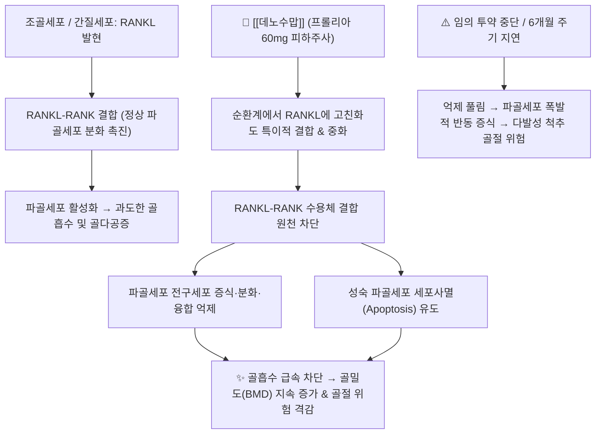
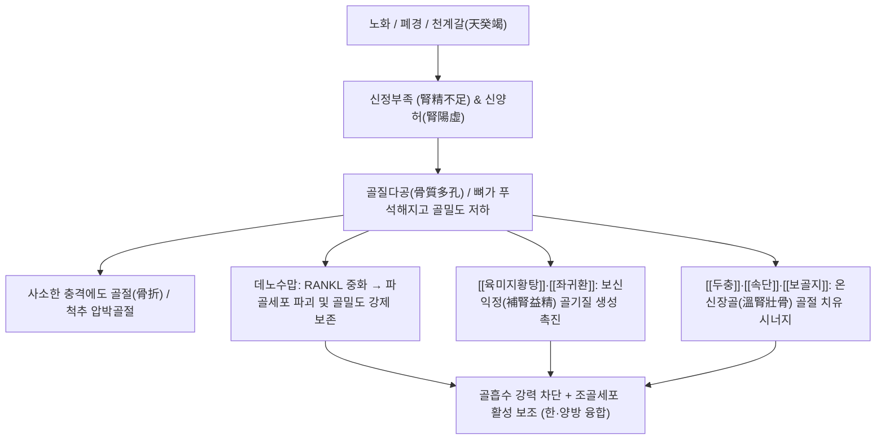

# 데노수맙 (Denosumab / 프롤리아)

> **핵심 3줄 요약 (Key Summary)**:
> 🌿 분류 및 정의: 파골세포의 형성, 기능 및 생존에 필수적인 사이토카인 RANKL을 표적으로 중화하는 완전 인간 단일클론항체(Fully Human IgG2 Monoclonal Antibody) 골흡수 억제제.
> 🧪 작용 기전 & 장점: RANKL-RANK 결합을 차단하여 파골세포 분화를 원천 억제함으로써 골밀도(BMD)를 획기적으로 높이고 골절 위험을 격감시킴. 비스포스포네이트와 달리 신장 배설에 의존하지 않아 신기능 저하([[신부전]]) 환자에서도 용량 조절 없이 투여 가능.
> 🎯 주요 적응증 & 주의사항: 폐경 후 여성의 [[골다공증]], 남성 골다공증, 골소실 예방 (6개월마다 60mg 피하주사). 투여 전 [[저칼슘혈증]] 교정 필수. **투약 중단 시 파골세포 반동성 활성화로 다발성 [[척추 골절]] 및 [[대퇴골 골절]] 위험이 폭증하므로 임의 중단 절대 금기**(중단 시 [[비스포스포네이트]] 순차 치료 필수).

---

## 1. 기본 정보 및 식별 (Identification & Properties)

> [!note] 🧬 생물학적 단일클론항체 제제 (Biologic Macromolecule)
> 데노수맙은 약 147 kDa의 거대 면역글로불린(IgG2) 단일클론항체 당단백질 제제로, 소분자 화학합성 의약품과 달리 고유한 3D 펩타이드 복합체 구조를 가지며 세망내피계(Reticuloendothelial system)를 통해 펩타이드 단위로 이화 대사됩니다.

[[데노수맙]](Denosumab)은 골 대사 조절의 핵심 신호 전달 축인 RANKL을 직접 표적하는 최초의 생물학적 표적 제제이다. 암젠코리아의 **프롤리아 프리필드시린지 60mg(Prolia)**과 골전이 암 환자용 고용량 제제인 **엑스지바주 120mg(Xgeva)**이 대표적인 오리지널 제제이다.

### 1.1 기본 생물학적 및 의약품 정보

| 항목 | 상세 정보 |
| :--- | :--- |
| **성분명** | [[데노수맙]] (Denosumab) |
| **영문 일반명** | Denosumab |
| **ATC 코드** | M05BX04 (Other drugs affecting bone structure and mineralization) |
| **분자량 / 형태** | 약 147 kDa / 유전자재조합 완전 인간 단일클론항체 (IgG2) |
| **DrugBank ID** | DB06643 |
| **CAS 번호** | 615258-40-7 |
| **대표 상품명** | 프롤리아 프리필드시린지 60mg (암젠코리아), 엑스지바주 120mg |
| **주요 제형** | 피하주사용 무색 투명한 멸균 액제 (1.0mL 프리필드시린지) |
| **식약처 허가 적응증** | (1) 폐경 후 여성 및 남성 골다공증([[골다공증]]) 치료, (2) 전립선암·유방암 환자의 호르몬 결핍성 골소실 치료, (3) 글루코코르티코이드 유발성 골다공증 치료 |

### 1.2 제형별 외형 식별 정보

| 의약품명 | 성상 및 제형 | 투여 경로 | 제약회사 |
| :--- | :--- | :--- | :--- |
| **프롤리아 프리필드시린지 60mg** | 1.0mL 주사기에 든 무색~미황색 액 | 피하주사 (Subcutaneous, SC) | 암젠코리아 |
| **엑스지바주 120mg** | 1.7mL 바이알에 든 무색~미황색 액 | 피하주사 (Subcutaneous, SC) | 암젠코리아 |

---

## 2. 분자 약리 및 작용 기전 (Molecular Mechanism & PK/PD)

### 2.1 분자 표적: RANKL-RANK 신호전달 차단
* **파골세포 분화의 원천 차단**:
  * 골 대사에서 조골세포가 분비하는 RANKL은 파골세포 전구세포 표면의 수용체인 RANK(Receptor Activator of Nuclear Factor-$\kappa$B)와 결합하여 파골세포의 분화, 융합, 성숙을 촉진합니다.
  * 데노수맙은 체내 천연 억제 인자인 오스테오프로테게린(OPG)의 역할을 모방하여 **RANKL에 선택적으로 결합함으로써 RANKL이 RANK 수용체에 부착되는 것을 원천 차단**합니다.
* **파골세포 세포사멸 및 골밀도 지속 증가**:
  * 기존 파골세포의 수명을 단축시켜 조기 사멸(Apoptosis)을 유도하고, 신규 파골세포 형성을 막아 골흡수 표지자(CTX 등)를 수일 내에 80% 이상 급격히 억제합니다.
  * 피질골과 해면골 모두에서 골흡수를 차단하여 요추 및 대퇴골의 골밀도(BMD)를 투약 10년 차까지 지속적으로 증가시킵니다.

### 2.2 비스포스포네이트와의 결정적 차이점
* **골 기질 비축적성**: 비스포스포네이트는 하이드록시아파타이트 결정에 결합하여 수년간 잔류하지만, 데노수맙은 골 표면에 물리적으로 축적되지 않습니다.
* **신독성 부재 (신장 비배설)**: 비스포스포네이트는 신세관을 통해 배설되므로 신부전(eGFR < 30~35 mL/min) 환자에게 금기이지만, 데노수맙은 면역글로불린으로서 면역계의 식세포 시스템에 의해 아미노산으로 분해되므로 **신기능 저하 환자에서도 감량 없이 안전하게 투여 가능**합니다.
* **반동 현상 (Rebound Effect)**: 체내 잔류하지 않으므로 약효가 소실되는 6~7개월 시점부터 파골세포 활성이 급반등하여 골밀도가 급락하고 **다발성 척추 골절(Multiple vertebral fractures)**을 초래할 수 있습니다.

### 2.3 약동학적 특성 (Pharmacokinetics)

| 파라미터 | 임상 수치 및 특성 |
| :--- | :--- |
| **투여 경로 및 흡수** | 피하주사(SC) 후 서서히 흡수, 생체이용률 약 62% |
| **최고혈중농도 도달시간 ($T_{max}$)** | 투여 후 약 10일 (범위: 3~21일) |
| **대사 경로** | 면역글로불린 이화 경로(Reticuloendothelial system)를 통해 펩타이드/아미노산으로 분해 |
| **배설 경로** | 신장 배설 없음 (신기능 저하 환자에서도 약동학적 파라미터 불변) |
| **소실 반감기 ($t_{1/2}$)** | 약 25~28일 (골흡수 억제 활성은 약 6개월간 지속 유지됨) |

---

## 3. 임상 적응증 및 효능·효과 (Clinical Indications)

| 질환군 | 랜드마크 임상 근거 | 주요 임상 효과 |
| :--- | :--- | :--- |
| **폐경 후 여성 [[골다공증]]** | **FREEDOM 임상시험 (NEJM 2009, PMID: 19671655)** | 7,868명 대상 3년 추적: 위약 대비 **새로운 척추 골절 68% 감소 (p<0.001)**, **대퇴골 골절 40% 감소 (p=0.04)**, 비척추 골절 20% 감소 입증 |
| **10년 장기 치료 안전성** | **FREEDOM Extension (Lancet 2017, PMID: 28546097)** | 10년간 투여 시 골밀도가 요추 21.7%, 대퇴경부 9.2% 지속 상승하며 낮은 골절 발생률 유지 |
| **투약 중단 시 위험성** | **ECTS 체계적 문헌고찰 (Bone 2017, PMID: 28789921)** | 데노수맙 중단 환자에서 골흡수 표지자 급상승 및 **중단 8~16개월 내 다발성 척추 골절 위험 입증** (순차 치료 필수 권고) |
| **암 환자 골병변 (엑스지바)** | 고용량 제제 (120mg 매 4주) | 고형암 골전이 환자에서 병적 골절 및 척수 압박 등 골격계 합병증(SRE) 지연 |

---

## 4. 용법·용량 및 임상 투여 지침 (Dosage & Administration)

### 4.1 표준 골다공증 용법·용량 (프롤리아)
* **1회 60mg을 6개월마다 1회, 허벅지·복부 또는 상완부에 피하주사(SC)**합니다.
* 투약 주기는 **정확히 6개월(±수주 이내)**을 엄수해야 합니다.
* 모든 환자는 투약 기간 중 **칼슘 1,000mg/일 및 비타민 D 400~800 IU/일을 매일 병용 섭취**해야 합니다.

### 4.2 중단 및 순차 치료(Sequential Therapy) 지침
* 환자의 개인적 사정으로 데노수맙을 중단해야 할 경우, 약효 소실 시점인 **마지막 주사 후 6개월 시점에 경구 또는 정맥용 비스포스포네이트(알렌드로네이트, 졸레드론산 등)로 즉시 전환**하여 반동성 골흡수 폭발을 차단해야 합니다.

---

## 5. 금기 및 부작용 (Adverse Effects & Warnings)

### 5.1 투여 금기 (Contraindications)
* **저칼슘혈증 ([[저칼슘혈증]], Hypocalcemia) 환자**: 투여 전 혈청 칼슘 농도가 정상으로 교정되지 않은 환자는 절대 투여 금기.
* 본 제제에 과민증이 있는 환자.
* 임부 및 임신 가능성이 있는 여성 (태아 골격 발달 손상 위험).

### 5.2 부작용 및 독성 경고
* **저칼슘혈증 (투약 초기 주의)**:
  * 골흡수가 급격히 차단되면서 혈중 칼슘이 뼈로 이동하여 혈청 칼슘 농도가 급락할 수 있습니다.
  * 특히 만성 신부전(CKD stage 4~5) 환자에서 중증 저칼슘혈증(손발 저림, 근육 경련, 테타니, 부정맥) 발생 위험이 높으므로 투약 전후 혈청 칼슘 검사가 필수적입니다.
* **턱뼈 괴사 (ONJ, Osteonecrosis of the Jaw)**:
  * 파골세포 억제로 인한 골 재형성 저하로 드물게 악골 괴사가 발생할 수 있습니다.
  * 발치나 임플란트 등 침습적 치과 치료를 계획 중인 경우, 치료를 완료하고 잇몸이 치유된 후 데노수맙을 투여하도록 지도합니다.
* **비전형 대퇴골 골절 (AFF, Atypical Femoral Fracture)**:
  * 장기 투여 시 대퇴골 간부 또는 전자하 부위에 전구 통증(허벅지, 서혜부 통증)을 동반한 비전형 골절이 발생할 수 있습니다.

---

## 6. 약물 상호작용 (Drug Interactions)

| 병용 약물군 | 대표 약물 | 상호작용 양상 및 기전 | 임상 대처 및 가이드 |
| :--- | :--- | :--- | :--- |
| **비스포스포네이트** | 알렌드로네이트, 졸레드론산 | 동시 병용 시 과도한 골 재형성 억제 우려 | 동시 병용 비권장, 데노수맙 중단 후 **순차 전환 치료**로 활용 |
| **면역억제제 / 코르티코스테로이드** | 메토트렉세이트, 덱사메타손 | 면역 억제 및 중증 감염(피부 연조직염 등) 위험 증가 | 감염 징후(발열, 피부 발적) 면밀 관찰 |
| **칼슘 및 비타민 D 보충제** | 탄산칼슘, 콜레칼시페롤 | 저칼슘혈증 예방을 위한 필수 보조 요법 | 매일 규칙적 복용 지도 |

---

## 7. 한의학적 융합 및 임상 응용 (Integrative Korean Medicine)

### 7.1 골다공증의 한의학적 병태 인식: 신주골(腎主骨) 및 골위(骨痿)
뼈가 약해지고 쉽게 골절되는 골다공증은 한의학에서 **신주골(腎主骨, 신장은 뼈를 주관한다)** 이론에 따라 **신허(腎虛)**, **신정부족(腎精不足)**, **신양허(腎陽虛)**, **골위(骨痿)**의 범주에 속합니다.

| 한방 처방 및 본초 | 주요 구성 | 한의학적 기전 및 데노수맙 병용 시너지 |
| :--- | :--- | :--- |
| **[[좌귀환]](左歸丸)** | [[숙지황]], 산약, 산수유, 구기자, [[우슬]], 녹각교 | 보신익정(補腎益精) 및 자음보혈, 조골세포 기질 단백질 합성을 촉진하여 골 형성 보조 |
| **[[독활기생탕]](獨活寄生湯)** | 독활, [[두충]], [[속단]], 상기생, [[당귀]], [[우슬]] | 익간신(益肝腎), 강근골(强筋骨), 거풍습, 노인성 골다공증 환자의 요각통([[신허요통]]) 및 근력 저하 개선 |
| **대표 장골 본초** | [[두충]], [[속단]], [[보골지]], [[구척]], 녹각 | 온신장골(溫腎壯骨), 에스트로겐 유사 활성을 통해 [[골흡수]] 억제 및 골밀도 보존 보조 |

### 7.2 진료실 실전 문진 및 코칭 가이드
1. **6개월 주사 주기 엄수 교육 (가장 중요)**:
   * "프롤리아는 맞다가 중단하면 억제되었던 뼈 파괴 세포가 한꺼번에 폭발하여 척추가 부러질 위험이 매우 큽니다. 반드시 6개월마다 잊지 말고 주사를 맞으셔야 하며, 중단할 때는 반드시 주치의와 상의해 다른 약으로 바꿔서 넘어가셔야 합니다"라고 강력히 티칭합니다.
2. **치과 치료 전 사전 고지**:
   * 치과에서 발치, 임플란트 치료 계획이 있는지 확인하고, 주사 맞기 전에 치과 치료를 먼저 마치도록 안내합니다.
3. **칼슘 및 비타민 D 복약 확인**:
   * 약물 투여 후 칼슘이 급격히 떨어지는 저칼슘혈증(손발 저림, 입 주위 얼얼함)을 막기 위해 처방받은 칼슘과 비타민 D를 매일 거르지 않고 드시는지 점검합니다.

---

## 8. 출처 및 참고 문헌 (References)

* Cummings, S. R. et al. (2009). Denosumab for prevention of fractures in postmenopausal women with osteoporosis. *The New England Journal of Medicine*, 361(8), 756-765. PMID: 19671655

* Bone, H. G., Wagman, R. B., Brandi, M. L., et al. (2017). 10 years of denosumab treatment in postmenopausal women with osteoporosis: results from the phase 3 randomised FREEDOM trial and open-label extension. *The Lancet. Diabetes & Endocrinology*, 5(7), 513-523. PMID: 28546097

* Tsourdi, E., Langdahl, B., Cohen-Solal, M., et al. (2017). Discontinuation of Denosumab therapy for osteoporosis: A systematic review and position statement by ECTS. *Bone*, 105, 11-17. PMID: 28789921
---

## 📎 개념 학습 보충 (2026-11-14 논문 연계)

### 오늘 논문에서의 역할
2026-11-14 네트워크 메타분석(PMID 42494861)에서 데노수맙은 [[테리파라타이드]]·[[아발로파라타이드]]·경구 및 정맥 [[비스포스포네이트]]와 함께 비교됐다. 같은 회차의 골형성제 vs 항흡수제 메타분석(PMID 42906675)은 골밀도·골절 위험에서 골형성제가 유리하지만 통증·삶의 질 차이는 없다고 정리했다 — 데노수맙의 자리는 '골형성제 이후 이행'과 '신기능 저하로 비스포스포네이트를 쓰기 어려운 환자'다.
### 관련 개념 연결
기전 축은 RANKL·파골세포·[[골 재형성]], 대체·순차 축은 [[비스포스포네이트]]·[[테리파라타이드]]·[[로모소주맙]]·[[아발로파라타이드]], 평가 축은 [[골밀도]]·[[골교체표지자]]이다. 투석 환자 맥락은 [[혈액투석]]·[[C반응성 단백질]]과 연결해 읽는다.
### 임상 주의
중단 시 반동성 골소실이 급격해 '쉬어가는 약'이 아니다. 골형성제 이후 이행으로 쓸 때도 이행 약물을 끊는 시점의 골밀도·골절 위험을 미리 계획해야 한다. 저칼슘혈증과 턱뼈 무혈성 괴사 감시는 [[비스포스포네이트]]와 동일한 주의가 필요하다.
