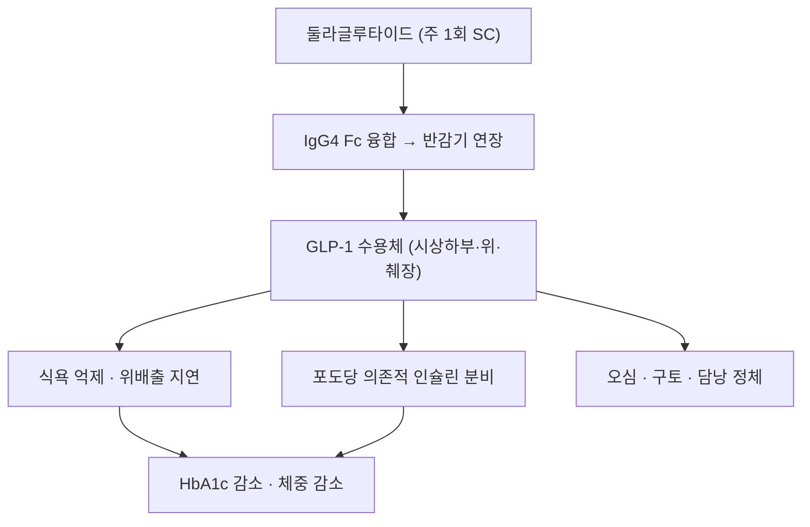

# 둘라글루타이드 (Dulaglutide, 트룰리시티, A10BJ05)

> **핵심 3줄 요약 (Key Summary)**:
> 🧪 주성분·제형: [[GLP-1]] 유사체와 변형 IgG4 Fc 단편을 유전자재조합으로 융합한 단백질 의약품(약 63 kDa). 주 1회 피하주사 오토인젝터
> 📍 작용 기전: Fc 융합으로 단백분해를 피해 반감기를 약 4~5일로 늘린 GLP-1 수용체 작용제. 식욕 억제·위배출 지연·포도당 의존적 인슐린 분비
> 🎯 적응증: 제2형 당뇨병의 혈당 조절(0.75·1.5·3.0·4.5 mg), 심혈관 사건 위험 감소
> ⚠️ 주의사항: 위장관 부작용, 담낭·췌장 사건, 급격한 감량 시 [[제지방량]] 손실. 단백질 섭취·[[저항운동]] 병행

## 1. 약물 기본 정보 및 시판 제품 (Brand Identification)

![[둘라글루타이드_01_트룰리시티_오토인젝터.jpg|420]]
> [그림 1: 트룰리시티(둘라글루타이드) 0.75 mg/0.5 mL 일회용 오토인젝터 실물 — 주 1회 피하주사. 출처: Wikimedia Commons File:Autoinjector with Trulicity by Lilly (Dulaglutid)-3129.jpg, CC BY-SA 4.0]

![[둘라글루타이드_02_오토인젝터_구성.jpg|420]]
> [그림 2: 오토인젝터 본체와 라벨(성분명·용량 표기) — 바늘 은폐형 일회용. 출처: Wikimedia Commons File:Autoinjector with Trulicity by Lilly (Dulaglutid)-6709.jpg, CC BY-SA 4.0]

> 🖼️ 이미지 미확보 — **2D 화학 구조식**: 둘라글루타이드는 59~63 kDa급 Fc 융합 단백질로 PubChem에 단일 화합물 CID가 없다(조회 결과 404). 구조식 대신 "GLP-1 유사체 + 변형 IgG4 Fc" 구성 설명으로 대체한다.

| 항목 | 상세 정보 |
| :--- | :--- |
| **일반명** | 둘라글루타이드 / Dulaglutide |
| **대표 상품명** | 트룰리시티(Trulicity) |
| **ATC 코드 / 분류** | A10BJ05 (Glucagon-like peptide-1 analogues) |
| **PubChem CID** | 없음 — 단백질(Fc 융합체) |
| **분자량** | 약 63 kDa (GLP-1 유사체 2분자 + 변형 IgG4 Fc 1분자) |
| **주요 제형** | 일회용 오토인젝터 0.75·1.5·3.0·4.5 mg/0.5 mL (주 1회) |
| **허가 적응증** | 제2형 당뇨병 혈당 조절, 심혈관 사건 위험 감소 |

## 2. 분자 약리 기전 (Mechanism of Action)

- Fc 융합은 신생아 Fc 수용체(FcRn) 재순환을 이용해 단백분해를 줄이고 반감기를 늘리는 전략이다. GLP-1 부분은 DPP-4 절단 부위가 변형돼 있다.
- GLP-1 작용 자체는 계열 공통이다 — 중추 식욕 억제, 위배출 지연, 포도당 의존적 인슐린 분비.

## 3. 약동학 (Pharmacokinetics)

| 파라미터 | 값 | 임상 의미 |
| :--- | :--- | :--- |
| 생체이용률 | 약 47~65% (피하) | 주 1회 투여 |
| Tmax | 24~72시간 | 완만한 최고농도 |
| 분자량 | 약 63 kDa | 신장 여과가 느림 |
| 대사 | 단백분해(특정 CYP 무관) | 상호작용 가능성 낮음 |
| 반감기 | 약 4~5일 | 주 1회, 정상상태 2~4주 |
| 배설 | 대사산물 | 신기능 저하 시 주의 |

## 4. 용법·용량 (Dosage)

| 단계 | 용량 | 비고 |
| :--- | :--- | :--- |
| 시작 | 0.75 mg 주 1회 | 위장관 내약성 확인 |
| 증량 | 1.5 → 3.0 → 4.5 mg | 4주 이상 간격, 추가 혈당 조절 필요 시 |
| 투여 | 주 1회, 요일 고정 | 오토인젝터로 복부·대퇴·상완 |

## 5. 부작용·상호작용

- **위장관**: 오심·구토·설사·복통, 증량기 악화. 대개 4~8주에 적응된다.
- **담낭·췌장**: 담석·담낭염, 급성 췌장염. 지속 상복부 통증 시 중단.
- **신기능**: 탈수로 인한 급성신손상 가능 — 구토 지속 시 수분·신기능 확인.
- **근손실**: 감량 폭은 크지 않지만 인크레틴 계열 공통으로 [[제지방량]] 손실을 추적한다. 2026년 체계적 고찰(PMID 41996180)에서 계열 전체의 근육 지표 손실 중앙값이 총감량의 28.3%였다.
- **금기**: 갑상선 수질암·MEN2 병력, 과민반응, 임신·수유.
- **병용**: 인슐린·설포닐우레아 병용 시 저혈당 위험.

## 6. 한의 치료 연계·감량 프로토콜

- 위장관 부작용기에는 건비화위 처방을 소량·분복으로 단기 병용하고, 오심에는 내관(P6), 복부 팽만에는 중완(CV12)·천추(ST25) 자극을 더한다.
- 당뇨병성 말초신경병증 동반 환자에서는 감량보다 혈당 변동 폭과 신경병증 증상 악화를 먼저 본다 — 급격한 식사량 감소는 저혈당·탈수를 부른다.
- 운동은 주 2~3회 [[저항운동]] + 주 3~5회 걷기로 구성하고, 단백질 1.0~1.2 g/kg/일을 함께 지도한다.

## 7. 진료실 핵심 필기

- 문진 3종: ① 갑상선 수질암·MEN2·췌장염 병력 ② 인슐린·설포닐우레아 병용 여부 ③ 구토·설사로 인한 탈수·신기능 위험.
- "주 1회 고정 요일에 맞추고, 잊었으면 72시간 이내에 떠올려 주사한다"는 복약 지도를 한다(허가사항 기준 확인).
- 3개월마다 [[악력]]·[[생체전기저항분석]] 또는 [[이중에너지 X선 흡수계측]]으로 [[제지방량]]을 확인한다.

## 8. 출처 및 학술 참고 문헌 (References)

1. 2026-10-24 심층리뷰 3번 — Ann Intern Med 2026;179(7):996-1013, [PMID 41996180](https://pubmed.ncbi.nlm.nih.gov/41996180/).
   - [연구 요약] 둘라글루타이드를 포함한 인크레틴 계열 RCT 35편의 체성분 결과를 모아 근육 지표 손실이 총감량의 중앙값 28.3%임을 보고했다.
2. 식품의약품안전처 의약품안전나라 (https://nedrug.mfds.go.kr) — 트룰리시티 허가사항·용법용량.
   - [연구 요약] 국내 허가 용량·적응증·금기 확인용 1차 자료.
3. PubChem 조회 결과 — "dulaglutide" 단일 CID 없음(2026-10-24 조회, 404). 단백질 의약품이라 구조식 슬롯은 비우고 사유를 명시했다.

## 함께 보기

- [[GLP-1]] · [[인크레틴]] · [[GIP]] · [[세마글루타이드]] · [[리라글루타이드]] · [[티르제파타이드]]
- [[근감소성 비만]] · [[근감소증]] · [[제지방량]] · [[저항운동]] · [[당뇨병]]
- [[2026-10-24_대사노인질환_심층리뷰]] 3번 · [[2026-10-24_대사노인질환_개념학습]]
