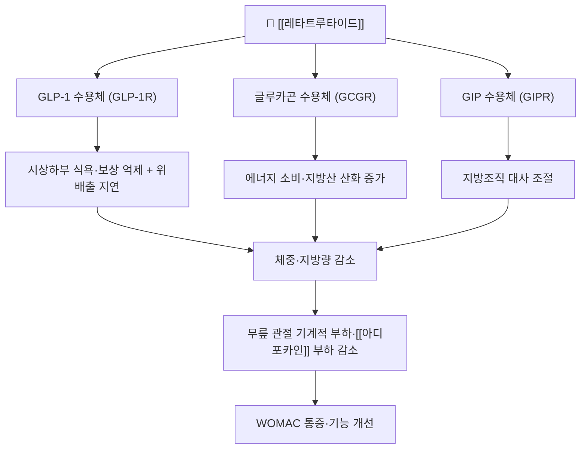

# 💊 [[레타트루타이드]] (Retatrutide)

> **핵심 3줄 요약 (Key Summary)**:
> 🧪 주성분·제형: [[GIP]]·[[GLP-1]]·[[글루카곤]] 세 수용체를 동시에 자극하는 삼중작용제 펩타이드. 주 1회 피하주사 제형이며 국내·미국 모두 허가 전 개발 단계다.
> 📍 작용 기전: 시상하부 식욕·보상 회로 억제 + 포도당 의존적 인슐린 분비 촉진 + [[글루카곤]] 수용체 매개 에너지 소비 증가의 세 축을 동시에 민다.
> 🎯 임상 적응증: 비만 동반 무릎 [[퇴행성 슬관절염]]에서 WOMAC 통증 개선이 3상 2건에서 보고됐다(2026-11-26 리뷰 2번).
> ⚠️ 주의사항: 이상반응은 대부분 위장관계였고 중대한 이상반응은 위약보다 많았다. 1년 20%를 넘는 감량 속도에서 [[근감소증]] 위험이 실제 문제다.

> 🖼️ 이미지 미확보 — 국내 미허가·개발 단계 약물이라 시판 패키지·블리스터 실사가 없고, 펩타이드 의약품이라 PubChem 소분자 CID도 조회되지 않는다(2026-11-26 조회 결과 404). 구조식 대신 수용체 작용 설명으로 대체한다. 사진을 다른 약으로 채우지 않는다.

---

## 1. 약물 기본 정보 및 시판 제품 (Brand Identification)

| 항목 | 상세 정보 |
| :--- | :--- |
| **일반명 (Generic Name)** | [[레타트루타이드]](한글) / Retatrutide |
| **대표 상품명 (Brand Names)** | 없음 — 허가 전 개발 단계 |
| **ATC 코드 / 분류** | 미부여(개발 단계) / GIP·GLP-1·글루카곤 삼중 수용체 작용제 |
| **PubChem CID** | 없음 — 펩타이드(단백질성) 의약품, 소분자 CID 미등재 |
| **화학식 / 분자량** | 공개 전 — 원문 초록에 기재 없음 |
| **주요 제형 및 함량** | 피하주사(주 1회). 3상 시험 용량 4 mg·9 mg·12 mg |
| **허가 적응증** | 없음 — 국내·미국 모두 미허가. 3상 결과만 공개된 상태 |

### 1.1 계열 지형 안에서의 위치

| 구분 | 약물 | 수용체 | 투여 | 이 노트와의 관계 |
| :--- | :--- | :--- | :--- | :--- |
| GLP-1 단일 | [[리라글루타이드]] | GLP-1R | 1일 1회 | 1세대 — 감량 폭이 가장 작다 |
| GLP-1 단일 | [[세마글루타이드]] | GLP-1R | 주 1회 | 무릎 골관절염 3상(STEP 9) 선례 |
| GLP-1 단일 | [[둘라글루타이드]] | GLP-1R | 주 1회 | Fc 융합으로 반감기 연장 |
| 삼중 | [[레타트루타이드]] | GIPR + GLP-1R + GCGR | 주 1회 | 감량 폭 최대, 근감소 감시 필요 |

---

## 2. 분자 약리 기전 및 작용 경로 (Mechanism of Action)

* **삼중 설계의 이유**: [[GLP-1]] 단독은 식욕 억제가 주된 축이라 감량의 상한이 있다. [[글루카곤]] 수용체 자극을 더하면 에너지 소비가 늘지만 혈당이 오르는 상쇄가 생기는데, 인크레틴 두 축이 이를 되받아 균형을 맞춘다.
* **통증 개선의 경로**: 약물이 연골을 직접 바꾼다는 근거는 없다. 체중 감소 → 관절 부하·지방세포 유래 염증 신호([[렙틴]]·[[IL-6]]) 감소 → 통증·기능 개선의 간접 경로로 읽는다.
* **미확인 영역**: 약물 고유의 진통 효과와 감량 효과는 이 시험 설계로 분리되지 않았다.

---

## 3. 약동학적 특성 (Pharmacokinetics: ADME)

| 약동학 파라미터 | 수치 및 임상적 의미 |
| :--- | :--- |
| **생체이용률 (Bioavailability, F)** | 초록 미기재 — 피하주사 제형 |
| **최고혈중농도 도달시간 (Tmax)** | 초록 미기재 |
| **혈장 단백결합률 (Protein Binding)** | 초록 미기재 |
| **대사 (Metabolism)** | 펩타이드로 통상 단백분해 경로 — 원문 미기재 |
| **반감기 (Elimination t1/2)** | 초록 미기재 — 주 1회 투여가 가능한 지속형 설계라는 사실만 확인된다 |
| **주요 배설 경로 (Excretion)** | 초록 미기재 |

> ⚠️ 이 표의 빈칸은 '없음'이 아니라 '이번 회차에서 확인하지 못함'이다. 처방·상담에 수치가 필요하면 원문 유료 본문이나 허가 심사 자료를 확인해야 한다.

---

## 4. 용법·용량 및 처방 가이드 (Dosage & Administration)

| 시험 | 대상 | 용량 | 관찰 기간 | 1차 평가변수 |
| :--- | :--- | :--- | :--- | :--- |
| TRIUMPH-4 | 비만 + 무릎 골관절염, 당뇨 없음, 445명 | 9 mg·12 mg 위약 대조 | 68주 | WOMAC 통증(0~10)·체중 변화율 |
| TRIUMPH-1-OA | 같은 모집단, 574명 | 4 mg·9 mg·12 mg 위약 대조 | 80주 | WOMAC 통증(0~10)·체중 변화율 |

* **용량 적정(titration) 단계·주입 부위·중단 기준**은 초록에 기술되지 않았다. 시판 후 지침이 아니라 시험 프로토콜 기준이므로, 환자에게 '이렇게 맞으면 된다'는 식으로 옮기지 않는다.
* **국내 사용 불가**: 허가 전이므로 처방·조제 대상이 아니다. 해외 구매 문의에는 근거 부족과 안전성 문제를 명확히 전달한다.

---

## 5. 부작용, 경고 및 약물 상호작용 (Adverse Effects & Interactions)

### 5.1 주요 부작용
* **위장관계**: 이상반응의 대부분이 위장관이었다. 오심·구토·설사로 식사량이 줄면 한약 복용 순응도와 흡수 시간이 함께 흔들린다.
* **중대한 이상반응**: 활성군에서 위약보다 많이 발생했다. 어떤 사건이었는지는 초록에 세부 분류가 없어 원문 확인이 필요하다.
* **근골격**: 68주에 체중 −20.0%·−23.7%는 제지방 손실을 동반한다. 65세 이상·기저 [[근감소증]] 의심 환자에서는 이득보다 손실이 클 수 있다.

### 5.2 병용·상호작용 주의
* 위배출 지연이 예상되므로 경구 한약·보충제의 흡수 시점이 달라질 수 있다. 복용 간격을 1~2시간 두고 위장관 증상을 함께 관찰한다.
* 인슐린·설포닐우레아 병용 시 저혈당 위험 — 이 시험은 당뇨병이 없는 환자만 포함해 이 조합의 자료가 없다.

---

## 6. 한의 치료 연계 및 병용/테이퍼링 프로토콜 (Integrative Medicine)

### 6.1 한약·양약 병용
* **시간차 투여**: 위배출 지연 → 한약은 식간으로 두고, 구역·복만이 있으면 補氣健脾 위주의 처방(예: [[육군자탕]] 계열)으로 조정한다.
* **근손실 방어**: 감량 속도가 빠른 구간에는 補腎·補氣 본초와 저항운동을 함께 붙인다. 약물이 근육을 지켜주지 않는다.

### 6.2 한의 중재의 자리
* 침·약침·추나로 통증 창을 만들어 운동 수행량을 확보하는 것이 현실적 역할이다. 감량만으로는 근력·가동범위가 따라오지 않는다는 점이 STEP 9 이후 일관된 관찰이다.
* 3개월 단위로 WOMAC 통증·체중·[[악력]]·5회 의자 일어서기를 같은 방식으로 기록한다.

---

## 7. 💡 사용자 진료실 핵심 필기 & 실전 임상 체크리스트

> 🛡️ Melt-In 원칙: 상부에 담은 학술 내용은 반복하지 않고, 진료실에서 바로 쓰는 판정·문진만 남긴다.

### 7.1 문진 체크리스트
1. **허가 여부 확인**: "국내에서 판매되는 약인가"를 먼저 묻는다. 해외 직구·병원 시험 참여 여부를 확인한다.
2. **감량 속도와 근육**: 6개월 체중 변화, 악력 저하, 계단 오르기 힘든지, 옷이 헐렁해진 부위(허벅지·엉덩이)를 확인한다.
3. **위장관**: 오심·구토·변비·복만. 한약 복용 시간과 식사량 변화를 함께 기록한다.
4. **기저질환**: 담낭·췌장 질환, 갑상선 수질암 가족력, 임신 계획.

### 7.2 환자 티칭 스크립트
> "살이 찐 상태에서 무릎이 아픈 분들에게 쓰는 새로운 주사약이 무릎 통증도 1점 이상 줄였다는 큰 연구가 나왔습니다. 다만 아직 국내에서 허가된 약이 아니고, 속이 안 좋아지는 부작용과 함께 근육이 빠질 수 있습니다. 지금 할 수 있는 가장 안전한 일은 체중을 줄이면서 허벅지 근육을 지키는 운동을 같이 하는 것입니다."

---

## 8. 출처 및 학술 참고 문헌 (References)

* **Retatrutide Once Weekly in Adults with Knee Osteoarthritis Pain and Obesity**. *N Engl J Med*. 2026 (Epub 2026-11-08). [PMID 43001755](https://pubmed.ncbi.nlm.nih.gov/43001755/) / [DOI 10.1056/NEJMoa2610676](https://doi.org/10.1056/NEJMoa2610676)
  * [연구 요약] TRIUMPH-4(445명·68주)와 TRIUMPH-1-OA(574명·80주) 두 3상에서 주 1회 레타트루타이드가 위약 대비 WOMAC 통증을 1.35~1.83점 더 낮추고 체중을 15~19%p 더 감량했다. 중대한 이상반응은 활성군에서 많았다.
* **Clinical Considerations With GLP-1 Therapies for Obesity and Knee Osteoarthritis: A Focus on Musculoskeletal Health and Nutritional Concerns**. *Osteoarthritis Cartilage*. 2026 (Epub 2026-11-22). [PMID 43068724](https://pubmed.ncbi.nlm.nih.gov/43068724/)
  * [연구 요약] GLP-1 계열 약물의 감량이 근골격·영양 상태에 미치는 영향을 정리한 종설. 근육량 보존과 단백질·저항운동 병행이 핵심 권고다.
* **2019 ACR/Arthritis Foundation Guideline for the Management of Osteoarthritis of the Hand, Hip, and Knee**. *Arthritis Care Res*. 2020;72(2):149-162. [PMID 31908149](https://pubmed.ncbi.nlm.nih.gov/31908149/)
  * [연구 요약] 골관절염 표준 치료의 기준선. 운동·체중 감량·NSAIDs의 권고 등급을 약물 중재와 대조할 때 쓴다.
* 시험 등록 정보: TRIUMPH-4(NCT05931367) · TRIUMPH-1-OA(NCT05929066) — 원 리뷰에 기재된 등록번호로, 프로토콜·용량 적정은 ClinicalTrials.gov에서 확인한다.

---

## 함께 보기
- [[세마글루타이드]] · [[리라글루타이드]] · [[둘라글루타이드]] · [[GLP-1]] · [[GIP]] · [[글루카곤]] · [[인크레틴]]
- [[비만]] · [[근감소증]] · [[퇴행성 슬관절염]] · [[WOMAC]] · [[악력]] · [[아디포카인]] · [[렙틴]] · [[IL-6]]
- [[2026-11-26_통합의학약리학_심층리뷰]] · [[2026-11-26_통합의학약리학_개념학습]]
