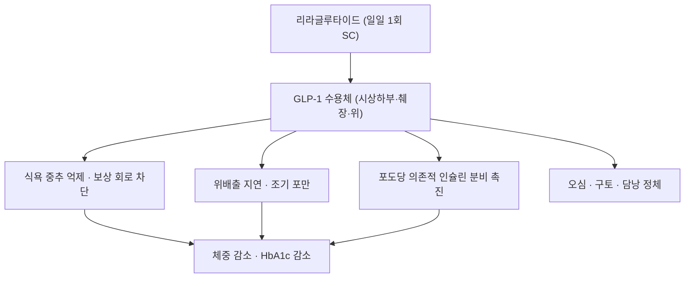

# 리라글루타이드 (Liraglutide, 삭센다 / 빅토자, A10BJ02)

> **핵심 3줄 요약 (Key Summary)**:
> 🧪 주성분·제형: 사람 [[GLP-1]] 서열에 팔미트산(C16) 지방산 사슬을 붙여 알부민 결합을 늘린 일일 1회 피하주사 펩타이드. 분자량 3,751, 97%가 혈청 알부민과 결합한다
> 📍 작용 기전: 시상하부 GLP-1 수용체 자극으로 식욕·보상 회로를 억제하고 위배출을 지연시킨다. 포도당 의존적 인슐린 분비 촉진
> 🎯 적응증: 제2형 당뇨병(빅토자 0.6~1.8 mg), 비만 치료(삭센다 3.0 mg) — 국내에서 비만 적응은 삭센다로 허가됐다
> ⚠️ 주의사항: 오심·구토 등 위장관 부작용, 급격한 감량에 따른 [[제지방량]]·근육 손실. 단백질 섭취와 [[저항운동]] 병행이 필수다

## 1. 약물 기본 정보 및 시판 제품 (Brand Identification)

![[리라글루타이드_01_삭센다펜_실사.jpg|320]]
> [그림 1: 삭센다(리라글루타이드 3 mg) 프리필드 펜 실물 — 일일 1회 피하주사용. 출처: Wikimedia Commons File:Saxenda Injection (Liraglutide) on arm.jpg, CC BY 3.0]

![[리라글루타이드_02_용량다이얼_실사.jpg|300]]
> [그림 2: 펜 후단의 용량 다이얼 — 회전시켜 0.6/1.2/1.8/2.4/3.0 mg을 맞춘다. 출처: Wikimedia Commons File:Saxenda Injection (Liraglutide) set in 24mg on hand.jpg, CC BY 3.0]

![[리라글루타이드_03_구조식.png|320]]
> [그림 3: 리라글루타이드 2D 화학 구조식(C172H265N43O51, 3,751 Da) — GLP-1 골격에 C16 지방이산 사슬이 결합된 구조. 정본: PubChem CID 16134956]

| 항목 | 상세 정보 |
| :--- | :--- |
| **일반명** | 리라글루타이드 / Liraglutide |
| **대표 상품명** | 삭센다(Saxenda, 비만), 빅토자(Victoza, 제2형 당뇨병) |
| **ATC 코드 / 분류** | A10BJ02 (Glucagon-like peptide-1 analogues) |
| **PubChem CID** | [16134956](https://pubchem.ncbi.nlm.nih.gov/compound/16134956) |
| **화학식 / 분자량** | C172H265N43O51 / 3,751 g/mol |
| **주요 제형** | 프리필드 펜 6 mg/mL(3 mL) — 삭센다, 빅토자 |
| **허가 적응증** | 제2형 당뇨병의 혈당 조절(빅토자), 비만·과체중 성인의 체중 관리(삭센다) |

### 1.1 제품·용량 매핑

| 제품 | 1일 용량 | 증량 방식 |
| :--- | :--- | :--- |
| 빅토자 | 0.6 → 1.2 → 1.8 mg | 1주 이상 간격으로 증량 |
| 삭센다 | 0.6 → 1.2 → 1.8 → 2.4 → 3.0 mg | 주 1회씩 0.6 mg 단계 증량, 3.0 mg 유지 |

## 2. 분자 약리 기전 (Mechanism of Action)

- **구조적 특징**: 천연 GLP-1의 34번 위치를 아르기닌으로 치환하고 26번 라이신에 C16 지방이산을 아미드 결합해 DPP-4 분해를 피하고 알부민 결합을 늘렸다. 그 결과 반감기가 수 분에서 13시간 안팎으로 늘어 일일 1회 투여가 가능해졌다.
- **중추 작용**: 궁상핵의 POMC/CART 뉴런을 활성화하고 NPY/AgRP 뉴런을 억제한다. 중변연계 보상 회로에도 작용해 고열량 음식 갈망을 줄인다.
- **말초 작용**: 위 배출 지연, 췌장 β세포 인슐린 분비 촉진, α세포 글루카곤 억제. 혈당이 낮을 때는 인슐린 분비가 늘지 않아 단독요법에서 저혈당이 드물다.

## 3. 약동학 (Pharmacokinetics)

| 파라미터 | 값 | 임상 의미 |
| :--- | :--- | :--- |
| 생체이용률 | 약 55% (피하) | 주사 부위 흡수 |
| Tmax | 8~12시간 | 야간 주사 시 다음날 식욕 억제 |
| 단백결합률 | 약 97% (알부민) | 저알부민혈증에서 유리형 증가 가능 |
| 대사 | 내인성 단백질과 동일 경로(광범위 단백분해) | 특정 CYP 의존 아님 |
| 반감기 | 약 13시간 | 일일 1회 투여 |
| 배설 | 대사산물 형태로 소변·대변 | 신기능 저하 시 용량 조절 불필요 |

## 4. 용법·용량 (Dosage)

| 적응증 | 시작 | 증량 | 유지 |
| :--- | :--- | :--- | :--- |
| 제2형 당뇨병 | 0.6 mg 1일 1회 | 1주 이상 간격 | 1.2 mg(최대 1.8 mg) |
| 비만 | 0.6 mg 1일 1회 | 주 1회 0.6 mg씩 | 3.0 mg (2.4 mg에서 4주 반응 없으면 중단 검토) |

- 주사 부위는 복부·대퇴·상완. 인슐린과 병용 시 같은 주사기를 재사용하지 않는다.
- 12주에 체중 5% 감소가 없으면 삭센다 유지 여부를 재평가한다(허가사항 기준).

## 5. 부작용·상호작용

- **위장관**: 오심·구토·설사·변비가 가장 흔하다. 대개 시작 2~4주에 심하고 증량기에 재발한다 — 증량을 늦추고 소량·분복으로 조정한다.
- **담낭·췌장**: 담석·담낭염, 급성 췌장염 보고. 지속되는 상복부 통증·구토는 중단 후 감별한다.
- **저혈당**: 인슐린·설포닐우레아 병용 시 위험. 병용약 감량을 검토한다.
- **근손실**: 급격한 감량에서 [[제지방량]] 손실이 두드러진다. 2026년 체계적 고찰(PMID 41996180)에서 약물·비약물 감량 모두 총감량의 25%를 넘는 근육 손실이 흔했다 — 단백질 1.2~1.5 g/kg/일과 주 2~3회 [[저항운동]]을 처방 세트로 묶는다.
- **금기**: 갑상선 수질암·MEN2 병력, 과민반응, 임신·수유. 중증 위마비·염증성 장질환 급성기에는 신중히 판단한다.
- **수술 전**: 마취·수술 전 흡인 위험 때문에 중단 시점을 마취과와 상의한다(개별 판단).

## 6. 한의 치료 연계·감량 프로토콜

- 위장관 부작용기에는 한약을 소량·분복·식후로 조정하고, 향사육군자탕·육군자탕 계열의 건비화위 처방을 짧게 쓰는 방식이 현실적이다. 단 약물 상호작용 데이터는 없으므로 1~2시간 시간차를 두고 복용하도록 지도한다.
- 침·약침은 오심(P6 내관)·복부 팽만(중완 CV12·천추 ST25) 증상 조절 목적으로 병행할 수 있다.
- 감량 속도는 월 2 kg 이내를 목표로 하고, 악력·보행속도 저하를 감량 조정 신호로 삼는다.

## 7. 진료실 핵심 필기

- 문진 3종: ① 시작 전 체중·허리둘레·[[악력]] 기저값 ② 갑상선·췌장·담낭 병력 ③ 복용 중인 당뇨약(저혈당 위험).
- 환자 티칭: "이 주사는 지방만 줄이지 않습니다. 빠지는 속도가 빠를수록 근육도 같이 빠지므로, 단백질과 근력 운동을 함께 하셔야 요요와 낙상을 막을 수 있습니다."
- 추적: 3개월마다 [[생체전기저항분석]] 또는 [[이중에너지 X선 흡수계측]]으로 [[제지방량]]·[[사지골격근량지수(ASMI)|ASMI]] 확인.

## 8. 출처 및 학술 참고 문헌 (References)

1. 2026-10-24 심층리뷰 3번 — Ann Intern Med 2026;179(7):996-1013, [PMID 41996180](https://pubmed.ncbi.nlm.nih.gov/41996180/).
   - [연구 요약] 인크레틴 계열(리라글루타이드 포함) RCT 35편에서 제지방량 손실이 총감량의 중앙값 28.3%였고 65%가 25% 벤치마크를 넘었다.
2. 식품의약품안전처 의약품안전나라 (https://nedrug.mfds.go.kr) — 삭센다·빅토자 허가사항·용법용량.
   - [연구 요약] 국내 허가 적응증·용량·금기 확인용 1차 자료.
3. PubChem CID [16134956](https://pubchem.ncbi.nlm.nih.gov/compound/16134956) — 화학식·분자량·구조식 정본.

## 함께 보기

- [[GLP-1]] · [[인크레틴]] · [[세마글루타이드]] · [[티르제파타이드]] · [[둘라글루타이드]] · [[GIP]]
- [[근감소성 비만]] · [[근감소증]] · [[제지방량]] · [[저항운동]] · [[비만]]
- [[2026-10-24_대사노인질환_심층리뷰]] 3번 · [[2026-10-24_대사노인질환_개념학습]]
