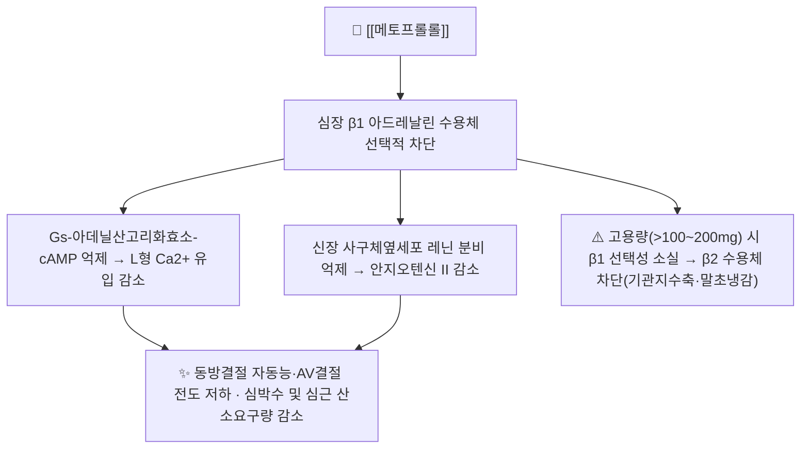

# 💊 [[메토프롤롤]] (Metoprolol, 베타록/Betaloc, ATC C07AB02)

> **핵심 3줄 요약 (Key Summary)**:
> - 🧪 주성분·제형: $\beta_1$ 아드레날린 수용체 선택적 2세대 [[베타차단제]]로 속방성 타르타르산염(Tartrate)과 서방성 숙신산염(Succinate CR/XL; [[베타록]]XL 등) 제형으로 시판되며 제형 간 적응증 차이가 뚜렷하다.
> - 📍 작용 기전: 심장의 $\beta_1$ 수용체를 선택적으로 차단해 심박수·심근 수축력·방실결절 전도 속도를 낮추고 사구체옆세포의 레닌 분비를 억제해 심근 산소 요구량과 혈압을 감소시킨다.
> - 🎯 임상 적응증: [[고혈압]], 협심증, 급성 심근경색 후 이차 예방, [[심방 세동 및 심방 조동]]·빈맥성 부정맥 심박수 조절, 박출률 저하 [[심부전]](HFrEF — **숙신산염 서방정 CR/XL**이 MERIT-HF 근거 보유), 폐쇄성 비후성 심근병증.
> - ⚠️ 주의사항: CYP2D6 주 대사 약물로 CYP2D6 저해제·유전자형에 따라 혈중 농도가 급변할 수 있고, 서맥·2~3도 방실차단·비대상성 심부전에는 금기이며, 급작스런 중단 시 반동성 빈맥·협심증 악화 위험이 있어 반드시 점진 감량해야 한다.

---

## 1. 약물 기본 정보 및 시판 제품 (Brand Identification)
> [!abstract]+ 🧪 3D 약리 분자 구조 (Interactive 3D Viewer)
> <iframe src="https://molecule-viewer-rho.vercel.app/?cid=4171" width="100%" height="450px" frameborder="0" allow="webgl" style="border-radius: 8px;"></iframe>

| 항목 | 상세 정보 |
| :--- | :--- |
| **일반명 (Generic Name)** | [[메토프롤롤]] (타르타르산염 / 숙신산염) / Metoprolol (Tartrate / Succinate) |
| **대표 상품명 (Brand Names)** | **베타록(Betaloc / Betaloc XL)**, 셀로켄(Seloken), Lopressor(속방), Toprol-XL(서방) |
| **ATC 코드 / 분류** | **C07AB02** — Beta blocking agents, selective, Metoprolol |
| **PubChem CID** | [4171](https://pubchem.ncbi.nlm.nih.gov/compound/4171) |
| **화학식 / 분자량** | $\text{C}_{15}\text{H}_{25}\text{NO}_3$ (유리염기 기준) / 267.36 g/mol |
| **주요 제형 및 함량** | 타르타르산염 속방정 50·100mg / 숙신산염 서방정(CR/XL) 25·50·100·200mg (국내 [[베타록]]XL 23.75/47.5/95mg 등), 주사제 |
| **식약처 허가 적응증** | [[고혈압]], 협심증, 심근경색 후 생존자의 장기 유지요법, 안정형 만성 [[심부전]](숙신산염 서방정), 빈맥성 [[부정맥]]·편두통 예방(제형별 허가 상이) |

### 1.1 대표 시판 제품 및 함유 복합제 매핑 (Brand Identification & Combinations)

| 구분 | 대표 제품명 / 브랜드 | 함유 성분 및 1회당 함량 | 제형 및 특징 | 주요 적응증 및 복약 지도 핵심 |
| :--- | :--- | :--- | :--- | :--- |
| **서방형 단일제 (ETC)** | [[베타록]]XL, Toprol-XL | 메토프롤롤숙신산염 서방정 (23.75/47.5/95mg 등) | 1일 1회 지효성 서방정 | **HFrEF 사망률 감소 입증(MERIT-HF)**, 분쇄·씹기 금지(일부 분할선 반할은 가능하나 제품별 확인) |
| **속방형 단일제 (ETC)** | [[셀로켄]], Lopressor | 메토프롤롤타르타르산염 50/100mg | 1일 2회 속방정 | 고혈압·협심증·급성기 빈맥 조절, 심부전 장기 생존 개선 근거는 숙신산염 CR/XL과 구분 |
| **감별 동일 계열 약물** | 콩코르, 딜라트렌, 인데놀 | [[비소프롤롤]], [[카르베딜롤]], [[프로프라놀롤]] | β1 선택형 vs α1·β 비선택형 | 메토프롤롤은 간 **CYP2D6** 대사 비중이 높아 신배설 위주 [[아테놀롤]]과 대사 경로가 다름 |

---

## 2. 분자 약리 기전 및 작용 경로 (Mechanism of Action)

* **주요 작용 기전 (Primary MoA)**:
  * 메토프롤롤은 심근과 신장 사구체옆세포의 $\beta_1$ 아드레날린 수용체를 경쟁적으로 차단하는 2세대 심장선택성 [[베타차단제]]입니다. [[카르베딜롤]]과 같은 $\alpha_1$ 혈관확장 작용이나 내인성 교감신경자극활성(ISA)은 없으며, 지질친화성(Lipophilic)이 중등도여서 [[아테놀롤]]보다는 중추신경계 이행(피로·악몽·우울감)이 약간 더 높고 [[프로프라놀롤]]보다는 낮습니다.
* **하류 신호전달 및 심부전·비후성 심근병증 기전**:
  * 교감신경 과흥분 상태에서 $\beta_1$ 차단은 만성 카테콜아민 독성과 심근 리모델링을 완화합니다. 특히 숙신산염 서방정(CR/XL)은 MERIT-HF 무작위 대조시험에서 만성 심부전(NYHA II~IV, LVEF ≤40%) 환자의 **전체 사망률을 34% 감소**시켰으며([PubMed 10376614](https://pubmed.ncbi.nlm.nih.gov/10376614/)), 폐쇄성 비후성 심근병증(HCM)에서도 좌심실 유출로 폐색과 증상을 유의하게 개선했습니다([PubMed 34915981](https://pubmed.ncbi.nlm.nih.gov/34915981/)).

---

## 3. 약동학적 특성 (Pharmacokinetics: ADME)

| 약동학 파라미터 | 수치 및 임상적 의미 |
| :--- | :--- |
| **생체이용률 (Bioavailability, F)** | 경구 약 **40~50%** (속방형 기준; 광범위한 간 초회통과효과 존재, 서방형은 약 77% 상대 이용률) |
| **최고혈중농도 도달시간 (Tmax)** | 속방형 타르타르산염 1.5~2시간 / 숙신산염 서방형 약 6~7시간 (24시간 평탄 농도 유지) |
| **혈장 단백결합률 (Protein Binding)** | 약 10~12% (매우 낮음) |
| **간 대사 효소 (Metabolism)** | **간 CYP2D6가 약 70~80% 담당** (유전적 저대사군 Poor metabolizer에서는 혈중 농도 수배 상승) |
| **배설 반감기 (Elimination t1/2)** | 약 **3~7시간** (CYP2D6 저대사군에서는 7~9시간까지 연장; 따라서 속방형은 1일 2회 필요) |
| **주요 배설 경로 (Excretion)** | 간 대사 후 **대부분 비활성 대사체(>90%)로 소변 배설**, 미변화체 신배설 <5% (신장애 시 용량 조절 거의 불필요, 간장애 시 주의) |

---

## 4. 용법·용량 및 처방 가이드 (Dosage & Administration)

| 임상 적응증 | 성인 표준 용법·용량 | 1일 최대 한도 용량 |
| :--- | :--- | :--- |
| [[고혈압]] · 협심증 | 속방형 1일 50~100mg (1~2회 분복) 또는 숙신산염 서방정 47.5~95mg 1일 1회 | 200~400mg/day (제형·환자별) |
| **안정형 만성 [[심부전]](HFrEF)** | **숙신산염 서방정** 12.5~25mg(국내 11.875~23.75mg 상당) 1일 1회로 시작, 2주 간격 점진 증량("Start low, go slow") | 목표 200mg(국내 190mg)/day([PubMed 10376614](https://pubmed.ncbi.nlm.nih.gov/10376614/)) |
| [[심방 세동 및 심방 조동]] 심박수 조절 | 서방정 25~100mg 1일 1회 또는 속방정 25~50mg 1일 2회 적정 | 200mg/day 내외 |
| **신기능/간기능 저하 환자** | 신장애 시 감량 불필요; **중증 간부전**에서는 초회 감량 및 서맥 모니터링 | 임상 반응 따라 감량 |

---

## 5. 부작용, 경고 및 약물 상호작용 (Adverse Effects & Interactions)

### 5.1 주요 부작용 및 독성 경고 (Black Box Warnings)
* **서맥·전도장애·저혈압 및 반동성 금단 경고(Black Box)**: 동성 서맥, 2~3도 방실차단, 심인성 쇼크, 급성 비대상성 [[심부전]]에는 금기입니다. 특히 관상동맥질환 환자에서 **메토프롤롤을 갑자기 중단하면 반동성 빈맥·협심증 악화·심근경색 위험**이 있으므로 1~2주에 걸쳐 서서히 감량해야 합니다.
* **말초 순환장애 및 중추신경계**: 사지 냉감·피로·어지럼·수면장애·발기부전이 나타날 수 있으며, 고용량에서는 $\beta_1$ 선택성이 약해져 천식·COPD 환자의 기관지 경련을 유발할 수 있습니다. 당뇨병 환자에서는 **저혈당의 자율신경 경고 증상(빈맥·심계항진)을 가려** 발한만 남는 저혈당 인지 장애를 일으킬 수 있습니다.

### 5.2 주요 병용 금기 및 상호작용
* 비디히드로피리딘계 칼슘차단제([[베라파밀]], [[딜티아젬]])·[[디곡신]]·[[아미오다론]]: 방실결절 전도 억제와 심근 수축력 저하가 상가되어 심각한 서맥·고도 방실차단·심부전 악화가 발생할 수 있습니다(특히 정맥 병용 금기).
* **CYP2D6 강력 억제제(플루옥세틴·파록세틴·부프로피온·퀴니딘·테르비나핀)**: 메토프롤롤의 간 대사를 강하게 억제해 **혈중 농도가 2~5배 급등**하며 심각한 서맥과 저혈압을 유발할 수 있습니다.
* **클로니딘 병용 중단 주의**: 클로니딘과 메토프롤롤 병용 상태에서 클로니딘만 먼저 중단하면 $\alpha$ 수용체 매개 반동성 고혈압 위기가 발생할 수 있습니다(베타차단제를 먼저 감량 중단).

---

## 6. 한의 치료 연계 및 병용/테이퍼링 프로토콜 (Integrative Medicine)

### 6.1 한약·양약 병용 투여 안전성 및 시너지 배오
* **절대 주의 한약재 (교감신경 항진 / 서맥·저칼륨 간섭)**:
  * [[마황]](에페드린): 마황의 교감신경 항진 작용은 $\beta$ 수용체 차단 효과를 상쇄하거나, 오히려 $\beta$ 차단 상태에서 비대항 $\alpha$-아드레날린 혈관수축을 일으켜 혈압 급등·부정맥 위험을 높일 수 있으므로 감기약·비만 처방에서 **마황 배제를 원칙**으로 합니다.
  * [[부자]](아코니틴계)·[[감초]] 과량: 부자의 강심·부정맥 유발 위험 및 감초 장기 고함량으로 인한 체액 저류·저칼륨혈증은 심부전·부정맥 환자의 예후를 해칠 수 있으므로 신중을 기합니다.
* **수족냉증·말초 순환 저하 완충 및 시간차 투여**:
  * 베타차단제 복용 후 손발 시림·피로를 호소하는 환자에게는 [[당귀사역탕]], [[온경탕]] 계열이나 온열 뜸 치료로 말초 미세순환을 보조하되, 저혈압이나 약물 흡수 간섭을 막기 위해 양약과 한약을 **1~2시간 간격**으로 분리 복용하고 내원 시 혈압·맥박(50회/분 미만 서맥 여부)을 매번 확인합니다.

### 6.2 양약 감량 및 한의 전환(테이퍼링) 가이드
* **임의 중단 절대 금지**: 심부전(MERIT-HF 적응증)·협심증·심방세동 환자에게 복용 중인 메토프롤롤을 **한의원 판단만으로 중단하거나 감량 지시하는 것은 금기**입니다. 모든 용량 조정은 순환기내과 주치의 처방 변경에 맞추어 1~2주 단위로 단계적 진행 여부를 협의하며, 한의 치료는 자율신경 안정(침구·이완)·말초 냉증 보완·동반 근골격 통증 조절 보조에 집중합니다.

---

## 7. 💡 사용자 진료실 핵심 필기 & 실전 임상 체크리스트

> [!tip] **베타차단제(메토프롤롤 vs 비소프롤롤 vs 카르베딜롤) 실전 감별 (볼트 강의록 연동)**
> - **제형 구분이 핵심**: 심부전 사망률 감소 근거(MERIT-HF, [PubMed 10376614](https://pubmed.ncbi.nlm.nih.gov/10376614/))는 속방형 타르타르산염이 아니라 **서방형 숙신산염(베타록 XL 등)** 에 기반한다.
> - **CYP2D6 대사 함정**: 환자가 최근 SSRI 항우울제(플루옥세틴·파록세틴)를 추가한 뒤 심한 어지럼·서맥(맥박 <50)을 호소하면 메토프롤롤 혈중 농도 급등을 의심해 내과 재평가를 권한다(반면 [[비소프롤롤]]은 CYP2D6 의존도가 낮음).

### 7.1 진료실 3대 핵심 문진 체크리스트
1. **제형·용법 및 항우울제 병용 확인**: 서방정(XL, 1일 1회)인지 속방정(1일 2회)인지 구분하고, CYP2D6 저해 약물 병용 여부를 점검.
2. **서맥·저혈압·수족냉증 평가**: 내원 시 요골맥박 수(50~55회/분 미만 여부), 기립성 어지럼, 기관지 천명음 악화 여부 확인.
3. **고위험 한약재 스크리닝**: 비만·비염·감기 처방 구성 시 [[마황]], [[세신]], [[부자]] 포함 여부를 사전 차단.

### 7.2 환자 티칭 스크립트
> *"메토프롤롤은 심장 박동과 혈압을 안정시켜 심장을 보호하는 중요한 약이므로 절대 갑자기 끊으시면 안 됩니다. 약을 드시면서 손발이 차거나 유난히 어지럽고 맥박이 느려지시면 주치의와 상의가 필요하며, 한의원에서는 심장에 무리가 가는 마황 성분을 빼고 말초 순환과 피로를 돕는 안전한 침·한약 치료를 병행해 드리겠습니다."*

---

## 8. 출처 및 학술 참고 문헌 (References)

1. MERIT-HF Study Group (1999). Effect of metoprolol CR/XL in chronic heart failure: Metoprolol CR/XL Randomised Intervention Trial in Congestive Heart Failure (MERIT-HF). *Lancet*, 353(9169):2001-2007. [PMID: 10376614](https://pubmed.ncbi.nlm.nih.gov/10376614/)
   - **[연구 요약]**: 만성 심부전 환자 3,991명을 대상으로 메토프롤롤 숙신산염 서방정(CR/XL) 투여 시 위약 대비 전체 사망률 및 급사율이 유의하게 감소함을 입증한 대규모 랜드마크 RCT.
2. Dybro AM, Rasmussen TB, Nielsen RR et al. (2021). Randomized Trial of Metoprolol in Patients With Obstructive Hypertrophic Cardiomyopathy. *Journal of the American College of Cardiology*, 78(25):2505-2517. [PMID: 34915981](https://pubmed.ncbi.nlm.nih.gov/34915981/)
   - **[연구 요약]**: 폐쇄성 비후성 심근병증 환자에서 메토프롤롤 투여 시 위약 대비 좌심실 유출로 압력차 감소, 증상 완화 및 삶의 질 개선을 확인한 무작위 교차 대조시험.
3. Chatzidou S, Kontogiannis C, Tsilimigras DI et al. (2018). Propranolol Versus Metoprolol for Treatment of Electrical Storm in Patients With Implantable Cardioverter-Defibrillator. *Journal of the American College of Cardiology*, 71(17):1897-1906. [PMID: 29699616](https://pubmed.ncbi.nlm.nih.gov/29699616/)
   - **[연구 요약]**: 삽입형 제세동기(ICD) 환자에서의 전기적 폭풍(심실성 부정맥 연쇄 발생) 조절에서 비선택성 프로프라놀롤과 $\beta_1$ 선택성 메토프롤롤의 효능 차이를 비교한 RCT.
4. Brunton LL, Hilal-Dandan R, Knollmann BC, eds. *Goodman & Gilman's The Pharmacological Basis of Therapeutics*. 13th ed. McGraw-Hill; 2018.
   - **[임상 교과서]**: $\beta_1$ 선택성 베타차단제의 약동학(CYP2D6 대사), 제형 차이 및 심혈관 약리 기전 총람.
5. 식품의약품안전처 의약품안전나라 의약품통합정보시스템 ([nedrug.mfds.go.kr](https://nedrug.mfds.go.kr)).
   - **[허가 정보]**: 메토프롤롤타르타르산염(셀로켄 등) 및 메토프롤롤숙신산염(베타록XL 등) 국내 허가 효능·용법 및 사용상 주의사항 정본.
