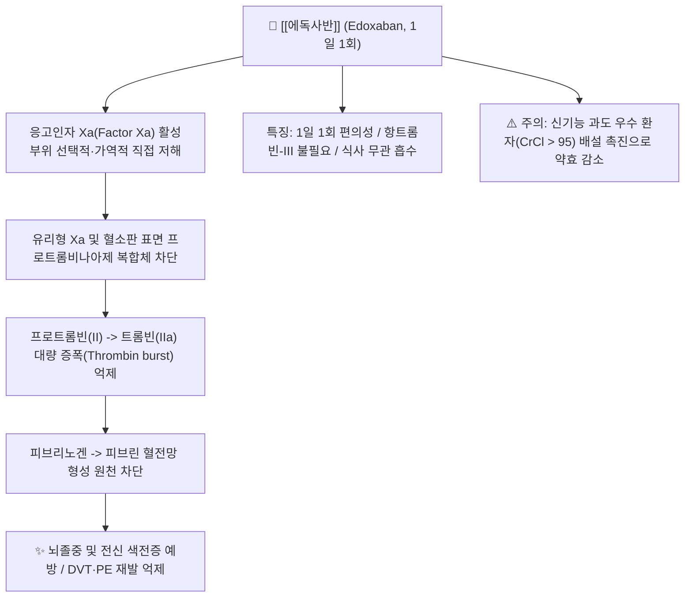

# 💊 [[에독사반]] (Edoxaban, Lixiana · 리자이나, ATC B01AF03)

> **핵심 3줄 요약 (Key Summary)**:
> 🧪 주성분·제형: [[에독사반]]은 경구용 직접 작용 Factor Xa 저해제([[DOAC]])로, 에독사반 토실산염 수화물 형태로 제조된 1일 1회 복용 정제([[리자이나정]] 15 mg, 30 mg, 60 mg) 전문의약품이다.
> 📍 작용 기전: 항트롬빈 III 비의존적으로 혈액 응고 캐스케이드의 공통 경로 중심 효소인 응고인자 Xa의 활성 부위에 나노몰 단위($K_i = 0.561\text{ nM}$)로 가역적·직접 결합하여 프로트롬빈이 트롬빈으로 전환되는 것을 차단하고 피브린 혈전 형성을 억제한다.
> 🎯 임상 및 한의 연계: 비판막성 심방세동의 뇌졸중 예방 및 심부정맥혈전증·폐색전증 치료에 쓰인다. 신기능 저하, 저체중, 특정 약물 병용 시 30 mg으로 감량하며, 신기능이 지나치게 정상 이상인 경우 약효 감소에 주의한다. 한의학적으로는 뇌졸중 후유증 처방인 [[반하백출천마탕]] 및 [[황련해독탕]]과의 병용 시 에독사반의 체내 흡수 및 응고 지표에 유의한 상호작용이 없음이 임상시험으로 검증되었으나, 강력한 항응고 효과로 인해 **심부자침, 도침, 습식부항(사혈)은 절대 금기**이다.

![[에독사반_화학구조식.png]]
> [그림 1] PubChem 에독사반(Edoxaban) 2D 화학 분자 구조식 (CID: 10280735)

![[에독사반_03_2D구조식.png|300]]
> [그림 1] [[에독사반]]의 2D 평면 화학 분자 구조식 (PubChem CID 10280735)
> [그림 2] 에독사반 고해상도 화학 구조 및 제제 프로파일

![[DOAC_제Xa인자_억제제_구조비교.svg]]
> [그림 3] 경구용 직접 Xa 저해제(에독사반, 리바록사반, 아픽사반)의 화학적 모핵 구조 비교

---

## 1. 약물 기본 정보 및 시판 제품 (Brand Identification)

> [!abstract]+ 🧪 3D 약리 분자 구조 (Interactive 3D Viewer)
> <iframe src="https://molecule-viewer-rho.vercel.app/?cid=10280735" style="width: 100%; height: 500px; border: none; border-radius: 12px; box-shadow: 0 4px 20px rgba(0,0,0,0.15);" allowfullscreen></iframe>

| 항목 | 상세 정보 |
| :--- | :--- |
| **일반명 (Generic Name)** | [[에독사반]](한글) / Edoxaban (English Generic Name) |
| **대표 상품명 (Brand Names)** | **리자이나정(Lixiana)** 15mg, 30mg, 60mg (다이이찌산쿄 / 대웅제약) |
| **ATC 코드 / 분류** | **B01AF03** — Direct factor Xa inhibitors / [03330] 혈액응고저지제 (전문의약품) |
| **PubChem CID** | [10280735](https://pubchem.ncbi.nlm.nih.gov/compound/10280735) |
| **화학식 / 분자량** | $C_{24}H_{30}ClN_7O_4S$ / **548.06 g/mol** (토실산염 수화물: 738.27 g/mol) |
| **주요 제형 및 함량** | 경구용 필름코팅정 **15 mg**, **30 mg**, **60 mg** (1일 1회 복용) |
| **식약처 허가 적응증** | 1. 비판막성 심방세동 환자에서 뇌졸중 및 전신 색전증의 위험 감소 2. 심부정맥혈전증(DVT) 및 폐색전증(PE)의 치료 및 재발 위험 감소 (초기 비경구 항응고제 5일 이상 투여 후 전환) |

### 1.1 대표 시판 제품 및 함유 복합제 매핑 (Brand Identification & Combinations)

| 구분 | 대표 제품명 / 브랜드 | 함유 성분 및 1회당 함량 | 제형 및 특징 | 주요 적응증 및 복약 지도 핵심 |
| :--- | :--- | :--- | :--- | :--- |
| **단일제 (오리지널)** | [[리자이나정]] 15mg / 30mg / 60mg | [[에독사반]]토실산염 15 mg, 30 mg, 60 mg | 경구 정제, 1일 1회 복용 | 음식물과 무관하게 복용 가능, 50% 감량 기준 준수 |
| **감별 1일 1회 DOAC** | [[리바록사반]](자렐토) | Rivaroxaban 10/15/20 mg | 경구 정제 | 신배설 33%, 15/20mg은 반드시 식사와 함께 복용 필요 |
| **감별 1일 2회 DOAC** | [[아픽사반]](엘리퀴스) | Apixaban 2.5/5 mg | 경구 정제 (1일 2회) | 신배설 27% 최저, 1일 2회 vs 에독사반 1일 1회 복약 순응도 비교 |
| **감별 트롬빈 억제제** | [[다비가트란]](프라닥사) | Dabigatran 110/150 mg | 경구 캡슐 (1일 2회) | 신배설 80% 최고, 캡슐 개봉 금지, 제산제 상호작용 감별 |

---

## 2. 분자 약리 기전 및 작용 경로 (Mechanism of Action)

* **주요 작용 기전 (Primary MoA)**:
  * **Factor Xa의 직접·선택적 억제**: 내인성 및 외인성 응고 경로의 최종 공통 분모인 응고인자 Xa에 고도로 특이적으로 결합한다($K_i = 0.561\text{ nM}$). 1분자의 Xa가 약 1,000분자의 트롬빈을 폭발적으로 증폭시키는 현상을 원천적으로 차단한다.
  * **프로트롬비나아제 복합체 차단**: 혈액 내 순환하는 유리형 Xa뿐만 아니라, 활성화된 혈소판 세포막에 칼슘 및 인지질과 함께 형성된 프로트롬비나아제(Prothrombinase) 복합체 내의 Xa까지 강력하게 억제한다.
  * **신속한 효과 발현**: 와파린처럼 비타민 K 의존성 응고인자 생성을 억제하기까지 수일이 걸리는 것과 달리, 복용 후 1~2시간 이내에 최대 항응고 효과가 신속하게 발현된다.
* **임상적 이점 (ENGAGE AF-TIMI 48)**:
  * 와파린 대비 비열등한 뇌졸중 예방 효과를 나타내면서, 주요 출혈(Major bleeding) 위험을 20% 유의하게 낮추고 두개내출혈(ICH)을 53% 감소시켰다(PMID: 24251359).

---

## 3. 약동학적 특성 (Pharmacokinetics: ADME)

| 약동학 파라미터 | 수치 및 임상적 의미 |
| :--- | :--- |
| **생체이용률 (Bioavailability, F)** | **약 62%** (소장에서 양호하게 흡수). 음식물 섭취 여부에 영향을 받지 않아 식전·식후 복용 무관. |
| **최고혈중농도 도달시간 (Tmax)** | 경구 투여 후 **약 1~2시간** 이내에 최고 혈중 농도에 도달하여 신속한 항응고 효과 발현. |
| **혈장 단백결합률 (Protein Binding)** | **약 55%** (타 DOAC 대비 낮아 단백 결합 치환 상호작용 위험이 적음). |
| **간 대사 효소 (Metabolism)** | 간 대사 비율은 10% 미만으로 미미함. 주로 카르복실에스테라제-1(CES1), CYP3A4, 글루쿠론산 포합에 의해 소량 대사됨. P-당단백질(P-gp)의 기질. |
| **배설 반감기 (Elimination t1/2)** | **약 10~14시간** (1일 1회 복용으로 24시간 동안 충분한 항응고 활성 유지). |
| **주요 배설 경로 (Excretion)** | **신장(소변)으로 약 50%**, **담즙 및 분변으로 약 50%** 배설. 4대 DOAC 중 신장 배설 의존도가 중등도 수준. |

---

## 4. 용법·용량 및 처방 가이드 (Dosage & Administration)

| 임상 적응증 | 성인 표준 용법·용량 | 1일 최대 한도 용량 |
| :--- | :--- | :--- |
| **비판막성 심방세동(NVAF) 뇌졸중 예방** | 보통 성인 1일 1회 **60 mg** 경구 투여 (식사와 무관) | 60 mg/day (1일 1회) |
| **3대 50% 감량 기준 (1개 이상 해당 시)** | 아래 3가지 요인 중 **1개 이상** 해당 시 1일 1회 **30 mg**으로 감량: 1. **신기능 저하**: 크레아티닌 청소율(CrCl) **15 ~ 50 mL/min** 2. **저체중**: 체중 **60 kg 이하** 3. **강력한 P-gp 억제제 병용**: 사이클로스포린, 드로네다론, 에리스로마이신, 케토코나졸 병용 시 | 30 mg/day (1일 1회) |
| **DVT 및 PE의 치료 및 재발 위험 감소** | 초기 최소 5일간 비경구 항응고제(헤파린 등) 투여 후 전환하여 1일 1회 **60 mg** 투여 (감량군 30 mg) | 60 mg/day |
| **초고령자 / 초저용량 (해외 일부 허가)** | 80세 이상 고령자 중 출혈 고위험군에서 15 mg 1일 1회 고려 가능 | 개별 판단 |

* **CrCl > 95 mL/min 상한선 패러독스 (Renal Clearance Paradox)**:
  * 신장 청소율이 지나치게 정상 이상으로 우수한 환자(CrCl > 95 mL/min)의 경우, 에독사반이 너무 빠르게 배설되어 최저 혈중 농도가 떨어짐으로써 와파린 대비 허혈성 뇌졸중 예방 효과가 감소할 수 있다. 이 경우 아픽사반 등 신배설률이 낮은 타 약제로의 대체를 고려한다(PMID: 24251359).

---

## 5. 부작용, 경고 및 약물 상호작용 (Adverse Effects & Interactions)

### 5.1 출혈 합병증 및 블랙박스 경고 (Black Box Warnings)
* **임의 중단 시 혈전색전증 급증 (Black Box Warning)**:
  * 항응고제를 임의로 중단하면 반동적으로 뇌졸중 및 혈전 위험이 급격히 증가하므로 반드시 의사와 상의해야 한다.
* **척수/경막외 혈종 위험 (Black Box Warning)**:
  * 척추 마취, 요추 천자 등 침습적 척추 시술 시 경막외 혈종으로 인한 영구적 하지 마비 위험이 있으므로 시술 전 최소 24~48시간 이상 중단해야 한다.
* **출혈 관련 부작용 (Bleeding)**:
  * 위장관 출혈(토혈, 흑변), 비출혈(코피), 잇몸 출혈, 혈뇨, 피하 반상출혈(멍), 빈혈.
  * 중증 출혈 시 특이적 역전제인 안덱사넷 알파(Andexanet alfa) 또는 프로트롬빈 복합체 농축액(PCC) 투여.

### 5.2 금기 및 약물 상호작용
* **투여 금기 (Contraindications)**:
  * 활동성 병적 출혈 환자.
  * 기계 인공판막 치환 환자 및 중등도~중증 승모판 협착증 환자.
  * 말기 신부전 환자 (CrCl < 15 mL/min 또는 혈액투석 환자).
  * 임부 및 수유부.
* **약물 상호작용 (Drug Interactions)**:
  * **강력한 P-gp 억제제** (사이클로스포린, 드로네다론, 에리스로마이신, 케토코나졸): 에독사반 혈중 농도를 유의하게 증가시키므로 **즉시 30 mg으로 50% 감량** 투여.
  * **강력한 P-gp 유도제** (리팜핀, 카바마제핀, 세인트존스워트): 에독사반 농도를 급감시키므로 병용 회피/금기.
  * **타 항혈전제 및 소염진통제** ([[아스피린]], [[클로피도그렐]], [[NSAIDs]]): 혈소판 억제 및 위점막 손상이 겹쳐 위장관 대출혈 위험이 2~3배 급증하므로 병용 시 각별한 주의.

---

## 6. 한의 치료 연계 및 병용/테이퍼링 프로토콜 (Integrative Medicine)

### 6.1 한약·양약 병용 투여 안전성 및 임상시험 근거 (J Ethnopharmacol 2025)
* **반하백출천마탕 및 황련해독탕 병용 임상 입증 (PMID: 39461388)**:
  * 뇌졸중 후유증, 현훈, 두통 환자에게 다용되는 **[[반하백출천마탕]]**과 청열해서·혈압 조절 처방인 **[[황련해독탕]]**을 에독사반과 병용한 인체 임상 1상 교차시험 결과, 에독사반의 **총 혈중 노출(AUC) 및 혈액응고 지표(aPTT, PT)에 유의한 변동이 없음**이 과학적으로 입증되었다.
  * 한약을 복용한다고 해서 에독사반을 임의 중단할 필요가 없으며, 1~2시간 시간차를 두고 복용하면서 일상적인 출혈 경향을 문진하는 것으로 안전하게 병용할 수 있다.
* **활혈거어약(活血祛瘀藥) 사용 시 출혈 주의**:
  * [[단삼]](丹蔘), [[당귀]](當歸), [[천궁]](川芎), [[도인]](桃仁), [[홍화]](紅花), [[삼칠]](三七) 등 강력한 혈액순환 개선 및 항혈전 성분을 포함하는 본초를 고용량으로 장기 병용할 경우 출혈 경향이 상승할 수 있으므로, 처방 시 거어약의 용량을 조절하고 피하 멍, 혈뇨, 잇몸 출혈 여부를 1주 단위로 면밀히 추적한다.

### 6.2 침구 및 한방 외치 치료 절대 안전 가이드 (침습 시술 금기)
* **사혈 요법 및 습식 부항(습부) 전면 금지**:
  * 에독사반 복용 환자에게 자락관법(사혈 부항), 도침(Acutotomy), 심부 관절강 천자 등 침습적 피부 절개 및 사혈 시술은 피하 대형 혈종 및 지혈 지연을 유발하므로 절대 시행하지 않는다.
* **호침 자침 안전 수칙**:
  * 0.20~0.25 mm 이하의 가는 침을 사용하고 사지 말단 위주의 원위취혈을 시행하며, 발침 후 최소 3~5분 이상 멸균 거즈로 압박 지혈을 철저히 시행한다.

---

## 7. 💡 사용자 진료실 핵심 필기 & 실전 임상 체크리스트

### 7.1 진료실 3대 핵심 문진 체크리스트
1. **1일 1회 복약 준수 및 복용 시간 확인**: 1일 1회 정해진 시간에 거르지 않고 복용하고 있는지 확인한다 (음식물과 무관하게 복용 가능).
2. **출혈 징후(피하 멍, 잇몸 출혈, 코피, 흑변, 혈뇨) 스크리닝**: 양치질 시 잇몸 출혈이 멈추지 않거나 대변이 자장면처럼 검게 변하지 않았는지, 이유 없는 피하 멍이 크게 들지 않는지 확인한다.
3. **신장 기능 및 감량 기준 충족 여부 점검**: 최근 병원 피검사에서 신기능(CrCl), 체중(60kg 이하 여부)을 확인하여 30mg 감량 처방이 적절히 이루어지고 있는지 점검한다.

### 7.2 환자 티칭 스크립트
> *"환자분께서 복용 중이신 에독사반(리자이나)은 피떡(혈전)이 생겨 뇌혈관을 막는 것을 방지해 주는 최신 항응고제입니다. 하루에 한 번 일정한 시간에 식사와 상관없이 꼬박꼬박 챙겨 드시는 것이 뇌경색을 막는 가장 중요한 방법입니다. 피가 묽어지는 약이므로 양치질할 때 피가 나거나 멍이 쉽게 들 수 있으며, 대변 색이 검거나 소변이 붉으면 즉시 병원에 알려야 합니다. 한의원에서는 안전성이 입증된 한약([[반하백출천마탕]] 등)을 병용하여 어지럼증과 기력을 다스려 드리지만, 피를 빼는 부항이나 깊은 침 시술은 멍과 혈종을 유발할 수 있어 피해야 하므로, 침 맞으시기 전에 반드시 이 약을 드신다고 말씀해 주셔야 합니다."*

---

## 8. 출처 및 학술 참고 문헌 (References)

* Brunton LL, Hilal-Dandan R, Knollmann BC, eds. *Goodman & Gilman's The Pharmacological Basis of Therapeutics*. 13th ed. McGraw-Hill; 2018.
  * `[연구 요약]` Factor Xa 직접 억제제의 분자 작용 기전, 약동학 및 항혈전 치료 지침 총람.

* 식품의약품안전처 의약품안전나라 의약품통합정보시스템 (https://nedrug.mfds.go.kr)
  * `[연구 요약]` 에독사반토실산염 단일제(리자이나정)의 품목 허가사항, 용법용량, 감량 기준 및 안전성 공인 정보.

* Giugliano RP, et al. (2013). Edoxaban versus warfarin in patients with atrial fibrillation. *N Engl J Med*. PMID: 24251359
  * `[연구 요약]` 비판막성 심방세동 환자 21,105명을 대상으로 에독사반(60mg/30mg 1일 1회)이 와파린 대비 뇌졸중 예방 비열등성 및 주요 출혈 20% 감소, 심혈관 사망률의 유의한 감소를 입증한 대규모 랜드마크 3상 연구(ENGAGE AF-TIMI 48).

* Büller HR, et al. (2013). Edoxaban versus warfarin for the treatment of symptomatic venous thromboembolism. *N Engl J Med*. PMID: 23991658
  * `[연구 요약]` 급성 심부정맥혈전증 및 폐색전증 환자 8,292명을 대상으로 초기 헤파린 투여 후 에독사반이 와파린 대비 비열등한 재발 억제 효능과 주요 출혈의 유의한 감소를 입증한 랜드마크 연구(Hokusai-VTE).

* Cho KH, et al. (2025). Impact of Banhabaekchulcheonmatang (Banxia Baizhu Tianma Tang) and Hwangryeonhaedoktang (Huang Lian Jie Du Tang) on edoxaban: Herb-drug interaction study in healthy subjects. *J Ethnopharmacol*. PMID: 39461388
  * `[연구 요약]` 건강 성인을 대상으로 한약 처방인 반하백출천마탕 및 황련해독탕과 에독사반 병용 시 약동학(AUC) 및 혈액응고 지표(PT, aPTT)에 유의한 간섭이 없음을 규명한 최초의 인체 임상시험.