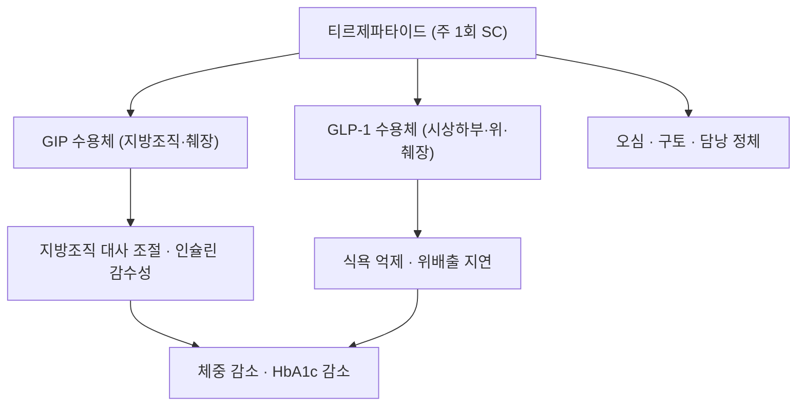

# 티르제파타이드 (Tirzepatide, 마운자로 / 젭바운드, A10BX16)

> **핵심 3줄 요약 (Key Summary)**:
> 🧪 주성분·제형: [[GIP]]과 [[GLP-1]] 수용체를 동시에 자극하는 이중작용 펩타이드. 분자량 4,813, 주 1회 피하주사
> 📍 작용 기전: GIP 수용체 작용이 지방조직 대사에 더해지고, GLP-1 작용이 식욕·위배출을 조절한다. 두 축의 상가·상승 효과로 [[세마글루타이드]] 단독보다 큰 감량이 보고됐다
> 🎯 적응증: 제2형 당뇨병(마운자로 2.5~15 mg), 비만·과체중(젭바운드)
> ⚠️ 주의사항: 위장관 부작용, 담낭·췌장 사건, 급격한 감량에 따른 [[제지방량]] 손실. 12주 반응 평가와 근육 지표 추적이 필요하다

## 1. 약물 기본 정보 및 시판 제품 (Brand Identification)

![[티르제파타이드_01_마운자로펜_실사.jpg|380]]
> [그림 1: 마운자로(티르제파타이드) 5 mg/0.5 mL 일회용 펜 실물 — 주 1회 피하주사. 출처: Wikimedia Commons File:Lilly mounjaro KwikPen Tirzepatid 5 mg per dose rate-9441.jpg, CC BY-SA 4.0]

![[티르제파타이드_02_펜라벨_실사.jpg|380]]
> [그림 2: 펜 라벨과 용량 표시부 — 5 mg/0.5 mL 1회용, 4회분 구성. 출처: Wikimedia Commons File:Lilly mounjaro KwikPen Tirzepatid 5 mg per dose rate-9442.jpg, CC BY-SA 4.0]

![[티르제파타이드_03_구조식.png|340]]
> [그림 3: 티르제파타이드 2D 화학 구조식(C225H348N48O68, 4,813 Da) — GIP·GLP-1 이중작용 서열과 지방산 사슬. 정본: PubChem CID 166567236]

| 항목 | 상세 정보 |
| :--- | :--- |
| **일반명** | 티르제파타이드 / Tirzepatide |
| **대표 상품명** | 마운자로(Mounjaro, 제2형 당뇨병), 젭바운드(Zepbound, 비만) |
| **ATC 코드 / 분류** | A10BX16 (Other blood glucose lowering drugs, excl. insulins) |
| **PubChem CID** | [166567236](https://pubchem.ncbi.nlm.nih.gov/compound/166567236) |
| **화학식 / 분자량** | C225H348N48O68 / 4,813 g/mol |
| **주요 제형** | 일회용 펜 2.5·5·7.5·10·12.5·15 mg/0.5 mL (주 1회) |
| **허가 적응증** | 제2형 당뇨병의 혈당 조절, 비만·과체중 성인의 체중 관리 |

### 1.1 계열 내 위치

| 약물 | 표적 | 투여 | 감량 폭(허가 근거) |
| :--- | :--- | :--- | :--- |
| [[리라글루타이드]] | GLP-1 | 1일 1회 | 약 5~8% |
| [[세마글루타이드]] | GLP-1 | 주 1회 | 약 12~15% |
| 티르제파타이드 | GIP + GLP-1 | 주 1회 | 약 15~21% |
| [[둘라글루타이드]] | GLP-1 | 주 1회 | 약 4~5% (당뇨 적응 중심) |

## 2. 분자 약리 기전 (Mechanism of Action)

- **이중작용**: GIP는 지방세포·골·중추에 작용하고, GLP-1은 식욕·위배출·인슐린 분비를 담당한다. 두 수용체를 함께 자극하면 단일 GLP-1 작용제보다 큰 감량이 나온다는 것이 이 계열의 핵심 가설이다.
- **구조**: GIP 서열을 기반으로 GLP-1 작용을 얹은 39~40 잔기 펩타이드에 C20 지방이산 사슬을 붙여 알부민 결합과 DPP-4 저항성을 확보했다.

## 3. 약동학 (Pharmacokinetics)

| 파라미터 | 값 | 임상 의미 |
| :--- | :--- | :--- |
| 생체이용률 | 약 80% (피하) | 주 1회 투여 가능 |
| Tmax | 8~72시간 (용량 의존) | 최고농도 도달이 완만 |
| 단백결합률 | 알부민 결합 | 유리형 농도 낮음 |
| 대사 | 단백분해(특정 CYP 무관) | 약물상호작용 가능성 낮음 |
| 반감기 | 약 5일 | 주 1회 투여, 정상상태 4주 |
| 배설 | 대사산물 소변·대변 | 신기능 저하 시 주의 |

## 4. 용법·용량 (Dosage)

| 적응증 | 시작 | 증량 | 최대 |
| :--- | :--- | :--- | :--- |
| 제2형 당뇨병 | 2.5 mg 주 1회 4주 | 4주마다 2.5 mg씩 | 15 mg |
| 비만 | 2.5 mg 주 1회 4주 | 4주마다 2.5 mg씩 | 15 mg |

- 위장관 부작용이 있으면 다음 단계로 올리지 않고 4주 더 유지한다.
- 12주 이상 유지 용량에서 체중 5% 감소가 없으면 유지 여부를 재평가한다.

## 5. 부작용·상호작용

- **위장관**: 오심·구토·설사·변비, 증량기 악화. 식사량을 줄이고 천천히 먹도록 지도한다.
- **담낭·췌장**: 담석·담낭염, 급성 췌장염. 지속 상복부 통증은 중단·감별.
- **근손실**: 감량 속도가 빠를수록 [[제지방량]] 손실 비율이 커진다. 2026년 체계적 고찰(PMID 41996180)에서 약물군의 근육 지표 손실이 총감량의 중앙값 28.3%였다 — 단백질 1.2~1.5 g/kg/일, 주 2~3회 [[저항운동]], 3개월 [[악력]]·[[사지골격근량지수(ASMI)|ASMI]] 추적.
- **금기**: 갑상선 수질암·MEN2 병력, 과민반응, 임신·수유.
- **병용**: 인슐린·설포닐우레아 병용 시 저혈당 — 병용약 감량 검토. 경구약 흡수 지연 가능성이 있어 위장관 운동에 민감한 약물은 시간차를 둔다.

## 6. 한의 치료 연계·감량 프로토콜

- 위장관 부작용기에는 육군자탕(六君子湯) 계열 건비 처방을 소량·분복으로 단기 사용하고, 오심에는 내관(P6) 자극을 병행한다.
- 감량기 근손실 방지를 위해 보익제(황기·인삼·산약) 위주의 처방을 저항운동과 함께 쓰는 전략이 임상적으로 시도된다. 다만 인크레틴 병용에서 근량을 보존했다는 RCT 근거는 아직 없다 — 기대 효과와 근거 수준을 구분해 설명한다.
- 감량은 월 2 kg 이내, 근력 저하·보행속도 저하 시 용량 조정 상담.

## 7. 진료실 핵심 필기

- 문진 3종: ① 갑상선 수질암·MEN2·췌장염 병력 ② 임신 계획 ③ 현재 체중·악력·허리둘레 기저값.
- "체중계 숫자보다 악력과 걸음걸이가 유지되는지가 중요하다"를 반복해서 말한다. 감량 속도가 빠른 환자일수록 [[제지방량]] 추적 주기를 3개월로 고정한다.
- 수술·시술 전에는 마취과와 중단 시점을 상의한다.

## 8. 출처 및 학술 참고 문헌 (References)

1. 2026-10-24 심층리뷰 3번 — Ann Intern Med 2026;179(7):996-1013, [PMID 41996180](https://pubmed.ncbi.nlm.nih.gov/41996180/).
   - [연구 요약] 티르제파타이드를 포함한 인크레틴 계열 RCT 35편에서 근육 지표 손실이 총감량의 중앙값 28.3%였고 65%가 25% 벤치마크를 넘었다.
2. 식품의약품안전처 의약품안전나라 (https://nedrug.mfds.go.kr) — 마운자로 허가사항·용법용량.
   - [연구 요약] 국내 허가 용량·적응증·금기 확인용 1차 자료.
3. PubChem CID [166567236](https://pubchem.ncbi.nlm.nih.gov/compound/166567236) — 화학식·분자량·구조식 정본.

## 함께 보기

- [[GIP]] · [[GLP-1]] · [[인크레틴]] · [[세마글루타이드]] · [[리라글루타이드]] · [[둘라글루타이드]]
- [[근감소성 비만]] · [[근감소증]] · [[제지방량]] · [[저항운동]] · [[비만]]
- [[2026-10-24_대사노인질환_심층리뷰]] 3번 · [[2026-10-24_대사노인질환_개념학습]]
