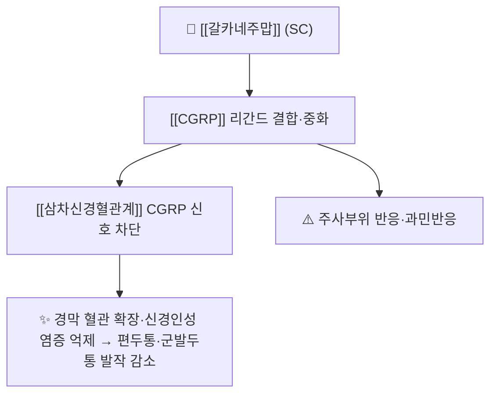

# 💊 [[갈카네주맙]] (Galcanezumab, Emgality / 엠갈리티, ATC N02CD02)

> **핵심 3줄 요약 (Key Summary)**:
> 🧪 주성분·제형: [[CGRP]] 리간드에 결합하는 인간화 단일클론항체(LY2951742, galcanezumab-gnlm). 프리필드 펜 120 mg/mL. 단백질이라 PubChem 2D 구조식이 없어 항체 표면 구조 도해로 대체한다
> 📍 작용 기전: CGRP 펩타이드를 중화해 [[삼차신경혈관계]] 활성화를 차단한다. 부하 용량 후 월 1회 유지가 특징이다
> 🎯 임상 적응증: 성인 [[편두통]] 예방 — 240 mg 부하 1회 후 120 mg 피하 월 1회. 삽화성 군발두통 예방에도 허가된 계열 내 유일한 약물이다
> ⚠️ 주의: 주사부위 반응·과민반응이 주요 이상반응이다. 군발두통 적응은 국내 허가·급여 범위를 별도로 확인한다

## 1. 약물 기본 정보 및 시판 제품 (Brand Identification)

![[갈카네주맙_01_엠갈리티_패키지.png|420]]
> [그림 1] 엠갈리티(갈카네주맙) 120 mg/mL 프리필드 펜 실사 — 라벨에 Emgality (galcanezumab-gnlm) 120 mg/mL가 읽힌다. Wikimedia Commons, CC BY-SA 4.0, 촬영 Kaiysea

![[단일클론항체_IgG1_표면구조.png|420]]
> [그림 2] 항체 골격의 표면(surface) 렌더링 — 중쇄·경쇄가 Y자로 조립된 면역글로불린의 입체 구조를 보여준다. 약물 특이 결정구조가 아닌 계열 공통 골격 도해다. Wikimedia Commons, CC BY-SA 4.0, Tokenzero

> 🖼️ 이미지 미확보 — 프리필드 펜 제형이라 정제·PTP 블리스터 성상 이미지가 존재하지 않는다. 패키지 실사와 항체 골격 도해 2장으로 정리하고, 다른 약 사진으로 채우지 않는다.

| 항목 | 상세 정보 |
| :--- | :--- |
| 일반명 (Generic Name) | [[갈카네주맙]](한글) / Galcanezumab (USAN, galcanezumab-gnlm) |
| 대표 상품명 (Brand Names) | Emgality(엠갈리티, Eli Lilly) |
| ATC 코드 / 분류 | N02CD02 — N02C 항편두통제 / N02CD CGRP 길항제 |
| PubChem CID | 없음 — 단일클론항체(단백질)로 소분자 CID 미부여 |
| 분자량 | 약 147 kDa(IgG4 골격) |
| 주요 제형 및 함량 | 프리필드 펜·시린지 120 mg/mL(1회용) |
| 표적 | CALCA(CGRP) 리간드 — [[CGRP]] |
| 허가 적응증 | 성인 편두통 예방(삽화성·만성), 삽화성 군발두통 예방(미국) |

### 1.1 계열 내 위치

| 구분 | 약물 | 표적 | 특징 |
| :--- | :--- | :--- | :--- |
| 리간드 중화 | [[갈카네주맙]] | CGRP 펩타이드 | 부하 용량 필요, 군발두통 적응 보유 |
| 리간드 중화 | [[프레마네주맙]] | CGRP 펩타이드 | 분기 1회 요법 가능 |
| 수용체 차단 | [[에레누맙]] | CGRP 수용체 | 변비·혈압 상승 상대적 주의 |

→ 계열 전체 지도는 [[CGRP 표적 약물]] 참조.

## 2. 분자 약리 기전 및 작용 경로 (Mechanism of Action)

- [[CGRP]]는 삼차신경절 감각뉴런에서 유리되어 경막 혈관을 확장하고 비만세포 탈과립을 유도한다. 갈카네주맙은 이 리간드에 결합해 수용체 접근을 막는다
- IgG4 골격은 Fc 매개 효과 기능이 약해, 표적 중화에 작용이 집중되는 설계다. 반감기는 약 27일이다
- 240 mg 부하 용량은 초기 혈중 농도를 빠르게 올리기 위한 것으로, 이후 120 mg 월 1회로 유지한다

## 3. 임상 근거

| 항목 | 내용 |
| :--- | :--- |
| 대표 시험 | EVOLVE-2 — 삽화성 [[편두통]]에서 갈카네주맙 120 mg·240 mg을 위약과 비교한 3상(Cephalalgia 2018;38(8):1442-1454) |
| 결과 | 두 용량 모두 위약보다 월간 편두통 일수와 50% 반응자 비율을 유의하게 개선했다. 부하 용량 후 월 1회 유지라는 현재 용법의 근거가 됐다 |
| 계열 간 비교 | 16편·9,123명 네트워크 메타분석에서 월간 편두통 일수 감소 효과가 가장 큰 것으로 나타났다(240 mg, SMD 0.5012, P<0.0001) |
| 출처 | [PMID 29848108](https://pubmed.ncbi.nlm.nih.gov/29848108/) · DOI [10.1177/0333102418779543](https://doi.org/10.1177/0333102418779543) / [PMID 41546694](https://pubmed.ncbi.nlm.nih.gov/41546694/) |

- 해석 주의: 효능 순위는 다른 약물과의 간접 비교에서 나온 값이고, 삽화성 편두통만 통합한 결과다. 효과 크기 차이가 곧 임상적 우월성을 뜻하지는 않는다 → [[네트워크 메타분석]]

## 4. 용법·용량 및 처방 가이드 (Dosage & Administration)

| 임상 상황 | 표준 용법·용량 | 비고 |
| :--- | :--- | :--- |
| 편두통 예방 | 240 mg 피하 부하 1회 → 이후 120 mg 월 1회 | 첫 달만 2회 투여(부하 240 mg은 120 mg 2회) |
| 반응 판정 | 12주 후 월간 편두통 일수 50% 미만 감소면 전환 | 계열 내 교체 또는 gepant·보툴리눔독소 |
| 군발두통 예방 | 300 mg 부하 후 300 mg 월 1회(미국 허가) | 국내 허가·급여 별도 확인 |

## 5. 부작용, 경고 및 약물 상호작용 (Adverse Effects & Interactions)

- 흔한 이상반응: 주사부위 반응, 비인두염. 대부분 경증이고 자가주사로 관리 가능하다
- 과민반응: 아나필락시스·혈관부종 보고가 있어 첫 투여 후 관찰한다
- 상호작용: 간 CYP 대사를 쓰지 않아 [[CYP3A4]] 매개 상호작용이 적다
- 임신·수유: 근거 제한. 임신 계획 환자는 개별 상담한다

## 6. 한의 치료 연계 및 병용 프로토콜 (Integrative Medicine)

- 기전 상보성: 말초 CGRP 중화 + 침의 중추 하행 억제계 조절은 층위가 달라 병용이 자연스럽다 → [[삼차신경혈관계]]
- 진료실 전략: 군발두통 환자에서 항체를 쓰는 경우, 발작기 산소요법·수마트립탄과 병행하면서 발작 사이 침·한약으로 자율신경 안정을 도모한다
- 근거 고지: 항체와 침의 병용 RCT는 없다. 근거 공백을 밝힌다 → [[전침]] · [[침 자극 강도와 용량]]

## 7. 💡 진료실 핵심 필기 & 실전 임상 체크리스트

### 7.1 문진 체크리스트
1. 부하 용량 설명: 첫 달에 2회 맞는다는 점을 미리 알리지 않으면 순응도가 떨어진다
2. 군발두통 감별: 일측 안와부 극심통 15~180분·동측 자율신경증상이면 [[군발두통]]을 먼저 배제한다
3. 예방 효과 판정: 12주 50% 기준을 문서로 합의한다

### 7.2 환자 티칭 스크립트
> *"이 주사는 편두통을 일으키는 물질(CGRP)을 직접 붙잡는 약입니다. 첫 달에 두 번 맞고, 그다음부터는 한 달에 한 번 맞습니다. 효과는 4주쯤부터 서서히 나타나고, 3개월 뒤에 편두통 일수가 절반 이상 줄었는지로 계속 맞을지를 정합니다. 맞은 자리가 붓거나 빨개질 수 있고, 드물게 알레르기 반응이 있어 첫 주사 후 상태를 확인합니다."*

## 8. 출처 및 학술 참고 문헌 (References)

- Skljarevski V, et al. Efficacy and safety of galcanezumab for the prevention of episodic migraine: Results of the EVOLVE-2 Phase 3 randomized controlled clinical trial. Cephalalgia. 2018;38(8):1442-1454 ([PMID 29848108](https://pubmed.ncbi.nlm.nih.gov/29848108/) / DOI [10.1177/0333102418779543](https://doi.org/10.1177/0333102418779543))
  - [연구 요약] 삽화성 편두통에서 갈카네주맙 120 mg·240 mg이 위약보다 월간 편두통 일수와 반응자 비율을 유의하게 개선한 3상 시험.
- Shakir I, et al. Efficacy and safety of CGRP monoclonal antibodies for migraine prevention in episodic migraine: a network meta-analysis. Eur J Clin Pharmacol. 2026;82(2):27 ([PMID 41546694](https://pubmed.ncbi.nlm.nih.gov/41546694/) / DOI [10.1007/s00228-025-03934-3](https://doi.org/10.1007/s00228-025-03934-3))
  - [연구 요약] 4종 항체 중 갈카네주맙 240 mg의 월간 편두통 일수 감소 효과(SMD 0.5012)가 가장 큰 것으로 추정된 네트워크 메타분석.
- European Headache Federation. Guideline on monoclonal antibodies targeting the CGRP pathway for migraine prevention — 2022 update ([PMC9188162](https://pmc.ncbi.nlm.nih.gov/articles/PMC9188162/))
  - [연구 요약] 승인 용량·근거 수준·권고 강도 정리. 부하 용량 체계 대조용.

## 함께 보기
- [[CGRP 표적 약물]] · [[CGRP]] · [[삼차신경혈관계]] · [[편두통]] · [[군발두통]] · [[에레누맙]] · [[프레마네주맙]] · [[에프티네주맙]] · [[네트워크 메타분석]] · [[SUCRA]]
- 관련 논문: [[2026-10-23_신경계통증의학_심층리뷰]] 3번
