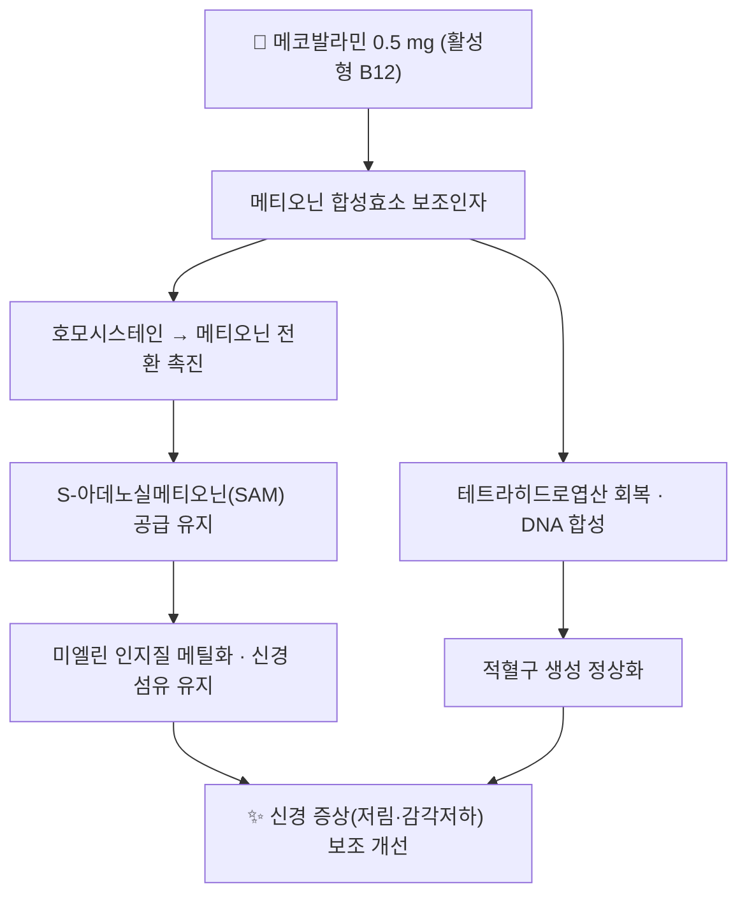

# 💊 메코발라민 (Mecobalamin, Methylcobalamin, B03BA05)

> **핵심 요약 (Key Summary)**:
> 🧪 주성분·제형: 비타민 B12의 활성형인 메틸코발라민. 경구 정제 0.5 mg이 국내외 표준 제형이고 주사제도 있다.
> 📍 작용 기전: 메티오닌 합성효소의 보조인자로 작용해 호모시스테인→메티오닌 전환을 돕고, 신경 세포의 메틸화 반응·미엘린 유지에 관여한다.
> 🎯 임상 적응증: [[당뇨병성 말초신경병증]]을 비롯한 말초신경병증의 보조 치료, 거대적아구성 빈혈(비타민 B12 결핍), 신경통·마비감의 보조.
> ⚠️ 주의사항: 결핍이 아닌 환자에서 단독으로 신경 손상을 되돌리는 근거는 제한적이다. [[당뇨병성 말초신경병증]]에서 한약 부가요법 시험들이 이 약을 기반 치료로 사용한다(2026-10-15 시험: 0.5 mg 1일 3회).

---

## 1. 약물 기본 정보 및 시판 제품 (Brand Identification)

![[메코발라민_02_구조식2D.png|320]]
> [그림 1: 메코발라민(메틸코발라민)의 2D 화학 구조식 — PubChem CID 10898559 (PubChem PNG 정본)]

> 🖼️ 이미지 미확보 — 시판 완제품의 패키지 실사·PTP 알약 성상은 이번 회차에 확보하지 못했다(제품 이미지 미등록 품목). 다른 약 사진으로 대체하지 않고 사유를 남긴다. 국내 시판 품목명·제품 사진은 의약품안전나라에서 확인한다.

| 항목 | 상세 정보 |
| :--- | :--- |
| 일반명 (Generic Name) | 메코발라민(한글) / Mecobalamin, Methylcobalamin |
| 대표 상품명 (Brand Names) | 국내·해외 다수 제네릭(성분명 '메코발라민'으로 유통) — 품목명은 의약품안전나라 확인 |
| ATC 코드 / 분류 | [B03BA05](https://atcddd.fhi.no/atc_ddd_index/?code=B03BA05) (비타민 B12 계열) |
| PubChem CID | [10898559](https://pubchem.ncbi.nlm.nih.gov/compound/10898559) |
| 화학식 / 분자량 | C63H91CoN13O14P / 1344.4 g/mol |
| 주요 제형 및 함량 | 정제 0.5 mg, 주사액 0.5 mg |
| 허가 적응증(국내 기준) | 말초신경병증(당뇨병성 포함), 비타민 B12 결핍성 빈혈·신경 증상 |

> ⚠️ PubChem은 같은 분자식에 대해 여러 CID를 함께 등록한다(10898559 · 6436232 · 60196341, 모두 C63H91CoN13O14P). 이 노트는 이름 조회에서 대표로 반환되는 10898559를 구조식 CID로 쓴다 — 값을 옮겨 적을 때는 반드시 PubChem 조회로 대조한다.

### 1.1 제형·함량과 임상 위치

| 구분 | 제제 | 용법·용량 | 임상 위치 |
| :--- | :--- | :--- | :--- |
| 경구 정제 | 메코발라민 0.5 mg | 0.5 mg 1일 3회(증상에 따라 조절) | [[당뇨병성 말초신경병증]] 외래 유지 |
| 주사제 | 메코발라민 0.5 mg 주 | 0.5 mg 주 2~3회 근주·정주 | 중증·급성기 보조 |
| 2026-10-15 시험 프로토콜 | 메코발라민 정 0.5 mg | 1일 3회(양군 공통 기반 치료) | 목단과립 부가효과 검증의 대조 기반 |

---

## 2. 분자 약리 기전 및 작용 경로 (Mechanism of Action)

- 메코발라민은 세포질의 메티오닌 합성효소 반응에서 메틸기를 전달하는 보조인자다. 이 반응이 막히면 호모시스테인이 쌓이고 DNA 합성이 지연되며 신경 미엘린 유지가 흔들린다 → [[산화 스트레스]]
- 신경병증에서의 임상 효과는 '결핍 교정' 이상의 직접 신경 재생 촉진 근거가 약하다. 그래서 시험 설계에서도 단독 치료가 아니라 기반 치료로 쓰고 부가 중재의 효과를 검증한다 → [[목단과립]]

---

## 3. 약동학적 특성 (Pharmacokinetics)

| 약동학 파라미터 | 수치 및 임상적 의미 |
| :--- | :--- |
| 생체이용률 (Bioavailability) | 경구 흡수는 내인성 인자(위벽세포 분비) 의존 — 회장 말단에서 흡수된다 |
| 최고혈중농도 도달시간 (Tmax) | 경구 3~6시간(개인차), 주사는 수십 분 |
| 혈장 단백결합률 | 코발라민류는 트랜스코발라민 II와 결합해 조직으로 운반된다 |
| 간 대사 | 간에서 일부 저장·전환, 담즙 배설 후 장간순환 |
| 배설 반감기 (t1/2) | 혈중 반감기는 짧지만 간·신장에 저장되어 작용이 지속된다 |
| 주요 배설 경로 | 소변(주), 담즙·대변 |

> ⚠️ 개별 수치는 허가사항·교과서마다 범위가 달라 단일 값으로 단정하지 않는다.

---

## 4. 용법·용량 및 처방 가이드 (Dosage & Administration)

| 임상 적응증 | 표준 용법·용량 | 비고 |
| :--- | :--- | :--- |
| 당뇨병성 말초신경병증(보조) | 0.5 mg 경구 1일 3회 | 2026-10-15 목단과립 시험의 양군 공통 기반 치료 용량 |
| 중증·급성기 보조 | 0.5 mg 주사 주 2~3회 | 경구 흡수 장애·중증에서 선택 |
| 비타민 B12 결핍 | 결핍 정도에 따라 결정 | 결핍 원인(흡수 장애·악성 빈혈) 확인이 우선 |

- 반응 판단은 저림·통증 [[NPRS]]와 신경병증 점수([[MDNS]] 등)를 4주 단위로 기록해 방향성으로 판단한다 → [[당뇨병성 말초신경병증]]

---

## 5. 부작용, 경고 및 약물 상호작용 (Adverse Effects & Interactions)

- **이상반응**: 과민반응(발진), 주사 부위 통증, 드물게 아나필락시스 보고. 경구제는 위장장애가 드물게 나타난다.
- **결핍 감별 우선**: 악성 빈혈·위절제·회장 절제·메트포르민 장기 복용에서는 흡수 장애가 있어 경구보다 주사가 필요할 수 있다 → [[메트포르민]]
- **다른 B12 제제와의 관계**: 시아노코발라민(B03BA01)·히드록소코발라민과 대체 가능하나, 활성형인 메코발라민은 신경 증상 보조 목적에 쓰이는 경향이 있다.
- **검사 간섭**: 혈중 코발라민 측정값은 투약 직후 상승하므로 결핍 판정은 투여 전 채혈이 원칙이다.
- 한약·본초 병용 관점에서 특별한 금기 조합은 알려져 있지 않다 → [[CYP3A4]]

---

## 6. 한의 치료 연계 및 병용/테이퍼링 프로토콜 (Integrative Medicine)

- [[당뇨병성 말초신경병증]]에서 메코발라민은 '기반 치료'이고, 한약·침은 그 위에 더하는 부가 축으로 설계한다. 2026-10-15 시험(목단과립)이 바로 이 구조다 → [[목단과립]] · [[당뇨병성 말초신경병증]]
- 대체가 아니라 병용이 근거의 방향이다. "B12를 끊고 한약으로 바꾼다"는 근거는 없다.
- 병행 시 확인 항목: 혈당 조절([[HbA1c]]), 족부 병변(발 검진), 출혈 위험(활혈화어 처방 병용 시) → [[당뇨발]] · [[와파린]]

---

## 7. 💡 사용자 진료실 핵심 필기 & 실전 임상 체크리스트

### 7.1 진료실 3대 문진
1. 결핍 위험 요인(위·회장 수술력, 악성 빈혈, 채식, [[메트포르민]] 장기 복용) 확인.
2. 현재 복용 B12 제제의 제형·용량·기간, 불규칙 복용 여부.
3. 저림의 분포(장갑-양말형 여부)와 야간 악화, 족부 병변 유무.

### 7.2 환자 티칭 스크립트
> "이 약은 신경을 싸고 있는 막과 혈구를 만드는 데 필요한 비타민 B12의 활성형입니다. 결핍을 채워 주는 약이라 당뇨로 인한 저림 자체를 근본적으로 되돌리는 약은 아닙니다. 그래서 저희는 이 약을 기반으로 두고, 익기·활혈 계열 한약을 함께 써서 저림 점수를 4주마다 확인하겠습니다. 발은 매일 직접 확인해 주셔야 합니다."

---

## 8. 출처 및 학술 참고 문헌 (References)

1. **Efficacy and safety of Mudan granules for treatment of diabetic peripheral neuropathy: a multicenter, double-blind, placebo-controlled, randomized, clinical trial.** *Journal of Ethnopharmacology*. 2026;368:121754. [PMID 42069162](https://pubmed.ncbi.nlm.nih.gov/42069162/) · [DOI 10.1016/j.jep.2026.121754](https://doi.org/10.1016/j.jep.2026.121754)
   - [연구 요약] [[당뇨병성 말초신경병증]] 400명 다기관 이중맹검 RCT에서 메코발라민 정 0.5 mg 1일 3회가 양군 공통 기반 치료였다 — 본 노트 용법·임상 위치의 근거다.
2. **WHO ATC/DDD Index — B03BA05 mecobalamin.** [링크](https://atcddd.fhi.no/atc_ddd_index/?code=B03BA05)
   - [연구 요약] 메코발라민의 ATC 코드와 DDD 기준(말초신경병증 치료 기준) 확인.
3. **PubChem Compound Summary — Mecobalamin (CID 10898559).** [링크](https://pubchem.ncbi.nlm.nih.gov/compound/10898559)
   - [연구 요약] 분자식 C63H91CoN13O14P·분자량 1344.4 g/mol·2D 구조식(그림 1) 확인.
4. **식품의약품안전처 의약품안전나라** — 메코발라민 품목 허가사항·제품 정보. [링크](https://nedrug.mfds.go.kr/searchDrug)
   - [연구 요약] 국내 허가 품목의 제형·용량·적응증 확인 경로.

## 함께 보기
- [[당뇨병성 말초신경병증]] · [[당뇨병]] · [[당뇨발]] · [[MDNS]] · [[목단과립]] · [[알파리포산]]
- [[2026-10-15_통합의학약리학_심층리뷰]] 1번
