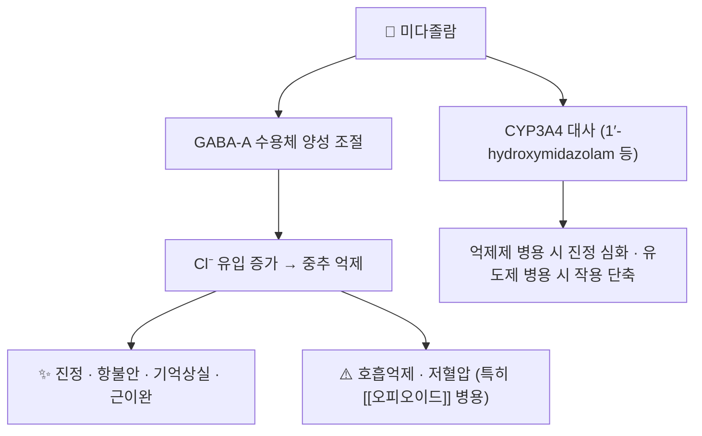

# 💊 미다졸람 (Midazolam, N05CD08)

> **핵심 요약 (Key Summary)**:
> 🧪 주성분·제형: 단시간 작용 벤조디아제핀. 주사제(진정·마취 전처치)가 중심이고 경구·비강 제형이 일부 국가에서 쓰인다.
> 📍 작용 기전: GABA-A 수용체를 통해 중추 신경 억제를 일으키며, CYP3A4 기질이라 상호작용 연구의 대표 프로브 약물이다.
> 🎯 임상 의의: 신약의 CYP3A 유도·저해 여부를 판정하는 지표로 쓰인다 — 2026-10-15 [[수제트리진]] 라벨은 미다졸람 AUC 48% 감소로 CYP3A 유도를 보여주었다.
> ⚠️ 주의: 호흡억제·진정 중첩(오피오이드·알코올), CYP3A 저해제 병용 시 진정 심화, 고령·간기능 저하에서 작용 연장.

---

## 1. 약물 기본 정보 및 시판 제품 (Brand Identification)

![[미다졸람_02_구조식2D.png|320]]
> [그림 1: 미다졸람의 2D 화학 구조식 — PubChem CID 4192 (PubChem PNG 정본)]

> 🖼️ 이미지 미확보 — 시판 완제품 패키지 실사·앰풀 성상은 이번 회차에 확보하지 못했다(주사제 중심 품목, 제품 이미지 미검증). 다른 약 사진으로 대체하지 않고 사유를 남긴다.

| 항목 | 상세 정보 |
| :--- | :--- |
| 일반명 (Generic Name) | 미다졸람(한글) / Midazolam |
| 대표 상품명 (Brand Names) | 국내·해외 주사제 다수 — 품목명은 의약품안전나라 확인 |
| ATC 코드 / 분류 | [N05CD08](https://atcddd.fhi.no/atc_ddd_index/?code=N05CD08) (벤조디아제핀계) |
| PubChem CID | [4192](https://pubchem.ncbi.nlm.nih.gov/compound/4192) |
| 화학식 / 분자량 | C18H13ClFN3 / 325.8 g/mol |
| 주요 제형 및 함량 | 주사액(1 mg/mL, 5 mg/mL 등), 일부 국가에서 경구액·비강 분무 |
| 허가 적응증(국내 기준) | 마취 전 처치·진정, 중환자 진정 등 — 허가사항 확인 |

---

## 2. 분자 약리 기전 및 작용 경로 (Mechanism of Action)

- GABA-A 수용체를 통한 중추 억제는 [[벤조디아제핀]] 계열 공통 기전이다 → [[GABA]] · [[벤조디아제핀]]
- CYP3A4 대사 의존성이 핵심이다. 그래서 신약의 CYP3A 유도·저해 판정에 프로브로 쓰인다 → [[CYP3A4]]

---

## 3. 약동학적 특성 (Pharmacokinetics)

| 약동학 파라미터 | 수치 및 임상적 의미 |
| :--- | :--- |
| 생체이용률 (Bioavailability) | 정맥 투여가 표준(경구는 초회통과로 낮다) |
| 최고혈중농도 도달시간 (Tmax) | 정맥 투여 시 수 분 내 최고 농도 |
| 혈장 단백결합률 | 높음(주로 알부민) |
| 간 대사 | CYP3A4 주대사 — 저해제·유도제에 민감하다 |
| 배설 반감기 (t1/2) | 수 시간(고령·간기능 저하 시 연장) |
| 주요 배설 경로 | 신장 배설(대사체 포합) |

> ⚠️ 원문 시험은 미다졸람의 약동학 수치를 제시하지 않고 AUC 변화만 보고했다 — 추정값을 적지 않는다.

## 4. 용법·용량 및 처방 가이드 (Dosage & Administration)

| 임상 상황 | 용법·용량 | 비고 |
| :--- | :--- | :--- |
| 마취 전 처치·진정 | 체중·연령·상태에 따라 개별 적정 | 의료기관 감시 하 사용 |
| 상호작용 시험에서의 위치 | CYP3A 프로브 기질 | 2026-10-15 [[수제트리진]] 라벨: 미다졸람 AUC 48% 감소 |
| 노인·간기능 저하 | 감량·간격 연장 | 진정 연장·낙상 위험 |

- 한의원 진료실에서 처방 약이 아니지만, **환자가 시행하는 시술(내시경 등) 전후 진정제 병용** 이력 확인에 필요한 지식이다.

## 5. 부작용, 경고 및 약물 상호작용 (Adverse Effects & Interactions)

### 5.1 주요 부작용
- **호흡억제**: [[오피오이드]] 병용 시 위험 상승 — 시술 전후 진정 사고의 주요 원인이다.
- **저혈압·심박수 변동**, 기억상실(전향성), 역설적 흥분(드물게).
- **고령**: 진정 연장·섬망·낙상 위험 증가.

### 5.2 주요 상호작용
- **CYP3A4 저해제**(아졸계 항진균제·일부 항생제 등): 진정 심화·작용 연장 → [[CYP3A4]]
- **CYP3A4 유도제**(일부 항경련제·리팜피신 등): 작용 단축.
- **신약 상호작용 판정**: 어떤 약이 CYP3A를 유도·저해하는지 판단하는 표준 프로브다 — 한약·본초 병용 상담에서도 같은 원리가 적용된다 → [[CYP3A4]] · [[오적산]]
- **중추억제제·알코올**: 진정·호흡억제 중첩.

## 6. 한의 치료 연계 및 병용/테이퍼링 프로토콜 (Integrative Medicine)

- 한의원에서 직접 다루는 약은 아니다. 실무 접점은 두 가지다: ① 시술(내시경·수술) 전후 진정제 이력 확인 ② 수면제·항불안제 감량 상담 시 계열 이해 → [[벤조디아제핀]] · [[인지행동치료(CBT-I)]]
- 수면 목적의 벤조디아제핀 장기 복용 환자는 CBT-I 기반 감량 설계와 한의 안신 처방 병행으로 접근한다 → [[산조인탕]] · [[불면증]]
- CYP3A4를 공유하는 한약·본초 병용 시 진정 심화 여부를 문진에 넣는다 → [[감초]] · [[세인트존스워트]]

## 7. 💡 사용자 진료실 핵심 필기 & 실전 임상 체크리스트

### 7.1 문진 체크리스트
1. 최근 시술·수술 전후 진정제 사용 이력(어지럼·기억 소실 여부).
2. 복용 중인 벤조디아제핀·수면제·오피오이드와 음주.
3. 낮 시간 졸림·낙상 위험(고령 환자에서 특히).

### 7.2 환자 티칭 스크립트
> "이 약은 시술할 때 긴장을 풀고 잠이 오게 하는 주사 진정제입니다. 다른 진정제·수면제·마약성 진통제와 같이 쓰면 숨쉬는 힘이 떨어질 수 있어, 시술 전에는 복용 중인 약을 모두 말씀해 주셔야 합니다. 일상에서 먹는 약은 아니라서 저희가 감량 계획을 세울 때는 오히려 수면제 쪽을 먼저 정리합니다."

## 8. 출처 및 학술 참고 문헌 (References)

1. **FDA 허가사항(Journavx — suzetrigine) — CYP3A 상호작용 항목.** [PDF](https://www.accessdata.fda.gov/drugsatfda_docs/label/2025/219209s000lbl.pdf)
   - [연구 요약] [[수제트리진]] 50 mg을 12시간마다 반복 투여했을 때 미다졸람 AUC가 48% 감소 — 신약의 CYP3A 유도를 미다졸람으로 판정한 근거다(2026-10-15 접속 확인).
2. **Safety and efficacy of Suzetrigine (VX-548) for acute moderate to severe pain: SR·MA.** *J Clin Anesth*. 2026;111:112156. [PMID 41785614](https://pubmed.ncbi.nlm.nih.gov/41785614/)
   - [연구 요약] CYP3A 매개 상호작용의 임상적 의미(다제복용 환자 확인 필요)를 다룬 근거 맥락.
3. **WHO ATC/DDD Index — N05CD08 midazolam.** [링크](https://atcddd.fhi.no/atc_ddd_index/?code=N05CD08)
   - [연구 요약] ATC 코드 확인(2026-10-15 조회) — 계열 분류(벤조디아제핀계) 근거.
4. **PubChem Compound Summary — Midazolam (CID 4192).** [링크](https://pubchem.ncbi.nlm.nih.gov/compound/4192)
   - [연구 요약] 분자식 C18H13ClFN3·분자량 325.8 g/mol·2D 구조식(그림 1) 확인.

## 함께 보기
- [[벤조디아제핀]] · [[디아제팜]] · [[로라제팜]] · [[GABA]] · [[CYP3A4]] · [[수제트리진]] · [[오피오이드]] · [[인지행동치료(CBT-I)]]
- [[2026-10-15_통합의학약리학_심층리뷰]] 3번
